Responsável: Luís Henrique Arruda Luna · Grupo 06

# Lista de verificação da Etapa 5 · V2

## Tabela de contribuição

| Integrante | Contribuição | Artefato / atividade |
| --- | --- | --- |
| [Luís Henrique Arruda Luna](https://github.com/Donnk61) | Revisão dos 11 critérios de desenvolvimento e dos 20 critérios de conteúdo da V1, com evidência esperada e regra de julgamento | [Desenvolvimento](#desenvolvimento-do-projeto) · [Conteúdo](#conteudo-da-disciplina) |
| [Luís Henrique Arruda Luna](https://github.com/Donnk61) | Registro da correspondência entre V1 e V2 e escolha dos recortes das fontes | [Conferência da lista](#conferencia-da-lista) |
| [Caio Breno de Souza Bezerra](https://github.com/CaioBezerra-Dev) | Autoria da lista V1 da Etapa 5, base desta revisão | [Lista V1](../verificacao/listas/etapa-5.md) |
| Claude (Anthropic) | Apoio à consulta dos artefatos, à redação dos critérios e à organização das tabelas | [Agradecimentos](#agradecimentos) |

Tabela 1 — Contribuição neste artefato.

Fonte: elaboração para o Grupo 06 (2026).

[Etapa 8](index.md) · [Autoinspeção do Grupo 06](grupo-06/etapa-5.md) · [Inspeção do Grupo 07](grupo-07/etapa-5.md) · [Lista V1 da Etapa 5](../verificacao/listas/etapa-5.md)

## Como aplicar

A Etapa 5 reúne os relatos das avaliações do storyboard e da análise de tarefas e os planejamentos da avaliação e do relato do protótipo de papel. Use a mesma redação na autoinspeção do Grupo 06 e na reinspeção do Grupo 07 (+1), que inspecionamos na Etapa 5. Cada item traz a evidência esperada, o vínculo com a V1 e o recorte da fonte.

- **Sim** quando a evidência atende à pergunta em todo o recorte aplicável.
- **Incompleto** quando há evidência parcial, contraditória ou sem cobertura de todos os integrantes.
- **Não** quando o requisito é aplicável e a evidência essencial está ausente nos locais consultados.

Na ficha, registre grupo, ID, versão consultada, constatação e linhas do documento. Para uma lacuna, indique onde procurou. [Método e escopo](index.md#metodo-de-inspecao).

## Desenvolvimento do projeto

Os critérios D01–D11 vêm do plano de ensino (Sales, 2026, pp. 3 e 8–9 do PDF).

??? question "D01 · O histórico identifica versão, data, descrição, autor e revisor em cada artefato da Etapa 5?"

    **Autor do item:** [Luís Henrique Arruda Luna](https://github.com/Donnk61).

    **O que conferir.** Abra o histórico de cada relato do storyboard, relato da análise de tarefas, planejamento da avaliação do papel e planejamento do relato. Confira se as cinco colunas existem e estão preenchidas na versão vigente.

    **Rastreabilidade na V1.** [D01](../verificacao/listas/etapa-5.md#d01) · mantido; a coluna de revisor passa a ser exigida explicitamente.

    { loading=lazy }

    
Fonte: Sales (2026), p. 8 do PDF. O grifo indica o trecho usado no critério.

    **Aplicação:** [Grupo 06](grupo-06/etapa-5.md#etapa-5-d01) · [Grupo 07](grupo-07/etapa-5.md#etapa-5-d01).

??? question "D02 · A versão vigente identifica um revisor distinto do autor, com revisão efetivamente registrada?"

    **Autor do item:** [Luís Henrique Arruda Luna](https://github.com/Donnk61).

    **O que conferir.** Na última linha do histórico, o revisor deve ser outra pessoa. “Revisão pendente”, “—” ou coluna ausente não comprovam revisão.

    **Rastreabilidade na V1.** [D02](../verificacao/listas/etapa-5.md#d02) · mantido; explicita que pendência declarada impede Sim.

    { loading=lazy }

    
Fonte: Sales (2026), p. 8 do PDF. O grifo indica o trecho usado no critério.

    **Aplicação:** [Grupo 06](grupo-06/etapa-5.md#etapa-5-d02) · [Grupo 07](grupo-07/etapa-5.md#etapa-5-d02).

??? question "D03 · Todos os artefatos têm referências correspondentes às citações?"

    **Autor do item:** [Luís Henrique Arruda Luna](https://github.com/Donnk61).

    **O que conferir.** Procure a seção de referências em cada documento e confira se as obras citadas no texto aparecem na lista. Páginas de navegação ficam fora do recorte.

    **Rastreabilidade na V1.** [D03](../verificacao/listas/etapa-5.md#d03) · mantido; restringe o recorte aos documentos de conteúdo.

    { loading=lazy }

    
Fonte: Sales (2026), p. 8 do PDF. O grifo indica o trecho usado no critério.

    **Aplicação:** [Grupo 06](grupo-06/etapa-5.md#etapa-5-d03) · [Grupo 07](grupo-07/etapa-5.md#etapa-5-d03).

??? question "D04 · Tabelas e figuras têm número, legenda, fonte e chamada correta no texto?"

    **Autor do item:** [Luís Henrique Arruda Luna](https://github.com/Donnk61).

    **O que conferir.** Percorra as tabelas e figuras dos quatro artefatos. Confira numeração, legenda, fonte e se a chamada no texto aponta para o elemento certo.

    **Rastreabilidade na V1.** [D04](../verificacao/listas/etapa-5.md#d04) · mantido; inclui a correção da chamada.

    { loading=lazy }

    
Fonte: Sales (2026), p. 8 do PDF. O grifo indica o trecho usado no critério.

    **Aplicação:** [Grupo 06](grupo-06/etapa-5.md#etapa-5-d04) · [Grupo 07](grupo-07/etapa-5.md#etapa-5-d04).

??? question "D05 · Cada artefato informa objetivo e escopo antes do conteúdo?"

    **Autor do item:** [Luís Henrique Arruda Luna](https://github.com/Donnk61).

    **O que conferir.** A abertura deve dizer o que o documento faz, qual funcionalidade cobre e como se liga às etapas anteriores. O nome da seção pode variar; vale o conteúdo.

    **Rastreabilidade na V1.** [D05](../verificacao/listas/etapa-5.md#d05) · refinado: avalia o conteúdo da abertura, não o título da seção.

    { loading=lazy }

    
Fonte: Sales (2026), p. 8 do PDF. O grifo indica o trecho usado no critério.

    **Aplicação:** [Grupo 06](grupo-06/etapa-5.md#etapa-5-d05) · [Grupo 07](grupo-07/etapa-5.md#etapa-5-d05).

??? question "D06 · O cronograma executado registra as atividades da Etapa 5 com responsáveis e datas reais?"

    **Autor do item:** [Luís Henrique Arruda Luna](https://github.com/Donnk61).

    **O que conferir.** Abra o cronograma executado e localize as linhas do período da Etapa 5. Confira se cobrem os relatos e planejamentos de todos os integrantes.

    **Rastreabilidade na V1.** [D06](../verificacao/listas/etapa-5.md#d06) · mantido; exige cobertura de todos os integrantes.

    { loading=lazy }

    
Fonte: Sales (2026), p. 8 do PDF. O grifo indica o trecho usado no critério.

    **Aplicação:** [Grupo 06](grupo-06/etapa-5.md#etapa-5-d06) · [Grupo 07](grupo-07/etapa-5.md#etapa-5-d06).

??? question "D07 · Há atas das reuniões da Etapa 5, com data, horários, participantes, pauta e decisões?"

    **Autor do item:** [Luís Henrique Arruda Luna](https://github.com/Donnk61).

    **O que conferir.** Consulte a área de atas. Ficha de inspeção não substitui ata.

    **Rastreabilidade na V1.** [D07](../verificacao/listas/etapa-5.md#d07) · mantido.

    { loading=lazy }

    
Fonte: Sales (2026), p. 9 do PDF. O grifo indica o trecho usado no critério.

    **Aplicação:** [Grupo 06](grupo-06/etapa-5.md#etapa-5-d07) · [Grupo 07](grupo-07/etapa-5.md#etapa-5-d07).

??? question "D08 · As gravações das reuniões e inspeções da etapa estão acessíveis e vinculadas ao registro?"

    **Autor do item:** [Luís Henrique Arruda Luna](https://github.com/Donnk61).

    **O que conferir.** Confira se os vídeos das inspeções e sessões da Etapa 5 abrem e estão ligados à página que os descreve.

    **Rastreabilidade na V1.** [D08](../verificacao/listas/etapa-5.md#d08) · mantido; autorização avaliada pelo que está declarado publicamente.

    { loading=lazy }

    
Fonte: Sales (2026), p. 9 do PDF. O grifo indica o trecho usado no critério.

    **Aplicação:** [Grupo 06](grupo-06/etapa-5.md#etapa-5-d08) · [Grupo 07](grupo-07/etapa-5.md#etapa-5-d08).

??? question "D09 · Há vídeo de apresentação da Etapa 5 de cada integrante, com categoria informada?"

    **Autor do item:** [Luís Henrique Arruda Luna](https://github.com/Donnk61).

    **O que conferir.** Abra a página de apresentações da Etapa 5. Um integrante sem vídeo impede Sim no agregado.

    **Rastreabilidade na V1.** [D09](../verificacao/listas/etapa-5.md#d09) · refinado para a verificação por integrante.

    { loading=lazy }

    
Fonte: Sales (2026), p. 9 do PDF. O grifo indica o trecho usado no critério.

    **Aplicação:** [Grupo 06](grupo-06/etapa-5.md#etapa-5-d09) · [Grupo 07](grupo-07/etapa-5.md#etapa-5-d09).

??? question "D10 · A tabela de contribuição abre cada artefato e corresponde a quem atuou nele?"

    **Autor do item:** [Luís Henrique Arruda Luna](https://github.com/Donnk61).

    **O que conferir.** Confira o início de cada documento. A ausência da tabela em um artefato impede Sim.

    **Rastreabilidade na V1.** [D10](../verificacao/listas/etapa-5.md#d10) · mantido.

    { loading=lazy }

    
Fonte: Sales (2026), p. 9 do PDF. O grifo indica o trecho usado no critério.

    **Aplicação:** [Grupo 06](grupo-06/etapa-5.md#etapa-5-d10) · [Grupo 07](grupo-07/etapa-5.md#etapa-5-d10).

??? question "D11 · O uso de IA é declarado com nome da ferramenta e atividade, na contribuição e nos agradecimentos?"

    **Autor do item:** [Luís Henrique Arruda Luna](https://github.com/Donnk61).

    **O que conferir.** Procure a ferramenta na tabela de contribuição e a seção de agradecimentos ao final. As duas são exigidas.

    **Rastreabilidade na V1.** [D11](../verificacao/listas/etapa-5.md#d11) · mantido.

    { loading=lazy }

    
Fonte: Sales (2026), p. 3 do PDF. O grifo indica o trecho usado no critério.

    **Aplicação:** [Grupo 06](grupo-06/etapa-5.md#etapa-5-d11) · [Grupo 07](grupo-07/etapa-5.md#etapa-5-d11).

## Conteúdo da disciplina

Os critérios E5-01–E5-20 adaptam Barbosa e Silva (2010) aos relatos do nível 1 e ao planejamento do papel.

??? question "E5-01 · Os quatro artefatos da Etapa 5 estão disponíveis para cada integrante e funcionalidade?"

    **Autor do item:** [Luís Henrique Arruda Luna](https://github.com/Donnk61).

    **O que conferir.** Relato do storyboard, relato da análise de tarefas, planejamento da avaliação do papel e planejamento do relato. Um plano coletivo é aceito quando cobre de forma demonstrável as tarefas de cada integrante.

    **Rastreabilidade na V1.** [E5-C01](../verificacao/listas/etapa-5.md#e5-c01) · mantido; aceita plano compartilhado com cobertura demonstrável.

    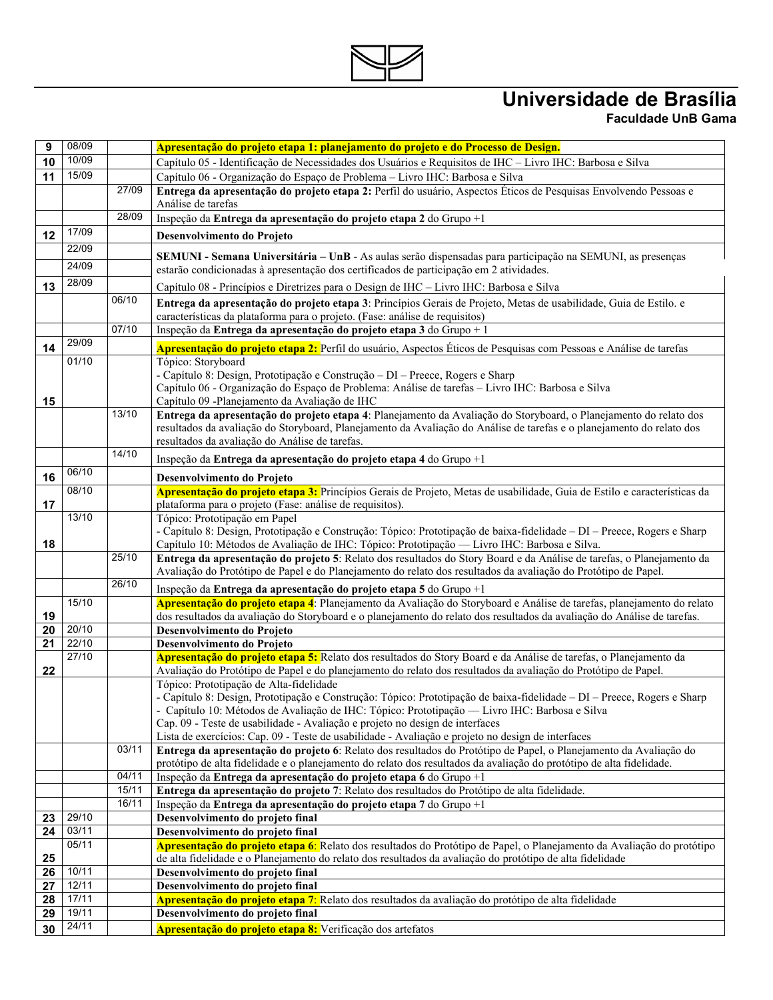{ loading=lazy }

    
Fonte: Sales (2026), p. 5 do PDF. O grifo indica o trecho usado no critério.

    **Aplicação:** [Grupo 06](grupo-06/etapa-5.md#etapa-5-e5-01) · [Grupo 07](grupo-07/etapa-5.md#etapa-5-e5-01).

??? question "E5-02 · Cada relato identifica objetivo, escopo, método, material avaliado, participante, data, duração e registro?"

    **Autor do item:** [Luís Henrique Arruda Luna](https://github.com/Donnk61).

    **O que conferir.** Procure a tabela ou o trecho de metadados da sessão em cada relato. Campos “a preencher” ou não identificados contam como lacuna.

    **Rastreabilidade na V1.** [E5-C02](../verificacao/listas/etapa-5.md#e5-c02) · mantido; lista os metadados mínimos.

    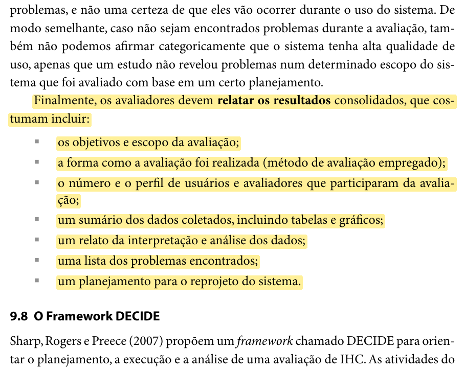{ loading=lazy }

    
Fonte: Barbosa e Silva (2010), p. 312. O grifo indica o trecho usado no critério.

    **Aplicação:** [Grupo 06](grupo-06/etapa-5.md#etapa-5-e5-02) · [Grupo 07](grupo-07/etapa-5.md#etapa-5-e5-02).

??? question "E5-03 · O relato do storyboard responde às perguntas planejadas e localiza os quadros discutidos?"

    **Autor do item:** [Luís Henrique Arruda Luna](https://github.com/Donnk61).

    **O que conferir.** Confira se cada pergunta tem resposta e se a resposta indica o quadro e um localizador verificável (tempo do vídeo ou trecho da transcrição).

    **Rastreabilidade na V1.** [E5-C03](../verificacao/listas/etapa-5.md#e5-c03) · mantido.

    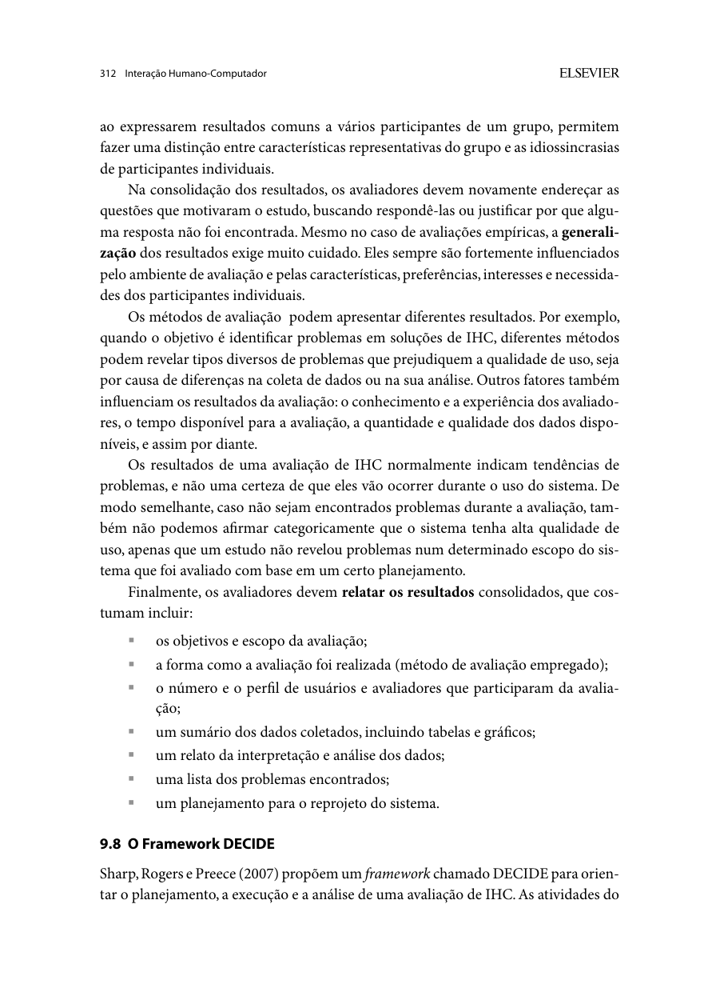{ loading=lazy }

    
Fonte: Barbosa e Silva (2010), p. 312. O grifo indica o trecho usado no critério.

    **Aplicação:** [Grupo 06](grupo-06/etapa-5.md#etapa-5-e5-03) · [Grupo 07](grupo-07/etapa-5.md#etapa-5-e5-03).

??? question "E5-04 · O relato da análise de tarefas discute cobertura, ordem, entradas, término e exceções dos modelos?"

    **Autor do item:** [Luís Henrique Arruda Luna](https://github.com/Donnk61).

    **O que conferir.** Identifique o nó da HTA ou a tarefa da CTT discutidos e separe a fala da pessoa da conferência técnica da equipe.

    **Rastreabilidade na V1.** [E5-C04](../verificacao/listas/etapa-5.md#e5-c04) · mantido.

    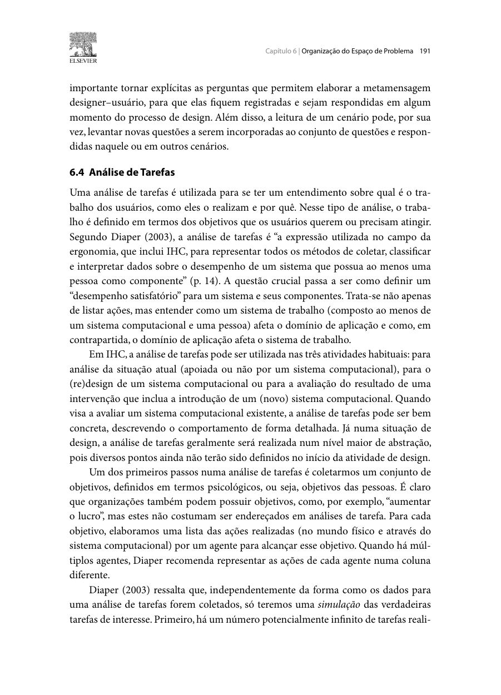{ loading=lazy }

    
Fonte: Barbosa e Silva (2010), p. 191. O grifo indica o trecho usado no critério.

    **Aplicação:** [Grupo 06](grupo-06/etapa-5.md#etapa-5-e5-04) · [Grupo 07](grupo-07/etapa-5.md#etapa-5-e5-04).

??? question "E5-05 · Fala, observação, interpretação e sugestão estão separadas e a origem de cada uma é verificável?"

    **Autor do item:** [Luís Henrique Arruda Luna](https://github.com/Donnk61).

    **O que conferir.** Para cada achado, deve ser possível chegar ao trecho da gravação ou da transcrição que o sustenta.

    **Rastreabilidade na V1.** [E5-C05](../verificacao/listas/etapa-5.md#e5-c05) · mantido.

    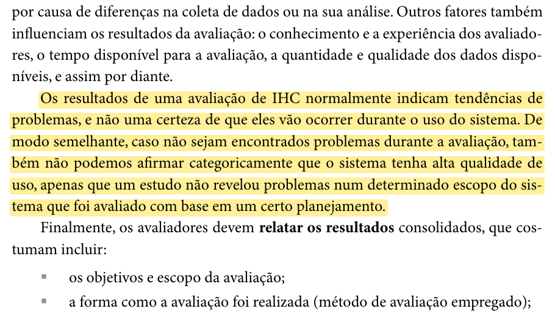{ loading=lazy }

    
Fonte: Barbosa e Silva (2010), p. 312. O grifo indica o trecho usado no critério.

    **Aplicação:** [Grupo 06](grupo-06/etapa-5.md#etapa-5-e5-05) · [Grupo 07](grupo-07/etapa-5.md#etapa-5-e5-05).

??? question "E5-06 · Os problemas indicam local, consequência, prioridade e destino no reprojeto?"

    **Autor do item:** [Luís Henrique Arruda Luna](https://github.com/Donnk61).

    **O que conferir.** Confira a tabela de problemas ou encaminhamentos. A ausência de prioridade em um relato impede Sim.

    **Rastreabilidade na V1.** [E5-C06](../verificacao/listas/etapa-5.md#e5-c06) · mantido.

    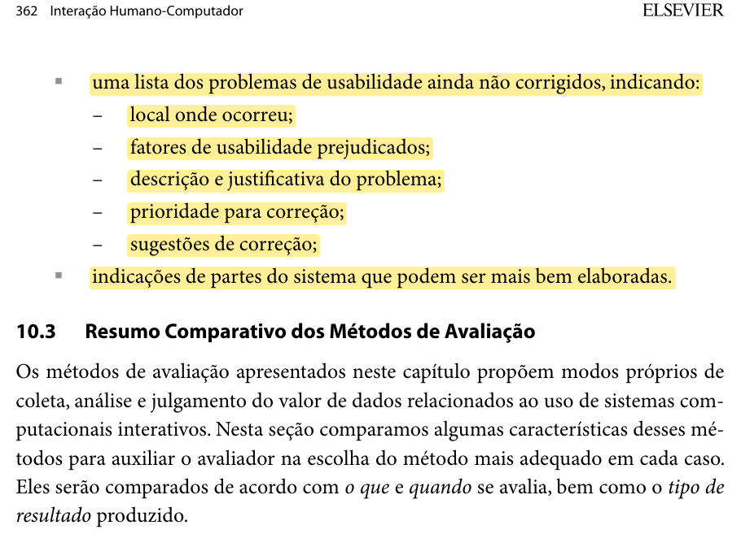{ loading=lazy }

    
Fonte: Barbosa e Silva (2010), p. 362. O grifo indica o trecho usado no critério.

    **Aplicação:** [Grupo 06](grupo-06/etapa-5.md#etapa-5-e5-06) · [Grupo 07](grupo-07/etapa-5.md#etapa-5-e5-06).

??? question "E5-07 · As lacunas e revisões dos modelos são registradas sem apagar a versão avaliada?"

    **Autor do item:** [Luís Henrique Arruda Luna](https://github.com/Donnk61).

    **O que conferir.** Compare o material avaliado com as revisões propostas. A versão usada na sessão deve continuar acessível.

    **Rastreabilidade na V1.** [E5-C07](../verificacao/listas/etapa-5.md#e5-c07) · mantido.

    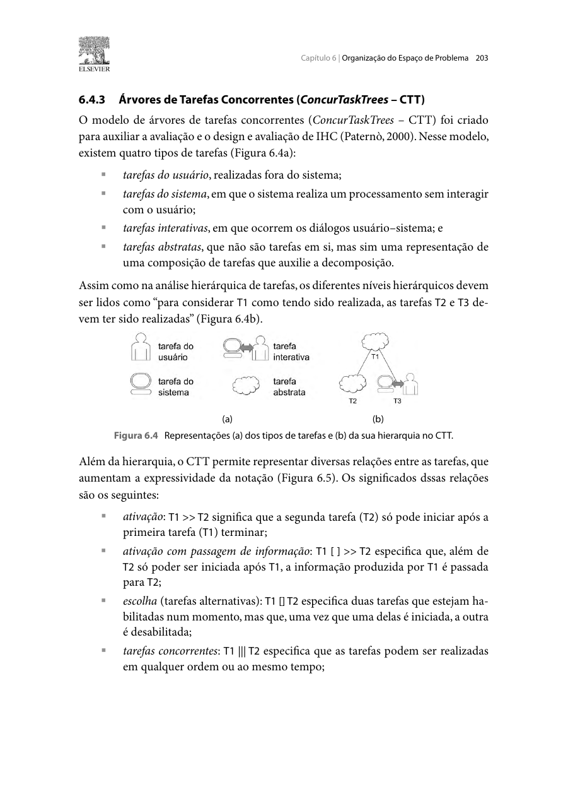{ loading=lazy }

    
Fonte: Barbosa e Silva (2010), p. 203. O grifo indica o trecho usado no critério.

    **Aplicação:** [Grupo 06](grupo-06/etapa-5.md#etapa-5-e5-07) · [Grupo 07](grupo-07/etapa-5.md#etapa-5-e5-07).

??? question "E5-08 · O planejamento da avaliação do papel cobre as seis atividades do DECIDE?"

    **Autor do item:** [Luís Henrique Arruda Luna](https://github.com/Donnk61).

    **O que conferir.** Procure objetivos, perguntas, método, questões práticas, ética e forma de avaliar os dados.

    **Rastreabilidade na V1.** [E5-C08](../verificacao/listas/etapa-5.md#e5-c08) · mantido.

    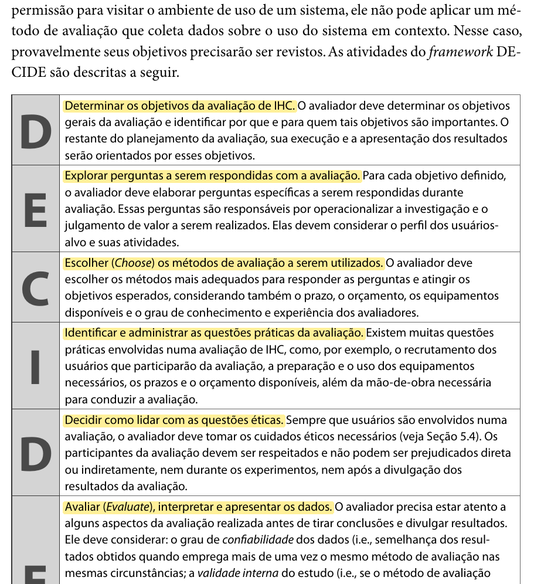{ loading=lazy }

    
Fonte: Barbosa e Silva (2010), p. 313. O grifo indica o trecho usado no critério.

    **Aplicação:** [Grupo 06](grupo-06/etapa-5.md#etapa-5-e5-08) · [Grupo 07](grupo-07/etapa-5.md#etapa-5-e5-08).

??? question "E5-09 · O método de prototipação em papel é explicado com autor do item, referência e recorte do trecho?"

    **Autor do item:** [Luís Henrique Arruda Luna](https://github.com/Donnk61).

    **O que conferir.** O plano deve explicar a execução de tarefas com respostas simuladas e trazer a imagem do trecho usado.

    **Rastreabilidade na V1.** [E5-C09](../verificacao/listas/etapa-5.md#e5-c09) · mantido.

    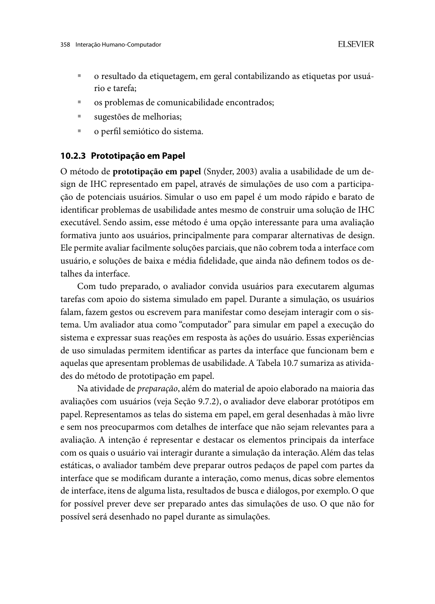{ loading=lazy }

    
Fonte: Barbosa e Silva (2010), p. 358. O grifo indica o trecho usado no critério.

    **Aplicação:** [Grupo 06](grupo-06/etapa-5.md#etapa-5-e5-09) · [Grupo 07](grupo-07/etapa-5.md#etapa-5-e5-09).

??? question "E5-10 · O inventário prevê telas e elementos móveis ligados às tarefas e aos modelos?"

    **Autor do item:** [Luís Henrique Arruda Luna](https://github.com/Donnk61).

    **O que conferir.** Procure a lista de folhas, cartões, mensagens e variantes, com vínculo à HTA, à CTT ou ao storyboard.

    **Rastreabilidade na V1.** [E5-C10](../verificacao/listas/etapa-5.md#e5-c10) · mantido.

    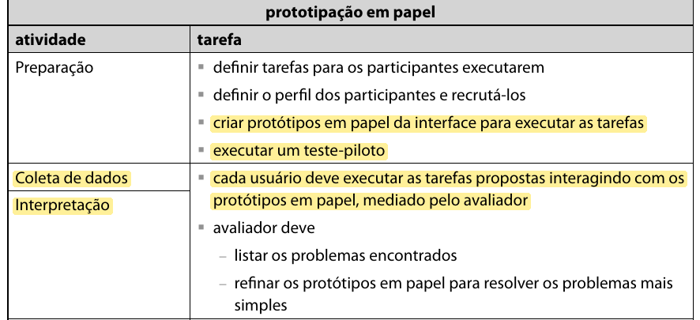{ loading=lazy }

    
Fonte: Barbosa e Silva (2010), p. 359. O grifo indica o trecho usado no critério.

    **Aplicação:** [Grupo 06](grupo-06/etapa-5.md#etapa-5-e5-10) · [Grupo 07](grupo-07/etapa-5.md#etapa-5-e5-10).

??? question "E5-11 · Enunciados, dados fictícios, estados iniciais e critérios de conclusão estão definidos?"

    **Autor do item:** [Luís Henrique Arruda Luna](https://github.com/Donnk61).

    **O que conferir.** Separe o que é entregue à pessoa do que fica com a equipe. Reinícios devem estar previstos.

    **Rastreabilidade na V1.** [E5-C11](../verificacao/listas/etapa-5.md#e5-c11) · mantido.

    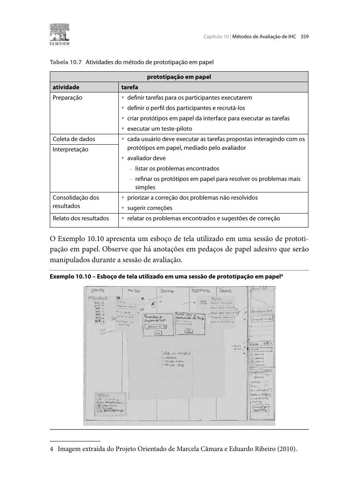{ loading=lazy }

    
Fonte: Barbosa e Silva (2010), p. 359. O grifo indica o trecho usado no critério.

    **Aplicação:** [Grupo 06](grupo-06/etapa-5.md#etapa-5-e5-11) · [Grupo 07](grupo-07/etapa-5.md#etapa-5-e5-11).

??? question "E5-12 · O plano distingue quem simula o sistema de quem observa o uso?"

    **Autor do item:** [Luís Henrique Arruda Luna](https://github.com/Donnk61).

    **O que conferir.** Procure a tabela de papéis. A distinção precisa estar escrita no plano, mesmo que a pessoa ainda seja confirmada.

    **Rastreabilidade na V1.** [E5-C12](../verificacao/listas/etapa-5.md#e5-c12) · refinado: exige a distinção escrita; a confirmação nominal é verificada na Etapa 6.

    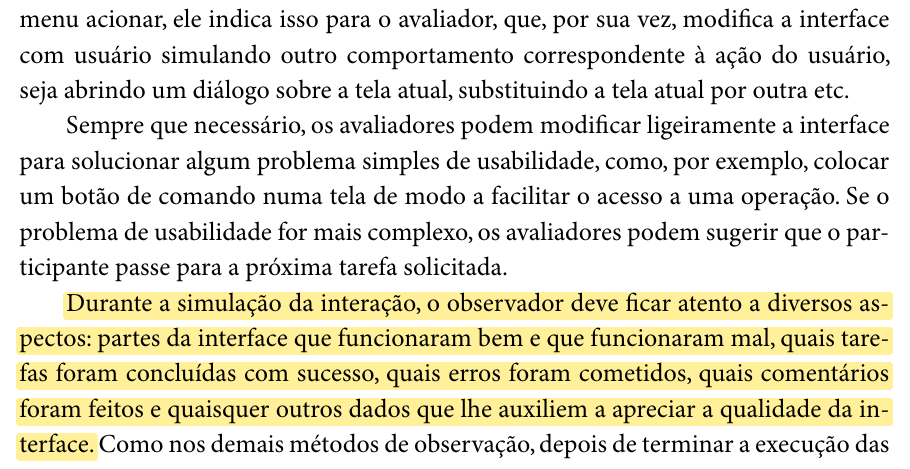{ loading=lazy }

    
Fonte: Barbosa e Silva (2010), p. 360. O grifo indica o trecho usado no critério.

    **Aplicação:** [Grupo 06](grupo-06/etapa-5.md#etapa-5-e5-12) · [Grupo 07](grupo-07/etapa-5.md#etapa-5-e5-12).

??? question "E5-13 · Perfil, recrutamento, quantidade justificada, modalidade, recursos e custo estão previstos?"

    **Autor do item:** [Luís Henrique Arruda Luna](https://github.com/Donnk61).

    **O que conferir.** As escolhas devem ser proporcionais ao escopo e não afirmar representatividade sem suporte.

    **Rastreabilidade na V1.** [E5-C13](../verificacao/listas/etapa-5.md#e5-c13) · mantido.

    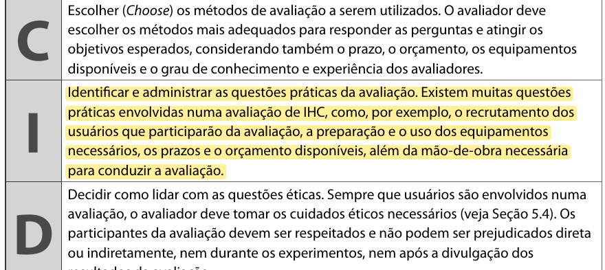{ loading=lazy }

    
Fonte: Barbosa e Silva (2010), p. 313. O grifo indica o trecho usado no critério.

    **Aplicação:** [Grupo 06](grupo-06/etapa-5.md#etapa-5-e5-13) · [Grupo 07](grupo-07/etapa-5.md#etapa-5-e5-13).

??? question "E5-14 · A agenda informa data, horário, duração, local, responsáveis e condição de confirmação?"

    **Autor do item:** [Luís Henrique Arruda Luna](https://github.com/Donnk61).

    **O que conferir.** Agenda proposta é aceita quando identificada como proposta e quando prevê piloto e tempo de análise antes da Etapa 6.

    **Rastreabilidade na V1.** [E5-C14](../verificacao/listas/etapa-5.md#e5-c14) · mantido.

    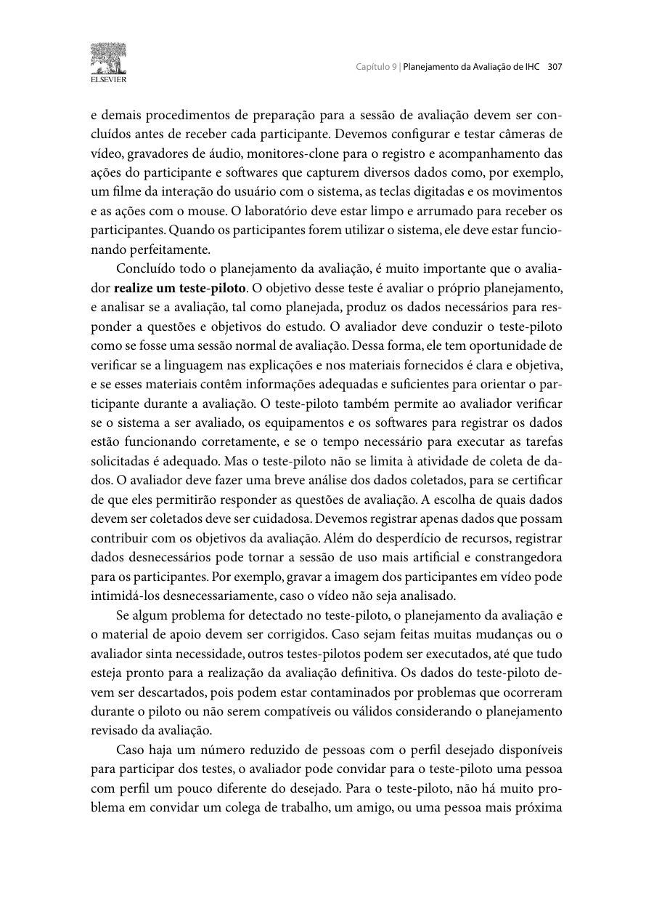{ loading=lazy }

    
Fonte: Barbosa e Silva (2010), p. 307. O grifo indica o trecho usado no critério.

    **Aplicação:** [Grupo 06](grupo-06/etapa-5.md#etapa-5-e5-14) · [Grupo 07](grupo-07/etapa-5.md#etapa-5-e5-14).

??? question "E5-15 · O piloto ensaia procedimento e registros, com dados separados da avaliação principal?"

    **Autor do item:** [Luís Henrique Arruda Luna](https://github.com/Donnk61).

    **O que conferir.** Outra pessoa, ajustes registrados antes da coleta e declaração de descarte dos dados.

    **Rastreabilidade na V1.** [E5-C15](../verificacao/listas/etapa-5.md#e5-c15) · mantido.

    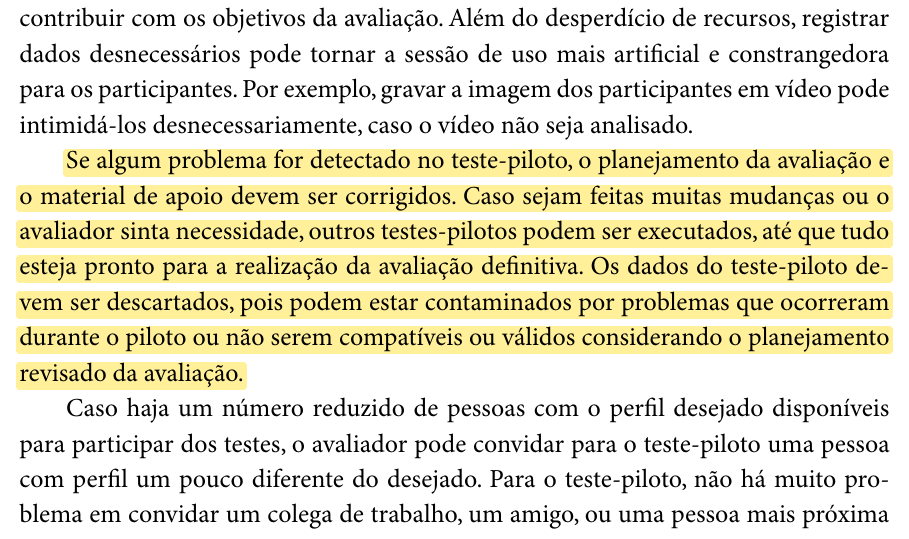{ loading=lazy }

    
Fonte: Barbosa e Silva (2010), p. 307. O grifo indica o trecho usado no critério.

    **Aplicação:** [Grupo 06](grupo-06/etapa-5.md#etapa-5-e5-15) · [Grupo 07](grupo-07/etapa-5.md#etapa-5-e5-15).

??? question "E5-16 · O consentimento cobre participação, gravação, uso do vídeo, privacidade e desistência?"

    **Autor do item:** [Luís Henrique Arruda Luna](https://github.com/Donnk61).

    **O que conferir.** O uso do vídeo inclui onde ele será publicado e quem poderá acessá-lo.

    **Rastreabilidade na V1.** [E5-C16](../verificacao/listas/etapa-5.md#e5-c16) · mantido.

    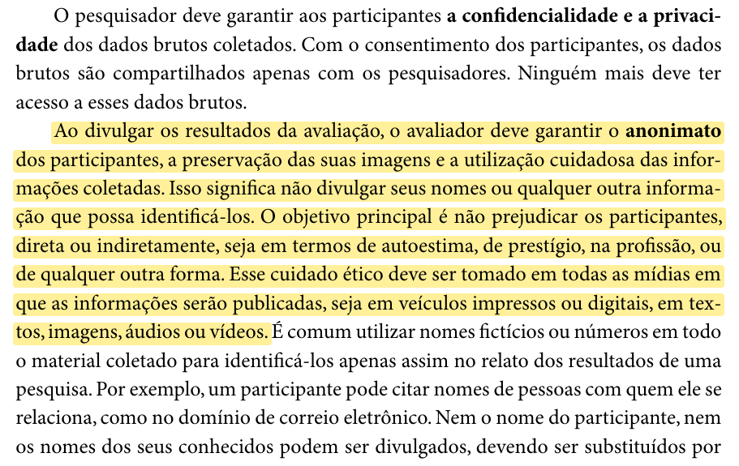{ loading=lazy }

    
Fonte: Barbosa e Silva (2010), p. 141. O grifo indica o trecho usado no critério.

    **Aplicação:** [Grupo 06](grupo-06/etapa-5.md#etapa-5-e5-16) · [Grupo 07](grupo-07/etapa-5.md#etapa-5-e5-16).

??? question "E5-17 · Os instrumentos registram ações, conclusão, ajuda, erros, comentários e falhas de simulação?"

    **Autor do item:** [Luís Henrique Arruda Luna](https://github.com/Donnk61).

    **O que conferir.** Procure a ficha de observação ou de execução por tarefa. A menção genérica a uma “planilha” sem campos não basta.

    **Rastreabilidade na V1.** [E5-C17](../verificacao/listas/etapa-5.md#e5-c17) · mantido.

    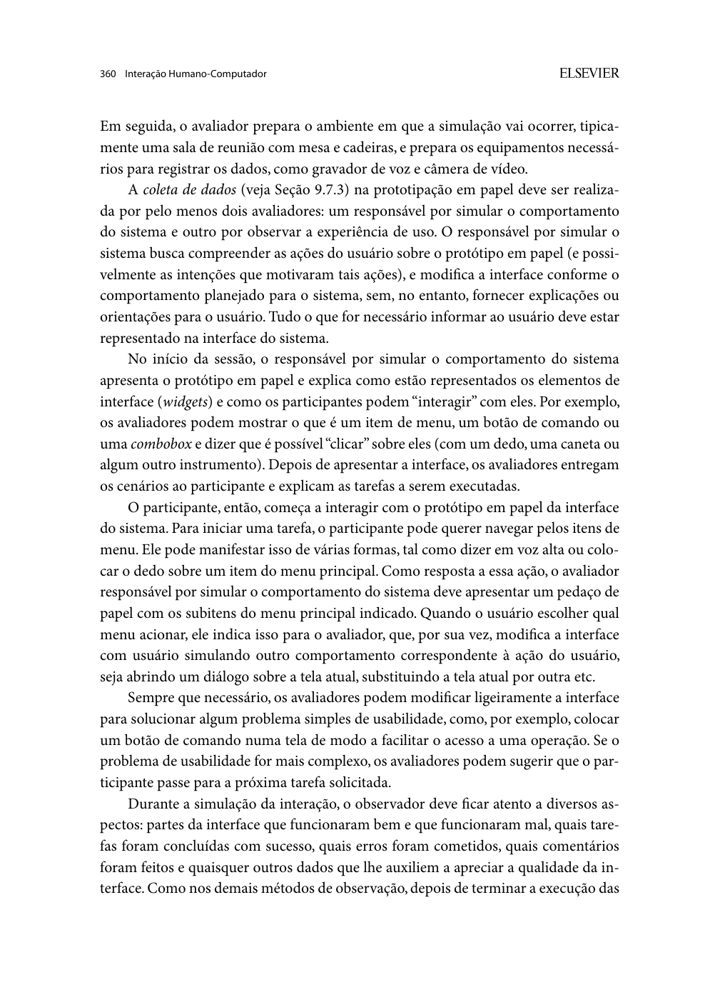{ loading=lazy }

    
Fonte: Barbosa e Silva (2010), p. 360. O grifo indica o trecho usado no critério.

    **Aplicação:** [Grupo 06](grupo-06/etapa-5.md#etapa-5-e5-17) · [Grupo 07](grupo-07/etapa-5.md#etapa-5-e5-17).

??? question "E5-18 · O plano do relato separa problemas corrigidos e pendentes e prevê a recorrência após a correção?"

    **Autor do item:** [Luís Henrique Arruda Luna](https://github.com/Donnk61).

    **O que conferir.** Procure campos de estado (corrigido/pendente) e de reteste ou recorrência.

    **Rastreabilidade na V1.** [E5-C18](../verificacao/listas/etapa-5.md#e5-c18) · mantido.

    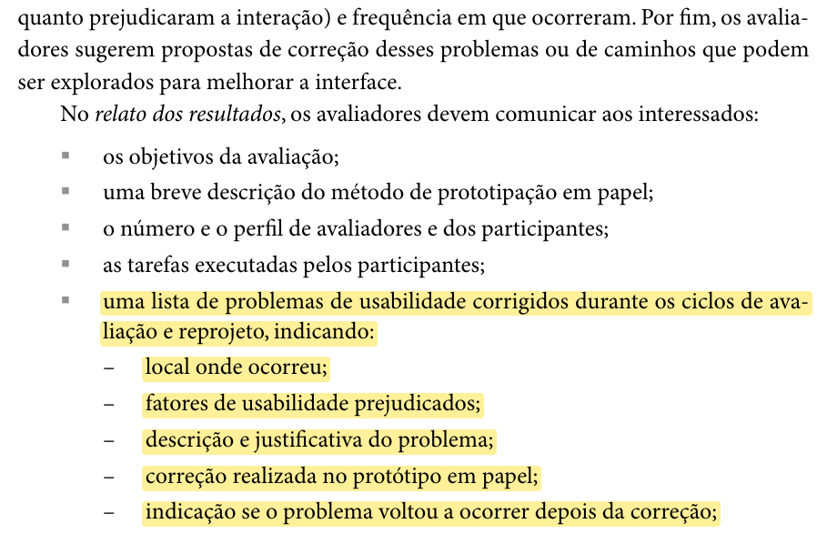{ loading=lazy }

    
Fonte: Barbosa e Silva (2010), p. 361. O grifo indica o trecho usado no critério.

    **Aplicação:** [Grupo 06](grupo-06/etapa-5.md#etapa-5-e5-18) · [Grupo 07](grupo-07/etapa-5.md#etapa-5-e5-18).

??? question "E5-19 · Indicadores e conclusões respeitam o método, a amostra e o que foi medido?"

    **Autor do item:** [Luís Henrique Arruda Luna](https://github.com/Donnk61).

    **O que conferir.** Percentuais, unanimidades e afirmações de validade devem corresponder ao número de pessoas e ao tipo de dado.

    **Rastreabilidade na V1.** [E5-C19](../verificacao/listas/etapa-5.md#e5-c19) · mantido.

    { loading=lazy }

    
Fonte: Barbosa e Silva (2010), p. 312. O grifo indica o trecho usado no critério.

    **Aplicação:** [Grupo 06](grupo-06/etapa-5.md#etapa-5-e5-19) · [Grupo 07](grupo-07/etapa-5.md#etapa-5-e5-19).

??? question "E5-20 · O encadeamento relato → decisão → tela/tarefa → pergunta do papel está rastreável?"

    **Autor do item:** [Luís Henrique Arruda Luna](https://github.com/Donnk61).

    **O que conferir.** Procure a matriz que liga os achados da Etapa 5 às folhas e tarefas do protótipo de papel.

    **Rastreabilidade na V1.** [E5-C20](../verificacao/listas/etapa-5.md#e5-c20) · mantido.

    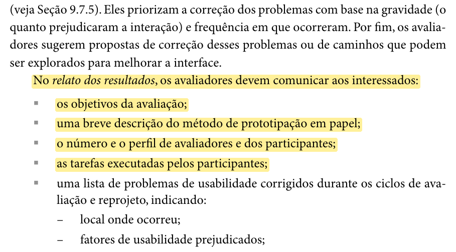{ loading=lazy }

    
Fonte: Barbosa e Silva (2010), p. 361. O grifo indica o trecho usado no critério.

    **Aplicação:** [Grupo 06](grupo-06/etapa-5.md#etapa-5-e5-20) · [Grupo 07](grupo-07/etapa-5.md#etapa-5-e5-20).

## Conferência da lista

A V2 preserva os 31 critérios da V1 (D01–D11 e E5-C01–E5-C20) na mesma ordem. As mudanças tornam a evidência esperada explícita: a coluna de revisor no histórico (D01), a pendência declarada como impedimento (D02), a avaliação do conteúdo da abertura em vez do título da seção (D05), a verificação por integrante (D09), a aceitação de plano coletivo com cobertura demonstrável (E5-01) e a exigência de que a separação de papéis esteja escrita no plano (E5-12).

| V1 | V2 | Mudança |
| --- | --- | --- |
| [D01](../verificacao/listas/etapa-5.md#d01) | [D01](#d01) | Mantido; a coluna de revisor passa a ser exigida explicitamente. |
| [D02](../verificacao/listas/etapa-5.md#d02) | [D02](#d02) | Mantido; explicita que pendência declarada impede Sim. |
| [D03](../verificacao/listas/etapa-5.md#d03) | [D03](#d03) | Mantido; restringe o recorte aos documentos de conteúdo. |
| [D04](../verificacao/listas/etapa-5.md#d04) | [D04](#d04) | Mantido; inclui a correção da chamada. |
| [D05](../verificacao/listas/etapa-5.md#d05) | [D05](#d05) | Refinado: avalia o conteúdo da abertura, não o título da seção. |
| [D06](../verificacao/listas/etapa-5.md#d06) | [D06](#d06) | Mantido; exige cobertura de todos os integrantes. |
| [D07](../verificacao/listas/etapa-5.md#d07) | [D07](#d07) | Mantido. |
| [D08](../verificacao/listas/etapa-5.md#d08) | [D08](#d08) | Mantido; autorização avaliada pelo que está declarado publicamente. |
| [D09](../verificacao/listas/etapa-5.md#d09) | [D09](#d09) | Refinado para a verificação por integrante. |
| [D10](../verificacao/listas/etapa-5.md#d10) | [D10](#d10) | Mantido. |
| [D11](../verificacao/listas/etapa-5.md#d11) | [D11](#d11) | Mantido. |
| [E5-C01](../verificacao/listas/etapa-5.md#e5-c01) | [E5-01](#e5-01) | Mantido; aceita plano compartilhado com cobertura demonstrável. |
| [E5-C02](../verificacao/listas/etapa-5.md#e5-c02) | [E5-02](#e5-02) | Mantido; lista os metadados mínimos. |
| [E5-C03](../verificacao/listas/etapa-5.md#e5-c03) | [E5-03](#e5-03) | Mantido. |
| [E5-C04](../verificacao/listas/etapa-5.md#e5-c04) | [E5-04](#e5-04) | Mantido. |
| [E5-C05](../verificacao/listas/etapa-5.md#e5-c05) | [E5-05](#e5-05) | Mantido. |
| [E5-C06](../verificacao/listas/etapa-5.md#e5-c06) | [E5-06](#e5-06) | Mantido. |
| [E5-C07](../verificacao/listas/etapa-5.md#e5-c07) | [E5-07](#e5-07) | Mantido. |
| [E5-C08](../verificacao/listas/etapa-5.md#e5-c08) | [E5-08](#e5-08) | Mantido. |
| [E5-C09](../verificacao/listas/etapa-5.md#e5-c09) | [E5-09](#e5-09) | Mantido. |
| [E5-C10](../verificacao/listas/etapa-5.md#e5-c10) | [E5-10](#e5-10) | Mantido. |
| [E5-C11](../verificacao/listas/etapa-5.md#e5-c11) | [E5-11](#e5-11) | Mantido. |
| [E5-C12](../verificacao/listas/etapa-5.md#e5-c12) | [E5-12](#e5-12) | Refinado: exige a distinção escrita; a confirmação nominal é verificada na Etapa 6. |
| [E5-C13](../verificacao/listas/etapa-5.md#e5-c13) | [E5-13](#e5-13) | Mantido. |
| [E5-C14](../verificacao/listas/etapa-5.md#e5-c14) | [E5-14](#e5-14) | Mantido. |
| [E5-C15](../verificacao/listas/etapa-5.md#e5-c15) | [E5-15](#e5-15) | Mantido. |
| [E5-C16](../verificacao/listas/etapa-5.md#e5-c16) | [E5-16](#e5-16) | Mantido. |
| [E5-C17](../verificacao/listas/etapa-5.md#e5-c17) | [E5-17](#e5-17) | Mantido. |
| [E5-C18](../verificacao/listas/etapa-5.md#e5-c18) | [E5-18](#e5-18) | Mantido. |
| [E5-C19](../verificacao/listas/etapa-5.md#e5-c19) | [E5-19](#e5-19) | Mantido. |
| [E5-C20](../verificacao/listas/etapa-5.md#e5-c20) | [E5-20](#e5-20) | Mantido. |

Tabela 2 — Correspondência entre as listas V1 e V2 da Etapa 5.

Fonte: elaboração para o Grupo 06 (2026).

## Agradecimentos

O Claude (Anthropic) apoiou a consulta aos artefatos, a redação dos critérios e a organização das tabelas. Luís Henrique Arruda Luna responde pelo conteúdo da lista.

## Histórico de versão

| Versão | Data | Descrição | Autor(es) | Revisor designado |
| :---: | :---: | --- | --- | --- |
| `2.0` | 22/11/2026 | Lista V2 da Etapa 5 no padrão da Etapa 8, com evidência esperada, correspondência com a V1 e recortes das fontes. | [Luís Henrique Arruda Luna](https://github.com/Donnk61) | [Caio Breno de Souza Bezerra](https://github.com/CaioBezerra-Dev) |

## Referências

1. SALES, André Barros de. *Plano de Ensino FIHC 022026 — Turma 01*. v1. Brasília: FCTE/UnB, 2026.

2. BARBOSA, Simone Diniz Junqueira; SILVA, Bruno Santana da. *Interação humano-computador*. Rio de Janeiro: Elsevier, 2010.

3. FAGAN, Michael E. *Design and code inspections to reduce errors in program development*. IBM Systems Journal, v. 15, n. 3, p. 182–211, 1976. [DOI 10.1147/sj.153.0182](https://doi.org/10.1147/sj.153.0182).
