Responsável: Caio Breno de Souza Bezerra · Grupo 06

# Lista de verificação da Etapa 6 · V2

## Tabela de contribuição

| Integrante | Contribuição | Artefato / atividade |
| --- | --- | --- |
| [Caio Breno de Souza Bezerra](https://github.com/CaioBezerra-Dev) | Revisão dos 11 critérios de desenvolvimento com base no plano de ensino e indicação da evidência esperada | [Desenvolvimento do projeto](#desenvolvimento-do-projeto) |
| [Caio Breno de Souza Bezerra](https://github.com/CaioBezerra-Dev) | Formulação dos 16 critérios sobre o relato de papel e os planejamentos de alta fidelidade, com recortes grifados das fontes | [Conteúdo da disciplina](#conteudo-da-disciplina) |
| [Caio Breno de Souza Bezerra](https://github.com/CaioBezerra-Dev) | Definição das regras de julgamento e registro das correspondências entre V1 e V2 | [Como aplicar](#como-aplicar) · [Conferência da lista](#conferencia-da-lista) |
| Codex (OpenAI) | Apoio à consulta do livro e do plano de ensino, à edição do texto e à preparação dos recortes | [Agradecimentos](index.md#agradecimentos) |

Tabela 1 — Contribuição neste artefato.

Fonte: elaboração para o Grupo 06 (2026).

[Etapa 8](index.md) 
[Resultados e gráficos](resultados/etapa-6.md) 
[Lista V1 da Etapa 6](../verificacao/listas/etapa-6.md)

## Como aplicar

Use a mesma redação na autoinspeção do Grupo 06 e na inspeção externa do Grupo 05 (−1). A resposta resume a cobertura dos artefatos daquela etapa. Cada item traz a evidência esperada, o vínculo com a V1 e um recorte da fonte com o trecho relevante grifado e o texto ao redor.

- **Sim** quando a evidência atende à pergunta em todo o recorte aplicável.
- **Incompleto** quando existe evidência parcial, contraditória ou sem cobertura de todos os artefatos do recorte.
- **Não** quando o requisito é aplicável e a evidência essencial está ausente nos locais consultados ou contraria a afirmação.

Na ficha, registre grupo, etapa, ID, versão, data, fonte e trecho que sustenta o julgamento. Para uma lacuna, indique onde procurou. Se algum item estiver fora de escopo, documente o motivo antes de calcular as contagens. [Método e escopo](index.md#metodo-de-inspecao).

## Desenvolvimento do projeto

??? question "D01 · O histórico identifica a versão, a data e a mudança de cada artefato?"

    **Autor do item:** [Caio Breno de Souza Bezerra](https://github.com/CaioBezerra-Dev).

    **O que conferir.** Abra o histórico em cada documento principal. Confira se as entradas permitem distinguir a versão corrente e o que mudou.

    **Rastreabilidade na V1.** [D01](../verificacao/listas/etapa-6.md#d01) · mantido com campos explícitos.

    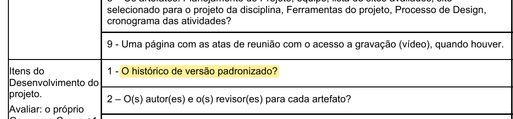{ loading=lazy }

    
Fonte: Sales (2026), p. 8 do PDF. O grifo indica o trecho usado no critério.

    **Aplicação:** [Grupo 05](grupo-05/etapa-6.md#etapa-6-d01) · [Grupo 06](grupo-06/etapa-6.md#etapa-6-d01).

??? question "D02 · A versão consultada identifica quem escreveu e quem revisou o artefato?"

    **Autor do item:** [Caio Breno de Souza Bezerra](https://github.com/CaioBezerra-Dev).

    **O que conferir.** Leia a entrada da versão corrente. O revisor deve ser distinto do autor e a entrada deve registrar revisão ou atribuí-la àquela versão. Campo vazio, autor repetido ou revisão a definir indicam lacuna.

    **Rastreabilidade na V1.** [D02](../verificacao/listas/etapa-6.md#d02) · refinado para a versão examinada.

    { loading=lazy }

    
Fonte: Sales (2026), p. 8 do PDF. O grifo indica o trecho usado no critério.

    **Aplicação:** [Grupo 05](grupo-05/etapa-6.md#etapa-6-d02) · [Grupo 06](grupo-06/etapa-6.md#etapa-6-d02).

??? question "D03 · Os artefatos principais apresentam referências bibliográficas?"

    **Autor do item:** [Caio Breno de Souza Bezerra](https://github.com/CaioBezerra-Dev).

    **O que conferir.** Confira referências que fundamentam método, planejamento ou resultados nos documentos do inventário. Páginas de índice entram na conferência antiga quando foram citadas nela.

    **Rastreabilidade na V1.** [D03](../verificacao/listas/etapa-6.md#d03) · delimita os documentos principais.

    { loading=lazy }

    
Fonte: Sales (2026), p. 8 do PDF. O grifo indica o trecho usado no critério.

    **Aplicação:** [Grupo 05](grupo-05/etapa-6.md#etapa-6-d03) · [Grupo 06](grupo-06/etapa-6.md#etapa-6-d03).

??? question "D04 · Figuras e tabelas têm identificação, fonte e chamada no texto?"

    **Autor do item:** [Caio Breno de Souza Bezerra](https://github.com/CaioBezerra-Dev).

    **O que conferir.** Confira as figuras e tabelas de conteúdo. Procure numeração e legenda, origem e uma chamada que aponte para o elemento. Registre quais elementos têm lacunas.

    **Rastreabilidade na V1.** [D04](../verificacao/listas/etapa-6.md#d04) · mantido com escopo de conteúdo.

    { loading=lazy }

    
Fonte: Sales (2026), p. 8 do PDF. O grifo indica o trecho usado no critério.

    **Aplicação:** [Grupo 05](grupo-05/etapa-6.md#etapa-6-d04) · [Grupo 06](grupo-06/etapa-6.md#etapa-6-d04).

??? question "D05 · Os artefatos apresentam objetivo e escopo antes de detalhar o conteúdo?"

    **Autor do item:** [Caio Breno de Souza Bezerra](https://github.com/CaioBezerra-Dev).

    **O que conferir.** Localize o trecho de abertura que informa a finalidade e a funcionalidade. Um título de seção diferente de ‘Introdução’ é aceito.

    **Rastreabilidade na V1.** [D05](../verificacao/listas/etapa-6.md#d05) · aceita aberturas equivalentes.

    { loading=lazy }

    
Fonte: Sales (2026), p. 8 do PDF. O grifo indica o trecho usado no critério.

    **Aplicação:** [Grupo 05](grupo-05/etapa-6.md#etapa-6-d05) · [Grupo 06](grupo-06/etapa-6.md#etapa-6-d05).

??? question "D06 · O cronograma executado identifica responsáveis e datas reais para os artefatos e atividades da etapa?"

    **Autor do item:** [Caio Breno de Souza Bezerra](https://github.com/CaioBezerra-Dev).

    **O que conferir.** Abra as entradas de execução e procure datas reais de início e fim, ação e pessoas. Use registros complementares de execução para localizar lacunas. Uma agenda prevista continua sendo planejamento.

    **Rastreabilidade na V1.** [D06](../verificacao/listas/etapa-6.md#d06) · explicita o que conta como execução.

    { loading=lazy }

    
Fonte: Sales (2026), p. 8 do PDF. O grifo indica o trecho usado no critério.

    **Aplicação:** [Grupo 05](grupo-05/etapa-6.md#etapa-6-d06) · [Grupo 06](grupo-06/etapa-6.md#etapa-6-d06).

??? question "D07 · A etapa tem ata de reunião com data, início e fim, participantes, pauta e decisões?"

    **Autor do item:** [Caio Breno de Souza Bezerra](https://github.com/CaioBezerra-Dev).

    **O que conferir.** Procure as atas da etapa e compare os campos publicados. Duração do vídeo sem indicação do encerramento da reunião deixa o horário em aberto.

    **Rastreabilidade na V1.** [D07](../verificacao/listas/etapa-6.md#d07) · explicita os campos da ata.

    { loading=lazy }

    
Fonte: Sales (2026), p. 9 do PDF. O grifo indica o trecho usado no critério.

    **Aplicação:** [Grupo 05](grupo-05/etapa-6.md#etapa-6-d07) · [Grupo 06](grupo-06/etapa-6.md#etapa-6-d07).

??? question "D08 · As gravações das reuniões de verificação da etapa estão localizáveis no site?"

    **Autor do item:** [Caio Breno de Souza Bezerra](https://github.com/CaioBezerra-Dev).

    **O que conferir.** Confira a associação entre reunião, etapa e endereço da gravação. Registre o acesso documentado. Consentimento de participantes das sessões é verificado no conteúdo da Etapa 7.

    **Rastreabilidade na V1.** [D08](../verificacao/listas/etapa-6.md#d08) · delimita gravação de reunião e retira presunção de autorização.

    { loading=lazy }

    
Fonte: Sales (2026), p. 9 do PDF. O grifo indica o trecho usado no critério.

    **Aplicação:** [Grupo 05](grupo-05/etapa-6.md#etapa-6-d08) · [Grupo 06](grupo-06/etapa-6.md#etapa-6-d08).

??? question "D09 · A apresentação da etapa tem vídeo publicado como não listado e identificado no site?"

    **Autor do item:** [Caio Breno de Souza Bezerra](https://github.com/CaioBezerra-Dev).

    **O que conferir.** Confira o vídeo previsto para o grupo ou para cada integrante, conforme a organização adotada, e a categoria declarada na página. O link aponta a gravação e a página registra a visibilidade.

    **Rastreabilidade na V1.** [D09](../verificacao/listas/etapa-6.md#d09) · explicita a categoria do plano de ensino.

    { loading=lazy }

    
Fonte: Sales (2026), p. 9 do PDF. O grifo indica o trecho usado no critério.

    **Aplicação:** [Grupo 05](grupo-05/etapa-6.md#etapa-6-d09) · [Grupo 06](grupo-06/etapa-6.md#etapa-6-d09).

??? question "D10 · A contribuição de cada pessoa está identificada no início dos artefatos, com links para as atividades?"

    **Autor do item:** [Caio Breno de Souza Bezerra](https://github.com/CaioBezerra-Dev).

    **O que conferir.** Aceite tabela de contribuição própria ou incorporada ao histórico. Confira pessoa, atividade atribuída e hiperligação para a atividade ou para a gravação quando houver.

    **Rastreabilidade na V1.** [D10](../verificacao/listas/etapa-6.md#d10) · aceita tabela equivalente com os mesmos campos.

    { loading=lazy }

    
Fonte: Sales (2026), p. 9 do PDF. O grifo indica o trecho usado no critério.

    **Aplicação:** [Grupo 05](grupo-05/etapa-6.md#etapa-6-d10) · [Grupo 06](grupo-06/etapa-6.md#etapa-6-d10).

??? question "D11 · O artefato declara a ferramenta de IA generativa usada e a finalidade do apoio?"

    **Autor do item:** [Caio Breno de Souza Bezerra](https://github.com/CaioBezerra-Dev).

    **O que conferir.** Use a seção de agradecimentos ou declaração, ou um registro de uso identificável no próprio artefato. Quando houver indicação de uso, confira o nome da ferramenta e as atividades. Se a evidência for só genérica, marque Incompleto.

    **Rastreabilidade na V1.** [D11](../verificacao/listas/etapa-6.md#d11) · prioriza a declaração explícita, aceita local equivalente.

    { loading=lazy }

    
Fonte: Sales (2026), p. 3 do PDF. O grifo indica o trecho usado no critério.

    **Aplicação:** [Grupo 05](grupo-05/etapa-6.md#etapa-6-d11) · [Grupo 06](grupo-06/etapa-6.md#etapa-6-d11).

## Cobertura dos artefatos

??? question "E6-01 · O relato do papel e os dois planejamentos de alta fidelidade estão localizáveis por funcionalidade?"

    **Autor do item:** [Caio Breno de Souza Bezerra](https://github.com/CaioBezerra-Dev).

    **O que conferir.** Para cada integrante ou fluxo, localize o relato do papel, o plano da avaliação e o plano do relato. Um plano comum serve quando sua abrangência identifica o fluxo e suas tarefas.

    **Rastreabilidade na V1.** [E6-C01](../verificacao/listas/etapa-6.md#e6-c01) · aceita plano comum com cobertura.

    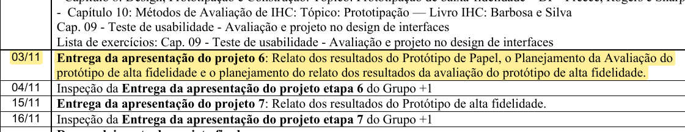{ loading=lazy }

    
Fonte: Sales (2026), p. 5 do PDF. O grifo indica o trecho usado no critério.

    **Aplicação:** [Grupo 05](grupo-05/etapa-6.md#etapa-6-e6-01) · [Grupo 06](grupo-06/etapa-6.md#etapa-6-e6-01).

## Relato da avaliação do protótipo de papel

??? question "E6-02 · O relato do papel situa a sessão, o método, os papéis, o perfil das pessoas e as tarefas executadas?"

    **Autor do item:** [Caio Breno de Souza Bezerra](https://github.com/CaioBezerra-Dev).

    **O que conferir.** Confira a atividade efetiva, quem operou as peças e quem observou, quantidade e perfil desidentificado, tarefas e material usado.

    **Rastreabilidade na V1.** [E6-C02](../verificacao/listas/etapa-6.md#e6-c02) · define os campos do relato.

    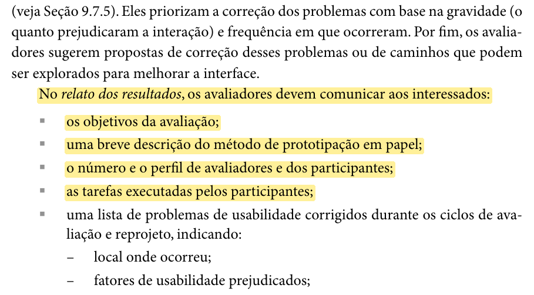{ loading=lazy }

    
Fonte: Barbosa e Silva (2010), p. 361. O grifo indica o trecho usado no critério.

    **Aplicação:** [Grupo 05](grupo-05/etapa-6.md#etapa-6-e6-02) · [Grupo 06](grupo-06/etapa-6.md#etapa-6-e6-02).

??? question "E6-03 · O desempenho e as opiniões no teste de papel estão associados a registros localizáveis?"

    **Autor do item:** [Caio Breno de Souza Bezerra](https://github.com/CaioBezerra-Dev).

    **O que conferir.** Identifique pessoa por código, tarefa ou tela, resultado, ajuda/dificuldade quando ocorrer e fonte específica. Aceite minuto na gravação ou linha identificada de ficha, transcrição ou nota.

    **Rastreabilidade na V1.** [E6-C03](../verificacao/listas/etapa-6.md#e6-c03) · aceita registros equivalentes.

    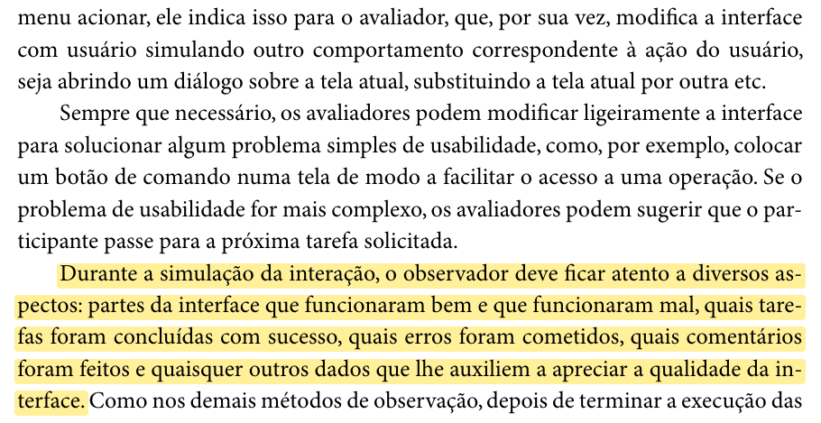{ loading=lazy }

    
Fonte: Barbosa e Silva (2010), p. 360. O grifo indica o trecho usado no critério.

    **Aplicação:** [Grupo 05](grupo-05/etapa-6.md#etapa-6-e6-03) · [Grupo 06](grupo-06/etapa-6.md#etapa-6-e6-03).

??? question "E6-04 · O relato identifica as correções efetivamente feitas no papel e o que ocorreu depois de cada ajuste?"

    **Autor do item:** [Caio Breno de Souza Bezerra](https://github.com/CaioBezerra-Dev).

    **O que conferir.** Localize problema, fator afetado e ajuste aplicado; registre recorrência ou falta de reteste. Aceite declaração explícita de que não houve correção no papel quando todos os problemas foram encaminhados para a etapa seguinte.

    **Rastreabilidade na V1.** [E6-C04](../verificacao/listas/etapa-6.md#e6-c04) · esclarece correção, reteste e ausência de iteração.

    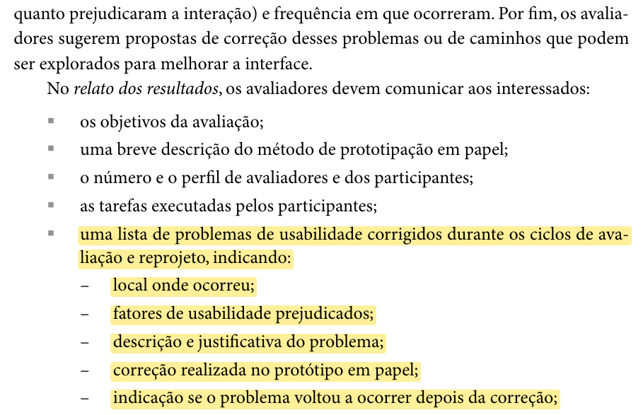{ loading=lazy }

    
Fonte: Barbosa e Silva (2010), p. 361. O grifo indica o trecho usado no critério.

    **Aplicação:** [Grupo 05](grupo-05/etapa-6.md#etapa-6-e6-04) · [Grupo 06](grupo-06/etapa-6.md#etapa-6-e6-04).

??? question "E6-05 · Os problemas pendentes do papel têm local, fator afetado, justificativa, prioridade e proposta?"

    **Autor do item:** [Caio Breno de Souza Bezerra](https://github.com/CaioBezerra-Dev).

    **O que conferir.** Abra a lista de pendências. Relacione cada achado a tela/tarefa, ao problema observado e ao fator afetado. Confira o encaminhamento e a justificativa da prioridade. Quando nenhum problema for observado, procure declaração com alcance definido.

    **Rastreabilidade na V1.** [E6-C05](../verificacao/listas/etapa-6.md#e6-c05) · mantém o conjunto previsto no livro.

    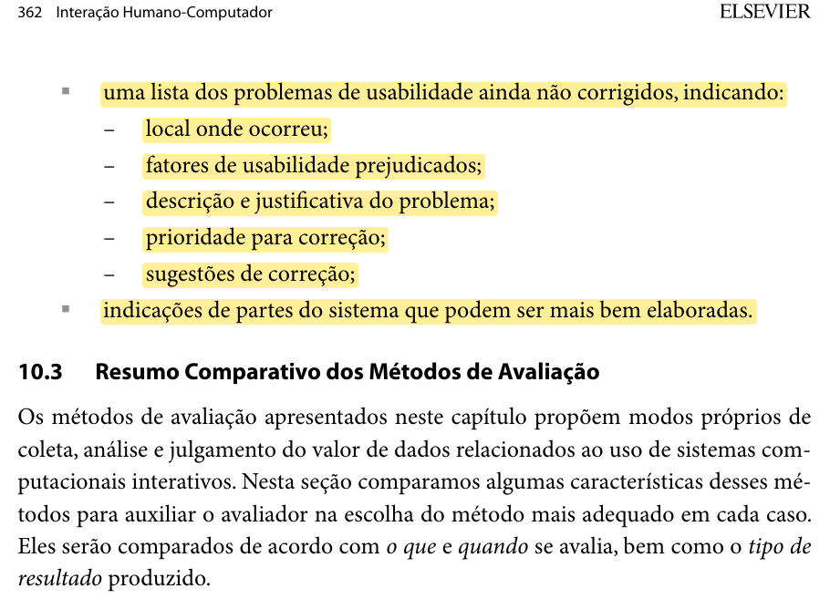{ loading=lazy }

    
Fonte: Barbosa e Silva (2010), p. 362. O grifo indica o trecho usado no critério.

    **Aplicação:** [Grupo 05](grupo-05/etapa-6.md#etapa-6-e6-05) · [Grupo 06](grupo-06/etapa-6.md#etapa-6-e6-05).

??? question "E6-06 · O relato do papel relaciona as conclusões às perguntas e às decisões para a alta fidelidade?"

    **Autor do item:** [Caio Breno de Souza Bezerra](https://github.com/CaioBezerra-Dev).

    **O que conferir.** Rastreie perguntas, dado ou observação de suporte e decisão. Identifique o que será mantido, alterado ou revisto na alta fidelidade.

    **Rastreabilidade na V1.** [E6-C06](../verificacao/listas/etapa-6.md#e6-c06) · explicita o vínculo pergunta–decisão.

    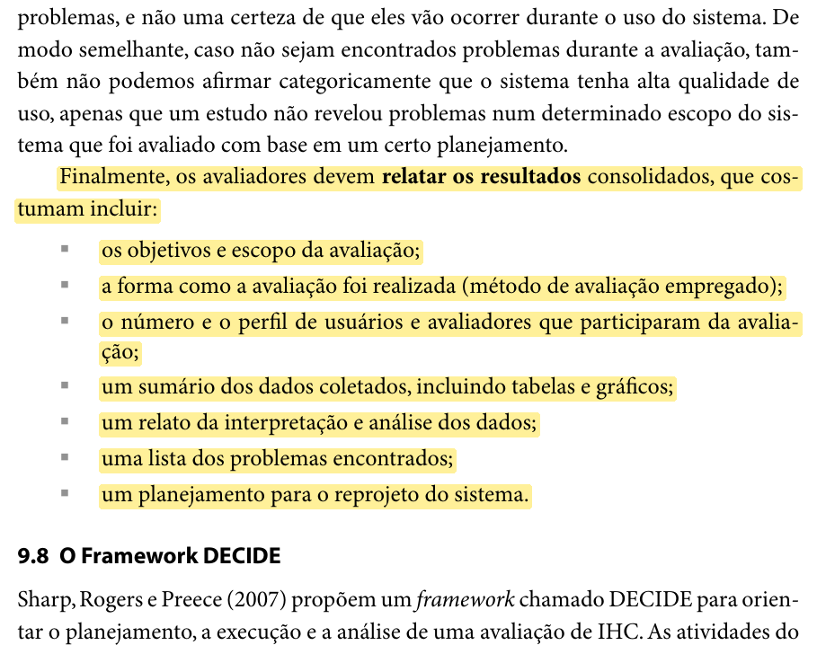{ loading=lazy }

    
Fonte: Barbosa e Silva (2010), p. 312. O grifo indica o trecho usado no critério.

    **Aplicação:** [Grupo 05](grupo-05/etapa-6.md#etapa-6-e6-06) · [Grupo 06](grupo-06/etapa-6.md#etapa-6-e6-06).

## Planejamento da avaliação de alta fidelidade

??? question "E6-07 · O planejamento da avaliação articula as seis atividades do DECIDE e justifica a escolha do método?"

    **Autor do item:** [Caio Breno de Souza Bezerra](https://github.com/CaioBezerra-Dev).

    **O que conferir.** Confira objetivos, perguntas, método fundamentado, questões práticas, ética e interpretação. A escolha do método deve responder ao que se quer observar. A organização do texto pode variar.

    **Rastreabilidade na V1.** [E6-C07](../verificacao/listas/etapa-6.md#e6-c07) + [E6-C08](../verificacao/listas/etapa-6.md#e6-c08) · consolidados.

    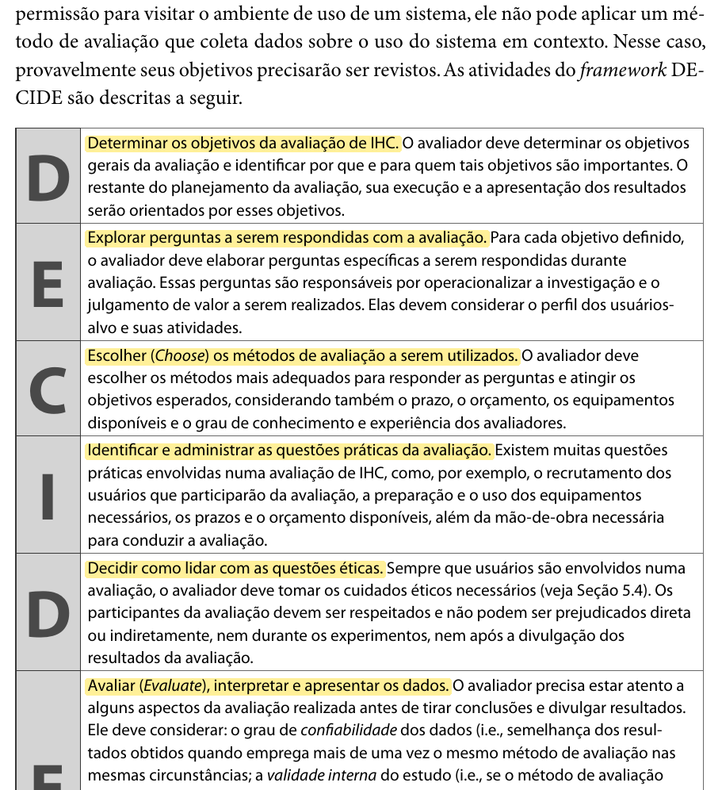{ loading=lazy }

    
Fonte: Barbosa e Silva (2010), p. 313. O grifo indica o trecho usado no critério.

    **Aplicação:** [Grupo 05](grupo-05/etapa-6.md#etapa-6-e6-07) · [Grupo 06](grupo-06/etapa-6.md#etapa-6-e6-07).

??? question "E6-08 · O plano define o perfil, o recrutamento e a quantidade justificada de participantes?"

    **Autor do item:** [Caio Breno de Souza Bezerra](https://github.com/CaioBezerra-Dev).

    **O que conferir.** Procure critérios de inclusão, meio de convite, número previsto e razão metodológica ou operacional dessa quantidade.

    **Rastreabilidade na V1.** [E6-C09](../verificacao/listas/etapa-6.md#e6-c09) · operacionaliza o recrutamento.

    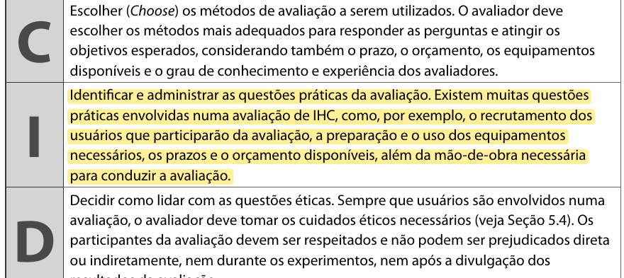{ loading=lazy }

    
Fonte: Barbosa e Silva (2010), p. 313. O grifo indica o trecho usado no critério.

    **Aplicação:** [Grupo 05](grupo-05/etapa-6.md#etapa-6-e6-08) · [Grupo 06](grupo-06/etapa-6.md#etapa-6-e6-08).

??? question "E6-09 · As tarefas de alta fidelidade são aplicáveis com enunciado, estado de partida e critério de conclusão?"

    **Autor do item:** [Caio Breno de Souza Bezerra](https://github.com/CaioBezerra-Dev).

    **O que conferir.** Confirme, para cada fluxo, as tarefas e dados necessários, ponto de partida e condição de êxito observável. Use os roteiros vinculados ao plano.

    **Rastreabilidade na V1.** [E6-C10](../verificacao/listas/etapa-6.md#e6-c10) · mantém condições reprodutíveis.

    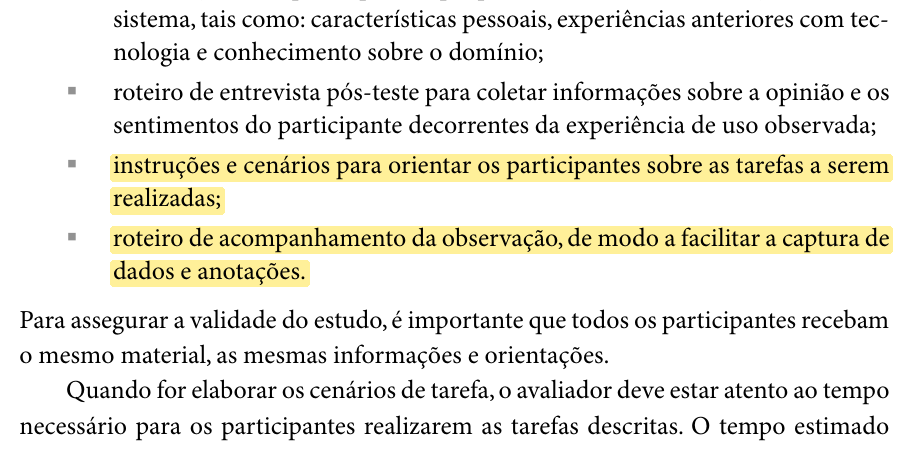{ loading=lazy }

    
Fonte: Barbosa e Silva (2010), p. 306. O grifo indica o trecho usado no critério.

    **Aplicação:** [Grupo 05](grupo-05/etapa-6.md#etapa-6-e6-09) · [Grupo 06](grupo-06/etapa-6.md#etapa-6-e6-09).

??? question "E6-10 · A logística identifica agenda, modalidade, duração, equipe, recursos e custos?"

    **Autor do item:** [Caio Breno de Souza Bezerra](https://github.com/CaioBezerra-Dev).

    **O que conferir.** Confira datas e horários previstos ou janela, local ou canal, duração estimada, funções, equipamentos e custo previsto. Custo zero pode ser declarado.

    **Rastreabilidade na V1.** [E6-C11](../verificacao/listas/etapa-6.md#e6-c11) · aceita janela e modalidade coerentes.

    { loading=lazy }

    
Fonte: Barbosa e Silva (2010), p. 313. O grifo indica o trecho usado no critério.

    **Aplicação:** [Grupo 05](grupo-05/etapa-6.md#etapa-6-e6-10) · [Grupo 06](grupo-06/etapa-6.md#etapa-6-e6-10).

??? question "E6-11 · O plano prevê piloto antes da avaliação principal, com registro e descarte dos dados?"

    **Autor do item:** [Caio Breno de Souza Bezerra](https://github.com/CaioBezerra-Dev).

    **O que conferir.** Confirme objetivo do ensaio, cronologia, pessoa distinta, registro de ajustes e separação dos dados. A execução é tratada no relato da Etapa 7.

    **Rastreabilidade na V1.** [E6-C12](../verificacao/listas/etapa-6.md#e6-c12) · restringe àquilo que o plano prevê.

    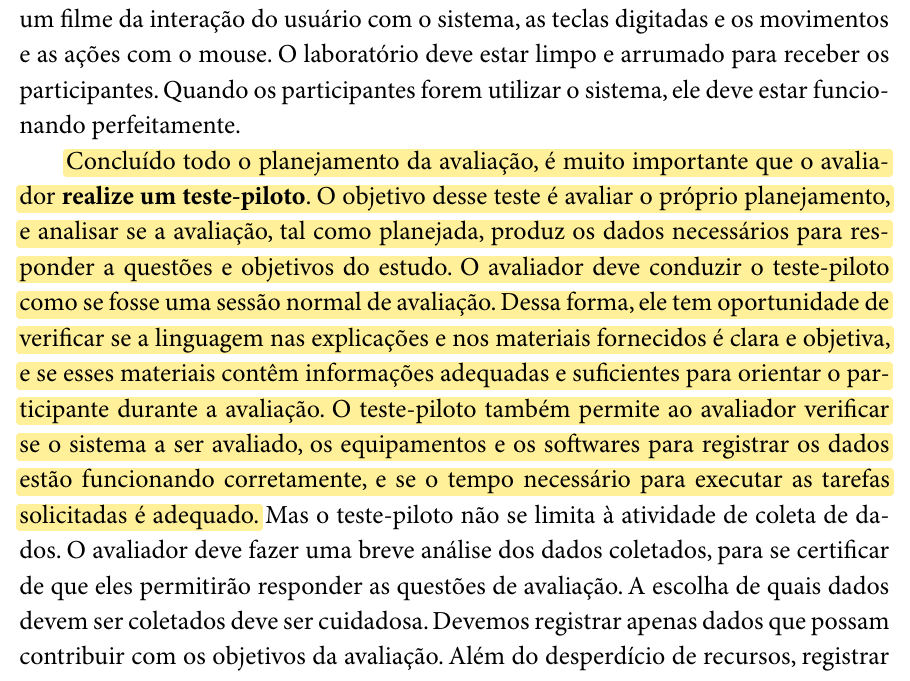{ loading=lazy }

    
Fonte: Barbosa e Silva (2010), p. 307. O grifo indica o trecho usado no critério.

    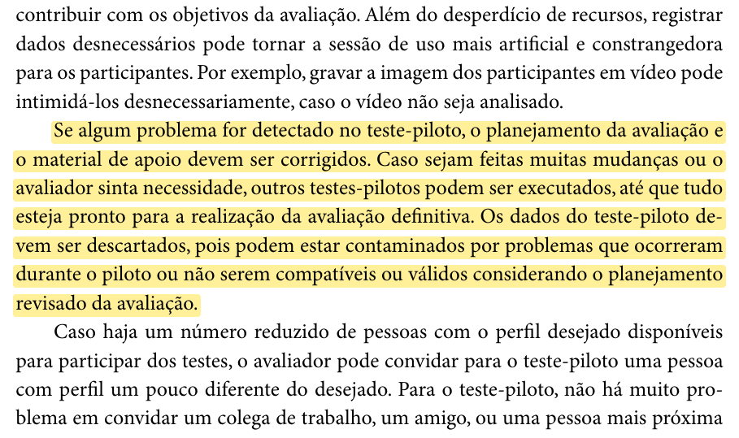{ loading=lazy }

    
Fonte: Barbosa e Silva (2010), p. 307. O grifo indica o trecho usado no critério.

    **Aplicação:** [Grupo 05](grupo-05/etapa-6.md#etapa-6-e6-11) · [Grupo 06](grupo-06/etapa-6.md#etapa-6-e6-11).

??? question "E6-12 · O planejamento prevê consentimento, privacidade e autorização para o uso das gravações?"

    **Autor do item:** [Caio Breno de Souza Bezerra](https://github.com/CaioBezerra-Dev).

    **O que conferir.** Confira participação voluntária, desistência, gravação e alcance da divulgação, tratamento de dados e possibilidade de consulta ao modelo do termo. Use o registro sem expor termos assinados.

    **Rastreabilidade na V1.** [E6-C13](../verificacao/listas/etapa-6.md#e6-c13) · explicita gravação e disponibilização.

    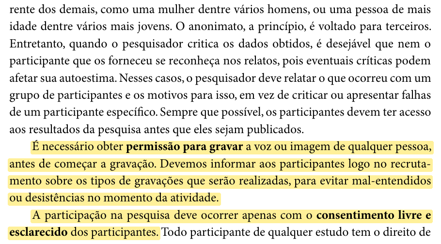{ loading=lazy }

    
Fonte: Barbosa e Silva (2010), p. 141. O grifo indica o trecho usado no critério.

    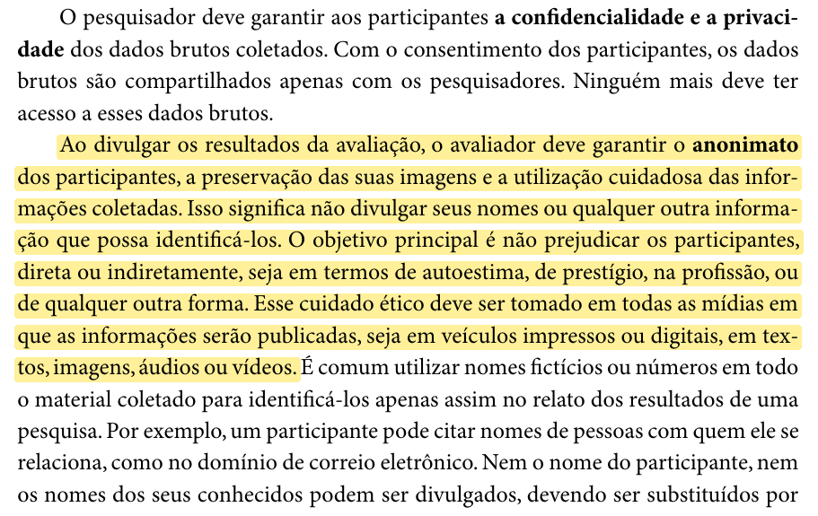{ loading=lazy }

    
Fonte: Barbosa e Silva (2010), p. 141. O grifo indica o trecho usado no critério.

    **Aplicação:** [Grupo 05](grupo-05/etapa-6.md#etapa-6-e6-12) · [Grupo 06](grupo-06/etapa-6.md#etapa-6-e6-12).

??? question "E6-13 · O plano liga medidas a metas e define como registrar desempenho e opinião?"

    **Autor do item:** [Caio Breno de Souza Bezerra](https://github.com/CaioBezerra-Dev).

    **O que conferir.** Confira a ficha ou roteiro por tarefa, com regra para êxito, ajuda, erros e ausência de dados, e vínculo entre as medidas e as metas/perguntas. Aceite opinião global quando o planejamento justificar esse nível.

    **Rastreabilidade na V1.** [E6-C14](../verificacao/listas/etapa-6.md#e6-c14) + [E6-C15](../verificacao/listas/etapa-6.md#e6-c15) · consolidados, com unidade da medida explícita.

    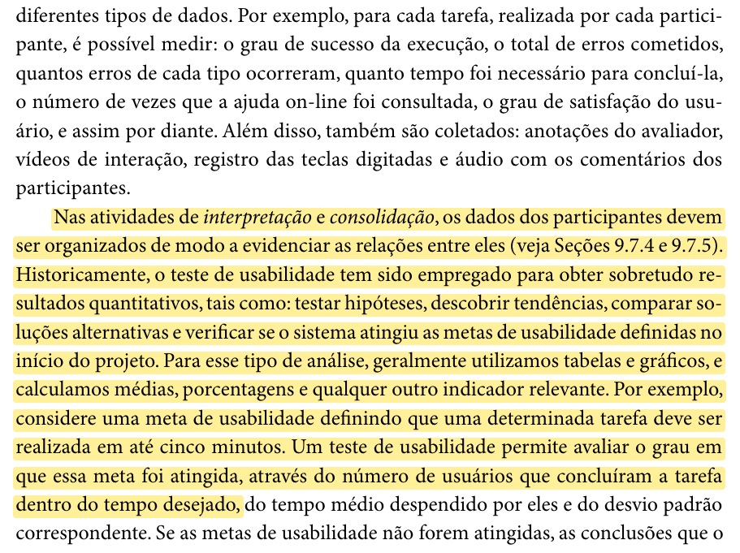{ loading=lazy }

    
Fonte: Barbosa e Silva (2010), p. 342. O grifo indica o trecho usado no critério.

    **Aplicação:** [Grupo 05](grupo-05/etapa-6.md#etapa-6-e6-13) · [Grupo 06](grupo-06/etapa-6.md#etapa-6-e6-13).

## Planejamento do relato de alta fidelidade

??? question "E6-14 · O plano do relato prevê objetivos, método, pessoas, tarefas, medições e problemas?"

    **Autor do item:** [Caio Breno de Souza Bezerra](https://github.com/CaioBezerra-Dev).

    **O que conferir.** Procure todos esses elementos no índice proposto, nos modelos ou no texto, sem exigir dados que ainda dependem da coleta.

    **Rastreabilidade na V1.** [E6-C16](../verificacao/listas/etapa-6.md#e6-c16) · distingue estrutura de execução.

    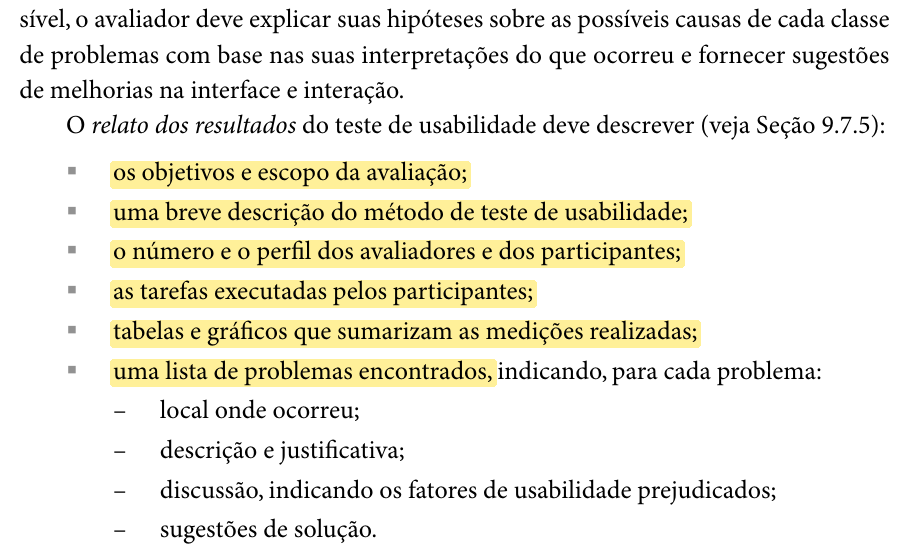{ loading=lazy }

    
Fonte: Barbosa e Silva (2010), p. 343. O grifo indica o trecho usado no critério.

    **Aplicação:** [Grupo 05](grupo-05/etapa-6.md#etapa-6-e6-14) · [Grupo 06](grupo-06/etapa-6.md#etapa-6-e6-14).

??? question "E6-15 · O plano do relato define interpretação por pergunta, limites e encaminhamento das correções?"

    **Autor do item:** [Caio Breno de Souza Bezerra](https://github.com/CaioBezerra-Dev).

    **O que conferir.** Procure critérios para interpretar o resultado, explicitar lacunas, priorizar propostas e acompanhar mudanças ou retestes. Limitações, resultados inconclusivos e próximos passos podem estar em seções distintas.

    **Rastreabilidade na V1.** [E6-C17](../verificacao/listas/etapa-6.md#e6-c17) + [E6-C18](../verificacao/listas/etapa-6.md#e6-c18) · consolidados no plano do relato.

    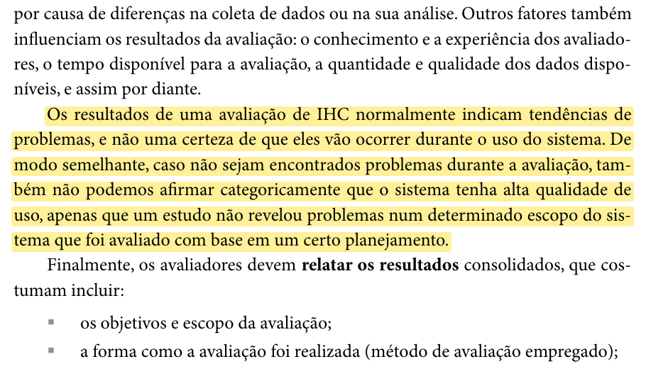{ loading=lazy }

    
Fonte: Barbosa e Silva (2010), p. 312. O grifo indica o trecho usado no critério.

    **Aplicação:** [Grupo 05](grupo-05/etapa-6.md#etapa-6-e6-15) · [Grupo 06](grupo-06/etapa-6.md#etapa-6-e6-15).

## Protótipos de papel e de alta fidelidade

??? question "E6-16 · As peças usadas no teste de papel são identificáveis e o plano descreve o protótipo digital pretendido?"

    **Autor do item:** [Caio Breno de Souza Bezerra](https://github.com/CaioBezerra-Dev).

    **O que conferir.** Localize fotos, PDF ou telas associados às tarefas e à sessão do papel e a identificação do protótipo digital nos planos. A versão digital efetivamente testada é conferida na Etapa 7.

    **Rastreabilidade na V1.** [E6-C19](../verificacao/listas/etapa-6.md#e6-c19) · separa material de planejamento da versão digital aplicada.

    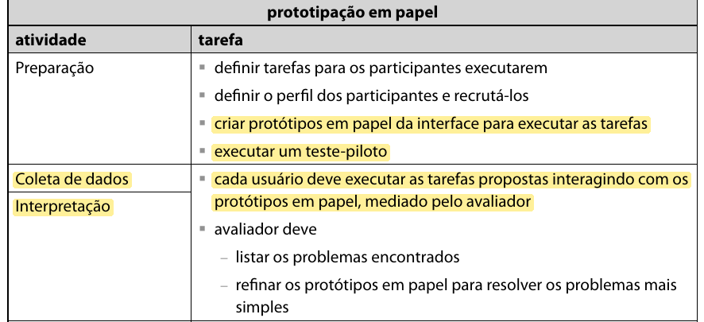{ loading=lazy }

    
Fonte: Barbosa e Silva (2010), p. 359. O grifo indica o trecho usado no critério.

    **Aplicação:** [Grupo 05](grupo-05/etapa-6.md#etapa-6-e6-16) · [Grupo 06](grupo-06/etapa-6.md#etapa-6-e6-16).

## Conferência da lista

O critério [E6-C20](../verificacao/listas/etapa-6.md#e6-c20) foi deslocado para o controle de qualidade desta lista. A presença de autor, referência e recorte grifado é verificada na própria ficha de critérios. Os resultados dos grupos se referem aos artefatos que a lista avalia.

## Histórico de versão

| Versão | Data | Descrição | Autor(es) | Revisor designado |
| :---: | :---: | --- | --- | --- |
| `2.0` | 19/11/2026 | Revisão dos critérios e registro de correspondência com a V1. | [Caio Breno de Souza Bezerra](https://github.com/CaioBezerra-Dev) | [Heitor Pinheiro Gonçalves das Chagas](https://github.com/Heitorovski01) |
| `2.1` | 19/11/2026 | Amplia o contexto dos recortes de referência e identifica a V1 nos vínculos. | [Caio Breno de Souza Bezerra](https://github.com/CaioBezerra-Dev) | [Heitor Pinheiro Gonçalves das Chagas](https://github.com/Heitorovski01) |

## Referências

1. SALES, André Barros de. *Plano de Ensino FIHC 022026 — Turma 01*. v1. Brasília: FCTE/UnB, 2026.

2. BARBOSA, Simone Diniz Junqueira; SILVA, Bruno Santana da. *Interação humano-computador*. Rio de Janeiro: Elsevier, 2010.
