Responsável: Caio Breno de Souza Bezerra · Grupo 06

# Lista de verificação da Etapa 7 · V2

## Tabela de contribuição

| Integrante | Contribuição | Artefato / atividade |
| --- | --- | --- |
| [Caio Breno de Souza Bezerra](https://github.com/CaioBezerra-Dev) | Revisão dos 11 critérios de desenvolvimento e indicação de como comprovar cada requisito nos artefatos publicados | [Desenvolvimento do projeto](#desenvolvimento-do-projeto) |
| [Caio Breno de Souza Bezerra](https://github.com/CaioBezerra-Dev) | Formulação dos 15 critérios sobre os relatos de alta fidelidade, da execução das sessões à documentação dos resultados e do reprojeto | [Conteúdo da disciplina](#conteudo-da-disciplina) |
| [Caio Breno de Souza Bezerra](https://github.com/CaioBezerra-Dev) | Registro das correspondências com a V1 e definição das evidências que sustentam cada resposta | [Como aplicar](#como-aplicar) · [Conferência da lista](#conferencia-da-lista) |
| Codex (OpenAI) | Apoio à consulta das referências, à edição dos enunciados e ao preparo dos recortes grifados | [Agradecimentos](index.md#agradecimentos) |

Tabela 1 — Contribuição neste artefato.

Fonte: elaboração para o Grupo 06 (2026).

[Etapa 8](index.md) · [Resultados e gráficos](resultados/etapa-7.md) · [Lista V1 da Etapa 7](../verificacao/listas/etapa-7.md)

## Como aplicar

Use a mesma redação na autoinspeção do Grupo 06 e na inspeção externa do Grupo 07 (+1). A resposta resume a cobertura dos artefatos daquela etapa. Cada item traz a evidência esperada, o vínculo com a V1 e um recorte da fonte com o trecho relevante grifado e o texto ao redor.

- **Sim** quando a evidência atende à pergunta em todo o recorte aplicável.
- **Incompleto** quando existe evidência parcial, contraditória ou sem cobertura de todos os artefatos do recorte.
- **Não** quando o requisito é aplicável e a evidência essencial está ausente nos locais consultados ou contraria a afirmação.

Na ficha, registre grupo, etapa, ID, versão, data, fonte e trecho que sustenta o julgamento. Para uma lacuna, indique onde procurou. Se algum item estiver fora de escopo, documente o motivo antes de calcular as contagens. [Método e escopo](index.md#metodo-de-inspecao).

## Desenvolvimento do projeto

??? question "D01 · O histórico identifica a versão, a data e a mudança de cada artefato?"

    **Autor do item:** [Caio Breno de Souza Bezerra](https://github.com/CaioBezerra-Dev).

    **O que conferir.** Abra o histórico em cada documento principal. Confira se as entradas permitem distinguir a versão corrente e o que mudou.

    **Rastreabilidade na V1.** [D01](../verificacao/listas/etapa-7.md#d01) · mantido com campos explícitos.

    { loading=lazy }

    
Fonte: Sales (2026), p. 8 do PDF. O grifo indica o trecho usado no critério.

    **Aplicação:** [Grupo 06](grupo-06/etapa-7.md#etapa-7-d01) · [Grupo 07](grupo-07/etapa-7.md#etapa-7-d01).

??? question "D02 · A versão consultada identifica quem escreveu e quem revisou o artefato?"

    **Autor do item:** [Caio Breno de Souza Bezerra](https://github.com/CaioBezerra-Dev).

    **O que conferir.** Leia a entrada da versão corrente. O revisor deve ser distinto do autor e a entrada deve registrar revisão ou atribuí-la àquela versão. Campo vazio, autor repetido ou revisão a definir indicam lacuna.

    **Rastreabilidade na V1.** [D02](../verificacao/listas/etapa-7.md#d02) · refinado para a versão examinada.

    { loading=lazy }

    
Fonte: Sales (2026), p. 8 do PDF. O grifo indica o trecho usado no critério.

    **Aplicação:** [Grupo 06](grupo-06/etapa-7.md#etapa-7-d02) · [Grupo 07](grupo-07/etapa-7.md#etapa-7-d02).

??? question "D03 · Os artefatos principais apresentam referências bibliográficas?"

    **Autor do item:** [Caio Breno de Souza Bezerra](https://github.com/CaioBezerra-Dev).

    **O que conferir.** Confira referências que fundamentam método, planejamento ou resultados nos documentos do inventário. Páginas de índice entram na conferência antiga quando foram citadas nela.

    **Rastreabilidade na V1.** [D03](../verificacao/listas/etapa-7.md#d03) · delimita os documentos principais.

    { loading=lazy }

    
Fonte: Sales (2026), p. 8 do PDF. O grifo indica o trecho usado no critério.

    **Aplicação:** [Grupo 06](grupo-06/etapa-7.md#etapa-7-d03) · [Grupo 07](grupo-07/etapa-7.md#etapa-7-d03).

??? question "D04 · Figuras e tabelas têm identificação, fonte e chamada no texto?"

    **Autor do item:** [Caio Breno de Souza Bezerra](https://github.com/CaioBezerra-Dev).

    **O que conferir.** Confira as figuras e tabelas de conteúdo. Procure numeração e legenda, origem e uma chamada que aponte para o elemento. Registre quais elementos têm lacunas.

    **Rastreabilidade na V1.** [D04](../verificacao/listas/etapa-7.md#d04) · mantido com escopo de conteúdo.

    { loading=lazy }

    
Fonte: Sales (2026), p. 8 do PDF. O grifo indica o trecho usado no critério.

    **Aplicação:** [Grupo 06](grupo-06/etapa-7.md#etapa-7-d04) · [Grupo 07](grupo-07/etapa-7.md#etapa-7-d04).

??? question "D05 · Os artefatos apresentam objetivo e escopo antes de detalhar o conteúdo?"

    **Autor do item:** [Caio Breno de Souza Bezerra](https://github.com/CaioBezerra-Dev).

    **O que conferir.** Localize o trecho de abertura que informa a finalidade e a funcionalidade. Um título de seção diferente de ‘Introdução’ é aceito.

    **Rastreabilidade na V1.** [D05](../verificacao/listas/etapa-7.md#d05) · aceita aberturas equivalentes.

    { loading=lazy }

    
Fonte: Sales (2026), p. 8 do PDF. O grifo indica o trecho usado no critério.

    **Aplicação:** [Grupo 06](grupo-06/etapa-7.md#etapa-7-d05) · [Grupo 07](grupo-07/etapa-7.md#etapa-7-d05).

??? question "D06 · O cronograma executado identifica responsáveis e datas reais para os artefatos e atividades da etapa?"

    **Autor do item:** [Caio Breno de Souza Bezerra](https://github.com/CaioBezerra-Dev).

    **O que conferir.** Abra as entradas de execução e procure datas reais de início e fim, ação e pessoas. Use registros complementares de execução para localizar lacunas. Uma agenda prevista continua sendo planejamento.

    **Rastreabilidade na V1.** [D06](../verificacao/listas/etapa-7.md#d06) · explicita o que conta como execução.

    { loading=lazy }

    
Fonte: Sales (2026), p. 8 do PDF. O grifo indica o trecho usado no critério.

    **Aplicação:** [Grupo 06](grupo-06/etapa-7.md#etapa-7-d06) · [Grupo 07](grupo-07/etapa-7.md#etapa-7-d06).

??? question "D07 · A etapa tem ata de reunião com data, início e fim, participantes, pauta e decisões?"

    **Autor do item:** [Caio Breno de Souza Bezerra](https://github.com/CaioBezerra-Dev).

    **O que conferir.** Procure as atas da etapa e compare os campos publicados. Duração do vídeo sem indicação do encerramento da reunião deixa o horário em aberto.

    **Rastreabilidade na V1.** [D07](../verificacao/listas/etapa-7.md#d07) · explicita os campos da ata.

    { loading=lazy }

    
Fonte: Sales (2026), p. 9 do PDF. O grifo indica o trecho usado no critério.

    **Aplicação:** [Grupo 06](grupo-06/etapa-7.md#etapa-7-d07) · [Grupo 07](grupo-07/etapa-7.md#etapa-7-d07).

??? question "D08 · As gravações das reuniões de verificação da etapa estão localizáveis no site?"

    **Autor do item:** [Caio Breno de Souza Bezerra](https://github.com/CaioBezerra-Dev).

    **O que conferir.** Confira a associação entre reunião, etapa e endereço da gravação. Registre o acesso documentado. Consentimento de participantes das sessões é verificado no conteúdo da Etapa 7.

    **Rastreabilidade na V1.** [D08](../verificacao/listas/etapa-7.md#d08) · delimita gravação de reunião e retira presunção de autorização.

    { loading=lazy }

    
Fonte: Sales (2026), p. 9 do PDF. O grifo indica o trecho usado no critério.

    **Aplicação:** [Grupo 06](grupo-06/etapa-7.md#etapa-7-d08) · [Grupo 07](grupo-07/etapa-7.md#etapa-7-d08).

??? question "D09 · A apresentação da etapa tem vídeo publicado como não listado e identificado no site?"

    **Autor do item:** [Caio Breno de Souza Bezerra](https://github.com/CaioBezerra-Dev).

    **O que conferir.** Confira o vídeo previsto para o grupo ou para cada integrante, conforme a organização adotada, e a categoria declarada na página. O link aponta a gravação e a página registra a visibilidade.

    **Rastreabilidade na V1.** [D09](../verificacao/listas/etapa-7.md#d09) · explicita a categoria do plano de ensino.

    { loading=lazy }

    
Fonte: Sales (2026), p. 9 do PDF. O grifo indica o trecho usado no critério.

    **Aplicação:** [Grupo 06](grupo-06/etapa-7.md#etapa-7-d09) · [Grupo 07](grupo-07/etapa-7.md#etapa-7-d09).

??? question "D10 · A contribuição de cada pessoa está identificada no início dos artefatos, com links para as atividades?"

    **Autor do item:** [Caio Breno de Souza Bezerra](https://github.com/CaioBezerra-Dev).

    **O que conferir.** Aceite tabela de contribuição própria ou incorporada ao histórico. Confira pessoa, atividade atribuída e hiperligação para a atividade ou para a gravação quando houver.

    **Rastreabilidade na V1.** [D10](../verificacao/listas/etapa-7.md#d10) · aceita tabela equivalente com os mesmos campos.

    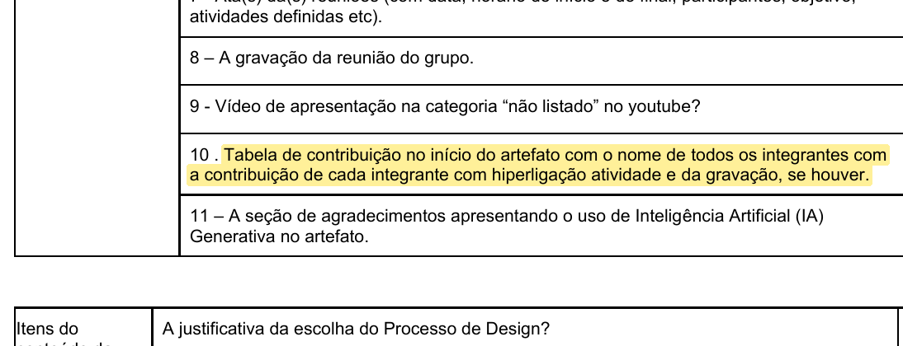{ loading=lazy }

    
Fonte: Sales (2026), p. 9 do PDF. O grifo indica o trecho usado no critério.

    **Aplicação:** [Grupo 06](grupo-06/etapa-7.md#etapa-7-d10) · [Grupo 07](grupo-07/etapa-7.md#etapa-7-d10).

??? question "D11 · O artefato declara a ferramenta de IA generativa usada e a finalidade do apoio?"

    **Autor do item:** [Caio Breno de Souza Bezerra](https://github.com/CaioBezerra-Dev).

    **O que conferir.** Use a seção de agradecimentos ou declaração, ou um registro de uso identificável no próprio artefato. Quando houver indicação de uso, confira o nome da ferramenta e as atividades. Se a evidência for só genérica, marque Incompleto.

    **Rastreabilidade na V1.** [D11](../verificacao/listas/etapa-7.md#d11) · prioriza a declaração explícita, aceita local equivalente.

    { loading=lazy }

    
Fonte: Sales (2026), p. 3 do PDF. O grifo indica o trecho usado no critério.

    **Aplicação:** [Grupo 06](grupo-06/etapa-7.md#etapa-7-d11) · [Grupo 07](grupo-07/etapa-7.md#etapa-7-d11).

## Conteúdo da disciplina

??? question "E7-01 · O relato executado está disponível para cada integrante ou funcionalidade atribuída?"

    **Autor do item:** [Caio Breno de Souza Bezerra](https://github.com/CaioBezerra-Dev).

    **O que conferir.** Abra os relatos no índice ou menu e confirme que têm resultados das sessões, não apenas roteiro ou espaço a preencher.

    **Rastreabilidade na V1.** [E7-C01](../verificacao/listas/etapa-7.md#e7-c01) · disponibilidade examinada separadamente da versão do protótipo.

    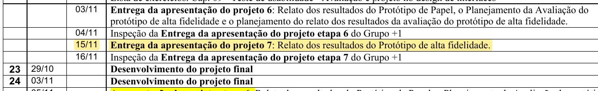{ loading=lazy }

    
Fonte: Sales (2026), p. 5 do PDF. O grifo indica o trecho usado no critério.

    **Aplicação:** [Grupo 06](grupo-06/etapa-7.md#etapa-7-e7-01) · [Grupo 07](grupo-07/etapa-7.md#etapa-7-e7-01).

??? question "E7-02 · O relato delimita objetivos e escopo da avaliação?"

    **Autor do item:** [Caio Breno de Souza Bezerra](https://github.com/CaioBezerra-Dev).

    **O que conferir.** Localize o objetivo avaliado, o fluxo e o que foi coberto; cruze com o plano quando o texto remeter a ele.

    **Rastreabilidade na V1.** [E7-C02](../verificacao/listas/etapa-7.md#e7-c02) · mantido.

    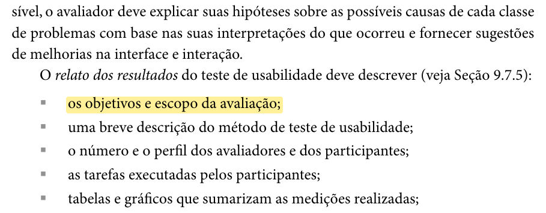{ loading=lazy }

    
Fonte: Barbosa e Silva (2010), p. 343. O grifo indica o trecho usado no critério.

    **Aplicação:** [Grupo 06](grupo-06/etapa-7.md#etapa-7-e7-02) · [Grupo 07](grupo-07/etapa-7.md#etapa-7-e7-02).

??? question "E7-03 · O relato descreve como o teste de usabilidade foi executado?"

    **Autor do item:** [Caio Breno de Souza Bezerra](https://github.com/CaioBezerra-Dev).

    **O que conferir.** Confira modalidade, uso do protótipo pelo participante, papéis e forma de registro de desempenho e opinião. Aceite um protocolo ajustado quando a execução é documentada.

    **Rastreabilidade na V1.** [E7-C03](../verificacao/listas/etapa-7.md#e7-c03) · reforça a distinção entre previsto e executado.

    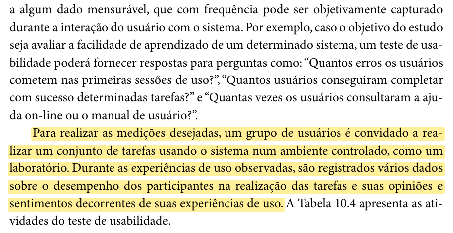{ loading=lazy }

    
Fonte: Barbosa e Silva (2010), p. 341. O grifo indica o trecho usado no critério.

    **Aplicação:** [Grupo 06](grupo-06/etapa-7.md#etapa-7-e7-03) · [Grupo 07](grupo-07/etapa-7.md#etapa-7-e7-03).

??? question "E7-04 · O relato informa quantidade, perfil pertinente e função de quem avaliou ou participou?"

    **Autor do item:** [Caio Breno de Souza Bezerra](https://github.com/CaioBezerra-Dev).

    **O que conferir.** Confira total de sessões, códigos, características relevantes dos participantes e papéis da equipe. Perfil planejado ou código isolado deixa lacuna na caracterização.

    **Rastreabilidade na V1.** [E7-C04](../verificacao/listas/etapa-7.md#e7-c04) · requer perfil efetivo.

    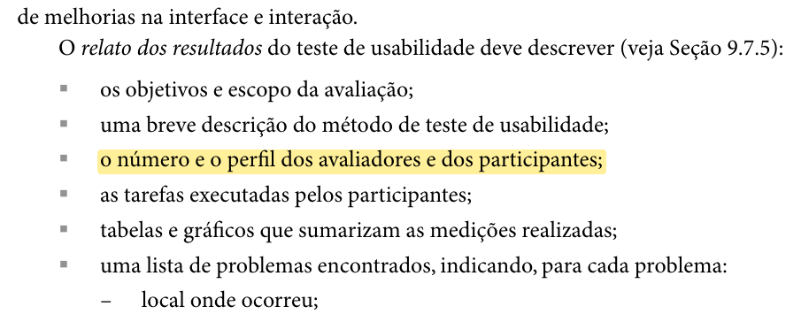{ loading=lazy }

    
Fonte: Barbosa e Silva (2010), p. 343. O grifo indica o trecho usado no critério.

    **Aplicação:** [Grupo 06](grupo-06/etapa-7.md#etapa-7-e7-04) · [Grupo 07](grupo-07/etapa-7.md#etapa-7-e7-04).

??? question "E7-05 · Os resultados identificam tarefas e desfechos por pessoa?"

    **Autor do item:** [Caio Breno de Souza Bezerra](https://github.com/CaioBezerra-Dev).

    **O que conferir.** Procure pessoa × tarefa, conclusão, ajuda e dificuldades quando ocorrerem, e indicação explícita do que ficou sem executar quando o roteiro não foi aplicado.

    **Rastreabilidade na V1.** [E7-C05](../verificacao/listas/etapa-7.md#e7-c05) · acrescenta o tratamento de tarefa não executada.

    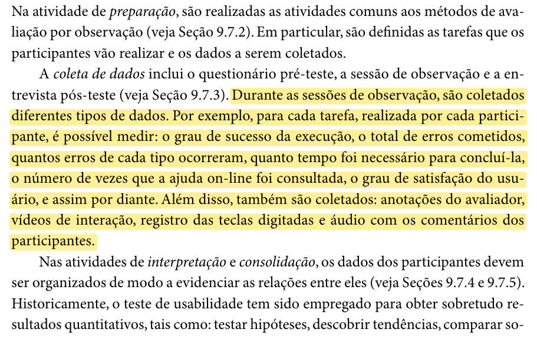{ loading=lazy }

    
Fonte: Barbosa e Silva (2010), p. 342. O grifo indica o trecho usado no critério.

    **Aplicação:** [Grupo 06](grupo-06/etapa-7.md#etapa-7-e7-05) · [Grupo 07](grupo-07/etapa-7.md#etapa-7-e7-05).

??? question "E7-06 · Desempenho e opinião têm evidência individual localizável?"

    **Autor do item:** [Caio Breno de Souza Bezerra](https://github.com/CaioBezerra-Dev).

    **O que conferir.** Cruze o achado com tarefa e pessoa, minuto/intervalo de um vídeo identificado ou trecho de ficha/transcrição. A presença do vídeo da sessão sem localizador não basta.

    **Rastreabilidade na V1.** [E7-C06](../verificacao/listas/etapa-7.md#e7-c06) · aceita ficha ou transcrição localizável.

    { loading=lazy }

    
Fonte: Barbosa e Silva (2010), p. 342. O grifo indica o trecho usado no critério.

    **Aplicação:** [Grupo 06](grupo-06/etapa-7.md#etapa-7-e7-06) · [Grupo 07](grupo-07/etapa-7.md#etapa-7-e7-06).

??? question "E7-07 · O resumo das medições explicita denominadores e distingue ausência de dado de zero observado?"

    **Autor do item:** [Caio Breno de Souza Bezerra](https://github.com/CaioBezerra-Dev).

    **O que conferir.** Confira contas e unidades, inclusive o número de pessoas por tarefa; uma pessoa com dois ângulos continua sendo uma observação. Se a medida não foi coletada, procure essa indicação.

    **Rastreabilidade na V1.** [E7-C07](../verificacao/listas/etapa-7.md#e7-c07) · inclui conferência da base e das contas.

    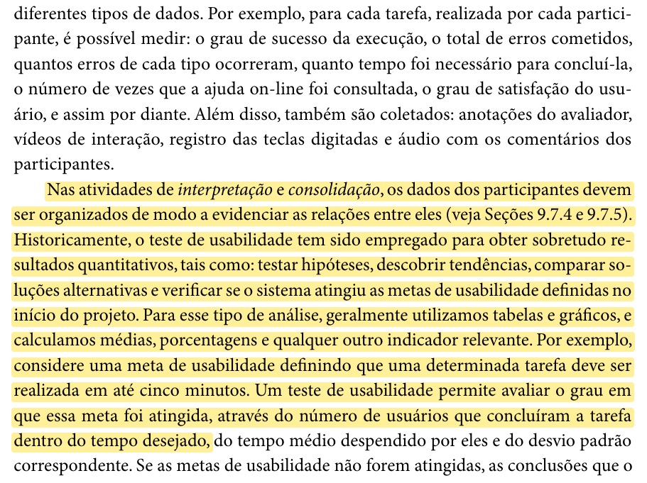{ loading=lazy }

    
Fonte: Barbosa e Silva (2010), p. 342. O grifo indica o trecho usado no critério.

    **Aplicação:** [Grupo 06](grupo-06/etapa-7.md#etapa-7-e7-07) · [Grupo 07](grupo-07/etapa-7.md#etapa-7-e7-07).

??? question "E7-08 · Os problemas encontrados têm local, evidência, consequência de uso e sugestão?"

    **Autor do item:** [Caio Breno de Souza Bezerra](https://github.com/CaioBezerra-Dev).

    **O que conferir.** Confira identificador, local, descrição, observação que sustenta a constatação, fator/impacto de usabilidade e proposta. Aceite declaração de nenhum problema observado com escopo explícito.

    **Rastreabilidade na V1.** [E7-C08](../verificacao/listas/etapa-7.md#e7-c08) · diferencia a observação da hipótese.

    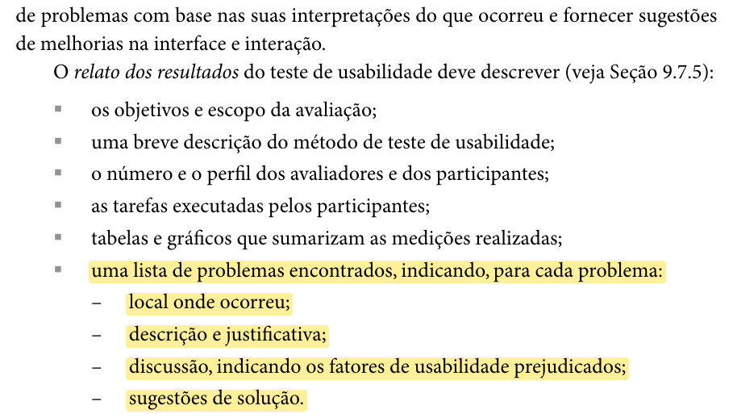{ loading=lazy }

    
Fonte: Barbosa e Silva (2010), p. 343. O grifo indica o trecho usado no critério.

    **Aplicação:** [Grupo 06](grupo-06/etapa-7.md#etapa-7-e7-08) · [Grupo 07](grupo-07/etapa-7.md#etapa-7-e7-08).

??? question "E7-09 · O relato distingue proposta, mudança aplicada e resultado de reteste?"

    **Autor do item:** [Caio Breno de Souza Bezerra](https://github.com/CaioBezerra-Dev).

    **O que conferir.** Siga os problemas ou decisões do papel e confira se passaram à versão digital, se foram apenas propostos ou se houve nova observação. Aceite declaração de correção pendente ou falta de reteste.

    **Rastreabilidade na V1.** [E7-C09](../verificacao/listas/etapa-7.md#e7-c09) · acrescenta continuidade com o papel.

    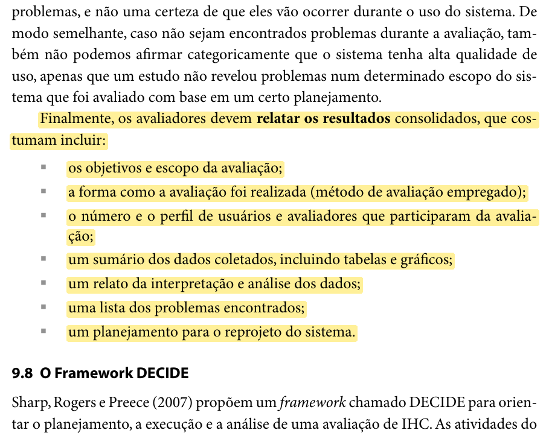{ loading=lazy }

    
Fonte: Barbosa e Silva (2010), p. 312. O grifo indica o trecho usado no critério.

    **Aplicação:** [Grupo 06](grupo-06/etapa-7.md#etapa-7-e7-09) · [Grupo 07](grupo-07/etapa-7.md#etapa-7-e7-09).

??? question "E7-10 · O relato informa o que ocorreu com o piloto e mantém seus dados fora da análise principal?"

    **Autor do item:** [Caio Breno de Souza Bezerra](https://github.com/CaioBezerra-Dev).

    **O que conferir.** Procure o registro separado do ensaio e da amostra principal. A declaração explícita de piloto ausente atende à transparência deste item e entra como limitação quando pertinente.

    **Rastreabilidade na V1.** [E7-C10](../verificacao/listas/etapa-7.md#e7-c10) · trata o cenário sem piloto.

    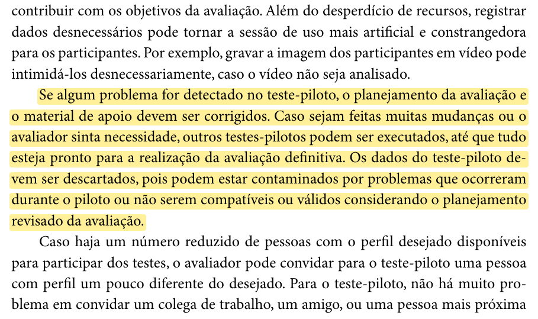{ loading=lazy }

    
Fonte: Barbosa e Silva (2010), p. 307. O grifo indica o trecho usado no critério.

    **Aplicação:** [Grupo 06](grupo-06/etapa-7.md#etapa-7-e7-10) · [Grupo 07](grupo-07/etapa-7.md#etapa-7-e7-10).

??? question "E7-11 · O relato registra o consentimento obtido para participação, gravação e disponibilização?"

    **Autor do item:** [Caio Breno de Souza Bezerra](https://github.com/CaioBezerra-Dev).

    **O que conferir.** Confira a declaração de autorização relacionada às sessões e ao uso dos registros. A publicação de termo assinado é dispensável. Modelo e link do vídeo, isolados, deixam dúvidas sobre a autorização.

    **Rastreabilidade na V1.** [E7-C11](../verificacao/listas/etapa-7.md#e7-c11) · define a evidência pública suficiente.

    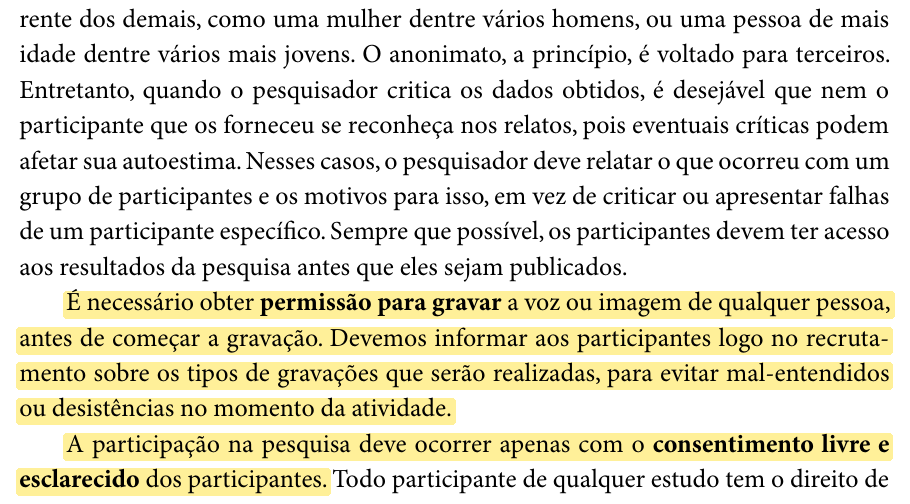{ loading=lazy }

    
Fonte: Barbosa e Silva (2010), p. 141. O grifo indica o trecho usado no critério.

    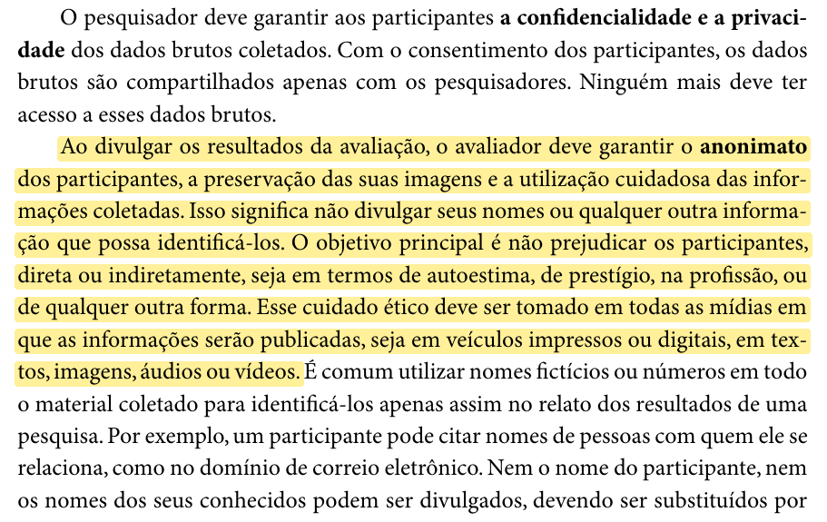{ loading=lazy }

    
Fonte: Barbosa e Silva (2010), p. 141. O grifo indica o trecho usado no critério.

    **Aplicação:** [Grupo 06](grupo-06/etapa-7.md#etapa-7-e7-11) · [Grupo 07](grupo-07/etapa-7.md#etapa-7-e7-11).

??? question "E7-12 · É possível identificar e abrir o protótipo na versão usada no teste?"

    **Autor do item:** [Caio Breno de Souza Bezerra](https://github.com/CaioBezerra-Dev).

    **O que conferir.** Abra o acesso informado e procure versão, revisão do Figma ou commit que permita reconhecer o material da sessão. Link atual sem identificação do recorte testado oferece evidência parcial.

    **Rastreabilidade na V1.** [E7-C12](../verificacao/listas/etapa-7.md#e7-c12) · explicita o vínculo da versão à sessão.

    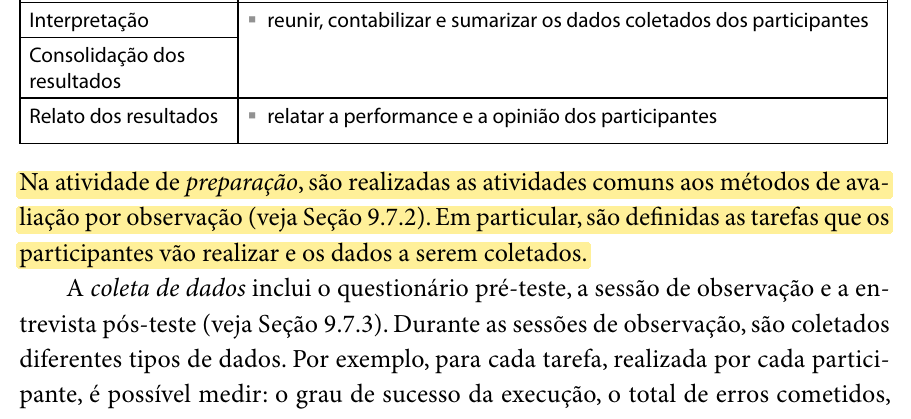{ loading=lazy }

    
Fonte: Barbosa e Silva (2010), p. 342. O grifo indica o trecho usado no critério.

    **Aplicação:** [Grupo 06](grupo-06/etapa-7.md#etapa-7-e7-12) · [Grupo 07](grupo-07/etapa-7.md#etapa-7-e7-12).

??? question "E7-13 · As conclusões delimitam o alcance da amostra, dos materiais e do procedimento?"

    **Autor do item:** [Caio Breno de Souza Bezerra](https://github.com/CaioBezerra-Dev).

    **O que conferir.** Confira o que os dados sustentam, limitações de amostra, simulação e condução, e os pontos que ficaram sem medida ou precisam de nova avaliação.

    **Rastreabilidade na V1.** [E7-C13](../verificacao/listas/etapa-7.md#e7-c13) · mantido com verificação de alcance.

    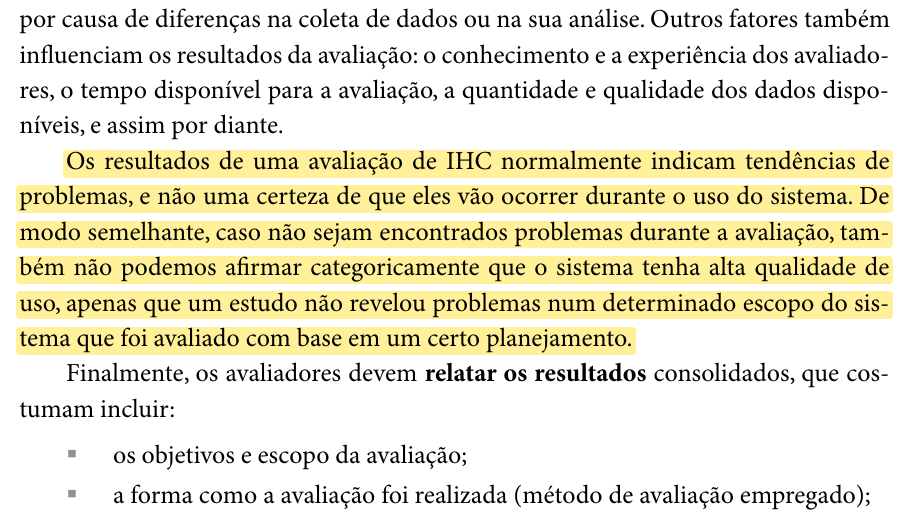{ loading=lazy }

    
Fonte: Barbosa e Silva (2010), p. 312. O grifo indica o trecho usado no critério.

    **Aplicação:** [Grupo 06](grupo-06/etapa-7.md#etapa-7-e7-13) · [Grupo 07](grupo-07/etapa-7.md#etapa-7-e7-13).

??? question "E7-14 · As gravações das sessões estão identificadas e vinculadas ao relato?"

    **Autor do item:** [Caio Breno de Souza Bezerra](https://github.com/CaioBezerra-Dev).

    **O que conferir.** Confira o acesso documentado por sessão e a indicação de privacidade ou de acesso restrito. Use o registro de avaliação; apresentação e reunião de verificação têm finalidade própria.

    **Rastreabilidade na V1.** [E7-C14](../verificacao/listas/etapa-7.md#e7-c14) · regra documental, contempla acesso restrito.

    { loading=lazy }

    
Fonte: Barbosa e Silva (2010), p. 141. O grifo indica o trecho usado no critério.

    { loading=lazy }

    
Fonte: Barbosa e Silva (2010), p. 342. O grifo indica o trecho usado no critério.

    **Aplicação:** [Grupo 06](grupo-06/etapa-7.md#etapa-7-e7-14) · [Grupo 07](grupo-07/etapa-7.md#etapa-7-e7-14).

??? question "E7-15 · O relato responde às perguntas do plano e explicita desvios relevantes da execução?"

    **Autor do item:** [Caio Breno de Souza Bezerra](https://github.com/CaioBezerra-Dev).

    **O que conferir.** Cruze perguntas com os resultados e identifique perguntas sem resposta ou parcialmente respondidas. Confira mudanças de tarefas, amostra, modalidade ou medições e o efeito na interpretação; registre equivalência quando houver.

    **Rastreabilidade na V1.** Novo · torna verificável a relação planejamento–execução.

    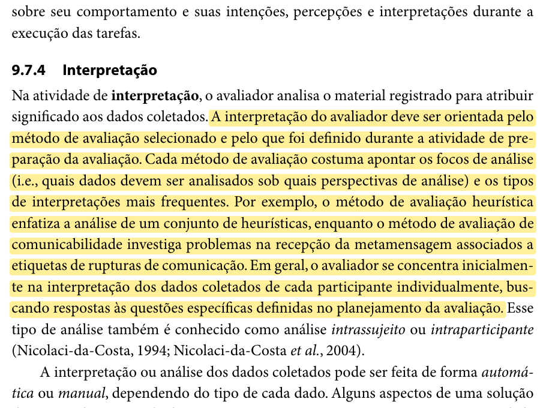{ loading=lazy }

    
Fonte: Barbosa e Silva (2010), p. 310. O grifo indica o trecho usado no critério.

    { loading=lazy }

    
Fonte: Barbosa e Silva (2010), p. 312. O grifo indica o trecho usado no critério.

    **Aplicação:** [Grupo 06](grupo-06/etapa-7.md#etapa-7-e7-15) · [Grupo 07](grupo-07/etapa-7.md#etapa-7-e7-15).

## Conferência da lista

O critério [E7-C15](../verificacao/listas/etapa-7.md#e7-c15) foi deslocado para o controle de qualidade desta lista. A presença de autor, referência e recorte grifado é verificada na própria ficha de critérios. Os resultados dos grupos se referem aos artefatos que a lista avalia.

## Histórico de versão

| Versão | Data | Descrição | Autor(es) | Revisor designado |
| :---: | :---: | --- | --- | --- |
| `2.0` | 19/11/2026 | Revisão dos critérios e registro de correspondência com a V1. | [Caio Breno de Souza Bezerra](https://github.com/CaioBezerra-Dev) | [Luís Henrique Arruda Luna](https://github.com/Donnk61) |
| `2.1` | 19/11/2026 | Amplia o contexto dos recortes de referência e identifica a V1 nos vínculos. | [Caio Breno de Souza Bezerra](https://github.com/CaioBezerra-Dev) | [Luís Henrique Arruda Luna](https://github.com/Donnk61) |

## Referências

1. SALES, André Barros de. *Plano de Ensino FIHC 022026 — Turma 01*. v1. Brasília: FCTE/UnB, 2026.

2. BARBOSA, Simone Diniz Junqueira; SILVA, Bruno Santana da. *Interação humano-computador*. Rio de Janeiro: Elsevier, 2010.
