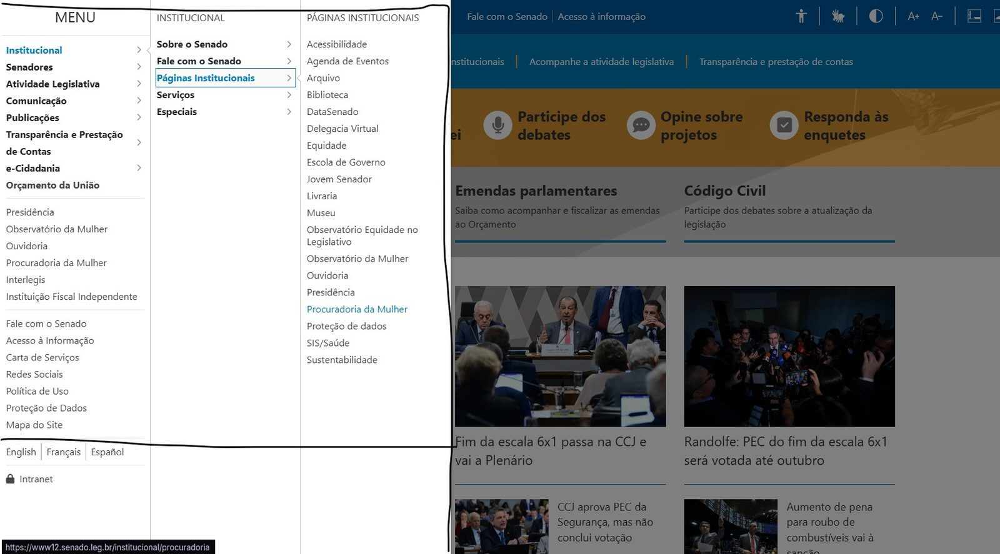

Responsável pelo preenchimento: Caio Breno de Souza Bezerra · Grupo 06

# Item 1 · Site escolhido

## Tabela de contribuição

A Tabela 1 registra o trabalho neste artefato.

| Integrante | Contribuição | Artefato / atividade |
| --- | --- | --- |
| [Caio Breno de Souza Bezerra](https://github.com/CaioBezerra-Dev) | Redige a justificativa, o objetivo e os recortes trabalhados | [Conteúdo](#justificativa-da-escolha) |
| Codex (OpenAI) | Apoio à redação, à organização da página e à conferência das fontes | [Agradecimentos](#agradecimentos) |

Tabela 1 — Contribuição neste artefato.

Fonte: elaboração do Grupo 06 (2026).

## Introdução

O [Portal do Senado Federal](https://www12.senado.leg.br/) foi o site escolhido para o projeto. O portal oferece acesso a informações legislativas e a serviços que permitem propor ideias, acompanhar contribuições, participar de audiências, agendar visitas e solicitar vagas em plenárias.

## Justificativa da escolha

### Comparação dos candidatos

O grupo comparou quatro portais pelo público atendido, pela viabilidade de recrutar participantes em Brasília, pelo tipo de interação oferecida e pela margem de reprojeto ao longo da disciplina. A primeira escolha foi o Portal da Transparência do DF, voltado à consulta de painéis e tabelas. A inspeção desse portal apontou sobretudo problemas de conformidade de acessibilidade. O LexML concentrava a interação em buscas de documentos e atendia principalmente ao público jurídico. O portal de Unaí reunia consultas e serviços municipais, com um público mais difícil de recrutar em Brasília. A decisão pelo Senado foi registrada em 9 de setembro, após a apresentação da Etapa 1. [Comparação dos quatro portais](../entrega-1/sites-avaliados.md#sintese-da-comparacao) · [Ata da decisão](../atas/ata-02.md#decisoes)

O Senado reuniu **um público amplo, recrutamento viável e serviços em que a pessoa precisa agir e entender o resultado da própria ação**. Uma pessoa pode procurar uma informação, propor uma ideia, acompanhar o que aconteceu com ela ou pedir uma vaga. Essa variedade permite observar dificuldades diferentes ao longo de um percurso, desde encontrar a entrada do serviço até interpretar uma confirmação ou saber qual é o próximo passo. [Escopo e motivação na Etapa 1](../entrega-1/site-escolhido.md#motivacao)

### O que a inspeção preliminar mostrou

A avaliação heurística de Israel registrou três problemas que ajudaram a delimitar o recorte. O menu *Institucional* expunha mais de 30 links em cinco blocos, o que dificultava decidir por onde começar. A identidade visual e os caminhos de navegação mudavam entre subdomínios, o que podia dificultar a orientação ao passar de uma seção para outra. Siglas como CCJ, PEC e CMMPV apareciam em manchetes sem explicação, exigindo conhecimento prévio de quem queria entender o conteúdo. A Figura 1 mostra o menu na versão observada. [Ficha dos problemas e da severidade](../entrega-1/site-escolhido.md#problemas-que-o-grupo-leva-adiante)

??? note "Figura 1 — Menu Institucional na inspeção preliminar"

    <figure markdown="span">
      { loading=lazy }
      <figcaption>Figura 1 — Menu Institucional na inspeção preliminar da Etapa 1.</figcaption>
    </figure>
    
Fonte: captura de Israel Soares de Paiva na avaliação do Portal do Senado Federal (2026).

### Como a escolha orientou o projeto

Os achados orientaram perguntas de avaliação sobre **localizar o serviço, entender a ação e reconhecer seu resultado**. No recorte de ideias legislativas, por exemplo, o grupo investigou se a pessoa achava o caminho de envio, conseguia revisar o texto e distinguia “ideia recebida” de “ideia publicada”. Nos agendamentos e nas vagas, o término do percurso precisava ser reconhecível por uma confirmação com os dados do pedido. São situações que o grupo conseguiu representar em protótipos com dados fictícios, observar em sessões e relacionar às metas de eficácia, prevenção de erros e satisfação. [Metas de usabilidade](../entrega-3/metas-usabilidade.md#metas-que-o-projeto-deve-alcancar) · [Avaliação do fluxo de ideias](../entrega-7/individual/caio/relato-alta-fidelidade.md#tarefas-desempenho-e-opiniao)

## Objetivo e aspectos trabalhados

O objetivo foi **avaliar e propor melhorias de usabilidade para percursos de participação e acesso a serviços do Senado Federal**. A equipe trabalhou a visibilidade das entradas, a consistência de navegação, a clareza dos termos e dos estados do sistema e o feedback depois de enviar ou confirmar uma ação. Os recortes também consideraram legibilidade, contraste e o acesso a opções de apoio.

A Tabela 2 relaciona os percursos às propostas avaliadas.

| Percurso | Aspectos trabalhados | Avaliação |
| --- | --- | --- |
| Enviar e acompanhar uma ideia legislativa | Descoberta do serviço, conferência do texto, confirmação e interpretação dos estados | [Recorte de Caio](../entrega-7/individual/caio/relato-alta-fidelidade.md) |
| Sugerir e acompanhar um complemento de ideia | Localização da ação, autoria e distinção entre análise, publicação e encaminhamento | [Recorte de Bruno](../entrega-7/individual/bruno/relato-alta-fidelidade.md) |
| Participar de uma audiência pública interativa | Entrada na audiência, escolha do tipo de manifestação e leitura do protocolo | [Recorte de Heitor](../entrega-7/individual/heitor/relato-alta-fidelidade.md) |
| Agendar uma visita ao Senado | Regras da visita, leitura do calendário, apoio de acessibilidade e comprovante | [Recorte de Israel](../entrega-7/individual/israel/relato-alta-fidelidade.md) |
| Solicitar uma vaga em plenária | Disponibilidade, revisão dos dados e confirmação da vaga | [Recorte de Luís](../entrega-7/individual/luis/relato-alta-fidelidade.md) |

Tabela 2 — Percursos e aspectos trabalhados no projeto.

Fonte: escolha do site na Etapa 1 e relatos de avaliação da Etapa 7 (2026).

Os relatos da Etapa 7 registram o que as pessoas fizeram nas simulações e as limitações de cada avaliação. A [síntese de resultados](resultados.md) relaciona os achados ao objetivo do projeto.

## Agradecimentos

Codex (OpenAI) apoiou a redação, a formatação e a conferência das referências.

## Histórico de versão

A Tabela 3 registra as versões deste item.

| Versão | Data | Descrição | Autor(es) | Revisor(es) |
| :---: | :---: | --- | --- | --- |
| `1.0` | 26/11/2026 | Redige a justificativa, o objetivo e os recortes trabalhados | [Caio Breno de Souza Bezerra](https://github.com/CaioBezerra-Dev) | — |
| `1.1` | 26/11/2026 | Detalha a comparação dos portais e a relação entre os achados iniciais e as tarefas avaliadas | [Caio Breno de Souza Bezerra](https://github.com/CaioBezerra-Dev) | — |
| `1.2` | 26/11/2026 | Apresenta a captura do menu em um bloco recolhível com legenda e fonte | [Caio Breno de Souza Bezerra](https://github.com/CaioBezerra-Dev) | [Bruno Ferreira Dornelas](https://github.com/brunnf) (designado) |

Tabela 3 — Histórico de versão do site escolhido.

Fonte: elaboração do Grupo 06 (2026).

## Referências

1. SALES, André Barros de. *Plano de Ensino FIHC 022026 — Turma 01*. FCTE/UnB, 2026. Projeto final da disciplina, pp. 7–8.
2. GRUPO 06. [Site escolhido](../entrega-1/site-escolhido.md) e [Sites avaliados](../entrega-1/sites-avaliados.md). Etapa 1, 2026.
3. GRUPO 06. [Relatos da avaliação de alta fidelidade](../entrega-7/index.md). Etapa 7, 2026.
