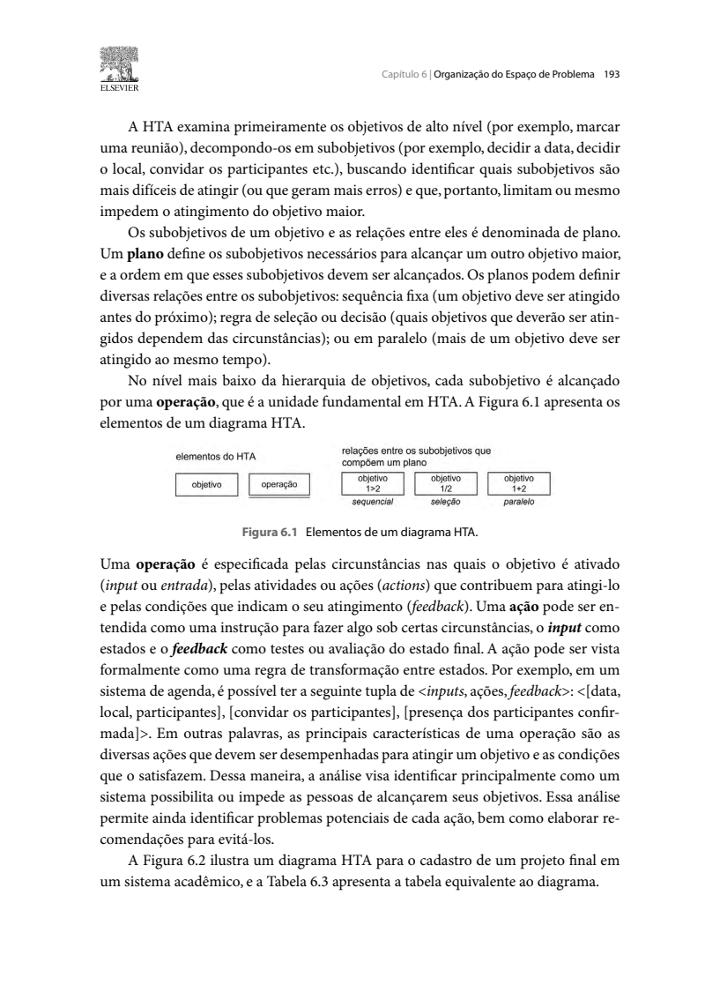
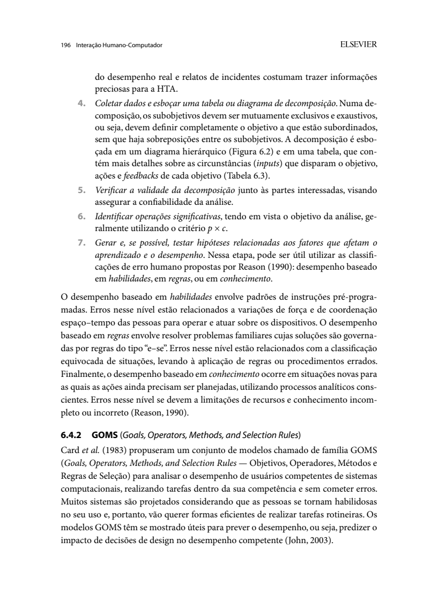
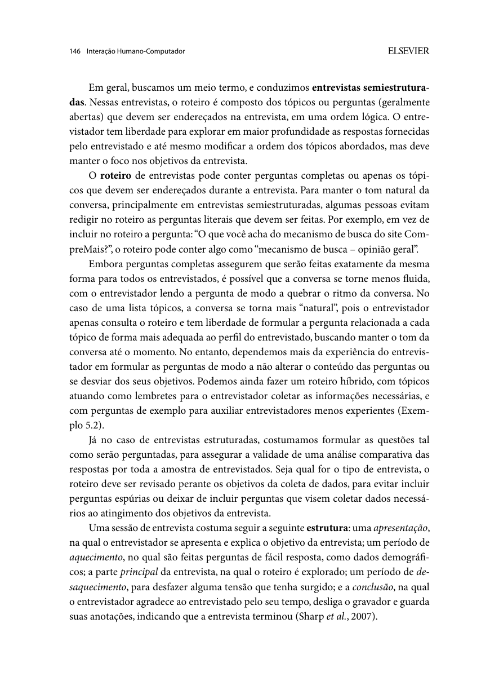
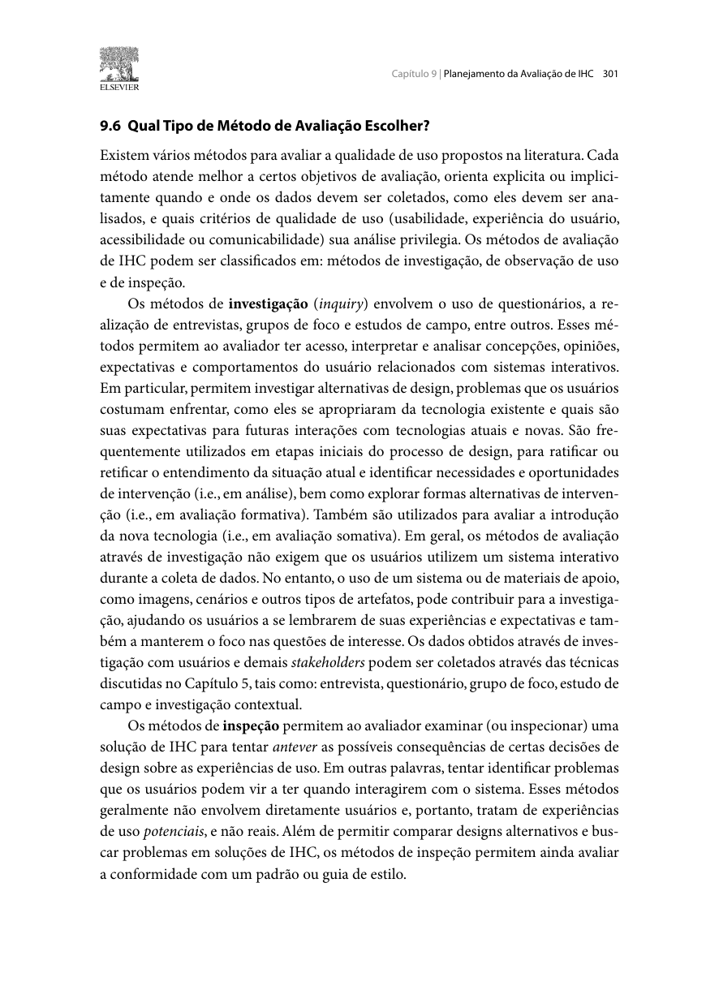
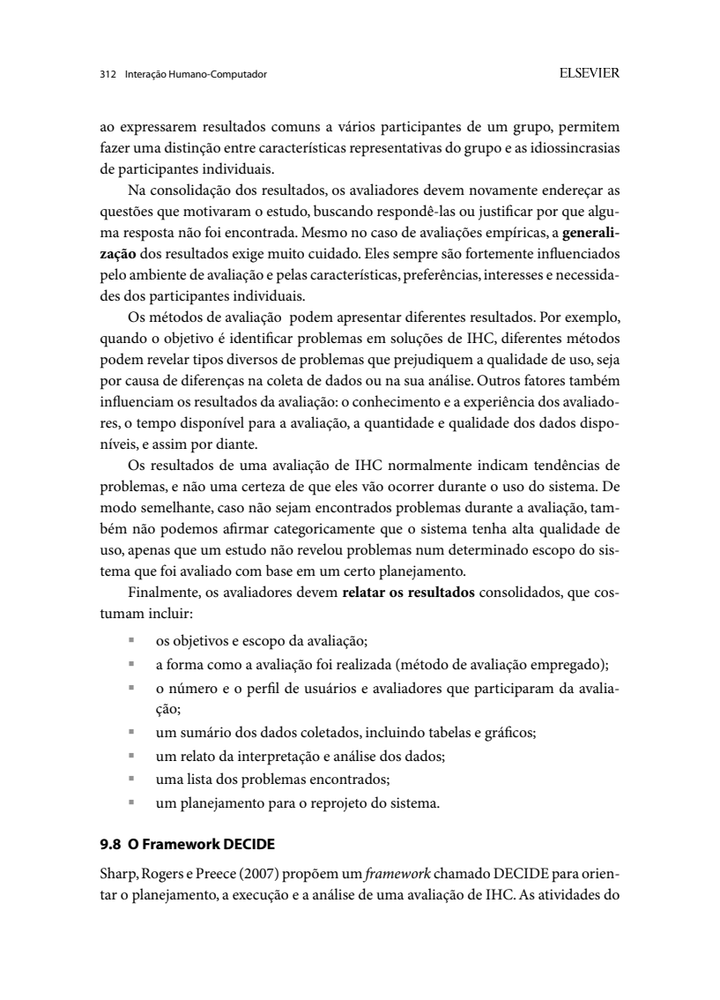
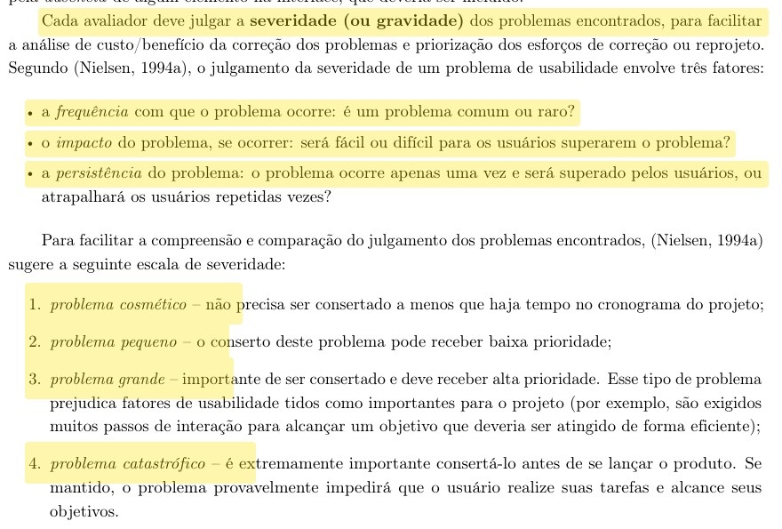
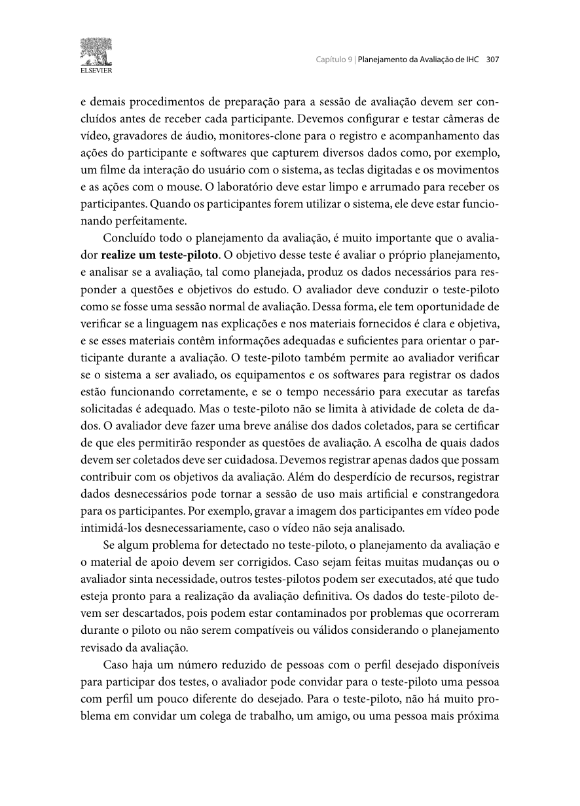

Responsável: Bruno Ferreira Dornelas — Verificação

# Lista de verificação — Etapa 4

## Tabela de contribuição

A Tabela 1 registra as contribuições na preparação desta lista.

| Integrante | Contribuição | Artefato / atividade |
| --- | --- | --- |
| [Bruno Ferreira Dornelas](https://github.com/brunnf) | Fornecimento da lista oficial e elaboração dos itens 14 e 15 | [Item 14](#item-14-bruno-ferreira-dornelas) e [Item 15](#item-15-bruno-ferreira-dornelas) |
| [Caio Breno de Souza Bezerra](https://github.com/CaioBezerra-Dev) | Elaboração dos itens 16 e 17 sobre operações HTA e salvaguardas no TCLE | [Item 16](#item-16-caio-breno-de-souza-bezerra) e [Item 17](#item-17-caio-breno-de-souza-bezerra) |
| [Heitor Pinheiro Gonçalves das Chagas](https://github.com/Heitorovski01) | Elaboração dos itens 18 e 19 sobre exclusividade/exaustão e rastreabilidade Storyboard-HTA | [Item 18](#item-18-heitor-pinheiro-goncalves-das-chagas) e [Item 19](#item-19-heitor-pinheiro-goncalves-das-chagas) |
| [Israel Soares de Paiva](https://github.com/IsraelSoares-25) | Elaboração dos itens 20 e 21 sobre componentes do relato e severidade de Nielsen | [Item 20](#item-20-israel-soares-de-paiva) e [Item 21](#item-21-israel-soares-de-paiva) |
| [Luis Henrique Arruda Luna](https://github.com/Donnk61) | Elaboração dos itens 22 e 23 sobre protocolo do teste piloto e papel do avaliador | [Item 22](#item-22-luis-henrique-arruda-luna) e [Item 23](#item-23-luis-henrique-arruda-luna) |
| Google Gemini e Claude (Anthropic) | Apoio na estruturação dos itens, redação e conferência bibliográfica | [Agradecimentos](#agradecimentos) |

Tabela 1 — Contribuição na preparação da lista.

Fonte: elaboração para o Grupo 06 (2026).

## Introdução

Esta lista será usada na autoverificação do Grupo 06 para a Apresentação 4: planejamento da avaliação do Storyboard e da Análise de Tarefas e planejamento dos respectivos relatos dos resultados.

As Tabelas 2, 3 e 4 seguem o modelo das inspeções anteriores. Os campos **Resposta**, **Versão, data e hora da avaliação** e **Observação** permanecem em branco para preenchimento na inspeção. As opções de resposta são **Sim**, **Não** e **Incompleto**. A data do histórico desta página corresponde à preparação da lista.

## Vídeo de verificação

A inserir após a realização da inspeção, com link, data, horário e participantes.

## Itens de desenvolvimento do projeto

A Tabela 2 mantém os **11 itens de desenvolvimento** utilizados nas inspeções anteriores, com base no plano de ensino [1].

| # | Questão: O GitHub Pages possui… | Resposta | Versão, data e hora da avaliação | Observação |
| :---: | --- | :---: | :---: | --- |
| 1 | O histórico de versão padronizado? | | | |
| 2 | O(s) autor(es) e o(s) revisor(es) para cada artefato? | | | |
| 3 | Referências bibliográficas e/ou bibliografia em todos os artefatos? | | | |
| 4 | As tabelas e imagens possuem legenda e fonte e são chamadas dentro do texto? | | | |
| 5 | Um texto fazendo uma introdução dos artefatos? | | | |
| 6 | O cronograma executado com quem realizou cada artefato/atividade com as datas de início e fim? | | | |
| 7 | Ata(s) da(s) reuniões (com data, horário de início e fim, participantes, objetivo, atividades definidas etc.)? | | | |
| 8 | A gravação da reunião do grupo? | | | |
| 9 | Vídeo de apresentação na categoria "não listado" no YouTube? | | | |
| 10 | Tabela de contribuição no início do artefato com o nome de todos os integrantes? | | | |
| 11 | A seção de agradecimentos apresentando o uso de Inteligência Artificial (IA) Generativa no artefato? | | | |

Tabela 2 — Itens de desenvolvimento do projeto da Etapa 4.

Fonte: SALES (2026).

## Itens de conteúdo da disciplina

A Tabela 3 apresenta os critérios de conteúdo da Apresentação 4 do plano de ensino [1], preservando a numeração **2 a 13**. Essa numeração é independente da Tabela 2. As solicitações de referência, foto e autoria integram os critérios a verificar nos artefatos.

| # | Item | Resposta | Versão, data e hora da avaliação | Observação |
| :---: | --- | :---: | :---: | --- |
| 2 | O planejamento da avaliação segue o Framework DECIDE? | | | |
| 3 | Descreve o(s) objetivo(s) da avaliação? (apropriação de tecnologia pelos usuários; ideias e alternativas de design; conformidade com um padrão; e/ou problemas na interação e na interface na fase do modelo conceitual) | | | |
| 4 | Os métodos de avaliação a serem utilizados?   Adicionar referência bibliográfica da fonte e foto do texto da referência explicando os métodos de avaliação.   Autor: | | | |
| 5 | As questões práticas da avaliação (sobre o recrutamento dos usuários que participarão da avaliação (onde e o perfil), quantos usuários participarão da avaliação e a razão dessa quantidade, presencial real ou remota; a preparação e o uso dos equipamentos necessários; os prazos; o orçamento; recursos de mão-de-obra necessária para conduzir a avaliação)? | | | |
| 6 | As questões éticas (se os participantes da avaliação devem ser respeitados e não podem ser prejudicados direta ou indiretamente, nem durante os experimentos nem após a divulgação dos resultados da avaliação)? | | | |
| 7 | A estrutura do relatório do resultado da avaliação (os objetivos da avaliação; uma breve descrição do método de prototipação em papel; o número e o perfil de avaliadores e dos participantes; as tarefas executadas pelos participantes; lista de problemas encontrados etc.)? | | | |
| 8 | Um cronograma (data e horário) e local para realização da avaliação do Storyboard e da Análise das Tarefas? | | | |
| 9 | Cada desenho do Storyboard está relacionado a uma especificação do artefato da Análise de Tarefas? | | | |
| 10 | A quantidade de storyboards é igual à quantidade de integrantes do grupo? | | | |
| 11 | A definição do teste piloto e data para realização do teste piloto antes da avaliação?   Adicionar referência bibliográfica da fonte e foto do texto da referência explicando o teste piloto.   Autor: | | | |
| 12 | O resultado do teste piloto não será apresentado no resultado da avaliação? | | | |
| 13 | Os itens que o avaliador deve realizar/anotar durante a avaliação (listar os problemas encontrados, priorizar a correção dos problemas não resolvidos)? | | | |

Tabela 3 — Itens de conteúdo da disciplina da Etapa 4.

Fonte: SALES (2026).

## Itens elaborados pelo grupo

A Tabela 4 apresenta os **10 itens adicionais** elaborados pelos integrantes do Grupo 06 para complementar a inspeção da Etapa 4. Cada integrante formulou 2 itens específicos fundamentados na literatura técnica de Barbosa e Silva (2010), Nielsen (1994) e nas normas éticas vigentes.

| # | Item de Verificação | Autor | Resposta | Versão, data e hora da avaliação | Observação |
| :---: | --- | :---: | :---: | :---: | --- |
| 14 | O diagrama HTA utiliza a notação canônica de retângulos com linha na base para operações e explicita os operadores lógicos dos planos (`>`, `/`, `+`, `( )`)? | Bruno Ferreira Dornelas | | | |
| 15 | O artefato documenta métricas mensuráveis de sucesso acordadas com stakeholders e explicita as consequências da falha em atingir o objetivo? | Bruno Ferreira Dornelas | | | |
| 16 | As operações da HTA possuem explicitamente especificadas as circunstâncias de ativação (*input*), as ações (*ações*) e a condição de término (*feedback*)? | Caio Breno de Souza Bezerra | | | |
| 17 | O TCLE assegura explicitamente a não maleficência, garantia de desistência sem ônus, sigilo e solicitação formal de autorização para gravações? | Caio Breno de Souza Bezerra | | | |
| 18 | A decomposição de objetivos em subobjetivos na HTA comprova ser mutuamente exclusiva (sem sobreposições) e exaustiva (completa)? | Heitor Pinheiro Gonçalves das Chagas | | | |
| 19 | Cada quadro do Storyboard possui rastreabilidade formal e identificada com as operações modeladas na Análise de Tarefas (HTA)? | Heitor Pinheiro Gonçalves das Chagas | | | |
| 20 | O planejamento do relato dos resultados estrutura os 8 componentes de consolidação de dados e expressa os limites de generalização? | Israel Soares de Paiva | | | |
| 21 | O planejamento do relato define uma métrica ou escala padronizada de severidade (ex.: escala de 0 a 4 de Nielsen) para orientar o futuro reprojeto? | Israel Soares de Paiva | | | |
| 22 | O artefato fixa a realização do teste piloto com participante fora da amostra oficial e registra formalmente o descarte dos seus dados no relato final? | Luis Henrique Arruda Luna | | | |
| 23 | O planejamento estabelece diretrizes operacionais sobre o papel do avaliador durante as sessões (não indução e anotação imediata de atritos)? | Luis Henrique Arruda Luna | | | |

Tabela 4 — Itens de verificação elaborados pelo Grupo 06 para a Etapa 4.

Fonte: elaboração do Grupo 06 (2026).

### Item 14 — Bruno Ferreira Dornelas

**Referência:**

BARBOSA, Simone Diniz Junqueira; SILVA, Bruno Santana da. *Interação humano-computador*. Rio de Janeiro: Elsevier, 2010. p. 193–194.

**Fundamentação:** na HTA clássica (Annett; Duncan, 1967; Barbosa; Silva, 2010), os elementos gráficos distinguem os níveis hierárquicos: subobjetivos não terminais geram ramificações, enquanto as **operações** (unidades fundamentais que não se decompõem) são representadas por retângulos com um traço espesso horizontal na base. Além disso, os planos articulam a lógica de execução através de operadores semânticos definidos: sequência fixa (`>`), regra de decisão/seleção (`/`), paralelismo (`+`) e opcionalidade (`( )`). Sem essa precisão notacional, o diagrama torna-se ambíguo para a equipe de design.

**Como verificar:** consultar os diagramas de decomposição da HTA:
* **Sim:** quando as operações terminais estiverem graficamente diferenciadas dos objetivos não terminais (com linha espessa na base) e todos os nós possuírem planos identificados com operadores lógicos padronizados;
* **Incompleto:** quando os planos estiverem descritos em linguagem natural vaga, sem operadores lógicos, ou quando não houver distinção visual clara das operações terminais;
* **Não:** quando o diagrama for um mero fluxograma genérico sem a sintaxe formal da HTA.

**Trecho do livro:**

A Figura 1 reproduz a notação canônica da Figura 6.1 do livro de Barbosa e Silva (2010, p. 193), evidenciando a representação de planos e a linha inferior nas operações.

Figura 1 — Elementos do diagrama HTA e especificação de operações.

Fonte: BARBOSA; SILVA (2010, p. 193).

---

### Item 15 — Bruno Ferreira Dornelas

**Referência:**

BARBOSA, Simone Diniz Junqueira; SILVA, Bruno Santana da. *Interação humano-computador*. Rio de Janeiro: Elsevier, 2010. p. 195–196.

**Fundamentação:** no passo 2 do método de HTA, Barbosa e Silva orientam a *"obter consenso entre as partes interessadas na definição dos objetivos da tarefa e medidas de sucesso"*. Para cada objetivo da análise, devem ser fixadas métricas mensuráveis (como tempo aceitável ou taxa de erro) e respondidas duas perguntas-chave: *"qual evidência objetiva indicará que o objetivo foi atingido?"* e *"quais as consequências da falha em atingir esse objetivo?"*. Isso evita que o modelo seja criado sem critérios de validação da utilidade do sistema.

**Como verificar:** consultar a seção de objetivos e contexto da tarefa analisada:
* **Sim:** quando houver tabela ou texto registrando indicadores mensuráveis de sucesso (ex.: tempo máximo, tolerância a erros), evidências perceptíveis de êxito e o impacto negativo caso a tarefa falhe;
* **Incompleto:** quando listar apenas o objetivo final do usuário, sem explicitar medidas mensuráveis acordadas ou sem indicar as consequências de falha;
* **Não:** quando a tarefa for apresentada sem qualquer menção a métricas de sucesso ou consequências de insucesso.

**Trecho do livro:**

A Figura 2 reproduz os passos 1 e 2 da HTA, com a exigência de consenso e definição das medidas de sucesso.

Figura 2 — Passos da HTA e obtenção de consenso sobre medidas de sucesso.

Fonte: BARBOSA; SILVA (2010, p. 196).

---

### Item 16 — Caio Breno de Souza Bezerra

**Referência:**

BARBOSA, Simone Diniz Junqueira; SILVA, Bruno Santana da. *Interação humano-computador*. Rio de Janeiro: Elsevier, 2010. p. 193–195.

**Fundamentação:** de acordo com Barbosa e Silva (2010, p. 193), uma operação em HTA só está adequadamente especificada quando informa: as circunstâncias nas quais o objetivo é ativado (*input* ou entrada), as atividades motoras ou cognitivas que contribuem para atingi-lo (*ações*) e as condições que indicam o seu atingimento (*feedback*). A ausência de qualquer uma dessas três dimensões compromete a rastreabilidade ergonômica durante os testes.

**Como verificar:** consultar a tabela detalhada da HTA (formato Tabela 6.3 do livro):
* **Sim:** quando cada operação na base da árvore contiver explicitamente os campos *Input*, *Ação* e *Feedback*;
* **Incompleto:** quando a tabela informar apenas entradas e saídas, omitindo a ação realizada, ou se apenas parte das operações estiver detalhada;
* **Não:** quando a tabela contiver apenas descrições textuais corridas sem identificar os elementos constitutivos da operação.

**Trecho do livro:**

A Figura 3 reproduz o trecho da página 193 que conceitua e formaliza a tríade de especificação das operações.

Figura 3 — Especificação formal de uma operação na HTA.

Fonte: BARBOSA; SILVA (2010, p. 193).

---

### Item 17 — Caio Breno de Souza Bezerra

**Referência:**

BARBOSA, Simone Diniz Junqueira; SILVA, Bruno Santana da. *Interação humano-computador*. Rio de Janeiro: Elsevier, 2010. p. 141–143.  
BRASIL. Conselho Nacional de Saúde. *Resolução nº 510, de 7 de abril de 2016*. Brasília: CNS, 2016.

**Fundamentação:** a ética em pesquisas com seres humanos exige não apenas a garantia de sigilo e anonimato, mas o compromisso explícito de não maleficência e a preservação da autonomia do participante (garantindo que ele possa interromper o teste a qualquer momento sem penalidades). Além disso, como gravações de áudio e tela contêm dados comportamentais sensíveis, o avaliador deve prever uma cláusula específica solicitando a autorização formal prévia para captação de mídia.

**Como verificar:** examinar o modelo de Termo de Consentimento Livre e Esclarecido (TCLE) na seção de questões éticas:
* **Sim:** quando o termo explicitar o objetivo da pesquisa, garantia de anonimato, direito de desistência a qualquer momento sem penalidades e uma solicitação formal expressa para autorização de gravação de áudio/vídeo;
* **Incompleto:** quando contiver um termo genérico sem cláusula de consentimento para gravação ou sem garantia formal de cancelamento sem prejuízos;
* **Não:** quando não apresentar a minuta do TCLE ou omitir os cuidados éticos fundamentais.

**Trecho do livro:**

A Figura 4 reproduz as orientações éticas e a condução respeitosa na coleta de dados com usuários.

Figura 4 — Diretrizes de respeito e ética na relação com os participantes.

Fonte: BARBOSA; SILVA (2010, p. 146).

---

### Item 18 — Heitor Pinheiro Gonçalves das Chagas

**Referência:**

BARBOSA, Simone Diniz Junqueira; SILVA, Bruno Santana da. *Interação humano-computador*. Rio de Janeiro: Elsevier, 2010. p. 195–196.

**Fundamentação:** no passo 4 da HTA (*"Coletar dados e esboçar tabela ou diagrama"*), a literatura postula uma regra analítica estrita: *"os subobjetivos devem ser mutuamente exclusivos e exaustivos"*. Isso significa que não podem existir etapas sobrepostas ou redundantes no mesmo nível hierárquico (*exclusividade*) e que, ao cumprir os subobjetivos estabelecidos, o objetivo-pai deve estar 100% satisfeito, sem passos intermediários ocultos (*exaustão*).

**Como verificar:** analisar a lógica da quebra do Objetivo 0 nos subobjetivos:
* **Sim:** quando houver demonstração ou justificativa clara de que os subobjetivos cobrem integralmente o ciclo da tarefa sem que um subobjetivo invada o escopo funcional do outro;
* **Incompleto:** quando houver sobreposição evidente de ações entre nós irmãos ou lacunas não explicadas (etapas faltantes para atingir a meta);
* **Não:** quando a hierarquia for desordenada, misturando ações de granularidades incompatíveis no mesmo nível.

**Trecho do livro:**

A Figura 5 reproduz o passo 4 da página 196, onde os critérios de exclusividade e exaustão são prescritos.

Figura 5 — Critérios de exclusividade e exaustão na decomposição da HTA.

Fonte: BARBOSA; SILVA (2010, p. 196).

---

### Item 19 — Heitor Pinheiro Gonçalves das Chagas

**Referência:**

BARBOSA, Simone Diniz Junqueira; SILVA, Bruno Santana da. *Interação humano-computador*. Rio de Janeiro: Elsevier, 2010. p. 193–195, p. 294, p. 301.

**Fundamentação:** o storyboard não é uma história em quadrinhos ilustrativa descolada do sistema; ele constitui a contextualização sociotécnica das tarefas. Cada cena deve refletir uma operação ou plano modelado na HTA, evidenciando a motivação inicial, a interação física/cognitiva, o conflito dramático de usabilidade e o desfecho. Manter uma tabela de rastreabilidade formal garante que o storyboard valide as mesmas barreiras diagnosticadas no modelo analítico.

**Como verificar:** consultar a seção do Storyboard e verificar a presença da matriz de rastreabilidade:
* **Sim:** quando houver tabela associando nominalmente cada quadro (ex.: QD01 a QD05) aos nós e operações correspondentes da HTA (ex.: Op. 1.1 a 4.4);
* **Incompleto:** quando a relação for apenas mencionada no texto corrido de forma vaga, sem mapa ou identificadores cruzados;
* **Não:** quando o storyboard retratar uma história independente que não dialogue com as operações da Análise de Tarefas.

**Trecho do livro:**

A Figura 6 reproduz a fundamentação sobre métodos de investigação apoiados em artefatos de representação de tarefas e cenários.

Figura 6 — Uso de artefatos visuais e materiais de apoio na avaliação de IHC.

Fonte: BARBOSA; SILVA (2010, p. 301).

---

### Item 20 — Israel Soares de Paiva

**Referência:**

BARBOSA, Simone Diniz Junqueira; SILVA, Bruno Santana da. *Interação humano-computador*. Rio de Janeiro: Elsevier, 2010. p. 312–313.

**Fundamentação:** Barbosa e Silva alertam que avaliações de IHC indicam *tendências de problemas*, e não certezas absolutas, exigindo cuidados para não generalizar indevidamente os achados. Para manter o rigor científico, os autores prescrevem que o relatório de resultados seja estruturado em tópicos consolidados (objetivos, método, participantes, dados brutos, interpretação, problemas encontrados e propostas de reprojeto). O planejamento deve definir antecipadamente essa estrutura.

**Como verificar:** consultar os artefatos de planejamento de relato da HTA e do Storyboard:
* **Sim:** quando o planejamento estruturar formalmente os 8 componentes de consolidação de dados de Barbosa e Silva e explicitar a ressalva sobre os limites de generalização dos resultados;
* **Incompleto:** quando o modelo de relatório listar tópicos soltos sem base na literatura ou omitir o tratamento e interpretação dos dados;
* **Não:** quando não houver planejamento de como as evidências coletadas serão apresentadas e interpretadas.

**Trecho do livro:**

A Figura 7 reproduz a página 312 com as recomendações de consolidação e os componentes obrigatórios do relato de resultados.

Figura 7 — Componentes do relato e cuidados metodológicos de generalização.

Fonte: BARBOSA; SILVA (2010, p. 312).

---

### Item 21 — Israel Soares de Paiva

**Referência:**

NIELSEN, Jakob. *Usability Engineering*. San Francisco: Morgan Kaufmann, 1994.  
BARBOSA, Simone Diniz Junqueira; SILVA, Bruno Santana da. *Interação humano-computador*. Rio de Janeiro: Elsevier, 2010. p. 312.

**Fundamentação:** coletar problemas de usabilidade sem um método de classificação compromete o planejamento das correções no reprojeto. A literatura estabelece que os problemas devem ser ponderados por sua gravidade (frequência, impacto e persistência), recomendando o uso da escala de severidade de Nielsen (0 — Não é um problema, 1 — Cosmético, 2 — Pequeno, 3 — Grande, 4 — Catastrófico). O planejamento da avaliação deve fixar essa escala para calibrar as decisões de design da Etapa 5.

**Como verificar:** examinar as seções de registro do avaliador e de planejamento de relato:
* **Sim:** quando o artefato explicitar a métrica de severidade de Nielsen (0 a 4) ou critério equivalente consagrado, com diretrizes de como os problemas serão ranqueados para correção;
* **Incompleto:** quando indicar que "os problemas serão priorizados", mas sem definir uma escala objetiva de classificação;
* **Não:** quando o artefato apenas listar problemas sem qualquer critério de priorização de correção.

**Trecho de referência:**

A Figura 8 apresenta a escala clássica de severidade de problemas de usabilidade proposta por Nielsen (1994).

Figura 8 — Escala de severidade de problemas de usabilidade de Nielsen (1994).

Fonte: NIELSEN (1994); BARBOSA; SILVA (2010, p. 312).

---

### Item 22 — Luis Henrique Arruda Luna

**Referência:**

BARBOSA, Simone Diniz Junqueira; SILVA, Bruno Santana da. *Interação humano-computador*. Rio de Janeiro: Elsevier, 2010. p. 278, p. 307–308.

**Fundamentação:** o teste piloto tem como propósito exclusivo avaliar o próprio processo de avaliação (checagem da clareza do roteiro, funcionamento de gravadores, adequação do tempo e conforto do ambiente). Para evitar viés amostral e contaminação estatística, o participante do piloto não pode integrar a amostra principal e os dados colhidos nessa sessão devem ser descartados, não integrando em hipótese alguma o relato de resultados finais.

**Como verificar:** consultar o cronograma e a seção de teste piloto nos planejamentos:
* **Sim:** quando o piloto tiver data e horário agendados antes das sessões oficiais, perfil de participante independente e registro inequívoco (via aviso em destaque) de que seus dados serão descartados do relatório final;
* **Incompleto:** quando houver teste piloto agendado, mas omitir o perfil do participante ou deixar em aberto se os dados serão ou não computados no resultado;
* **Não:** quando não houver previsão de teste piloto ou se o grupo planejar utilizar os dados do piloto como resultado da avaliação.

**Trecho do livro:**

A Figura 9 reproduz a página 307 de Barbosa e Silva (2010), definindo a finalidade do teste piloto e a regra de descarte de seus dados.

Figura 9 — Finalidade do ensaio piloto e descarte dos dados preliminares.

Fonte: BARBOSA; SILVA (2010, p. 307).

---

### Item 23 — Luis Henrique Arruda Luna

**Referência:**

BARBOSA, Simone Diniz Junqueira; SILVA, Bruno Santana da. *Interação humano-computador*. Rio de Janeiro: Elsevier, 2010. p. 146–148, p. 301.

**Fundamentação:** em entrevistas e leituras guiadas, a postura do avaliador pode introduzir severos vieses cognitivos. A literatura preconiza que o avaliador deve manter neutralidade estrita, evitando perguntas indutoras que sugiram respostas esperadas, respeitando os silêncios e o ritmo de raciocínio do usuário e registrando as reações e hesitações espontâneas em tempo real no instrumento de coleta.

**Como verificar:** consultar as instruções de conduta e preparação da equipe nos planejamentos de avaliação:
* **Sim:** quando houver seção definindo o papel do avaliador com diretrizes explícitas de não indução de respostas, escuta ativa, respeito ao tempo do usuário e protocolo de anotação de divergências;
* **Incompleto:** quando apenas indicar quem será o avaliador, sem elencar as regras comportamentais durante a condução da sessão;
* **Não:** quando não definir o papel do avaliador durante o experimento.

**Trecho do livro:**

A Figura 10 reproduz as diretrizes para condução e postura neutra durante sessões de entrevista e investigação.

Figura 10 — Postura neutra e condução da sessão pelo avaliador.

Fonte: BARBOSA; SILVA (2010, p. 146).

---

## Agradecimentos

O Google Gemini e o Claude (Anthropic) apoiaram a transcrição e a organização dos itens de verificação e a checagem da fundamentação bibliográfica. A revisão humana e o preenchimento da inspeção estão pendentes.

## Histórico de versão

Revisor designado: [Caio Breno de Souza Bezerra](https://github.com/CaioBezerra-Dev). A revisão será registrada quando realizada.

| Versão | Data | Descrição | Autor(es) | Revisor(es) |
| :---: | :---: | --- | --- | --- |
| 1.0 | 13/10/2026 | Prepara a lista da Etapa 4 com 11 itens de desenvolvimento e 12 de conteúdo | [Bruno Ferreira Dornelas](https://github.com/brunnf) | [Caio Breno de Souza Bezerra](https://github.com/CaioBezerra-Dev) |
| 1.1 | 13/10/2026 | Inclusão dos 10 itens elaborados pelo grupo (itens 14 a 23) com fundamentação e imagens de referência | [Heitor Pinheiro Gonçalves das Chagas](https://github.com/Heitorovski01) | [Caio Breno de Souza Bezerra](https://github.com/CaioBezerra-Dev) |

## Referências

[1] BARBOSA, Simone Diniz Junqueira; SILVA, Bruno Santana da. *Interação humano-computador*. Rio de Janeiro: Elsevier, 2010.

[2] BRASIL. Conselho Nacional de Saúde. *Resolução nº 510, de 7 de abril de 2016*. Brasília: CNS, 2016.

[3] NIELSEN, Jakob. *Usability Engineering*. San Francisco: Morgan Kaufmann, 1994.

[4] SALES, André Barros de. *Plano de Ensino FIHC 022026 — Turma 01*. Brasília: FCTE/UnB, 2026.

