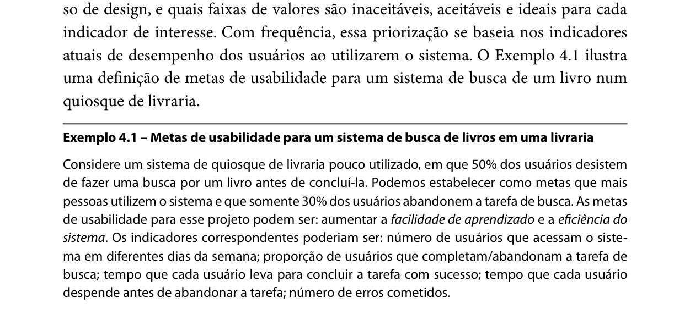
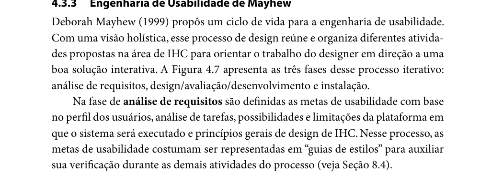
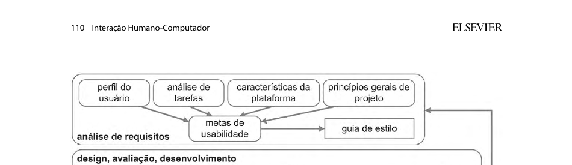
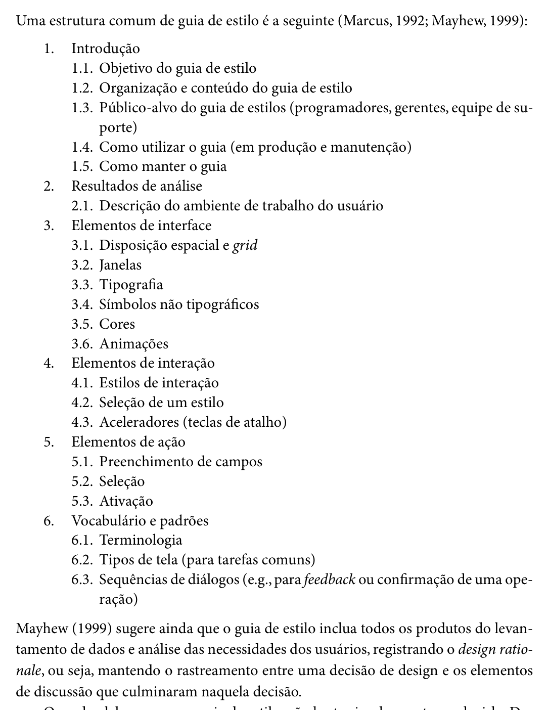
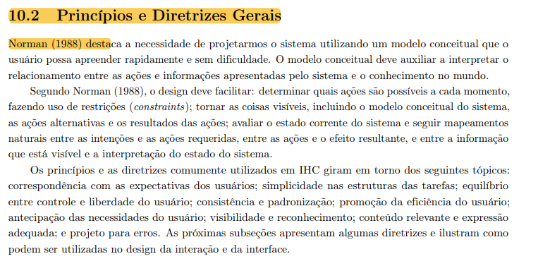
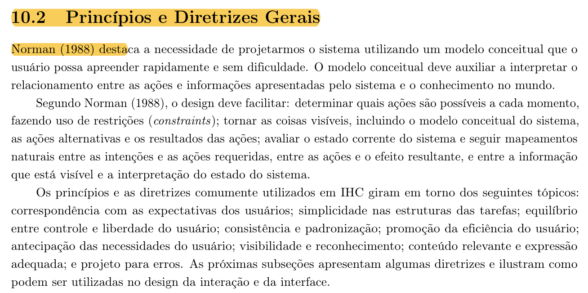

Responsável: Bruno Ferreira Dornelas e Heitor Pinheiro Gonçalves das Chagas — Verificação

# Lista de verificação — Etapa 3 (Grupo 07)

## Tabela de contribuição

A Tabela 1 registra quem atuou neste artefato.

| Integrante | Contribuição | Artefato / atividade |
| --- | --- | --- |
| [Heitor Pinheiro Gonçalves das Chagas](https://github.com/Heitorovski01) | Condução da inspeção dos artefatos do Grupo 07 e redação da lista | [Desenvolvimento](#itens-de-desenvolvimento-do-projeto), [Conteúdo](#itens-de-conteudo-da-disciplina) e [Itens do grupo](#itens-elaborados-pelo-grupo) |
| [Bruno Ferreira Dornelas](https://github.com/brunnf) | Inspeção dos artefatos do Grupo 07 e gravação da reunião | [Desenvolvimento](#itens-de-desenvolvimento-do-projeto), [Conteúdo](#itens-de-conteudo-da-disciplina) e [Vídeo](#video-de-verificacao) |
| [Israel Soares de Paiva](https://github.com/IsraelSoares-25) | Inspeção e conferência dos princípios, metas e desenvolvimento | [Desenvolvimento](#itens-de-desenvolvimento-do-projeto) e [Conteúdo](#itens-de-conteudo-da-disciplina) |
| [Luís Henrique Luna de Arruda](https://github.com/Donnk61) | Inspeção de princípios gerais e análise de agradecimentos de IA | [Desenvolvimento](#itens-de-desenvolvimento-do-projeto) e [Conteúdo](#itens-de-conteudo-da-disciplina) |
| Google Gemini | Registro de anotações e transcrição da reunião de inspeção | [Agradecimentos](#agradecimentos) |

Tabela 1 — Contribuição neste artefato.

Fonte: elaboração do Grupo 06 (2026).

## Introdução

Este artefato reúne a lista de verificação da Entrega 3 — Princípios Gerais de Projeto, Metas de Usabilidade, Guia de Estilo e Características da Plataforma (Fase: análise de requisitos) — aplicada aos artefatos do **Grupo 07**, elaborada com base nos critérios definidos pelo professor André Barros no plano de ensino [1] e na literatura de Interação Humano-Computador [2] [3]. A avaliação segue o método de inspeção de software [4], registrando para cada item a resposta (**Sim**, **Não** ou **Incompleto**), a versão, data e hora da avaliação e as observações detalhadas.

## Vídeo de verificação

O vídeo a seguir apresenta a reunião de inspeção realizada pelos integrantes do Grupo 06 sobre os artefatos da Etapa 3 produzidos pelo Grupo 07.

- Categoria no YouTube: **não listado**
- Link: [https://youtu.be/ENgIjCLN0Ns](https://youtu.be/ENgIjCLN0Ns)
- Data da gravação: 09/10/2026, às 21:28 (GMT-03:00)
- Participantes: Bruno Ferreira Dornelas, Heitor Pinheiro Gonçalves das Chagas, Israel Soares de Paiva e Luís Henrique Luna de Arruda

??? note "Vídeo — Inspeção da Etapa 3 do Grupo 07"

    

      <iframe
        loading="lazy"
        style="position: absolute; top: 0; left: 0; width: 100%; height: 100%; border: 0;"
        src="https://www.youtube-nocookie.com/embed/ENgIjCLN0Ns"
        title="Inspeção da Etapa 3 do Grupo 07"
        allow="accelerometer; autoplay; clipboard-write; encrypted-media; gyroscope; picture-in-picture; web-share"
        referrerpolicy="strict-origin-when-cross-origin"
        allowfullscreen>
      </iframe>
    

## Itens de desenvolvimento do projeto

A Tabela 2 apresenta a avaliação dos 11 itens de desenvolvimento do projeto aplicados aos artefatos da Etapa 3 do Grupo 07.

| # | Questão: O GitHub Pages possui… | Resposta | Versão, data e hora da avaliação | Observação |
| :---: | --- | :---: | :---: | --- |
| 1 | O histórico de versão padronizado? | Sim | 09/10/2026 às 21:28 | Histórico de versão presente e padronizado com versão, data, descrição, autor e revisor nos artefatos inspecionados (00:00:04). |
| 2 | O(s) autor(es) e o(s) revisor(es) para cada artefato? | Sim | 09/10/2026 às 21:28 | Autores e revisores devidamente indicados no histórico dos artefatos (00:00:04). |
| 3 | Referências bibliográficas e/ou bibliografia em todos os artefatos? | Sim | 09/10/2026 às 21:28 | Referências bibliográficas presentes e em conformidade com as normas (00:00:04). |
| 4 | As tabelas e imagens possuem legenda e fonte e são chamadas dentro do texto? | Sim | 09/10/2026 às 21:28 | Verificado por amostragem que as tabelas e figuras possuem legenda, fonte e são chamadas no corpo do texto (00:00:04). |
| 5 | Um texto fazendo uma introdução dos artefatos? | Sim | 09/10/2026 às 21:28 | Os artefatos contam com seção de introdução contextualizando o tema abordado (00:00:04). |
| 6 | O cronograma executado com quem realizou cada artefato/atividade com as datas de início e fim? | Sim | 09/10/2026 às 21:29 | O cronograma executado da Etapa 3 detalha quem realizou cada atividade com as respectivas datas de início e fim (00:01:28). |
| 7 | Ata(s) da(s) reuniões (com data, horário de início e fim, participantes, objetivo, atividades definidas etc.)? | Não | 09/10/2026 às 21:29 | Constatou-se a existência apenas de atas referentes à Etapa 1; faltam os registros e atas de reunião da Etapa 3 (00:01:28). |
| 8 | A gravação da reunião do grupo? | Não | 09/10/2026 às 21:31 | Não constam gravações das reuniões da etapa, visto que os encontros do grupo foram realizados presencialmente (00:03:34). |
| 9 | Vídeo de apresentação na categoria "não listado" no YouTube? | Não | 09/10/2026 às 21:32 | Apenas o vídeo da Etapa 1 está disponível; a entrega da Etapa 3 não disponibilizou o vídeo de apresentação (00:04:18). |
| 10 | Tabela de contribuição no início do artefato com o nome de todos os integrantes? | Sim | 09/10/2026 às 21:33 | Tabela de contribuição presente no início dos artefatos com o nome dos integrantes e atividades correspondentes (00:05:21). |
| 11 | A seção de agradecimentos apresentando o uso de Inteligência Artificial (IA) Generativa no artefato? | Não | 09/10/2026 às 21:33 | O uso de inteligência artificial generativa consta apenas na tabela de contribuição, sem uma seção de agradecimentos dedicada nos artefatos (00:05:21). |

Tabela 2 — Verificação dos itens de desenvolvimento do projeto do Grupo 07.

Fonte: SALES (2026); elaboração do Grupo 06 (2026).

## Itens de conteúdo da disciplina

A Tabela 3 apresenta a avaliação dos itens de conteúdo da disciplina (itens 10 a 17 do plano de ensino) para a Etapa 3 do Grupo 07.

| # | Item | Resposta | Versão, data e hora da avaliação | Observação |
| :---: | --- | :---: | :---: | --- |
| 10 | As características da plataforma para o projeto | Sim | 09/10/2026 às 21:34 | As características técnicas da plataforma foram documentadas, registrando suas possibilidades e limitações (00:06:27). |
| 11 | Os Princípios Gerais do Projeto que serão utilizados no projeto? Adicionar referência bibliográfica da fonte e foto do texto da referência explicando Os Princípios Gerais do Projeto. Autor: | Sim | 09/10/2026 às 21:34 | Princípios gerais selecionados para o projeto com fundamentação teórica e indicação de autoria (00:06:27). |
| 12 | Os Princípios Gerais do Projeto contém os seguintes tópicos: • 1- correspondência com as expectativas dos usuários; • 2- simplicidade nas estruturas das tarefas; • 3- equilíbrio entre controle e liberdade do usuário; • 4- consistência e padronização; promoção da eficiência do usuário; • 5- antecipação das necessidades do usuário; • 6 - visibilidade e reconhecimento; • 7- conteúdo relevante e expressão adequada; e • 8 - projeto para erros. Adicionar referência bibliográfica da fonte e foto do texto da referência explicando os tópicos dos Princípios Gerais do Projeto. Autor: | Sim | 09/10/2026 às 21:35 | Todos os oito tópicos foram contemplados e consolidados em uma matriz de síntese devidamente estruturada (00:07:32). |
| 13 | As metas de usabilidade que devem ser alcançadas no projeto ou os objetivos de uma avaliação de IHC. Adicionar referência bibliográfica da fonte e foto do texto da referência explicando as metas de usabilidade OU os objetivos de uma avaliação de IHC. Autor: | Sim | 09/10/2026 às 21:36 | Foram definidas seis metas de usabilidade na seção 6 do artefato, com procedimentos para avaliação (00:08:35). |
| 14 | A razão da seleção das metas de usabilidade? | Sim | 09/10/2026 às 21:36 | As razões da seleção de cada meta estão detalhadas na seção 6.5, justificadas com base nas análises anteriores (00:08:35). |
| 15 | O Guia de Estilo do projeto? Adicionar referência bibliográfica da fonte e foto do texto da referência explicando guia de estilo. Autor: | Sim | 09/10/2026 às 21:37 | Guia de estilo do projeto elaborado com referências bibliográficas da literatura e recortes do livro (00:09:21). |
| 16 | O Guia de Estilo do projeto possui a seguinte estrutura: • 1. Introdução (com Objetivo do guia de estilo, Organização e conteúdo do guia de estilo, Público-alvo do guia de estilos (programadores, gerentes, equipe de suporte), Como utilizar o guia (em produção e manutenção), Como manter o guia • 2. Resultados de análise • Descrição do ambiente de trabalho do usuário • 3. Elementos de interface • Disposição espacial e grid • Janelas • Tipografia • Cores • 4. Elementos de interação - • Estilos de interação • Seleção de um estilo • Aceleradores (teclas de atalho) • 5. Elementos de ação • Preenchimento de campos • Seleção • Ativação • 6. Vocabulário e padrões • Terminologia • Tipos de tela (para tarefas comuns) • Sequências de diálogos (e.g., para feedback ou confirmação de uma operação) Adicionar referência bibliográfica da fonte e foto do texto da referência explicando a estrutura do guia de estilo. Autor: | Sim | 09/10/2026 às 21:37 | A estrutura formal exigida em seis seções foi contemplada: introdução, resultados de análise, elementos de interface, interação, ação e vocabulário (00:09:21). |
| 17 | O Guia de Estilo corresponde ao site avaliado? | Sim | 09/10/2026 às 21:37 | O guia de estilo corresponde adequadamente ao contexto e à identidade do sistema avaliado pelo grupo (00:09:21). |

Tabela 3 — Verificação dos itens de conteúdo da disciplina do Grupo 07.

Fonte: SALES (2026); elaboração do Grupo 06 (2026).

## Itens elaborados pelo grupo

A Tabela 4 reúne os itens adicionais de verificação formulados pelo Grupo 06 com base na literatura de IHC e avaliados nos artefatos do Grupo 07.

| # | Item | Resposta | Versão, data e hora da avaliação | Autor do item | Observação |
| :---: | --- | :---: | :---: | --- | --- |
| 18 | As metas de usabilidade explicitam como serão avaliadas, com indicadores e faixas de valores inaceitáveis, aceitáveis e ideais para cada indicador? | Sim | 09/10/2026 às 21:40 | [Bruno Ferreira Dornelas](https://github.com/brunnf) | Metas de usabilidade explicitam a avaliação com indicadores e faixas de valores inaceitáveis, aceitáveis e ideais (00:12:08). |
| 19 | As características da plataforma registram (1) as possibilidades e (2) as limitações da plataforma em que o sistema será executado, e as metas de usabilidade são definidas levando em conta essas características, junto com os demais insumos da análise de requisitos: perfil do usuário, análise de tarefas e princípios gerais de projeto? | Sim | 09/10/2026 às 21:40 | [Caio Breno de Souza Bezerra](https://github.com/CaioBezerra-Dev) | Registra as possibilidades e limitações técnicas da plataforma, articulando-as com os requisitos da análise (00:12:08). |
| 20 | O Guia de Estilo registra o design rationale das decisões de design, estabelecendo a rastreabilidade entre os elementos de interface/interação e os resultados do perfil de usuário, da análise de tarefas e da plataforma? | Sim | 09/10/2026 às 21:41 | [Heitor Pinheiro Gonçalves das Chagas](https://github.com/Heitorovski01) | O guia de estilo registra o *design rationale* e consolida a rastreabilidade na Tabela 6 (00:13:21). |
| 21 | Os Princípios Gerais do Projeto explicitam quais diretrizes e princípios de IHC foram selecionados para a aplicação, justificando suas escolhas com base nas necessidades dos usuários e na literatura de referência? | Sim | 09/10/2026 às 21:41 | [Israel Soares de Paiva](https://github.com/IsraelSoares-25) | Os princípios gerais explicitam as diretrizes selecionadas com base nas necessidades dos usuários e na literatura (00:13:21). |
| 22 | Cada tópico dos Princípios Gerais do Projeto é explicado pelas diretrizes que o compõem e ilustrado com ao menos um exemplo concreto de como o tópico se manifesta, ou deveria se manifestar, na interação ou na interface do site avaliado? | Sim | 09/10/2026 às 21:41 | [Luís Henrique Luna de Arruda](https://github.com/Donnk61) | Os tópicos contam com diretrizes explicativas e exemplos concretos de violação na seção 3.2 do artefato (00:13:21). |

Tabela 4 — Verificação dos itens elaborados pelo Grupo 06 aplicados ao Grupo 07.

Fonte: elaboração do Grupo 06 (2026); item 18 fundamentado em BARBOSA; SILVA (2010, p. 105–106); item 19 fundamentado em BARBOSA; SILVA (2010, p. 109–110); item 20 fundamentado em BARBOSA; SILVA (2010, p. 283); item 21 fundamentado em BARBOSA; SILVA (2010, p. 283) e BARBOSA et al. (2021, p. 238); item 22 fundamentado em BARBOSA et al. (2021, p. 237–238).

---

## Fundamentação dos itens elaborados pelo grupo

As subseções a seguir apresentam as referências teóricas, a fundamentação e as figuras comprobatórias dos itens formulados pelo Grupo 06.

### Item 18 — Bruno Ferreira Dornelas

**Referência:**

BARBOSA, Simone Diniz Junqueira; SILVA, Bruno Santana da. *Interação humano-computador*. Rio de Janeiro: Elsevier, 2010. p. 105–106.

**Fundamentação:** o trecho relaciona a definição das metas à escolha dos fatores prioritários, à forma de avaliação e às faixas de valores de cada indicador. O Exemplo 4.1 ilustra indicadores como conclusão ou abandono, tempo e erros.

**Trechos do livro:**

Figura 1 — Definição de metas de usabilidade: fatores e avaliação.

Fonte: BARBOSA; SILVA (2010, p. 105), recorte do livro.

Figura 2 — Faixas de aceitação e indicadores de usabilidade.

Fonte: BARBOSA; SILVA (2010, p. 106), recorte do livro.

### Item 19 — Caio Breno de Souza Bezerra

**Referência:**

BARBOSA, Simone Diniz Junqueira; SILVA, Bruno Santana da. *Interação humano-computador*. Rio de Janeiro: Elsevier, 2010. p. 109–110.

**Fundamentação:** na engenharia de usabilidade de Mayhew, na fase de análise de requisitos são definidas as metas de usabilidade com base no perfil dos usuários, análise de tarefas, possibilidades e limitações da plataforma e princípios gerais de design de IHC (BARBOSA; SILVA, 2010, p. 109).

**Trechos do livro:**

Figura 3 — Possibilidades e limitações da plataforma como base das metas de usabilidade.

Fonte: BARBOSA; SILVA (2010, p. 109), recorte do livro.

Figura 4 — Características da plataforma na fase de análise de requisitos.

Fonte: BARBOSA; SILVA (2010, p. 110), recorte do livro.

### Item 20 — Heitor Pinheiro Gonçalves das Chagas

**Referência:**

BARBOSA, Simone Diniz Junqueira; SILVA, Bruno Santana da. *Interação humano-computador*. Rio de Janeiro: Elsevier, 2010. p. 283.

**Fundamentação:** Mayhew (1999) recomenda que o guia de estilo inclua os produtos do levantamento de dados e da análise de necessidades dos usuários, registrando formalmente o *design rationale* — isto é, mantendo a rastreabilidade entre cada decisão de design e os elementos observados nas tarefas e no perfil do usuário.

**Trecho do livro:**

Figura 5 — Estrutura e rastreabilidade (design rationale) no Guia de Estilo.

Fonte: BARBOSA; SILVA (2010, p. 283), recorte do livro.

### Item 21 — Israel Soares de Paiva

**Referência:**

BARBOSA, Simone Diniz Junqueira; SILVA, Bruno Santana da. *Interação humano-computador*. Rio de Janeiro: Elsevier, 2010. p. 283.

BARBOSA, Simone Diniz Junqueira et al. *Interação Humano-Computador e Experiência do Usuário*. Autopublicação, 2021. p. 238.

**Fundamentação:** a formalização dos princípios adotados orienta a construção de um modelo conceitual consistente. Registrar as justificativas das escolhas fundamentadas no perfil dos usuários e no domínio do problema assegura o *design rationale* e evita aplicações mecânicas ou arbitrárias de diretrizes.

**Trecho do livro:**

Figura 6 — Tópicos dos princípios e diretrizes gerais de IHC.

Fonte: BARBOSA et al. (2021, p. 238), recorte do livro.

### Item 22 — Luís Henrique Luna de Arruda

**Referência:**

BARBOSA, Simone Diniz Junqueira; SILVA, Bruno Santana da; SILVEIRA, Milene Selbach; GASPARINI, Isabela; DARIN, Ticianne; BARBOSA, Gabriel Diniz Junqueira. *Interação Humano-Computador e Experiência do Usuário*. Autopublicação, 2021. Cap. 10, seções 10.1 e 10.2, p. 237–238.

**Fundamentação:** diretrizes frequentemente são recomendações genéricas; cabe ao designer avaliar como elas devem se manifestar na solução de IHC. Cada tópico deve vir acompanhado de suas diretrizes detalhadas e de exemplos de aplicação concreta ou de violações encontradas na interface.

**Trecho do livro:**

Figura 7 — Diretrizes e manifestação dos tópicos de IHC na interface.

Fonte: BARBOSA et al. (2021, p. 237–238), recorte do livro.

---

## Agradecimentos

Esta página contou com o apoio do Google Gemini na anotação e transcrição das discussões e constatações da reunião de inspeção do Grupo 07, realizada em 09/10/2026. A verificação dos artefatos, o julgamento de conformidade e a responsabilidade pelo conteúdo publicado são exclusivos dos integrantes do Grupo 06.

## Histórico de versão

| Versão | Data | Descrição | Autor(es) | Revisor(es) |
| :---: | :---: | --- | --- | --- |
| `1.0` | 10/10/2026 | Criação da lista de verificação da Etapa 3 do Grupo 07 com base na gravação da reunião de inspeção e anotações do Gemini | [Heitor Pinheiro Gonçalves das Chagas](https://github.com/Heitorovski01) | [Bruno Ferreira Dornelas](https://github.com/brunnf) |

## Referências

[1] SALES, André Barros de. Plano de Ensino FIHC 022026 — Turma 01. Brasília: FCTE/UnB, 2026.

[2] BARBOSA, Simone Diniz Junqueira; SILVA, Bruno Santana da. *Interação humano-computador*. Rio de Janeiro: Elsevier, 2010.

[3] BARBOSA, Simone Diniz Junqueira et al. *Interação Humano-Computador e Experiência do Usuário*. Autopublicação, 2021.

[4] FAGAN, Michael E. Design and code inspections to reduce errors in program development. *IBM Systems Journal*, v. 15, n. 3, p. 182–211, 1976.
