Responsável: Bruno Ferreira Dornelas · Autor dos itens oficiais: André Barros de Sales

# Lista de verificação — Etapa 1 · V1

!!! warning "V1 desatualizada"
    A [Lista V2 da Etapa 1](../../entrega-8/lista-etapa-1.md) é a versão oficial para a reinspeção da Etapa 8. Esta página preserva os critérios usados nas primeiras inspeções da Entrega 1. Cada pergunta aponta para seu correspondente na V2 ou para o registro de como foi reorganizada.

## Tabela de contribuição

A Tabela 1 registra a contribuição neste artefato.

| Integrante / ferramenta | Contribuição | Artefato / atividade |
| --- | --- | --- |
| [Bruno Ferreira Dornelas](https://github.com/brunnf) | Organização da lista não preenchida da Etapa 1, geração dos recortes grifados do Plano de Ensino e vínculo V1–V2 | [Planejamento geral](#planejamento-geral-do-projeto) · [Desenvolvimento](#desenvolvimento-do-projeto) · [Conteúdo](#conteudo-da-disciplina) |
| [Caio Breno de Souza Bezerra](https://github.com/CaioBezerra-Dev) | Elaboração dos itens 3 e 4 sobre as seis atividades do framework DECIDE e os fatores de severidade de Nielsen | [E1-C03](#e1-c03) · [E1-C04](#e1-c04) |
| [Luís Henrique Arruda Luna](https://github.com/Donnk61) | Elaboração do item 5 sobre a classificação dos métodos de avaliação de IHC | [E1-C05](#e1-c05) |
| Google Gemini e Antigravity | Apoio à organização em blocos expansíveis, recortes grifados da lista oficial e conferência de referências | [Agradecimentos](#agradecimentos) |

Tabela 1 — Contribuição neste artefato.

Fonte: elaboração para o Grupo 06 (2026).

## Introdução

Cada pergunta possui **autor, evidência esperada, referência e imagem do trecho utilizado com marcação amarela**. Abra qualquer item abaixo para consultar sua fundamentação. Os **9 critérios de planejamento geral do projeto** (`E1-P01`–`E1-P09`), os **11 critérios de desenvolvimento do projeto** (`D01`–`D11`) e os **2 critérios de conteúdo da Entrega 1** (`E1-C01`–`E1-C02`) têm autoria do professor **André Barros de Sales** no Plano de Ensino [1]. Somam-se os **3 critérios elaborados pelo Grupo 06** (`E1-C03`–`E1-C05`, correspondentes aos itens `3` a `5`), fundamentados em Barbosa e Silva (2010) [2], Barbosa et al. (2021) [3] e Nielsen (1994) [4].

**Esta página define apenas as perguntas — a lista não é preenchida aqui.** As respostas, a versão inspecionada, a data/hora, as evidências e os vídeos das reuniões ficam registrados nas respectivas páginas de inspeção: [Autoverificação do Grupo 06](../grupo-06/etapa-1/lista-verificacao.md) e [Inspeção do Grupo 07](../grupo-07/etapa-1/lista-verificacao.md).

Ao aplicar a lista nas fichas de inspeção, usar **Sim / Não / Incompleto** (campo vazio significa ainda não inspecionado) e registrar a evidência correspondente à versão efetivamente examinada.

## Planejamento geral do projeto

O Plano de Ensino (SALES, 2026, p. 8 do PDF) [1] é a fonte das perguntas `E1-P01`–`E1-P09` da Entrega 1 (*Planejamento do Projeto, equipe, lista de sites avaliados, site selecionado para o projeto da disciplina, Ferramentas do projeto, Processo de Design, cronograma das atividades*).

??? question "E1-P01 (Item 1) — O GitHub Pages possui uma página apresentando os integrantes da equipe (com foto) com nome e sem matrícula?"

    **Rastreabilidade na V2.** [E1-02](../../entrega-8/lista-etapa-1.md#e1-02) · mantido no bloco *Conteúdo da disciplina*.

    **Autor do item:** André Barros de Sales.

    **O que conferir:** Abrir a página da equipe e confirmar se todos os integrantes possuem foto visível e nome completo, sem exposição de número de matrícula acadêmica.

    **Origem da pergunta:** Plano de ensino (SALES, 2026, p. 8 do PDF). A Figura 1 mostra o trecho destacado.

    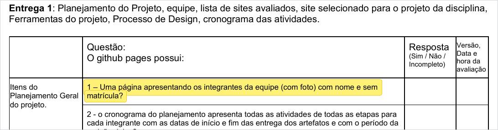{ loading=lazy }
    
Figura 1 — Fonte do critério E1-P01 (Item 1 do planejamento geral).

    
Fonte: SALES (2026, p. 8 do PDF).

??? question "E1-P02 (Item 2) — O cronograma do planejamento apresenta todas as atividades de todas as etapas para cada integrante com as datas de início e fim das entregas dos artefatos e com o período da revisão deles?"

    **Rastreabilidade na V2.** [E1-04](../../entrega-8/lista-etapa-1.md#e1-04) · detalha a atribuição nominal de autores e revisores por etapa.

    **Autor do item:** André Barros de Sales.

    **O que conferir:** Conferir no cronograma planejado a distribuição das atividades de todas as etapas do semestre, com autores identificados nominalmente, datas de início e fim de elaboração e período específico de revisão.

    **Origem da pergunta:** Plano de ensino (SALES, 2026, p. 8 do PDF). A Figura 2 mostra o trecho destacado.

    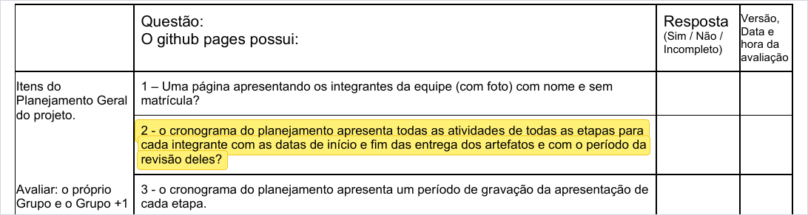{ loading=lazy }
    
Figura 2 — Fonte do critério E1-P02 (Item 2 do planejamento geral).

    
Fonte: SALES (2026, p. 8 do PDF).

??? question "E1-P03 (Item 3) — O cronograma do planejamento apresenta um período de gravação da apresentação de cada etapa?"

    **Rastreabilidade na V2.** [E1-05](../../entrega-8/lista-etapa-1.md#e1-05) · consolidado junto às janelas obrigatórias por etapa do cronograma planejado.

    **Autor do item:** André Barros de Sales.

    **O que conferir:** Verificar nas tabelas do cronograma planejado a existência de janela dedicada à gravação e edição da apresentação em vídeo em cada etapa da disciplina.

    **Origem da pergunta:** Plano de ensino (SALES, 2026, p. 8 do PDF). A Figura 3 mostra o trecho destacado.

    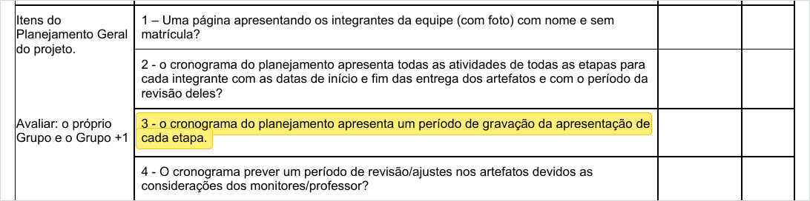{ loading=lazy }
    
Figura 3 — Fonte do critério E1-P03 (Item 3 do planejamento geral).

    
Fonte: SALES (2026, p. 8 do PDF).

??? question "E1-P04 (Item 4) — O cronograma prevê um período de revisão/ajustes nos artefatos devidos às considerações dos monitores/professor?"

    **Rastreabilidade na V2.** [E1-05](../../entrega-8/lista-etapa-1.md#e1-05) · consolidado junto às janelas obrigatórias por etapa do cronograma planejado.

    **Autor do item:** André Barros de Sales.

    **O que conferir:** Confirmar no cronograma planejado a previsão de intervalo posterior a cada apresentação para incorporar ajustes decorrentes do feedback do professor e dos monitores.

    **Origem da pergunta:** Plano de ensino (SALES, 2026, p. 8 do PDF). A Figura 4 mostra o trecho destacado.

    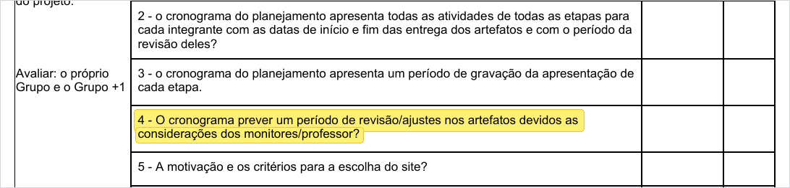{ loading=lazy }
    
Figura 4 — Fonte do critério E1-P04 (Item 4 do planejamento geral).

    
Fonte: SALES (2026, p. 8 do PDF).

??? question "E1-P05 (Item 5) — O GitHub Pages possui a motivação e os critérios para a escolha do site?"

    **Rastreabilidade na V2.** [E1-07](../../entrega-8/lista-etapa-1.md#e1-07) · mantido com critérios verificáveis de seleção.

    **Autor do item:** André Barros de Sales.

    **O que conferir:** Examinar a página do site escolhido para confirmar a exposição da motivação da equipe e dos critérios objetivos que fundamentaram a escolha do sistema avaliado na disciplina.

    **Origem da pergunta:** Plano de ensino (SALES, 2026, p. 8 do PDF). A Figura 5 mostra o trecho destacado.

    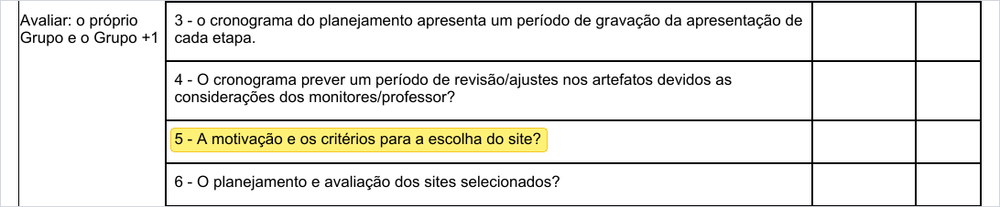{ loading=lazy }
    
Figura 5 — Fonte do critério E1-P05 (Item 5 do planejamento geral).

    
Fonte: SALES (2026, p. 8 do PDF).

??? question "E1-P06 (Item 6) — O GitHub Pages possui o planejamento e avaliação dos sites selecionados?"

    **Rastreabilidade na V2.** [E1-06](../../entrega-8/lista-etapa-1.md#e1-06) · explicita o vínculo com os relatórios e planejamentos individuais de avaliação.

    **Autor do item:** André Barros de Sales.

    **O que conferir:** Abrir o artefato de sites avaliados e conferir a documentação dos sites candidatos inspecionados pelos integrantes, acompanhada dos respectivos planejamentos e relatórios individuais.

    **Origem da pergunta:** Plano de ensino (SALES, 2026, p. 8 do PDF). A Figura 6 mostra o trecho destacado.

    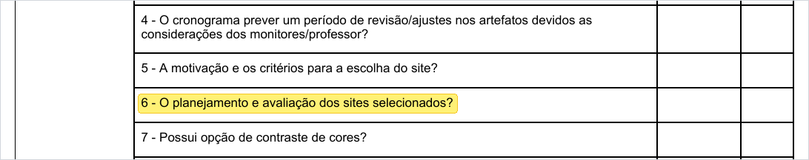{ loading=lazy }
    
Figura 6 — Fonte do critério E1-P06 (Item 6 do planejamento geral).

    
Fonte: SALES (2026, p. 8 do PDF).

??? question "E1-P07 (Item 7) — O GitHub Pages possui opção de contraste de cores?"

    **Rastreabilidade na V2.** [E1-03](../../entrega-8/lista-etapa-1.md#e1-03) · mantido no bloco *Conteúdo da disciplina*.

    **Autor do item:** André Barros de Sales.

    **O que conferir:** Testar na barra superior ou controles de acessibilidade do site a presença de alternância funcional de contraste/tema visual (claro, escuro ou alto contraste).

    **Origem da pergunta:** Plano de ensino (SALES, 2026, p. 8 do PDF). A Figura 7 mostra o trecho destacado.

    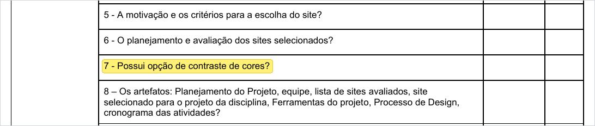{ loading=lazy }
    
Figura 7 — Fonte do critério E1-P07 (Item 7 do planejamento geral).

    
Fonte: SALES (2026, p. 8 do PDF).

??? question "E1-P08 (Item 8) — O GitHub Pages possui os artefatos: Planejamento do Projeto, equipe, lista de sites avaliados, site selecionado para o projeto da disciplina, Ferramentas do projeto, Processo de Design, cronograma das atividades?"

    **Rastreabilidade na V2.** [E1-01](../../entrega-8/lista-etapa-1.md#e1-01) e [E1-10](../../entrega-8/lista-etapa-1.md#e1-10) · verificam a presença do inventário completo e o detalhamento de ferramentas e disponibilidade.

    **Autor do item:** André Barros de Sales.

    **O que conferir:** Confirmar na navegação e páginas da Entrega 1 a publicação acessível de todos os artefatos exigidos: planejamento geral, equipe, sites avaliados, site escolhido, ferramentas, processo de design e cronograma.

    **Origem da pergunta:** Plano de ensino (SALES, 2026, p. 8 do PDF). A Figura 8 mostra o trecho destacado.

    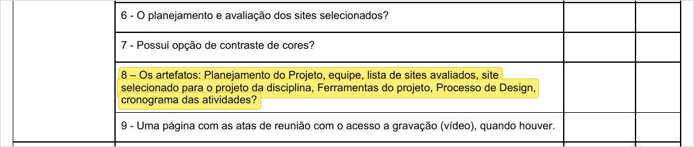{ loading=lazy }
    
Figura 8 — Fonte do critério E1-P08 (Item 8 do planejamento geral).

    
Fonte: SALES (2026, p. 8 do PDF).

??? question "E1-P09 (Item 9) — O GitHub Pages possui uma página com as atas de reunião com o acesso à gravação (vídeo), quando houver?"

    **Rastreabilidade na V2.** [D07](../../entrega-8/lista-etapa-1.md#d07) e [D08](../../entrega-8/lista-etapa-1.md#d08) · consolidados na conferência das atas e do acesso às gravações da etapa.

    **Autor do item:** André Barros de Sales.

    **O que conferir:** Verificar a existência de seção dedicada às atas de reunião no site, com vínculo funcional para a gravação em vídeo de cada reunião realizada.

    **Origem da pergunta:** Plano de ensino (SALES, 2026, p. 8 do PDF). A Figura 9 mostra o trecho destacado.

    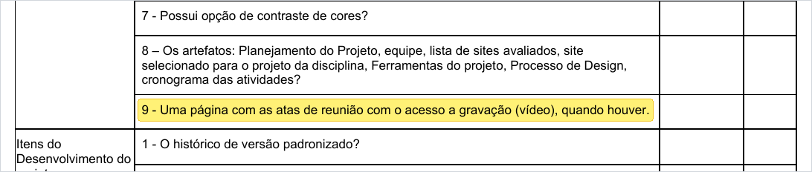{ loading=lazy }
    
Figura 9 — Fonte do critério E1-P09 (Item 9 do planejamento geral).

    
Fonte: SALES (2026, p. 8 do PDF).

## Desenvolvimento do projeto

O Plano de Ensino (SALES, 2026, p. 3 e p. 8–9 do PDF) [1] é a fonte das perguntas `D01`–`D11`.

??? question "D01 — O GitHub Pages possui o histórico de versão padronizado?"

    **Rastreabilidade na V2.** [D01](../../entrega-8/lista-etapa-1.md#d01).

    **Autor do item:** André Barros de Sales.

    **O que conferir:** Conferir presença de tabela padronizada com versão, data, descrição das alterações, autor(es) e revisor(es) em cada artefato da Etapa 1.

    **Origem da pergunta:** Plano de ensino (SALES, 2026, p. 8 do PDF). A Figura 10 mostra o trecho destacado.

    { loading=lazy }
    
Figura 10 — Fonte do critério D01.

    
Fonte: SALES (2026, p. 8 do PDF).

??? question "D02 — O GitHub Pages possui o(s) autor(es) e o(s) revisor(es) para cada artefato?"

    **Rastreabilidade na V2.** [D02](../../entrega-8/lista-etapa-1.md#d02).

    **Autor do item:** André Barros de Sales.

    **O que conferir:** Verificar identificação nominal de autor(es) e revisor(es) distintos em cada artefato, com revisão efetivamente registrada.

    **Origem da pergunta:** Plano de ensino (SALES, 2026, p. 8 do PDF). A Figura 11 mostra o trecho destacado.

    { loading=lazy }
    
Figura 11 — Fonte do critério D02.

    
Fonte: SALES (2026, p. 8 do PDF).

??? question "D03 — O GitHub Pages possui referências bibliográficas e/ou bibliografia em todos os artefatos?"

    **Rastreabilidade na V2.** [D03](../../entrega-8/lista-etapa-1.md#d03).

    **Autor do item:** André Barros de Sales.

    **O que conferir:** Conferir se todos os artefatos de conteúdo apresentam seção final de Referências e/ou Bibliografia padronizada conforme a ABNT, coerente com as citações no texto.

    **Origem da pergunta:** Plano de ensino (SALES, 2026, p. 8 do PDF). A Figura 12 mostra o trecho destacado.

    { loading=lazy }
    
Figura 12 — Fonte do critério D03.

    
Fonte: SALES (2026, p. 8 do PDF).

??? question "D04 — As tabelas e imagens possuem legenda e fonte e são chamadas dentro do texto?"

    **Rastreabilidade na V2.** [D04](../../entrega-8/lista-etapa-1.md#d04).

    **Autor do item:** André Barros de Sales.

    **O que conferir:** Inspecionar tabelas, cronogramas, heatmap, diagramas de processo de design e capturas dos sites candidatos para confirmar numeração, legenda, fonte e chamada explícita no texto.

    **Origem da pergunta:** Plano de ensino (SALES, 2026, p. 8 do PDF). A Figura 13 mostra o trecho destacado.

    { loading=lazy }
    
Figura 13 — Fonte do critério D04.

    
Fonte: SALES (2026, p. 8 do PDF).

??? question "D05 — O GitHub Pages possui um texto fazendo uma introdução dos artefatos?"

    **Rastreabilidade na V2.** [D05](../../entrega-8/lista-etapa-1.md#d05).

    **Autor do item:** André Barros de Sales.

    **O que conferir:** Verificar texto introdutório no início de cada documento contextualizando objetivo e escopo do artefato no planejamento do projeto.

    **Origem da pergunta:** Plano de ensino (SALES, 2026, p. 8 do PDF). A Figura 14 mostra o trecho destacado.

    { loading=lazy }
    
Figura 14 — Fonte do critério D05.

    
Fonte: SALES (2026, p. 8 do PDF).

??? question "D06 — O GitHub Pages possui o cronograma executado com quem realizou cada artefato/atividade com as datas de início e fim?"

    **Rastreabilidade na V2.** [D06](../../entrega-8/lista-etapa-1.md#d06).

    **Autor do item:** André Barros de Sales.

    **O que conferir:** Conferir registro do cronograma efetivamente executado da Etapa 1 com responsáveis, revisores e datas reais de início e término de cada atividade.

    **Origem da pergunta:** Plano de ensino (SALES, 2026, p. 8 do PDF). A Figura 15 mostra o trecho destacado.

    { loading=lazy }
    
Figura 15 — Fonte do critério D06.

    
Fonte: SALES (2026, p. 8 do PDF).

??? question "D07 — O GitHub Pages possui ata(s) da(s) reuniões (com data, horário de início e fim, participantes, objetivo, atividades definidas etc.)?"

    **Rastreabilidade na V2.** [D07](../../entrega-8/lista-etapa-1.md#d07).

    **Autor do item:** André Barros de Sales.

    **O que conferir:** Conferir na seção de Atas a presença da ata formal da Etapa 1 contendo data, horários de abertura e encerramento, participantes presentes, pauta/objetivo e deliberações.

    **Origem da pergunta:** Plano de ensino (SALES, 2026, p. 9 do PDF). A Figura 16 mostra o trecho destacado.

    { loading=lazy }
    
Figura 16 — Fonte do critério D07.

    
Fonte: SALES (2026, p. 9 do PDF).

??? question "D08 — O GitHub Pages possui a gravação da reunião do grupo?"

    **Rastreabilidade na V2.** [D08](../../entrega-8/lista-etapa-1.md#d08).

    **Autor do item:** André Barros de Sales.

    **O que conferir:** Verificar link acessível e funcional para a gravação em vídeo da reunião do grupo referente à Etapa 1.

    **Origem da pergunta:** Plano de ensino (SALES, 2026, p. 9 do PDF). A Figura 17 mostra o trecho destacado.

    { loading=lazy }
    
Figura 17 — Fonte do critério D08.

    
Fonte: SALES (2026, p. 9 do PDF).

??? question "D09 — O GitHub Pages possui vídeo de apresentação na categoria “não listado” no YouTube?"

    **Rastreabilidade na V2.** [D09](../../entrega-8/lista-etapa-1.md#d09).

    **Autor do item:** André Barros de Sales.

    **O que conferir:** Conferir disponibilidade do vídeo da Apresentação 1 publicado como “não listado” no YouTube e devidamente vinculado na página de apresentações do grupo.

    **Origem da pergunta:** Plano de ensino (SALES, 2026, p. 9 do PDF). A Figura 18 mostra o trecho destacado.

    { loading=lazy }
    
Figura 18 — Fonte do critério D09.

    
Fonte: SALES (2026, p. 9 do PDF).

??? question "D10 — O GitHub Pages possui tabela de contribuição no início do artefato com o nome dos integrantes e hiperligação da atividade?"

    **Rastreabilidade na V2.** [D10](../../entrega-8/lista-etapa-1.md#d10).

    **Autor do item:** André Barros de Sales.

    **O que conferir:** Conferir tabela no início de cada artefato identificando quem atuou naquela página, qual atividade realizou e a hiperligação para a seção ou gravação correspondente.

    **Origem da pergunta:** Plano de ensino (SALES, 2026, p. 9 do PDF). A Figura 19 mostra o trecho destacado.

    { loading=lazy }
    
Figura 19 — Fonte do critério D10.

    
Fonte: SALES (2026, p. 9 do PDF).

??? question "D11 — O GitHub Pages possui a seção de agradecimentos apresentando o uso de Inteligência Artificial (IA) Generativa no artefato?"

    **Rastreabilidade na V2.** [D11](../../entrega-8/lista-etapa-1.md#d11).

    **Autor do item:** André Barros de Sales.

    **O que conferir:** Conferir menção nominal às ferramentas de IA generativa utilizadas, detalhando a finalidade do apoio e reafirmando a responsabilidade humana pelo conteúdo.

    **Origem da pergunta:** Plano de ensino (SALES, 2026, p. 3 do PDF). A Figura 20 mostra o trecho destacado.

    { loading=lazy }
    
Figura 20 — Fonte do critério D11.

    
Fonte: SALES (2026, p. 3 do PDF).

## Conteúdo da disciplina

Os critérios `E1-C01` e `E1-C02` reproduzem os itens oficiais de conteúdo da **Entrega 1** na página 9 do Plano de Ensino [1].

??? question "E1-C01 (Item 1) — Apresenta a justificativa da escolha do Processo de Design, com referência bibliográfica da fonte, foto do texto da referência e identificação do(s) autor(es)?"

    **Rastreabilidade na V2.** [E1-08](../../entrega-8/lista-etapa-1.md#e1-08) e [E1-09](../../entrega-8/lista-etapa-1.md#e1-09) · desdobrados na fundamentação/comparação dos modelos de ciclo de vida e na justificativa contextualizada com autor, referência e foto da fonte.

    **Autor do item:** André Barros de Sales.

    **O que conferir:** Verificar no artefato de Processo de Design a justificativa para a adoção do modelo escolhido (ex.: Engenharia de Usabilidade de Mayhew) frente às características do projeto, acompanhada de referência bibliográfica ABNT, foto legível da página da obra e identificação nominal do(s) autor(es) do item.

    **Origem da pergunta:** Plano de ensino (SALES, 2026, p. 9 do PDF). A Figura 21 mostra o trecho destacado.

    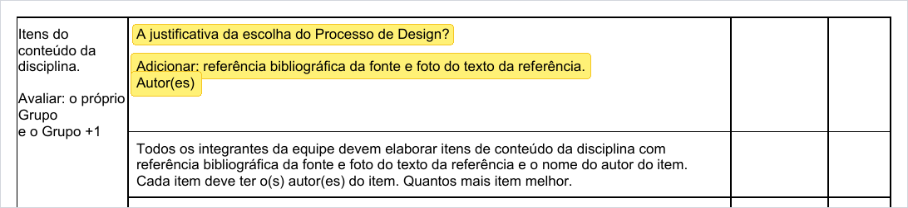{ loading=lazy }
    
Figura 21 — Fonte do critério E1-C01 (Item 1 de conteúdo da Entrega 1).

    
Fonte: SALES (2026, p. 9 do PDF).

??? question "E1-C02 (Item 2) — Todos os integrantes da equipe elaboraram itens de conteúdo da disciplina com referência bibliográfica da fonte, foto do texto da referência e nome do(s) autor(es) do item?"

    **Rastreabilidade na V2.** [E1-10](../../entrega-8/lista-etapa-1.md#e1-10) e [Conferência da lista](../../entrega-8/lista-etapa-1.md#conferencia-da-lista) · incorporado à verificação de conteúdo dos artefatos da etapa e ao controle de qualidade autoral da V2.

    **Autor do item:** André Barros de Sales.

    **O que conferir:** Confirmar nos artefatos da Entrega 1 e nos itens adicionais de verificação que todos os integrantes da equipe produziram contribuições de conteúdo da disciplina contendo nome explícito do autor, referência bibliográfica e recorte do trecho de referência.

    **Origem da pergunta:** Plano de ensino (SALES, 2026, p. 9 do PDF). A Figura 22 mostra o trecho destacado.

    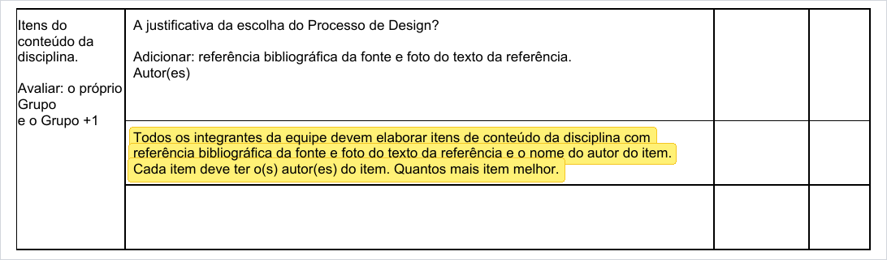{ loading=lazy }
    
Figura 22 — Fonte do critério E1-C02 (Item 2 de conteúdo da Entrega 1).

    
Fonte: SALES (2026, p. 9 do PDF).

## Itens elaborados pelo grupo

Os critérios `E1-C03` a `E1-C05` reúnem os **3 itens adicionais** (itens `3` a `5`) elaborados pelos integrantes do Grupo 06 para inspecionar o planejamento da avaliação dos sites candidatos na Entrega 1.

??? question "E1-C03 (Item 3) — O planejamento da avaliação de cada site candidato cobre as seis atividades do framework DECIDE: (1) determinar os objetivos; (2) explorar as perguntas a serem respondidas; (3) escolher os métodos; (4) identificar e administrar as questões práticas; (5) decidir como lidar com as questões éticas; e (6) avaliar, interpretar e apresentar os dados?"

    **Rastreabilidade na V2.** [E1-11](../../entrega-8/lista-etapa-1.md#e1-11) · mantido no bloco *Conteúdo da disciplina*.

    **Autor do item:** [Caio Breno de Souza Bezerra](https://github.com/CaioBezerra-Dev).

    **Referência:** BARBOSA, Simone Diniz Junqueira; SILVA, Bruno Santana da. *Interação humano-computador*. Rio de Janeiro: Elsevier, 2010. Cap. 9, Seção 9.7, p. 312–313.

    **Fundamentação:** Sharp, Rogers e Preece (2007 *apud* Barbosa; Silva, 2010, p. 312–313) propõem o framework DECIDE para orientar o planejamento, a execução e a análise de uma avaliação de IHC por meio de seis atividades interdependentes: determinar os objetivos gerais, explorar perguntas específicas, escolher os métodos adequados, administrar as questões práticas, decidir sobre os cuidados éticos e avaliar, interpretar e apresentar os dados.

    **Como verificar:**

    - **Sim:** os planejamentos de avaliação dos sites candidatos cobrem explicitamente todas as seis atividades do framework DECIDE.
    - **Incompleto:** apenas parte dos planejamentos aplica o DECIDE ou há omissão de uma ou mais das seis atividades.
    - **Não:** não há planejamento estruturado pelo framework DECIDE para os sites avaliados.

    A Figura 23 apresenta o quadro das seis atividades do framework DECIDE destacado em Barbosa e Silva (2010, p. 313).

    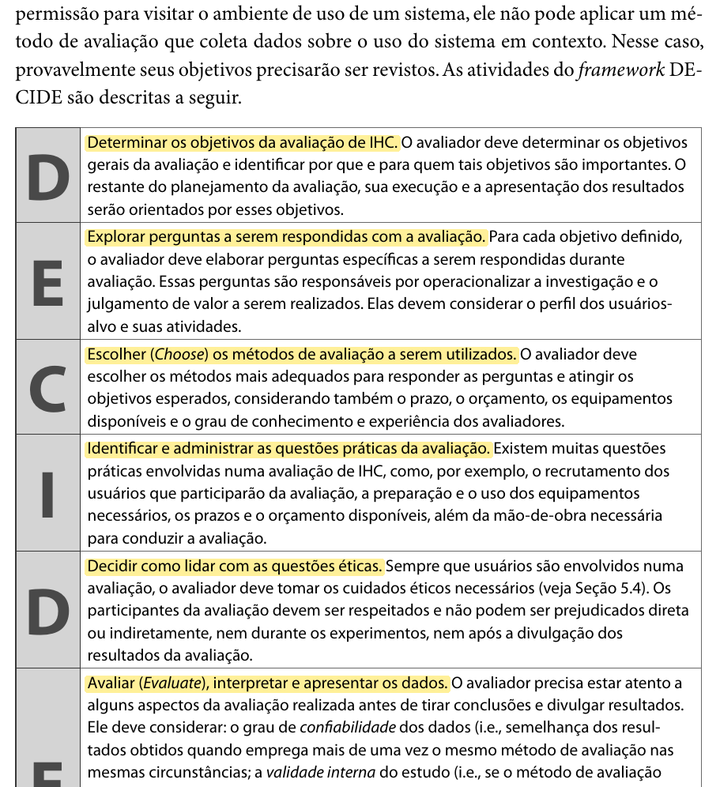{ loading=lazy }
    
Figura 23 — As seis atividades do framework DECIDE no planejamento da avaliação.

    
Fonte: BARBOSA; SILVA (2010, p. 313).

??? question "E1-C04 (Item 4) — Na inspeção dos sites candidatos, a severidade de cada problema de usabilidade é julgada pelos três fatores de Nielsen (1994): (1) a frequência com que o problema ocorre; (2) o impacto do problema, se ocorrer; e (3) a persistência do problema?"

    **Rastreabilidade na V2.** [E1-12](../../entrega-8/lista-etapa-1.md#e1-12) · mantido no bloco *Conteúdo da disciplina*.

    **Autor do item:** [Caio Breno de Souza Bezerra](https://github.com/CaioBezerra-Dev).

    **Referência:** BARBOSA, Simone Diniz Junqueira; SILVA, Bruno Santana da. *Interação humano-computador*. Rio de Janeiro: Elsevier, 2010. p. 284; NIELSEN, Jakob. *Usability Engineering*. San Francisco: Morgan Kaufmann, 1994.

    **Fundamentação:** Na avaliação heurística proposta por Nielsen (1994 *apud* Barbosa; Silva, 2010, p. 284), o julgamento da severidade de um problema de usabilidade articula três fatores: a frequência com que o problema ocorre, o impacto para o usuário caso ocorra e a persistência do problema ao longo do uso repetido.

    **Como verificar:**

    - **Sim:** as inspeções dos sites candidatos classificam a severidade dos problemas considerando explicitamente frequência, impacto e persistência.
    - **Incompleto:** há atribuição de notas de severidade sem explicitar os três fatores ou cobrindo apenas parte dos relatórios individuais.
    - **Não:** os problemas relatados nos sites candidatos não possuem classificação de severidade fundamentada.

    A Figura 24 reproduz o trecho destacado sobre os fatores de julgamento da severidade de problemas de usabilidade em Barbosa e Silva (2010, p. 284).

    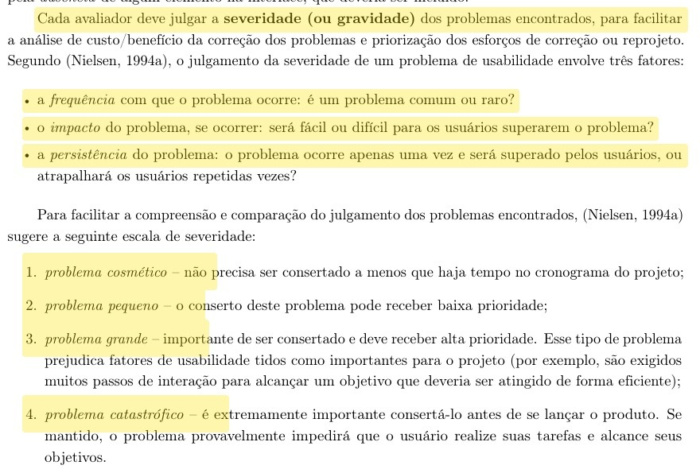{ loading=lazy }
    
Figura 24 — Fatores de frequência, impacto e persistência no julgamento da severidade.

    
Fonte: NIELSEN (1994); BARBOSA; SILVA (2010, p. 284).

??? question "E1-C05 (Item 5) — O planejamento da avaliação de cada site candidato identifica o método de avaliação de IHC utilizado, classificando-o como (1) método de investigação; (2) método de observação de uso; ou (3) método de inspeção?"

    **Rastreabilidade na V2.** [E1-13](../../entrega-8/lista-etapa-1.md#e1-13) · mantido no bloco *Conteúdo da disciplina*.

    **Autor do item:** [Luís Henrique Arruda Luna](https://github.com/Donnk61).

    **Referência:** BARBOSA, Simone Diniz Junqueira; SILVA, Bruno Santana da. *Interação humano-computador*. Rio de Janeiro: Elsevier, 2010. Cap. 9, Seção 9.6, p. 301 (correspondente a BARBOSA et al., 2021, Cap. 11, Seção 11.6, p. 272).

    **Fundamentação:** A literatura divide os métodos de avaliação de IHC em três grandes classes: **investigação** (entrevistas, questionários, grupos de foco e estudos de campo), **observação de uso** (registro do desempenho real ou em laboratório com participação de usuários) e **inspeção** (exame da interface por avaliadores para antever problemas potenciais de uso, como avaliação heurística e percurso cognitivo). Identificar o método e situá-lo na classe correta permite verificar sua aderência aos objetivos planejados.

    **Como verificar:**

    - **Sim:** todos os planejamentos dos sites candidatos nomeiam o método concreto adotado e o classificam corretamente em um dos três grupos (investigação, observação de uso ou inspeção).
    - **Incompleto:** apenas parte dos planejamentos faz a classificação ou o método é apenas nomeado sem indicar a classe correspondente.
    - **Não:** nenhum planejamento identifica ou classifica o método de avaliação empregado.

    A Figura 25 apresenta a classificação dos métodos de avaliação em investigação, observação de uso e inspeção destacada em Barbosa e Silva (2010, p. 301).

    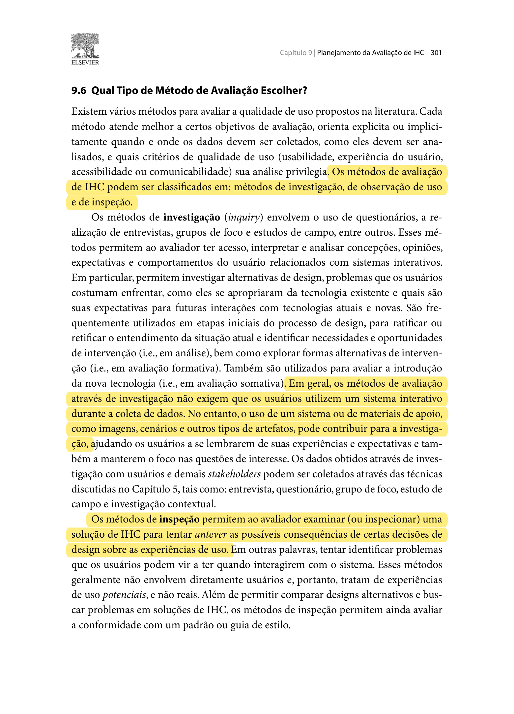{ loading=lazy }
    
Figura 25 — Classificação dos métodos de avaliação de IHC em investigação, observação de uso e inspeção.

    
Fonte: BARBOSA; SILVA (2010, p. 301).

## Agradecimentos

O Google Gemini e o Antigravity apoiaram a organização em blocos expansíveis, a geração dos recortes com destaque amarelo a partir do Plano de Ensino e a revisão das referências. A responsabilidade técnica pela organização desta página é de Bruno Ferreira Dornelas; os critérios `E1-P01`–`E1-P09`, `D01`–`D11` e `E1-C01`–`E1-C02` são de autoria docente de André Barros de Sales, e os critérios `E1-C03`–`E1-C05` pertencem aos respectivos integrantes do Grupo 06.

## Histórico de versão

| Versão | Data | Descrição | Autor(es) | Revisor(es) |
| :---: | :---: | --- | --- | --- |
| `1.0` | 23/11/2026 | Estruturação da lista V1 da Etapa 1 com recortes grifados e rastreabilidade para a V2 | [Bruno Ferreira Dornelas](https://github.com/brunnf) | [Caio Breno de Souza Bezerra](https://github.com/CaioBezerra-Dev) |

Tabela 2 — Histórico de versão.

Fonte: elaboração do Grupo 06 (2026).

## Referências

[1] SALES, André Barros de. *Plano de Ensino FIHC 022026 — Turma 01*, v1. Brasília: FCTE/UnB, 2026.

[2] BARBOSA, Simone Diniz Junqueira; SILVA, Bruno Santana da. *Interação humano-computador*. Rio de Janeiro: Elsevier, 2010.

[3] BARBOSA, Simone Diniz Junqueira et al. *Interação Humano-Computador e Experiência do Usuário*. Autopublicação, 2021.

[4] NIELSEN, Jakob. *Usability Engineering*. San Francisco: Morgan Kaufmann, 1994.
