Responsável: Bruno Ferreira Dornelas · Autor dos itens oficiais: André Barros de Sales

# Lista de verificação — Etapa 2 · V1

!!! warning "V1 desatualizada"
    A [Lista V2 da Etapa 2](../../entrega-8/lista-etapa-2.md) é a versão oficial para a reinspeção da Etapa 8. Esta página preserva os critérios usados nas primeiras inspeções da Entrega 2. Cada pergunta aponta para seu correspondente na V2 ou para o registro de como foi reorganizada.

## Tabela de contribuição

A Tabela 1 registra a contribuição neste artefato.

| Integrante / ferramenta | Contribuição | Artefato / atividade |
| --- | --- | --- |
| [Bruno Ferreira Dornelas](https://github.com/brunnf) | Organização da lista não preenchida da Etapa 2, geração dos recortes grifados, elaboração do item 13 e vínculo V1–V2 | [Desenvolvimento](#desenvolvimento-do-projeto) · [Conteúdo](#conteudo-da-disciplina) · [E2-C13](#e2-c13) |
| [Caio Breno de Souza Bezerra](https://github.com/CaioBezerra-Dev) | Elaboração dos itens 14 e 15 sobre os elementos de personas de Courage e Baxter e a relação da HTA | [E2-C14](#e2-c14) · [E2-C15](#e2-c15) |
| [Heitor Pinheiro Gonçalves das Chagas](https://github.com/Heitorovski01) | Elaboração do item 16 sobre definição de planos de ordenação e condições na HTA | [E2-C16](#e2-c16) |
| [Israel Soares de Paiva](https://github.com/IsraelSoares-25) | Elaboração do item 17 sobre princípios éticos e garantias essenciais no modelo de TCLE | [E2-C17](#e2-c17) |
| [Luís Henrique Arruda Luna](https://github.com/Donnk61) | Elaboração do item 18 sobre a classificação nos quatro tipos de tarefa da notação CTT | [E2-C18](#e2-c18) |
| Google Gemini e Antigravity | Apoio à organização em blocos expansíveis, recortes grifados das fontes e conferência de referências | [Agradecimentos](#agradecimentos) |

Tabela 1 — Contribuição neste artefato.

Fonte: elaboração para o Grupo 06 (2026).

## Introdução

Cada pergunta possui **autor, evidência esperada, referência e imagem do trecho utilizado com marcação amarela**. Abra qualquer item abaixo para consultar sua fundamentação. Os **11 critérios de desenvolvimento do projeto** (`D01`–`D11`) e os **12 critérios oficiais de conteúdo da Entrega 2** (`E2-C01`–`E2-C12`) têm autoria do professor **André Barros de Sales** no Plano de Ensino [1], ancorados nos capítulos 5 e 6 de Barbosa e Silva (2010) [2]. Somam-se os **6 critérios elaborados pelos integrantes do Grupo 06** (`E2-C13`–`E2-C18`, correspondentes aos itens `13` a `18`), fundamentados em Barbosa e Silva (2010) [2], Barbosa et al. (2021) [3] e Paternò (2000) [4].

**Esta página define apenas as perguntas — a lista não é preenchida aqui.** As respostas, a versão inspecionada, a data/hora, as observações e os vídeos das reuniões ficam registrados nas respectivas páginas de inspeção: [Autoverificação do Grupo 06](../grupo-06/etapa-2/lista-verificacao.md) e [Inspeção do Grupo 05](../grupo-05/etapa-2/lista-verificacao.md).

Ao aplicar a lista nas fichas de inspeção, usar **Sim / Não / Incompleto** (campo vazio significa ainda não inspecionado) e registrar a evidência correspondente à versão efetivamente examinada.

## Desenvolvimento do projeto

O Plano de Ensino (SALES, 2026, p. 3 e p. 8–9 do PDF) [1] é a fonte das perguntas `D01`–`D11`.

??? question "D01 — O GitHub Pages possui o histórico de versão padronizado?"

    **Rastreabilidade na V2.** [D01](../../entrega-8/lista-etapa-2.md#d01).

    **Autor do item:** André Barros de Sales.

    **O que conferir:** Conferir presença de tabela padronizada com versão, data, descrição das alterações, autor(es) e revisor(es) em cada artefato da Etapa 2.

    **Origem da pergunta:** Plano de ensino (SALES, 2026, p. 8 do PDF). A Figura 1 mostra o trecho destacado.

    { loading=lazy }
    
Figura 1 — Fonte do critério D01.

    
Fonte: SALES (2026, p. 8 do PDF).

??? question "D02 — O GitHub Pages possui o(s) autor(es) e o(s) revisor(es) para cada artefato?"

    **Rastreabilidade na V2.** [D02](../../entrega-8/lista-etapa-2.md#d02).

    **Autor do item:** André Barros de Sales.

    **O que conferir:** Verificar identificação nominal de autor(es) e revisor(es) distintos em cada artefato do grupo e individual da Etapa 2, com revisão efetivamente registrada.

    **Origem da pergunta:** Plano de ensino (SALES, 2026, p. 8 do PDF). A Figura 2 mostra o trecho destacado.

    { loading=lazy }
    
Figura 2 — Fonte do critério D02.

    
Fonte: SALES (2026, p. 8 do PDF).

??? question "D03 — O GitHub Pages possui referências bibliográficas e/ou bibliografia em todos os artefatos?"

    **Rastreabilidade na V2.** [D03](../../entrega-8/lista-etapa-2.md#d03).

    **Autor do item:** André Barros de Sales.

    **O que conferir:** Conferir se todos os artefatos de conteúdo apresentam seção final de Referências e/ou Bibliografia padronizada conforme a ABNT, coerente com as citações no texto.

    **Origem da pergunta:** Plano de ensino (SALES, 2026, p. 8 do PDF). A Figura 3 mostra o trecho destacado.

    { loading=lazy }
    
Figura 3 — Fonte do critério D03.

    
Fonte: SALES (2026, p. 8 do PDF).

??? question "D04 — As tabelas e imagens possuem legenda e fonte e são chamadas dentro do texto?"

    **Rastreabilidade na V2.** [D04](../../entrega-8/lista-etapa-2.md#d04).

    **Autor do item:** André Barros de Sales.

    **O que conferir:** Inspecionar quadros de perfil, avatares de personas, diagramas HTA e CTT, tabelas de operações e recortes bibliográficos para confirmar numeração, legenda, fonte e chamada explícita no texto.

    **Origem da pergunta:** Plano de ensino (SALES, 2026, p. 8 do PDF). A Figura 4 mostra o trecho destacado.

    { loading=lazy }
    
Figura 4 — Fonte do critério D04.

    
Fonte: SALES (2026, p. 8 do PDF).

??? question "D05 — O GitHub Pages possui um texto fazendo uma introdução dos artefatos?"

    **Rastreabilidade na V2.** [D05](../../entrega-8/lista-etapa-2.md#d05).

    **Autor do item:** André Barros de Sales.

    **O que conferir:** Verificar texto introdutório no início de cada documento contextualizando objetivo, escopo e relação com o espaço de problema investigado na Etapa 2.

    **Origem da pergunta:** Plano de ensino (SALES, 2026, p. 8 do PDF). A Figura 5 mostra o trecho destacado.

    { loading=lazy }
    
Figura 5 — Fonte do critério D05.

    
Fonte: SALES (2026, p. 8 do PDF).

??? question "D06 — O GitHub Pages possui o cronograma executado com quem realizou cada artefato/atividade com as datas de início e fim?"

    **Rastreabilidade na V2.** [D06](../../entrega-8/lista-etapa-2.md#d06).

    **Autor do item:** André Barros de Sales.

    **O que conferir:** Conferir registro do cronograma efetivamente executado da Etapa 2 com responsáveis, revisores e datas reais de início e término de cada atividade.

    **Origem da pergunta:** Plano de ensino (SALES, 2026, p. 8 do PDF). A Figura 6 mostra o trecho destacado.

    { loading=lazy }
    
Figura 6 — Fonte do critério D06.

    
Fonte: SALES (2026, p. 8 do PDF).

??? question "D07 — O GitHub Pages possui ata(s) da(s) reuniões (com data, horário de início e fim, participantes, objetivo, atividades definidas etc.)?"

    **Rastreabilidade na V2.** [D07](../../entrega-8/lista-etapa-2.md#d07).

    **Autor do item:** André Barros de Sales.

    **O que conferir:** Conferir na seção de Atas a presença da ata formal da Etapa 2 contendo data, horários de abertura e encerramento, participantes presentes, pauta/objetivo e deliberações.

    **Origem da pergunta:** Plano de ensino (SALES, 2026, p. 9 do PDF). A Figura 7 mostra o trecho destacado.

    { loading=lazy }
    
Figura 7 — Fonte do critério D07.

    
Fonte: SALES (2026, p. 9 do PDF).

??? question "D08 — O GitHub Pages possui a gravação da reunião do grupo?"

    **Rastreabilidade na V2.** [D08](../../entrega-8/lista-etapa-2.md#d08).

    **Autor do item:** André Barros de Sales.

    **O que conferir:** Verificar link acessível e funcional para a gravação em vídeo da reunião do grupo referente à Etapa 2.

    **Origem da pergunta:** Plano de ensino (SALES, 2026, p. 9 do PDF). A Figura 8 mostra o trecho destacado.

    { loading=lazy }
    
Figura 8 — Fonte do critério D08.

    
Fonte: SALES (2026, p. 9 do PDF).

??? question "D09 — O GitHub Pages possui vídeo de apresentação na categoria “não listado” no YouTube?"

    **Rastreabilidade na V2.** [D09](../../entrega-8/lista-etapa-2.md#d09).

    **Autor do item:** André Barros de Sales.

    **O que conferir:** Conferir disponibilidade do vídeo da Apresentação 2 publicado como “não listado” no YouTube e devidamente vinculado na página de apresentações do grupo.

    **Origem da pergunta:** Plano de ensino (SALES, 2026, p. 9 do PDF). A Figura 9 mostra o trecho destacado.

    { loading=lazy }
    
Figura 9 — Fonte do critério D09.

    
Fonte: SALES (2026, p. 9 do PDF).

??? question "D10 — O GitHub Pages possui tabela de contribuição no início do artefato com o nome dos integrantes e hiperligação da atividade?"

    **Rastreabilidade na V2.** [D10](../../entrega-8/lista-etapa-2.md#d10).

    **Autor do item:** André Barros de Sales.

    **O que conferir:** Conferir tabela no início de cada artefato identificando quem atuou naquela página, qual atividade realizou e o link direto para a seção correspondente.

    **Origem da pergunta:** Plano de ensino (SALES, 2026, p. 9 do PDF). A Figura 10 mostra o trecho destacado.

    { loading=lazy }
    
Figura 10 — Fonte do critério D10.

    
Fonte: SALES (2026, p. 9 do PDF).

??? question "D11 — O GitHub Pages possui a seção de agradecimentos apresentando o uso de Inteligência Artificial (IA) Generativa no artefato?"

    **Rastreabilidade na V2.** [D11](../../entrega-8/lista-etapa-2.md#d11).

    **Autor do item:** André Barros de Sales.

    **O que conferir:** Conferir menção nominal às ferramentas de IA generativa utilizadas, detalhando a finalidade do apoio e reafirmando a responsabilidade humana pelo conteúdo.

    **Origem da pergunta:** Plano de ensino (SALES, 2026, p. 3 do PDF). A Figura 11 mostra o trecho destacado.

    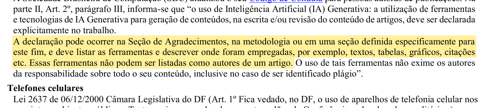{ loading=lazy }
    
Figura 11 — Fonte do critério D11.

    
Fonte: SALES (2026, p. 3 do PDF).

## Conteúdo da disciplina

Os critérios `E2-C01` a `E2-C12` reproduzem os itens **1 a 12** da lista oficial da **Entrega 2** (*Perfil do usuário, Aspectos Éticos de Pesquisas Envolvendo Pessoas e Análise de tarefas*), elaborada pelo professor **André Barros de Sales** [1] a partir de Barbosa e Silva (2010) [2].

??? question "E2-C01 (Item 1) — O perfil do usuário é definido por mais de uma forma (técnica de elicitação e/ou ferramenta)?"

    **Rastreabilidade na V2.** [E2-01](../../entrega-8/lista-etapa-2.md#e2-01) e [E2-07](../../entrega-8/lista-etapa-2.md#e2-07) · consolidados na combinação mínima de duas técnicas de coleta e nos registros individuais das sessões.

    **Autor do item:** André Barros de Sales.

    **O que conferir:** Confirmar se o perfil do usuário foi levantado combinando mais de uma técnica ou instrumento de coleta (ex.: entrevistas semiestruturadas somadas a observação de tarefa, questionário ou análise documental).

    **Origem da pergunta:** Plano de ensino (SALES, 2026, p. 9 do PDF). A Figura 12 mostra o trecho destacado.

    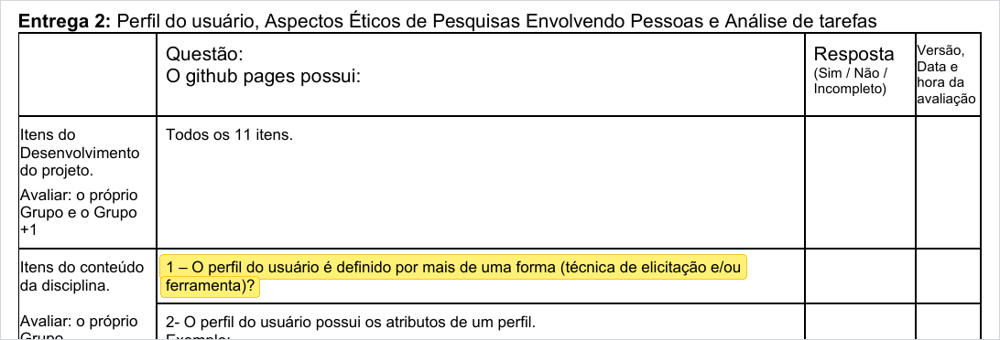{ loading=lazy }
    
Figura 12 — Fonte do critério E2-C01 (Item 1 da Entrega 2).

    
Fonte: SALES (2026, p. 9 do PDF).

??? question "E2-C02 (Item 2) — O perfil do usuário possui os atributos de um perfil (dados demográficos: idade, sexo, status socioeconômico; experiência no cargo; informações sobre a empresa; educação: grau de instrução, área de formação, cursos, alfabetismo etc.), incluindo referência bibliográfica, foto do texto da referência — Hackos e Redish (1998); Courage e Baxter (2005) — e autor do item?"

    **Rastreabilidade na V2.** [E2-02](../../entrega-8/lista-etapa-2.md#e2-02) · mantido com verificação completa dos atributos individuais do perfil.

    **Autor do item:** André Barros de Sales.

    **O que conferir:** Verificar no artefato de Perfil do Usuário o levantamento dos atributos individuais propostos por Hackos e Redish (1998) e Courage e Baxter (2005) em Barbosa e Silva (2010, p. 134–135), acompanhado de referência bibliográfica ABNT, foto da página da obra e identificação nominal do autor do item.

    **Origem da pergunta:** Plano de ensino (SALES, 2026, p. 9 do PDF) e Barbosa e Silva (2010, p. 134). As Figuras 13 e 14 mostram os trechos destacados.

    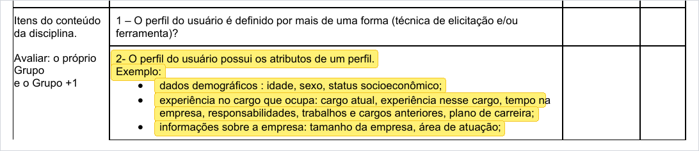{ loading=lazy }
    
Figura 13 — Fonte do critério E2-C02 no Plano de Ensino (Item 2 da Entrega 2).

    
Fonte: SALES (2026, p. 9 do PDF).

    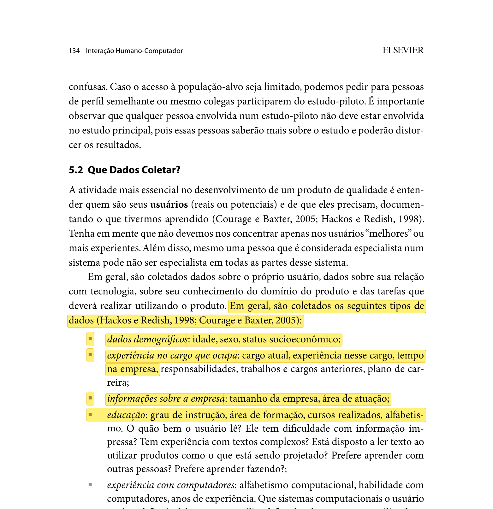{ loading=lazy }
    
Figura 14 — Fundamentação bibliográfica dos atributos do perfil em Barbosa e Silva (2010, p. 134).

    
Fonte: BARBOSA; SILVA (2010, p. 134).

??? question "E2-C03 (Item 3) — O perfil do usuário define os grupos de atributos: (1) idade; (2) experiência (leigo/novato, especialista); (3) atitudes (tecnófilos, tecnófobos); e (4) tarefas primárias, incluindo referência bibliográfica, foto do texto da referência e autor do item?"

    **Rastreabilidade na V2.** [E2-03](../../entrega-8/lista-etapa-2.md#e2-03) · mantido no bloco *Conteúdo da disciplina*.

    **Autor do item:** André Barros de Sales.

    **O que conferir:** Conferir se o artefato de Perfil do Usuário agrupa os usuários nas quatro dimensões descritas em Barbosa e Silva (2010, p. 175) — idade, experiência, atitudes e tarefas primárias — com referência bibliográfica, imagem do trecho utilizado e nome do autor.

    **Origem da pergunta:** Lista oficial da Entrega 2 no Plano de Ensino (SALES, 2026) e Barbosa e Silva (2010, p. 175). A Figura 15 mostra o trecho destacado na literatura-base.

    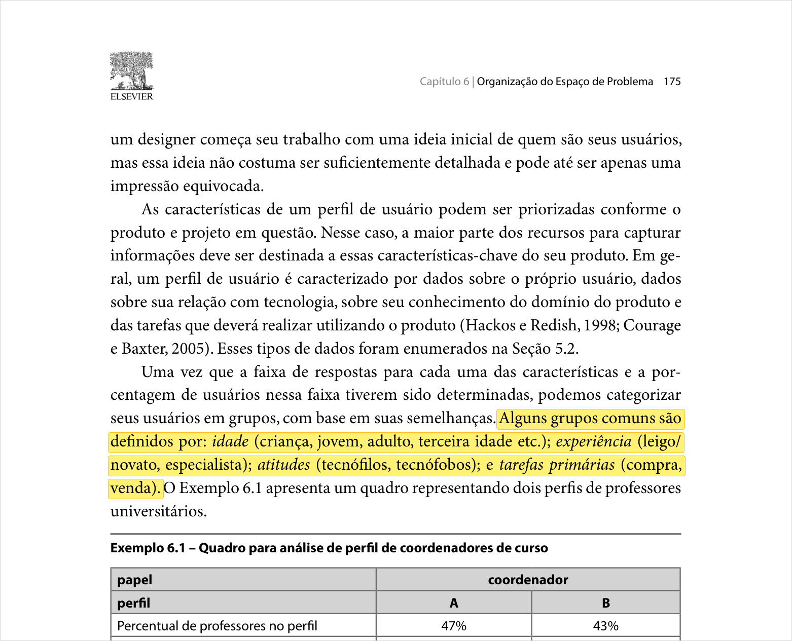{ loading=lazy }
    
Figura 15 — Grupos de atributos de perfil de usuário em Barbosa e Silva (2010, p. 175).

    
Fonte: BARBOSA; SILVA (2010, p. 175).

??? question "E2-C04 (Item 4) — Considera aspectos éticos de pesquisas envolvendo pessoas, incluindo referência bibliográfica, foto do texto da referência e autor do item?"

    **Rastreabilidade na V2.** [E2-04](../../entrega-8/lista-etapa-2.md#e2-04) · consolidado junto aos quatro princípios éticos fundamentais.

    **Autor do item:** André Barros de Sales.

    **O que conferir:** Examinar o artefato de Aspectos Éticos para confirmar a fundamentação dos cuidados éticos em pesquisas e avaliações de IHC envolvendo seres humanos, acompanhada de citação bibliográfica, foto do trecho da referência e autor do item.

    **Origem da pergunta:** Lista oficial da Entrega 2 no Plano de Ensino (SALES, 2026) e Barbosa e Silva (2010, p. 138). A Figura 16 mostra o trecho destacado.

    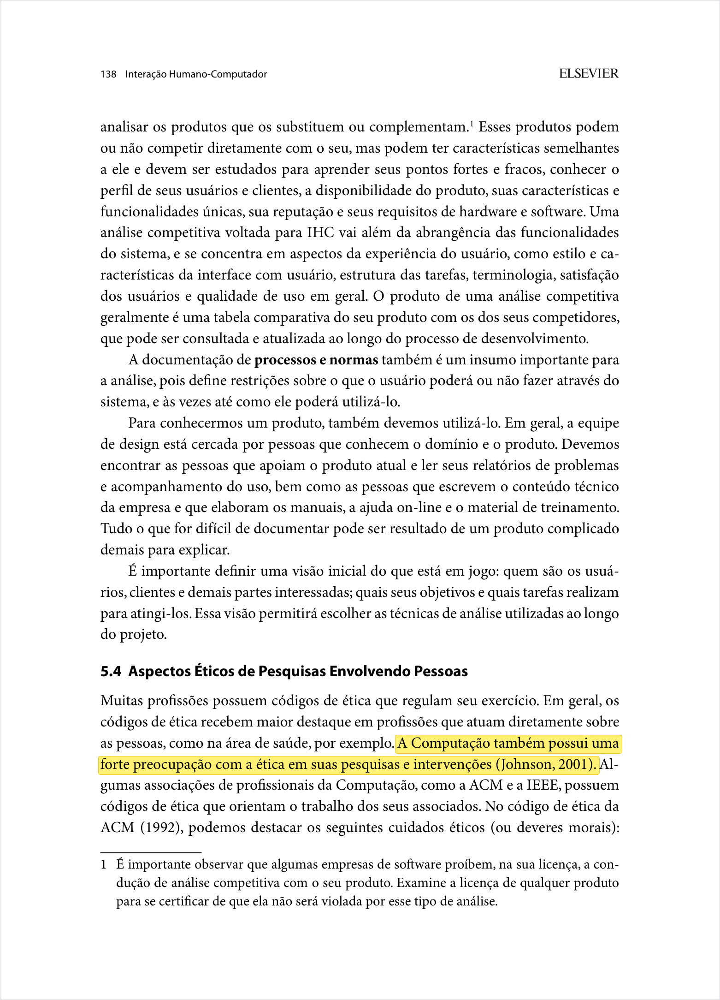{ loading=lazy }
    
Figura 16 — Aspectos éticos de pesquisas envolvendo pessoas em Barbosa e Silva (2010, p. 138).

    
Fonte: BARBOSA; SILVA (2010, p. 138).

??? question "E2-C05 (Item 5) — Apresenta os 4 princípios éticos (autonomia, beneficência, não maleficência, justiça e equidade), incluindo referência bibliográfica, foto do texto da referência e autor do item?"

    **Rastreabilidade na V2.** [E2-04](../../entrega-8/lista-etapa-2.md#e2-04) · consolidado na fundamentação ética da etapa.

    **Autor do item:** André Barros de Sales.

    **O que conferir:** Verificar a definição explícita dos quatro princípios éticos — autonomia, beneficência, não maleficência e justiça e equidade — aplicados à pesquisa com usuários do projeto, com referência bibliográfica, recorte da obra e nome do autor.

    **Origem da pergunta:** Lista oficial da Entrega 2 no Plano de Ensino (SALES, 2026) e Barbosa e Silva (2010, p. 139). A Figura 17 mostra o trecho destacado.

    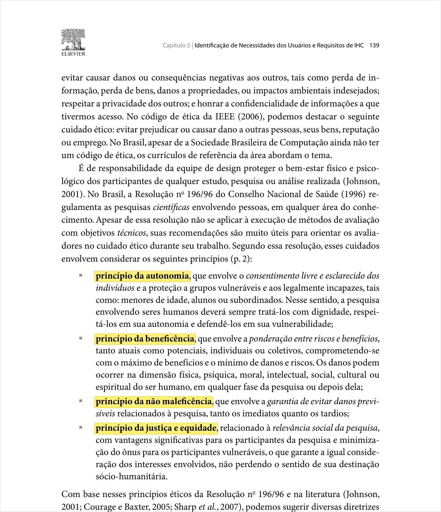{ loading=lazy }
    
Figura 17 — Os quatro princípios éticos em Barbosa e Silva (2010, p. 139).

    
Fonte: BARBOSA; SILVA (2010, p. 139).

??? question "E2-C06 (Item 6) — Solicita permissão para gravar a voz ou imagem de qualquer pessoa antes de começar a gravação?"

    **Rastreabilidade na V2.** [E2-05](../../entrega-8/lista-etapa-2.md#e2-05) · explicita a conferência do escopo autorizado de gravação por sessão.

    **Autor do item:** André Barros de Sales.

    **O que conferir:** Confirmar no protocolo ético e nos relatos individuais das sessões de coleta que nenhuma gravação de áudio, tela ou vídeo foi iniciada sem autorização prévia e explícita do participante.

    **Origem da pergunta:** Lista oficial da Entrega 2 no Plano de Ensino (SALES, 2026) e Barbosa e Silva (2010, p. 140). A Figura 18 mostra o trecho destacado.

    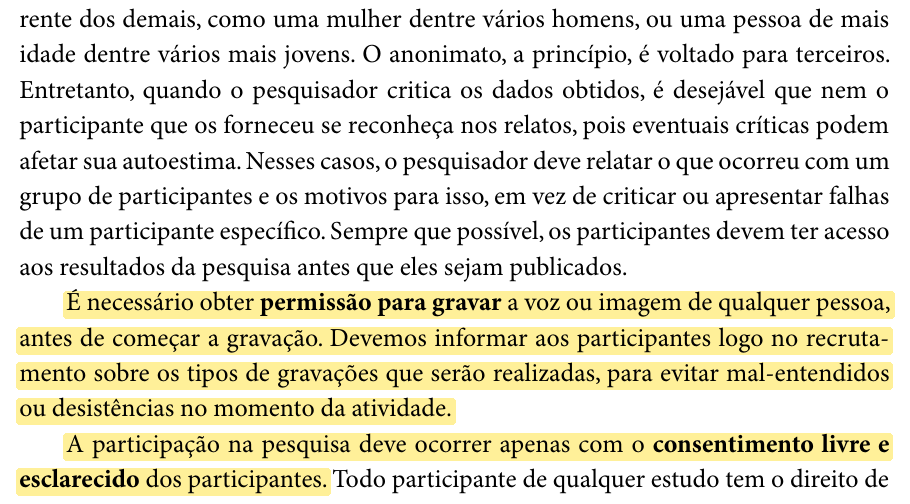{ loading=lazy }
    
Figura 18 — Permissão prévia para gravação de voz ou imagem em Barbosa e Silva (2010, p. 140).

    
Fonte: BARBOSA; SILVA (2010, p. 140).

??? question "E2-C07 (Item 7) — Apresenta o Termo de Consentimento Livre e Esclarecido (TCLE) dos participantes, incluindo referência bibliográfica, foto do texto da referência e autor do item?"

    **Rastreabilidade na V2.** [E2-06](../../entrega-8/lista-etapa-2.md#e2-06) · consolidado junto à verificação das cláusulas éticas do modelo de TCLE e do registro de aplicação.

    **Autor do item:** André Barros de Sales.

    **O que conferir:** Verificar a disponibilidade do modelo de TCLE utilizado pelo grupo e o registro de consentimento dos participantes entrevistados/observados, acompanhados de referência bibliográfica, foto da fonte e autor do item.

    **Origem da pergunta:** Lista oficial da Entrega 2 no Plano de Ensino (SALES, 2026) e Barbosa e Silva (2010, p. 141). A Figura 19 mostra o trecho destacado.

    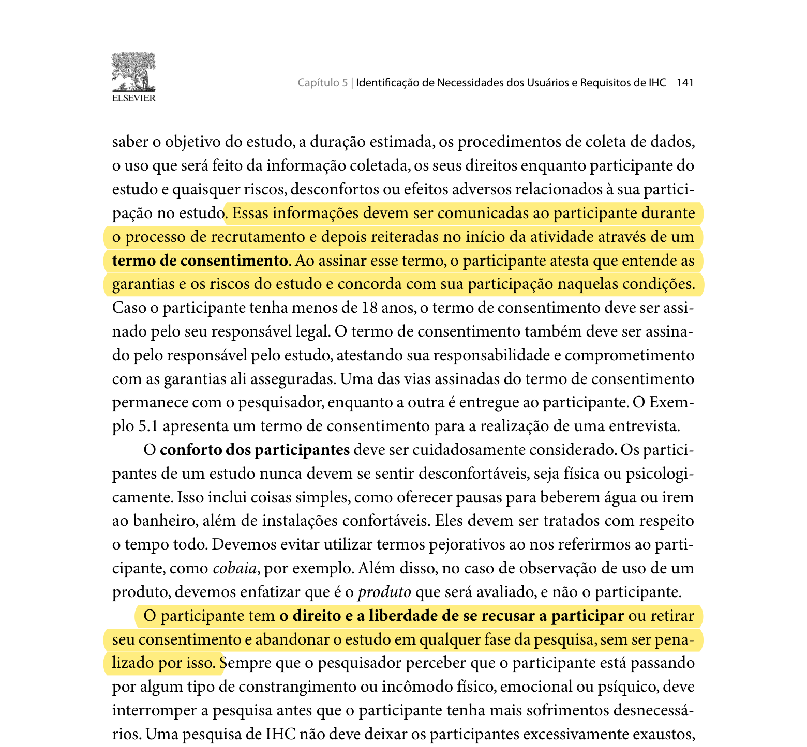{ loading=lazy }
    
Figura 19 — Termo de consentimento e direitos do participante em Barbosa e Silva (2010, p. 141).

    
Fonte: BARBOSA; SILVA (2010, p. 141).

??? question "E2-C08 (Item 8) — Foram utilizadas no mínimo duas técnicas para coletar dados e levantar os requisitos dos usuários (entrevistas; grupos de foco; questionários; brainstorming; card sorting; estudos de campo; investigação contextual), incluindo referência bibliográfica, foto do texto da referência e autor do item?"

    **Rastreabilidade na V2.** [E2-01](../../entrega-8/lista-etapa-2.md#e2-01) e [E2-07](../../entrega-8/lista-etapa-2.md#e2-07) · consolidados na triangulação metodológica e nos relatos das sessões individuais.

    **Autor do item:** André Barros de Sales.

    **O que conferir:** Confirmar no artefato de Técnicas de Coleta e nos relatos individuais o emprego efetivo de pelo menos duas técnicas reconhecidas pela literatura de IHC, com referência bibliográfica, foto da página da obra e identificação do autor.

    **Origem da pergunta:** Lista oficial da Entrega 2 no Plano de Ensino (SALES, 2026) e Barbosa e Silva (2010, p. 143). A Figura 20 mostra o trecho destacado.

    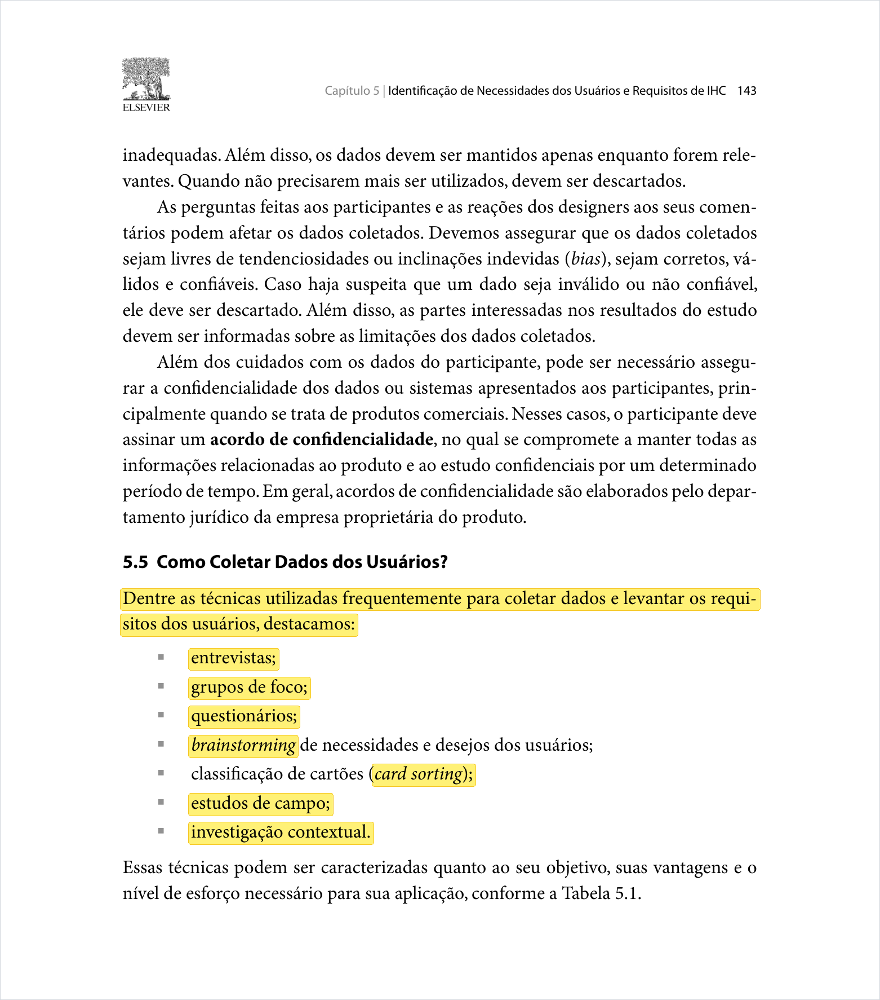{ loading=lazy }
    
Figura 20 — Técnicas de coleta de dados e levantamento de requisitos em Barbosa e Silva (2010, p. 143).

    
Fonte: BARBOSA; SILVA (2010, p. 143).

??? question "E2-C09 (Item 9) — Apresenta os cenários, incluindo referência bibliográfica, foto do texto da referência e autor do item?"

    **Rastreabilidade na V2.** [E2-10](../../entrega-8/lista-etapa-2.md#e2-10) · detalha a fundamentação conceitual e os sete elementos característicos de Rosson e Carroll (2002).

    **Autor do item:** André Barros de Sales.

    **O que conferir:** Examinar o artefato consolidado de Cenários e os cenários individuais dos integrantes, confirmando a fundamentação teórica com autor do item, referência bibliográfica e recorte do livro-texto.

    **Origem da pergunta:** Lista oficial da Entrega 2 no Plano de Ensino (SALES, 2026) e Barbosa e Silva (2010, p. 183). A Figura 21 mostra o trecho destacado.

    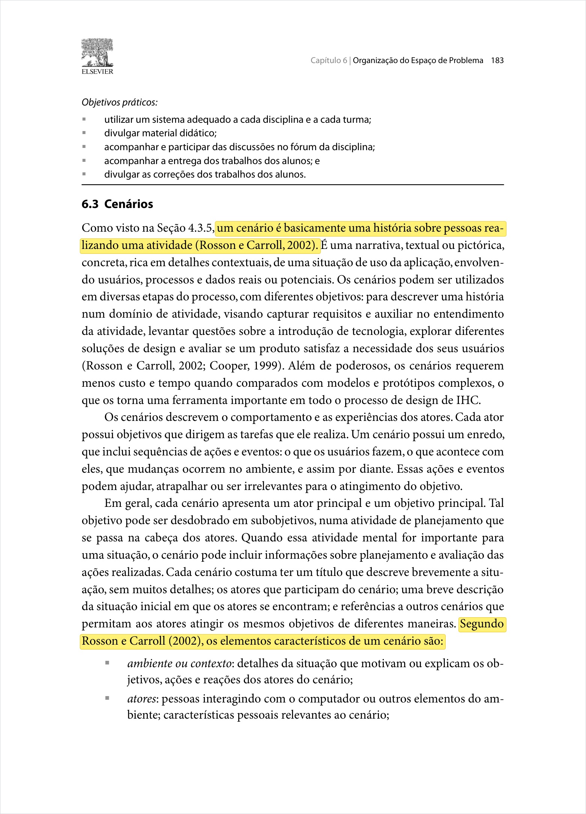{ loading=lazy }
    
Figura 21 — Definição e elementos característicos de cenários em Barbosa e Silva (2010, p. 183).

    
Fonte: BARBOSA; SILVA (2010, p. 183).

??? question "E2-C10 (Item 10) — Apresenta a análise de tarefas, incluindo referência bibliográfica, foto do texto da referência e autor do item?"

    **Rastreabilidade na V2.** [E2-12](../../entrega-8/lista-etapa-2.md#e2-12) · mantido com conferência da fundamentação e da consolidação das tarefas investigadas pela equipe.

    **Autor do item:** André Barros de Sales.

    **O que conferir:** Verificar no artefato de Análise de Tarefas a conceituação do método e o índice das tarefas analisadas no portal, acompanhados de referência bibliográfica, foto do texto da referência e identificação do autor.

    **Origem da pergunta:** Lista oficial da Entrega 2 no Plano de Ensino (SALES, 2026) e Barbosa e Silva (2010, p. 191). A Figura 22 mostra o trecho destacado.

    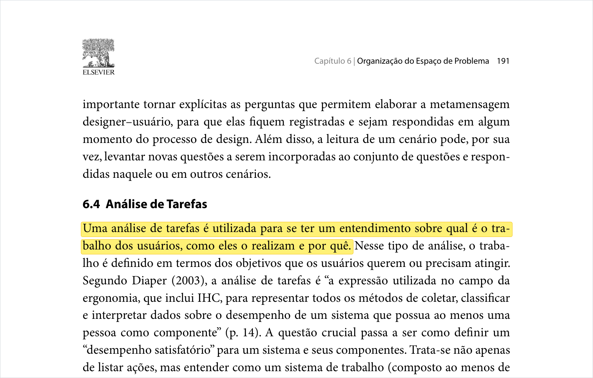{ loading=lazy }
    
Figura 22 — Definição de Análise de Tarefas em Barbosa e Silva (2010, p. 191).

    
Fonte: BARBOSA; SILVA (2010, p. 191).

??? question "E2-C11 (Item 11) — Apresenta uma atividade para cada integrante modelada em ao menos duas técnicas (HTA com diagrama, legenda e tabela; GOMS/KLM/CMN-GOMS/CPM-GOMS/CTT), incluindo referência bibliográfica, foto do texto da referência e autor do item?"

    **Rastreabilidade na V2.** [E2-13](../../entrega-8/lista-etapa-2.md#e2-13) · mantido com verificação individual por integrante das duas técnicas de modelagem.

    **Autor do item:** André Barros de Sales.

    **O que conferir:** Abrir as páginas individuais de análise de tarefas de todos os integrantes para confirmar que cada membro modelou sua atividade tanto em **HTA** (com diagrama hierárquico, legenda notacional e tabela detalhada) quanto em uma segunda técnica formal (**CTT** ou família **GOMS**), com referência, foto do livro e autor.

    **Origem da pergunta:** Lista oficial da Entrega 2 no Plano de Ensino (SALES, 2026) e Barbosa e Silva (2010, p. 192). A Figura 23 mostra o trecho destacado.

    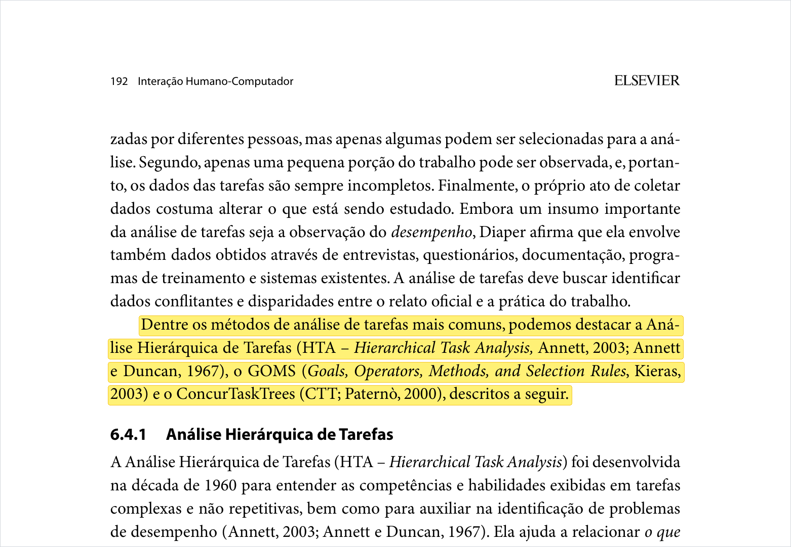{ loading=lazy }
    
Figura 23 — Métodos clássicos de análise de tarefas (HTA, GOMS e CTT) em Barbosa e Silva (2010, p. 192).

    
Fonte: BARBOSA; SILVA (2010, p. 192).

??? question "E2-C12 (Item 12) — Utilizaram alguma técnica para especificar as tarefas?"

    **Rastreabilidade na V2.** [E2-13](../../entrega-8/lista-etapa-2.md#e2-13) e [E2-14](../../entrega-8/lista-etapa-2.md#e2-14) · integrados à especificação estruturada de tarefas e operações (*input*, *ações* e *feedback*).

    **Autor do item:** André Barros de Sales.

    **O que conferir:** Verificar se, além da decomposição gráfica, os artefatos utilizam especificação estruturada das tarefas e operações (como tabelas formais de operações HTA por *input*, *ação* e *feedback* ou quadros descritivos equivalentes).

    **Origem da pergunta:** Lista oficial da Entrega 2 no Plano de Ensino (SALES, 2026) e Barbosa e Silva (2010, p. 193). A Figura 24 mostra o trecho destacado.

    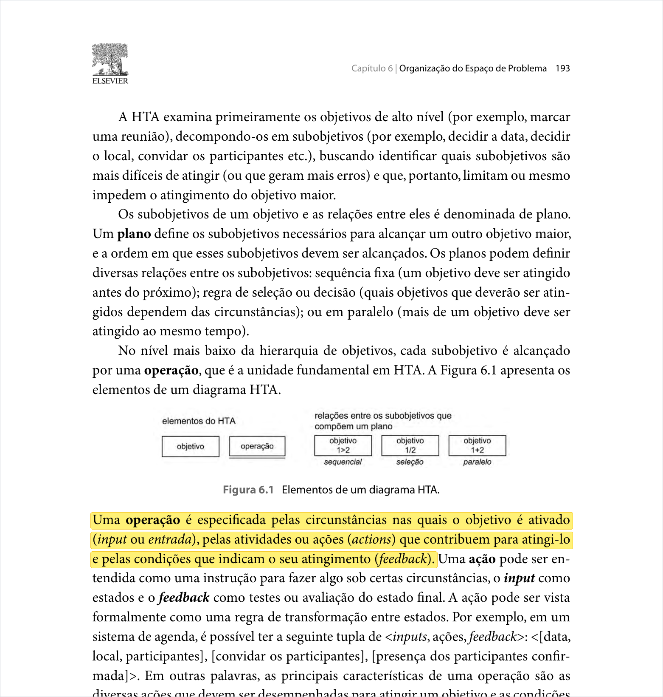{ loading=lazy }
    
Figura 24 — Especificação formal de operações na análise de tarefas em Barbosa e Silva (2010, p. 193).

    
Fonte: BARBOSA; SILVA (2010, p. 193).

## Itens elaborados pelo grupo

Em cumprimento à orientação final da lista oficial (*cada integrante da equipe deve elaborar ao menos um item de conteúdo da disciplina com referência bibliográfica da fonte e foto do texto da referência*), os critérios `E2-C13` a `E2-C18` reúnem os **6 itens adicionais** (itens `13` a `18`) elaborados pelo Grupo 06.

??? question "E2-C13 (Item 13) — Cada cenário apresenta: (1) título que descreve brevemente a situação; (2) os atores que participam; e (3) uma breve descrição da situação inicial?"

    **Rastreabilidade na V2.** [E2-11](../../entrega-8/lista-etapa-2.md#e2-11) · mantido no bloco *Conteúdo da disciplina*.

    **Autor do item:** [Bruno Ferreira Dornelas](https://github.com/brunnf).

    **Referência:** BARBOSA, Simone Diniz Junqueira et al. *Interação Humano-Computador e Experiência do Usuário*. Autopublicação, 2021. Cap. 6, p. 183.

    **Fundamentação:** De acordo com Barbosa et al. (2021, p. 183), cada cenário costuma abrir com um título conciso que descreve brevemente a situação sem detalhes excessivos, a identificação dos atores participantes e uma breve descrição da situação inicial em que esses atores se encontram antes do desenrolar das ações.

    **Como verificar:**

    - **Sim:** todos os cenários individuais e consolidados apresentam explicitamente título descritivo, atores participantes e situação inicial.
    - **Incompleto:** apenas parte dos cenários explicita os três elementos ou há omissão do contexto inicial antes das ações.
    - **Não:** textos narrativos genéricos sem título descritivo, atores definidos ou situação inicial.

    A Figura 25 apresenta o trecho destacado sobre a estrutura básica de abertura de um cenário em Barbosa et al. (2021, p. 183).

    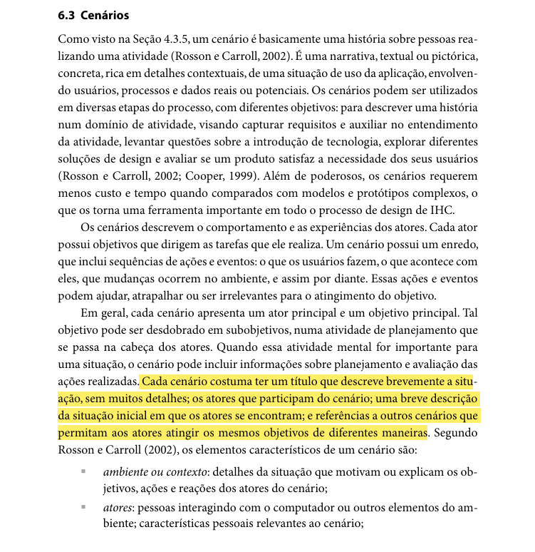{ loading=lazy }
    
Figura 25 — Estrutura básica de abertura do cenário: título, atores e situação inicial.

    
Fonte: BARBOSA et al. (2021, p. 183).

??? question "E2-C14 (Item 14) — Cada persona apresenta os elementos característicos de Courage e Baxter (2005): (1) identidade; (2) status; (3) objetivos; (4) habilidades; (5) tarefas; (6) relacionamentos; (7) requisitos; e (8) expectativas?"

    **Rastreabilidade na V2.** [E2-08](../../entrega-8/lista-etapa-2.md#e2-08) e [E2-09](../../entrega-8/lista-etapa-2.md#e2-09) · desdobrados na organização/priorização do elenco de personas e na conferência dos oito elementos de cada persona individual.

    **Autor do item:** [Caio Breno de Souza Bezerra](https://github.com/CaioBezerra-Dev).

    **Referência:** BARBOSA, Simone Diniz Junqueira; SILVA, Bruno Santana da. *Interação humano-computador*. Rio de Janeiro: Elsevier, 2010. Cap. 6, p. 177.

    **Fundamentação:** Para definir uma persona com rigor e utilidade como ferramenta de design e comunicação, Courage e Baxter (2005 *apud* Barbosa; Silva, 2010, p. 177) enumeram oito elementos característicos: identidade, status (primária, secundária, outro stakeholder ou antiusuário), objetivos, habilidades, tarefas, relacionamentos, requisitos e expectativas.

    **Como verificar:**

    - **Sim:** todas as personas do elenco contemplam explicitamente os oito elementos característicos de Courage e Baxter (2005).
    - **Incompleto:** parte das personas omite um ou mais dos oito elementos característicos.
    - **Não:** fichas superficiais restritas a dados biográficos fictícios sem os elementos estruturais da literatura.

    A Figura 26 reproduz os oito elementos característicos de uma persona destacados em Barbosa e Silva (2010, p. 177).

    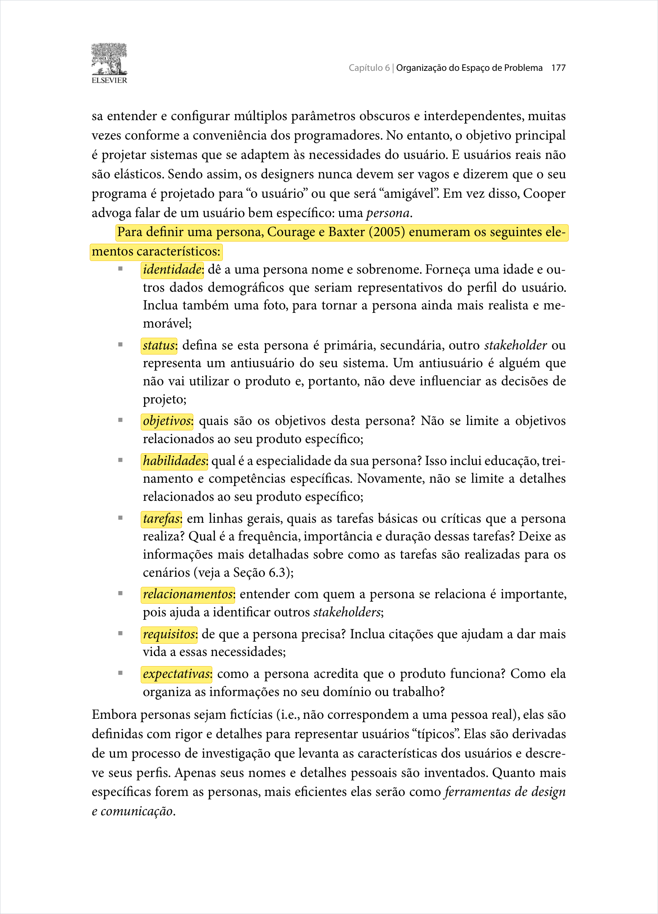{ loading=lazy }
    
Figura 26 — Elementos característicos de uma persona segundo Courage e Baxter (2005).

    
Fonte: BARBOSA; SILVA (2010, p. 177).

??? question "E2-C15 (Item 15) — Cada análise hierárquica de tarefas (HTA) relaciona: (1) o que as pessoas fazem (ou se recomenda que façam); (2) por que o fazem; e (3) quais as consequências caso não o façam corretamente?"

    **Rastreabilidade na V2.** [E2-14](../../entrega-8/lista-etapa-2.md#e2-14) · mantido junto à conferência das tabelas de operações (*input*, *ações* e *feedback*).

    **Autor do item:** [Caio Breno de Souza Bezerra](https://github.com/CaioBezerra-Dev).

    **Referência:** BARBOSA, Simone Diniz Junqueira; SILVA, Bruno Santana da. *Interação humano-computador*. Rio de Janeiro: Elsevier, 2010. Cap. 6, Seção 6.4.1, p. 192.

    **Fundamentação:** Na Seção 6.4.1, Barbosa e Silva (2010, p. 192) destacam que a HTA baseia-se em psicologia funcional para identificar problemas de desempenho em tarefas complexas, relacionando o que as pessoas fazem (ou se recomenda que façam), por que o fazem (objetivos) e quais as consequências caso não o façam corretamente.

    **Como verificar:**

    - **Sim:** cada modelagem HTA documenta as ações realizadas, os objetivos correspondentes e os problemas/consequências decorrentes de falhas na execução.
    - **Incompleto:** apenas parte das HTAs explicita as consequências de falha ou os motivos funcionais das operações.
    - **Não:** listagem mecânica de cliques na interface sem objetivos funcionais nem análise de consequências de erro.

    A Figura 27 apresenta o trecho destacado sobre o propósito analítico da HTA em Barbosa e Silva (2010, p. 192).

    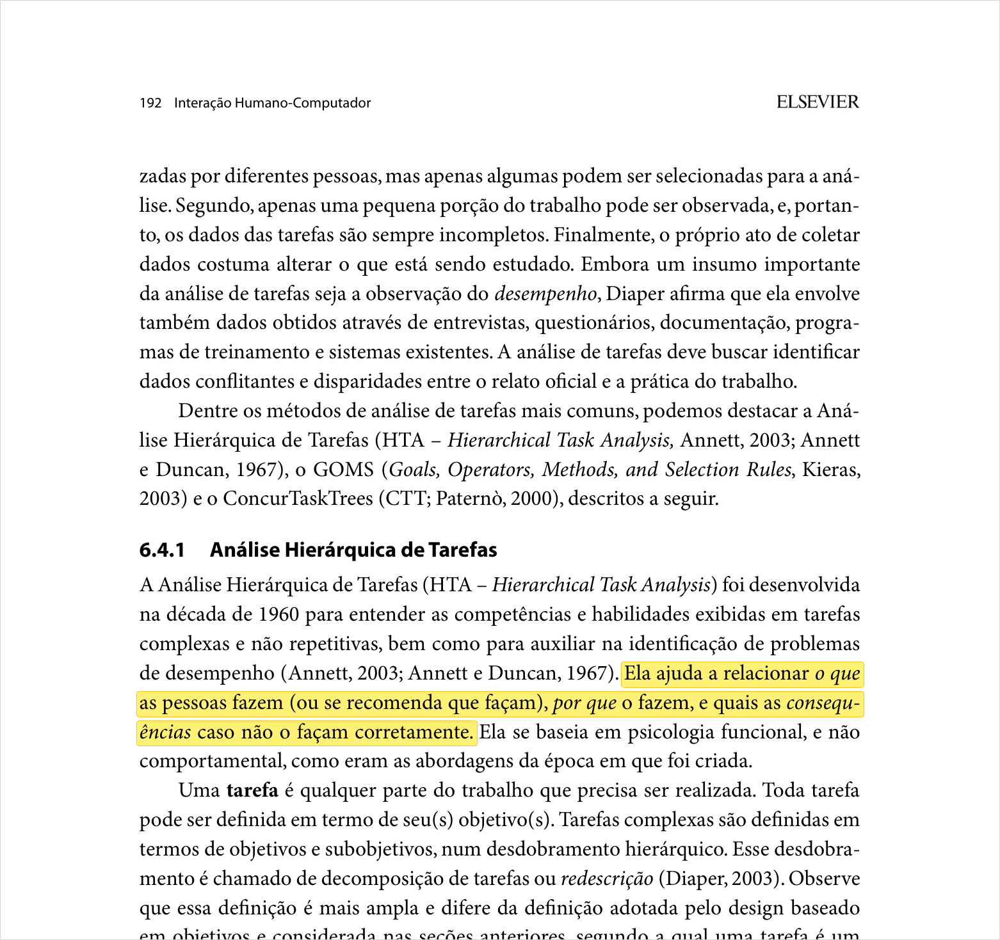{ loading=lazy }
    
Figura 27 — Relação entre ações, objetivos e consequências de falha na HTA.

    
Fonte: BARBOSA; SILVA (2010, p. 192).

??? question "E2-C16 (Item 16) — Na Análise Hierárquica de Tarefas (HTA), a decomposição dos objetivos em subobjetivos define planos que especificam a ordem e as condições de execução dos subobjetivos (como sequência, seleção ou paralelismo)?"

    **Rastreabilidade na V2.** [E2-15](../../entrega-8/lista-etapa-2.md#e2-15) · mantido no bloco *Conteúdo da disciplina*.

    **Autor do item:** [Heitor Pinheiro Gonçalves das Chagas](https://github.com/Heitorovski01).

    **Referência:** BARBOSA, Simone Diniz Junqueira; SILVA, Bruno Santana da. *Interação humano-computador*. Rio de Janeiro: Elsevier, 2010. Cap. 6, Seção 6.4.1, p. 193–195.

    **Fundamentação:** Na HTA, os subobjetivos de um objetivo maior e as relações entre eles formam um **plano**. O plano define os subobjetivos necessários para alcançar o objetivo-pai e a ordem ou condição em que devem ser alcançados — como sequência fixa (`>`), regra de seleção/decisão (`/`) ou paralelismo (`+`).

    **Como verificar:**

    - **Sim:** todos os diagramas e tabelas HTA definem planos explícitos para cada objetivo decomposto em subobjetivos.
    - **Incompleto:** apenas parte das análises especifica os planos ou há nós ramificados sem indicação de ordem/condição.
    - **Não:** árvores hierárquicas sem planos de execução definidos.

    A Figura 28 reproduz a conceituação de planos na HTA destacada em Barbosa e Silva (2010, p. 193).

    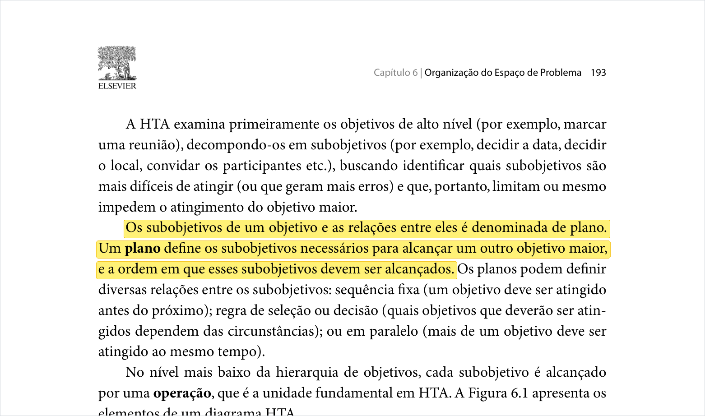{ loading=lazy }
    
Figura 28 — Definição de planos e ordenação de subobjetivos na HTA.

    
Fonte: BARBOSA; SILVA (2010, p. 193).

??? question "E2-C17 (Item 17) — O planejamento e a condução das pesquisas com usuários respeitam os princípios éticos fundamentais e disponibilizam o modelo de Termo de Consentimento Livre e Esclarecido (TCLE) com objetivos, riscos, garantias de confidencialidade e direito de recusa/desistência?"

    **Rastreabilidade na V2.** [E2-06](../../entrega-8/lista-etapa-2.md#e2-06) · consolidado com o critério oficial `E2-C07` para verificar todas as cláusulas éticas obrigatórias do modelo de TCLE.

    **Autor do item:** [Israel Soares de Paiva](https://github.com/IsraelSoares-25).

    **Referência:** BARBOSA, Simone Diniz Junqueira; SILVA, Bruno Santana da. *Interação humano-computador*. Rio de Janeiro: Elsevier, 2010. Cap. 5, Seção 5.4, p. 140–142.

    **Fundamentação:** O TCLE formaliza o respeito à autonomia, beneficência, não maleficência e justiça, comunicando ao participante antes do início da atividade o objetivo do estudo, a duração estimada, os procedimentos, os eventuais riscos ou desconfortos, o sigilo/anonimato dos dados e a plena liberdade de recusar ou retirar seu consentimento em qualquer etapa sem penalização.

    **Como verificar:**

    - **Sim:** os princípios éticos estão documentados e há modelo completo de TCLE contendo objetivos, riscos, confidencialidade e direito de recusa/desistência sem ônus.
    - **Incompleto:** modelo de TCLE presente apenas em parte dos artefatos individuais ou com omissão de cláusulas essenciais (como desistência livre ou confidencialidade).
    - **Não:** ausência de garantias éticas estruturadas e de modelo de TCLE.

    A Figura 29 apresenta as garantias comunicadas pelo termo de consentimento e o direito de desistência livre destacados em Barbosa e Silva (2010, p. 141).

    { loading=lazy }
    
Figura 29 — Garantias essenciais do TCLE e direito de desistência sem penalidade.

    
Fonte: BARBOSA; SILVA (2010, p. 141).

??? question "E2-C18 (Item 18) — Nos diagramas CTT, cada tarefa está classificada em um dos quatro tipos da notação, de acordo com sua natureza: (1) tarefa do usuário, realizada fora do sistema; (2) tarefa do sistema, processada sem interação com o usuário; (3) tarefa interativa, composta por diálogo entre usuário e sistema; ou (4) tarefa abstrata, que representa uma composição de tarefas?"

    **Rastreabilidade na V2.** [E2-16](../../entrega-8/lista-etapa-2.md#e2-16) · mantido e ampliado para verificar também os operadores de relação temporal da notação CTT.

    **Autor do item:** [Luís Henrique Arruda Luna](https://github.com/Donnk61).

    **Referência:** BARBOSA, Simone Diniz Junqueira; SILVA, Bruno Santana da. *Interação humano-computador*. Rio de Janeiro: Elsevier, 2010. Cap. 6, Seção 6.4.3, p. 203; PATERNÒ, Fabio. *Model-Based Design and Evaluation of Interactive Applications*. London: Springer-Verlag, 2000. Cap. 4.

    **Fundamentação:** No modelo *ConcurTaskTrees* (CTT) proposto por Paternò (2000 *apud* Barbosa; Silva, 2010, p. 203), cada nó da árvore recebe representação gráfica própria conforme um dos quatro tipos de tarefas: **tarefas do usuário** (cognitivas/físicas fora do sistema), **tarefas do sistema** (processamento interno sem interação), **tarefas interativas** (diálogos usuário–sistema) e **tarefas abstratas** (agrupamento de subtarefas de naturezas distintas).

    **Como verificar:**

    - **Sim:** todos os nós dos diagramas CTT possuem ícone/categoria coerente com sua natureza dentre os quatro tipos da notação.
    - **Incompleto:** parte das tarefas está sem classificação visual ou apresenta tipo incoerente com a ação descrita (ex.: decisão puramente mental marcada como tarefa do sistema).
    - **Não:** diagramas sem diferenciação dos quatro tipos de tarefa da notação CTT.

    A Figura 30 reproduz os quatro tipos de tarefas da notação CTT destacados em Barbosa e Silva (2010, p. 203).

    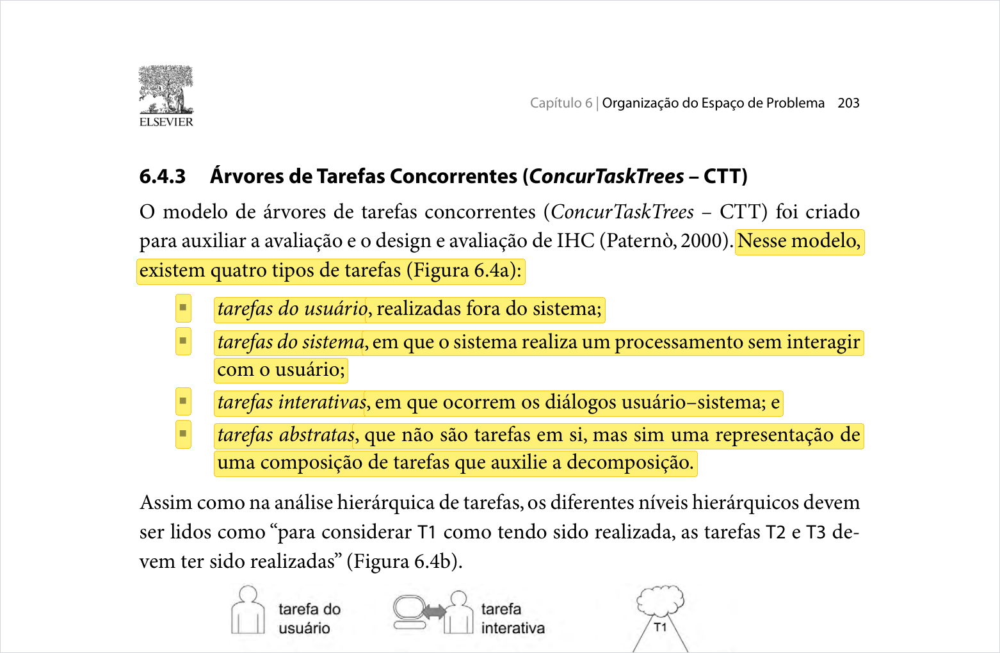{ loading=lazy }
    
Figura 30 — Os quatro tipos de tarefas no modelo ConcurTaskTrees (CTT).

    
Fonte: BARBOSA; SILVA (2010, p. 203).

## Agradecimentos

O Google Gemini e o Antigravity apoiaram a organização em blocos expansíveis, a geração dos recortes com destaque amarelo a partir do Plano de Ensino e de Barbosa e Silva (2010) e a revisão das referências. A responsabilidade técnica pela organização desta página é de Bruno Ferreira Dornelas; os critérios `D01`–`D11` e `E2-C01`–`E2-C12` são de autoria docente de André Barros de Sales, e os critérios `E2-C13`–`E2-C18` pertencem aos respectivos integrantes do Grupo 06.

## Histórico de versão

| Versão | Data | Descrição | Autor(es) | Revisor(es) |
| :---: | :---: | --- | --- | --- |
| `1.0` | 23/11/2026 | Estruturação da lista V1 da Etapa 2 com recortes grifados e rastreabilidade para a V2 | [Bruno Ferreira Dornelas](https://github.com/brunnf) | [Caio Breno de Souza Bezerra](https://github.com/CaioBezerra-Dev) |

Tabela 2 — Histórico de versão.

Fonte: elaboração do Grupo 06 (2026).

## Referências

[1] SALES, André Barros de. *Plano de Ensino FIHC 022026 — Turma 01*, v1. Brasília: FCTE/UnB, 2026.

[2] BARBOSA, Simone Diniz Junqueira; SILVA, Bruno Santana da. *Interação humano-computador*. Rio de Janeiro: Elsevier, 2010.

[3] BARBOSA, Simone Diniz Junqueira et al. *Interação Humano-Computador e Experiência do Usuário*. Autopublicação, 2021.

[4] PATERNÒ, Fabio. *Model-Based Design and Evaluation of Interactive Applications*. London: Springer-Verlag, 2000.
