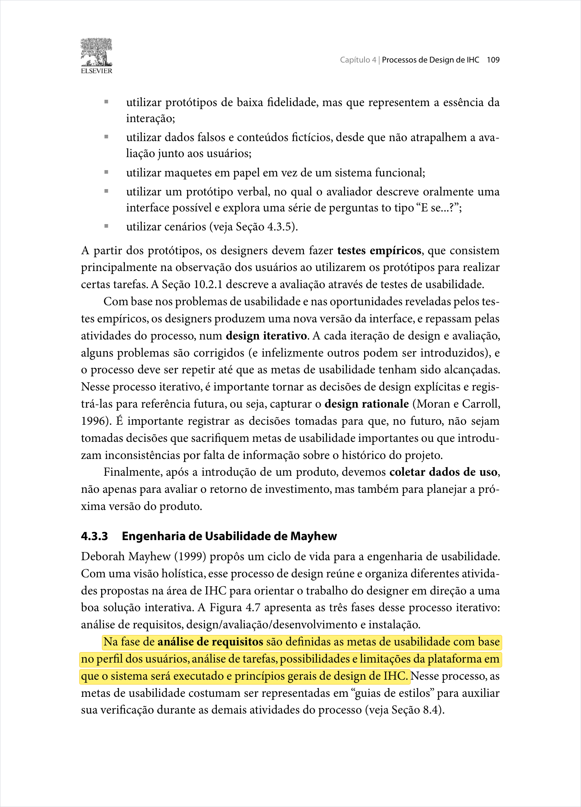
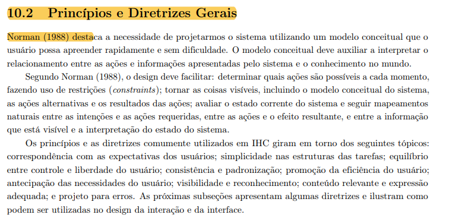
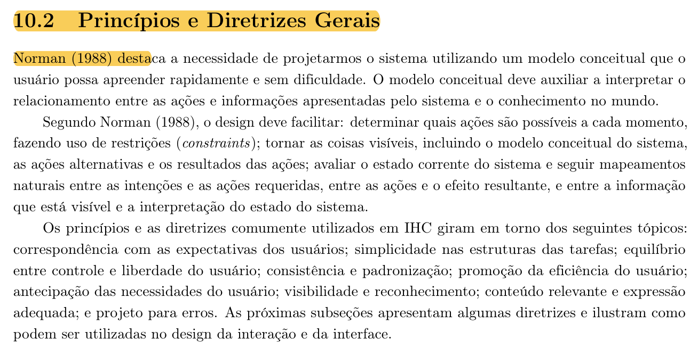
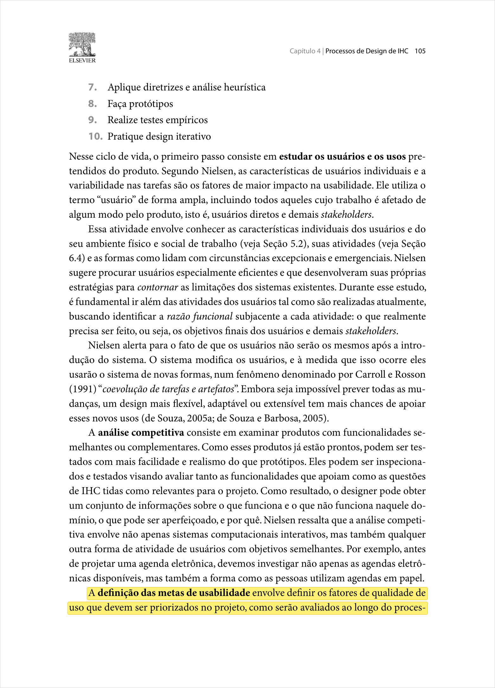
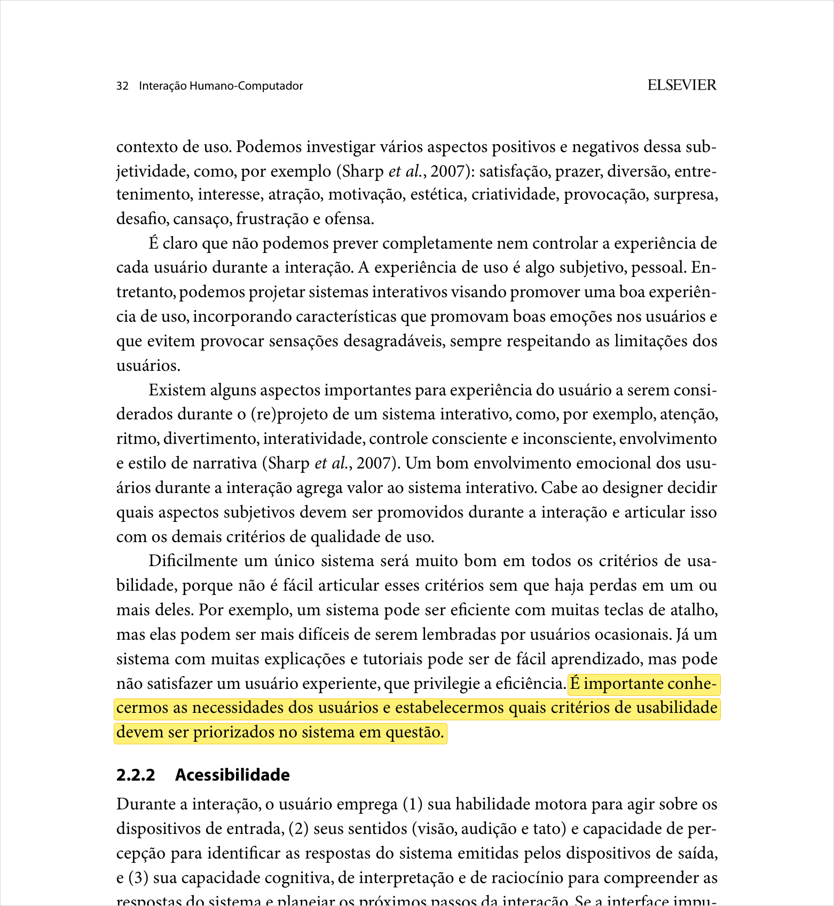
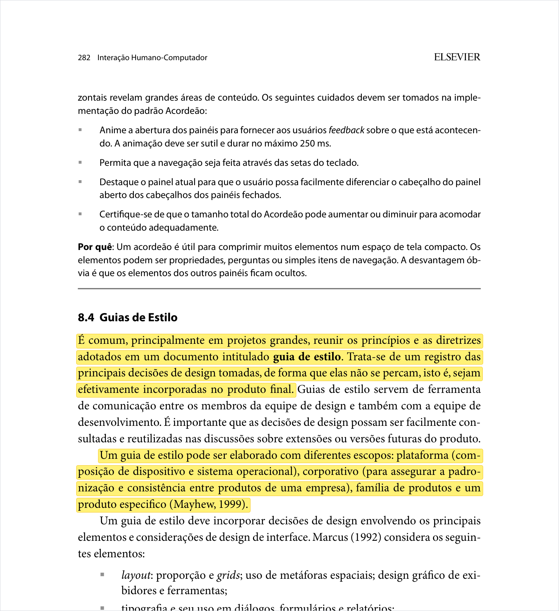
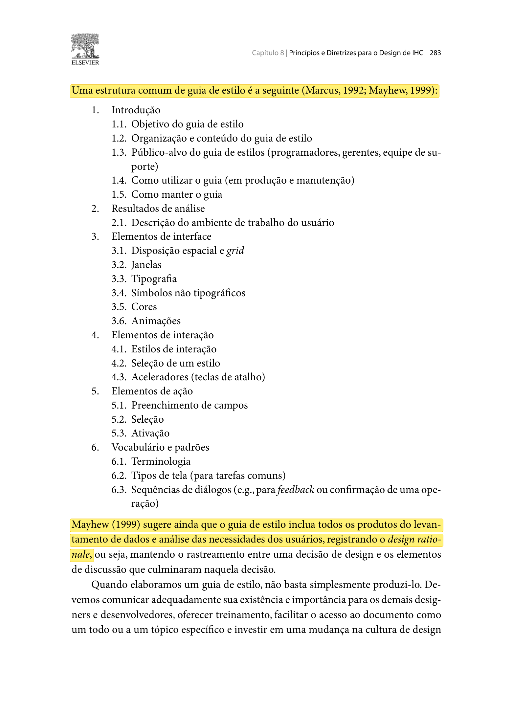
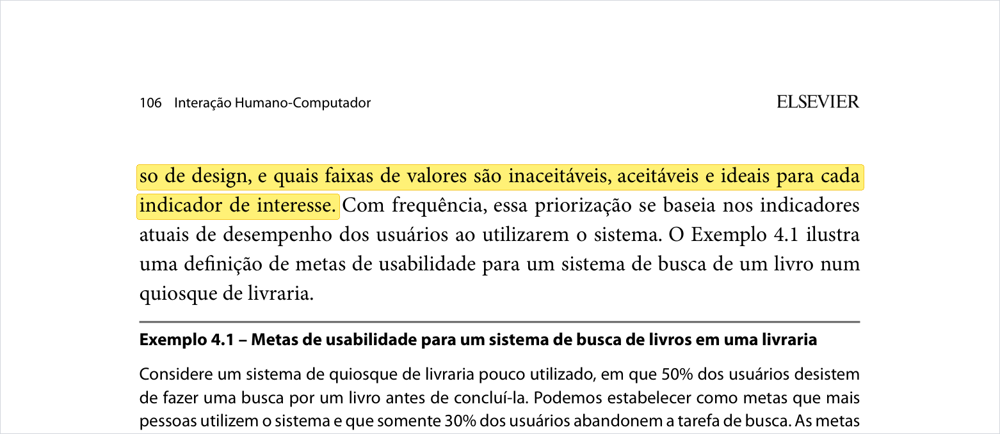
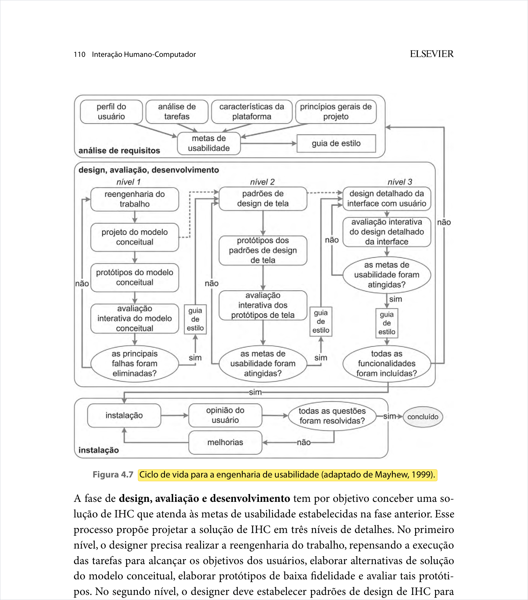

Responsável: Bruno Ferreira Dornelas · Autor dos itens oficiais: André Barros de Sales

# Lista de verificação — Etapa 3 · V1

!!! warning "V1 desatualizada"
    A [Lista V2 da Etapa 3](../../entrega-8/lista-etapa-3.md) é a versão oficial para a reinspeção da Etapa 8. Esta página preserva os critérios usados nas primeiras inspeções da Entrega 3. Cada pergunta aponta para seu correspondente na V2 ou para o registro de como foi reorganizada.

## Tabela de contribuição

A Tabela 1 registra a contribuição neste artefato.

| Integrante / ferramenta | Contribuição | Artefato / atividade |
| --- | --- | --- |
| [Bruno Ferreira Dornelas](https://github.com/brunnf) | Organização da lista não preenchida da Etapa 3, geração dos recortes grifados, elaboração do item 18 e vínculo V1–V2 | [Desenvolvimento](#desenvolvimento-do-projeto) · [Conteúdo](#conteudo-da-disciplina) · [E3-C18](#e3-c18) |
| [Caio Breno de Souza Bezerra](https://github.com/CaioBezerra-Dev) | Elaboração do item 19 sobre possibilidades e limitações da plataforma como insumo das metas de usabilidade | [E3-C19](#e3-c19) |
| [Heitor Pinheiro Gonçalves das Chagas](https://github.com/Heitorovski01) | Elaboração do item 20 sobre registro de *design rationale* e rastreabilidade no Guia de Estilo | [E3-C20](#e3-c20) |
| [Israel Soares de Paiva](https://github.com/IsraelSoares-25) | Elaboração do item 21 sobre seleção crítica e justificativa dos princípios gerais adotados | [E3-C21](#e3-c21) |
| [Luís Henrique Arruda Luna](https://github.com/Donnk61) | Elaboração do item 22 sobre explicação pelas diretrizes e manifestação empírica dos tópicos no site avaliado | [E3-C22](#e3-c22) |
| Google Gemini e Antigravity | Apoio à organização em blocos expansíveis, recortes grifados das fontes e conferência de referências | [Agradecimentos](#agradecimentos) |

Tabela 1 — Contribuição neste artefato.

Fonte: elaboração para o Grupo 06 (2026).

## Introdução

Cada pergunta possui **autor, evidência esperada, referência e imagem do trecho utilizado com marcação amarela**. Abra qualquer item abaixo para consultar sua fundamentação. Os **11 critérios de desenvolvimento do projeto** (`D01`–`D11`) e os **8 critérios oficiais de conteúdo da Entrega 3** (`E3-C10`–`E3-C17`, preservando a numeração `10` a `17` do Plano de Ensino) têm autoria do professor **André Barros de Sales** [1], fundamentados em Barbosa e Silva (2010) [2] e Barbosa et al. (2021) [3]. Somam-se os **5 critérios elaborados pelos integrantes do Grupo 06** (`E3-C18`–`E3-C22`, correspondentes aos itens `18` a `22`), ancorados nos capítulos de processos de design, princípios gerais e guias de estilo da literatura de IHC.

**Esta página define apenas as perguntas — a lista não é preenchida aqui.** As respostas, a versão inspecionada, a data/hora, as observações e os vídeos das reuniões ficam registrados nas respectivas páginas de inspeção: [Autoverificação do Grupo 06](../grupo-06/etapa-3/lista-verificacao.md) e [Inspeção do Grupo 07](../grupo-07/etapa-3/lista-verificacao.md).

Ao aplicar a lista nas fichas de inspeção, usar **Sim / Não / Incompleto** (campo vazio significa ainda não inspecionado) e registrar a evidência correspondente à versão efetivamente examinada.

## Desenvolvimento do projeto

O Plano de Ensino (SALES, 2026, p. 3 e p. 8–9 do PDF) [1] é a fonte das perguntas `D01`–`D11`.

??? question "D01 — O GitHub Pages possui o histórico de versão padronizado?"

    **Rastreabilidade na V2.** [D01](../../entrega-8/lista-etapa-3.md#d01).

    **Autor do item:** André Barros de Sales.

    **O que conferir:** Conferir presença de tabela padronizada com versão, data, descrição das alterações, autor(es) e revisor(es) em cada artefato da Etapa 3.

    **Origem da pergunta:** Plano de ensino (SALES, 2026, p. 8 do PDF). A Figura 1 mostra o trecho destacado.

    { loading=lazy }
    
Figura 1 — Fonte do critério D01.

    
Fonte: SALES (2026, p. 8 do PDF).

??? question "D02 — O GitHub Pages possui o(s) autor(es) e o(s) revisor(es) para cada artefato?"

    **Rastreabilidade na V2.** [D02](../../entrega-8/lista-etapa-3.md#d02).

    **Autor do item:** André Barros de Sales.

    **O que conferir:** Verificar identificação nominal de autor(es) e revisor(es) distintos em cada artefato da Etapa 3, com revisão efetivamente registrada.

    **Origem da pergunta:** Plano de ensino (SALES, 2026, p. 8 do PDF). A Figura 2 mostra o trecho destacado.

    { loading=lazy }
    
Figura 2 — Fonte do critério D02.

    
Fonte: SALES (2026, p. 8 do PDF).

??? question "D03 — O GitHub Pages possui referências bibliográficas e/ou bibliografia em todos os artefatos?"

    **Rastreabilidade na V2.** [D03](../../entrega-8/lista-etapa-3.md#d03).

    **Autor do item:** André Barros de Sales.

    **O que conferir:** Conferir se todos os artefatos de conteúdo apresentam seção final de Referências e/ou Bibliografia padronizada conforme a ABNT, coerente com as citações no texto.

    **Origem da pergunta:** Plano de ensino (SALES, 2026, p. 8 do PDF). A Figura 3 mostra o trecho destacado.

    { loading=lazy }
    
Figura 3 — Fonte do critério D03.

    
Fonte: SALES (2026, p. 8 do PDF).

??? question "D04 — As tabelas e imagens possuem legenda e fonte e são chamadas dentro do texto?"

    **Rastreabilidade na V2.** [D04](../../entrega-8/lista-etapa-3.md#d04).

    **Autor do item:** André Barros de Sales.

    **O que conferir:** Inspecionar tabelas de metas e princípios, capturas do portal, propostas de tela do Guia de Estilo e recortes bibliográficos para confirmar numeração, legenda, fonte e chamada explícita no texto.

    **Origem da pergunta:** Plano de ensino (SALES, 2026, p. 8 do PDF). A Figura 4 mostra o trecho destacado.

    { loading=lazy }
    
Figura 4 — Fonte do critério D04.

    
Fonte: SALES (2026, p. 8 do PDF).

??? question "D05 — O GitHub Pages possui um texto fazendo uma introdução dos artefatos?"

    **Rastreabilidade na V2.** [D05](../../entrega-8/lista-etapa-3.md#d05).

    **Autor do item:** André Barros de Sales.

    **O que conferir:** Verificar texto introdutório no início de cada documento contextualizando objetivo, escopo e papel do artefato na fase de análise de requisitos.

    **Origem da pergunta:** Plano de ensino (SALES, 2026, p. 8 do PDF). A Figura 5 mostra o trecho destacado.

    { loading=lazy }
    
Figura 5 — Fonte do critério D05.

    
Fonte: SALES (2026, p. 8 do PDF).

??? question "D06 — O GitHub Pages possui o cronograma executado com quem realizou cada artefato/atividade com as datas de início e fim?"

    **Rastreabilidade na V2.** [D06](../../entrega-8/lista-etapa-3.md#d06).

    **Autor do item:** André Barros de Sales.

    **O que conferir:** Conferir registro do cronograma efetivamente executado da Etapa 3 com responsáveis, revisores e datas reais de início e término de cada atividade.

    **Origem da pergunta:** Plano de ensino (SALES, 2026, p. 8 do PDF). A Figura 6 mostra o trecho destacado.

    { loading=lazy }
    
Figura 6 — Fonte do critério D06.

    
Fonte: SALES (2026, p. 8 do PDF).

??? question "D07 — O GitHub Pages possui ata(s) da(s) reuniões (com data, horário de início e fim, participantes, objetivo, atividades definidas etc.)?"

    **Rastreabilidade na V2.** [D07](../../entrega-8/lista-etapa-3.md#d07) e [E3-18](../../entrega-8/lista-etapa-3.md#e3-18).

    **Autor do item:** André Barros de Sales.

    **O que conferir:** Conferir na seção de Atas a presença da ata formal da Etapa 3 contendo data, horários de abertura e encerramento, participantes presentes, pauta/objetivo e deliberações.

    **Origem da pergunta:** Plano de ensino (SALES, 2026, p. 9 do PDF). A Figura 7 mostra o trecho destacado.

    { loading=lazy }
    
Figura 7 — Fonte do critério D07.

    
Fonte: SALES (2026, p. 9 do PDF).

??? question "D08 — O GitHub Pages possui a gravação da reunião do grupo?"

    **Rastreabilidade na V2.** [D08](../../entrega-8/lista-etapa-3.md#d08) e [E3-18](../../entrega-8/lista-etapa-3.md#e3-18).

    **Autor do item:** André Barros de Sales.

    **O que conferir:** Verificar link acessível e funcional para a gravação em vídeo da reunião do grupo referente à Etapa 3.

    **Origem da pergunta:** Plano de ensino (SALES, 2026, p. 9 do PDF). A Figura 8 mostra o trecho destacado.

    { loading=lazy }
    
Figura 8 — Fonte do critério D08.

    
Fonte: SALES (2026, p. 9 do PDF).

??? question "D09 — O GitHub Pages possui vídeo de apresentação na categoria “não listado” no YouTube?"

    **Rastreabilidade na V2.** [D09](../../entrega-8/lista-etapa-3.md#d09).

    **Autor do item:** André Barros de Sales.

    **O que conferir:** Conferir disponibilidade do vídeo da Apresentação 3 publicado como “não listado” no YouTube e devidamente vinculado na página de apresentações do grupo.

    **Origem da pergunta:** Plano de ensino (SALES, 2026, p. 9 do PDF). A Figura 9 mostra o trecho destacado.

    { loading=lazy }
    
Figura 9 — Fonte do critério D09.

    
Fonte: SALES (2026, p. 9 do PDF).

??? question "D10 — O GitHub Pages possui tabela de contribuição no início do artefato com o nome dos integrantes e hiperligação da atividade?"

    **Rastreabilidade na V2.** [D10](../../entrega-8/lista-etapa-3.md#d10).

    **Autor do item:** André Barros de Sales.

    **O que conferir:** Conferir tabela no início de cada artefato identificando quem atuou naquela página, qual atividade realizou e o link direto para a seção correspondente.

    **Origem da pergunta:** Plano de ensino (SALES, 2026, p. 9 do PDF). A Figura 10 mostra o trecho destacado.

    { loading=lazy }
    
Figura 10 — Fonte do critério D10.

    
Fonte: SALES (2026, p. 9 do PDF).

??? question "D11 — O GitHub Pages possui a seção de agradecimentos apresentando o uso de Inteligência Artificial (IA) Generativa no artefato?"

    **Rastreabilidade na V2.** [D11](../../entrega-8/lista-etapa-3.md#d11).

    **Autor do item:** André Barros de Sales.

    **O que conferir:** Conferir menção nominal às ferramentas de IA generativa utilizadas, detalhando a finalidade do apoio e reafirmando a responsabilidade humana pelo conteúdo.

    **Origem da pergunta:** Plano de ensino (SALES, 2026, p. 3 do PDF). A Figura 11 mostra o trecho destacado.

    { loading=lazy }
    
Figura 11 — Fonte do critério D11.

    
Fonte: SALES (2026, p. 3 do PDF).

## Conteúdo da disciplina

Os critérios `E3-C10` a `E3-C17` reproduzem os itens **10 a 17** da lista oficial da **Entrega 3** (*Princípios Gerais de Projeto, Metas de usabilidade, Guia de Estilo — Fase: análise de requisitos*), elaborada pelo professor **André Barros de Sales** [1].

??? question "E3-C10 (Item 10) — Apresenta as características da plataforma para o projeto?"

    **Rastreabilidade na V2.** [E3-01](../../entrega-8/lista-etapa-3.md#e3-01) · mantido com conferência da fundamentação bibliográfica e dos recortes da fonte.

    **Autor do item:** André Barros de Sales.

    **O que conferir:** Verificar no artefato de Características da Plataforma a descrição do ambiente tecnológico de execução do sistema avaliado, registrando suas capacidades técnicas e restrições operacionais na fase de análise de requisitos.

    **Origem da pergunta:** Lista oficial da Entrega 3 no Plano de Ensino (SALES, 2026) e Barbosa e Silva (2010, p. 109). A Figura 12 mostra o trecho destacado.

    { loading=lazy }
    
Figura 12 — Características da plataforma na análise de requisitos em Barbosa e Silva (2010, p. 109).

    
Fonte: BARBOSA; SILVA (2010, p. 109).

??? question "E3-C11 (Item 11) — Apresenta os Princípios Gerais do Projeto que serão utilizados no projeto, com referência bibliográfica da fonte, foto do texto da referência explicando os Princípios Gerais do Projeto e autor do item?"

    **Rastreabilidade na V2.** [E3-02](../../entrega-8/lista-etapa-3.md#e3-02) · mantido no bloco *Conteúdo da disciplina*.

    **Autor do item:** André Barros de Sales.

    **O que conferir:** Examinar o artefato de Princípios Gerais de Projeto para confirmar a declaração explícita dos princípios adotados no projeto, acompanhada de referência bibliográfica ABNT, foto do trecho da obra explicando os princípios gerais e identificação nominal do autor.

    **Origem da pergunta:** Lista oficial da Entrega 3 no Plano de Ensino (SALES, 2026) e Barbosa et al. (2021, p. 238). A Figura 13 mostra o trecho destacado.

    { loading=lazy }
    
Figura 13 — Princípios e diretrizes gerais de projeto em Barbosa et al. (2021, p. 238).

    
Fonte: BARBOSA et al. (2021, p. 238).

??? question "E3-C12 (Item 12) — Os Princípios Gerais do Projeto contêm os 8 tópicos: (1) correspondência com as expectativas dos usuários; (2) simplicidade nas estruturas das tarefas; (3) equilíbrio entre controle e liberdade do usuário; (4) consistência e padronização e promoção da eficiência do usuário; (5) antecipação das necessidades do usuário; (6) visibilidade e reconhecimento; (7) conteúdo relevante e expressão adequada; e (8) projeto para erros — com referência bibliográfica, foto do texto da referência e autor do item?"

    **Rastreabilidade na V2.** [E3-03](../../entrega-8/lista-etapa-3.md#e3-03) · mantido com conferência integral dos oito eixos estruturantes.

    **Autor do item:** André Barros de Sales.

    **O que conferir:** Conferir se o artefato contempla todos os tópicos listados pelo Plano de Ensino a partir da literatura de IHC, acompanhados de referência bibliográfica, foto legível da página de referência e nome do autor do item.

    **Origem da pergunta:** Lista oficial da Entrega 3 no Plano de Ensino (SALES, 2026) e Barbosa et al. (2021, p. 238). A Figura 14 mostra o trecho destacado.

    { loading=lazy }
    
Figura 14 — Tópicos dos princípios gerais de projeto em Barbosa et al. (2021, p. 238).

    
Fonte: BARBOSA et al. (2021, p. 238).

??? question "E3-C13 (Item 13) — Apresenta as metas de usabilidade que devem ser alcançadas no projeto (ou os objetivos de uma avaliação de IHC), com referência bibliográfica da fonte, foto do texto da referência e autor do item?"

    **Rastreabilidade na V2.** [E3-04](../../entrega-8/lista-etapa-3.md#e3-04) · mantido no bloco *Conteúdo da disciplina*.

    **Autor do item:** André Barros de Sales.

    **O que conferir:** Verificar no artefato de Metas de Usabilidade a definição clara das metas priorizadas para o projeto, acompanhada de referência bibliográfica ABNT, foto do trecho explicativo do livro-texto e identificação do autor do item.

    **Origem da pergunta:** Lista oficial da Entrega 3 no Plano de Ensino (SALES, 2026) e Barbosa e Silva (2010, p. 105). A Figura 15 mostra o trecho destacado.

    { loading=lazy }
    
Figura 15 — Definição de metas de usabilidade em Barbosa e Silva (2010, p. 105).

    
Fonte: BARBOSA; SILVA (2010, p. 105).

??? question "E3-C14 (Item 14) — Apresenta a razão da seleção das metas de usabilidade?"

    **Rastreabilidade na V2.** [E3-05](../../entrega-8/lista-etapa-3.md#e3-05) · mantido com conferência do vínculo entre a priorização das metas e as dores levantadas na Etapa 2.

    **Autor do item:** André Barros de Sales.

    **O que conferir:** Confirmar se cada meta de usabilidade selecionada possui justificativa explícita explicando por que foi priorizada no contexto dos usuários, das tarefas e dos problemas diagnosticados no portal avaliado.

    **Origem da pergunta:** Lista oficial da Entrega 3 no Plano de Ensino (SALES, 2026) e Barbosa e Silva (2010, p. 32). A Figura 16 mostra o trecho destacado.

    { loading=lazy }
    
Figura 16 — Priorização de critérios e metas de usabilidade em Barbosa e Silva (2010, p. 32).

    
Fonte: BARBOSA; SILVA (2010, p. 32).

??? question "E3-C15 (Item 15) — Apresenta o Guia de Estilo do projeto, com referência bibliográfica da fonte, foto do texto da referência explicando guia de estilo e autor do item?"

    **Rastreabilidade na V2.** [E3-06](../../entrega-8/lista-etapa-3.md#e3-06) · mantido no bloco *Conteúdo da disciplina*.

    **Autor do item:** André Barros de Sales.

    **O que conferir:** Verificar no artefato de Guia de Estilo a conceituação formal do documento e de seu propósito como registro das decisões de design, acompanhada de referência bibliográfica, foto do texto da referência e nome do autor.

    **Origem da pergunta:** Lista oficial da Entrega 3 no Plano de Ensino (SALES, 2026) e Barbosa e Silva (2010, p. 282). A Figura 17 mostra o trecho destacado.

    { loading=lazy }
    
Figura 17 — Definição e escopos de um Guia de Estilo em Barbosa e Silva (2010, p. 282).

    
Fonte: BARBOSA; SILVA (2010, p. 282).

??? question "E3-C16 (Item 16) — O Guia de Estilo do projeto possui a estrutura em 6 seções: (1) Introdução (objetivo, organização, público-alvo, como utilizar e como manter); (2) Resultados de análise (ambiente de trabalho do usuário); (3) Elementos de interface (disposição espacial e grid, janelas, tipografia e cores); (4) Elementos de interação (estilos de interação, seleção de um estilo e aceleradores); (5) Elementos de ação (preenchimento de campos, seleção e ativação); e (6) Vocabulário e padrões (terminologia, tipos de tela e sequências de diálogos) — com referência bibliográfica, foto do texto da referência e autor do item?"

    **Rastreabilidade na V2.** [E3-07](../../entrega-8/lista-etapa-3.md#e3-07), [E3-14](../../entrega-8/lista-etapa-3.md#e3-14), [E3-16](../../entrega-8/lista-etapa-3.md#e3-16) e [E3-17](../../entrega-8/lista-etapa-3.md#e3-17) · mantido na estrutura global de seis seções e desdobrado na verificação específica de fluxos de tarefas, feedback/erros e vocabulário acessível.

    **Autor do item:** André Barros de Sales.

    **O que conferir:** Percorrer todas as seções e subseções do Guia de Estilo para confirmar a cobertura integral da estrutura proposta por Marcus (1992) e Mayhew (1999) em Barbosa e Silva (2010, p. 283), com referência, foto do livro e identificação do autor.

    **Origem da pergunta:** Lista oficial da Entrega 3 no Plano de Ensino (SALES, 2026) e Barbosa e Silva (2010, p. 283). A Figura 18 mostra o trecho destacado.

    { loading=lazy }
    
Figura 18 — Estrutura clássica em seis seções do Guia de Estilo em Barbosa e Silva (2010, p. 283).

    
Fonte: BARBOSA; SILVA (2010, p. 283).

??? question "E3-C17 (Item 17) — O Guia de Estilo corresponde ao site avaliado?"

    **Rastreabilidade na V2.** [E3-08](../../entrega-8/lista-etapa-3.md#e3-08) e [E3-15](../../entrega-8/lista-etapa-3.md#e3-15) · verificam a correspondência direta com os problemas reais diagnosticados no portal e a consistência dos wireframes/telas com os padrões definidos no guia.

    **Autor do item:** André Barros de Sales.

    **O que conferir:** Confirmar se a tipografia, a paleta cromática, o grid, os componentes de ação, a terminologia e os exemplos de telas do Guia de Estilo foram especificamente concebidos para o domínio e os problemas reais do site escolhido pela equipe (e não como um guia genérico descontextualizado).

    **Origem da pergunta:** Lista oficial da Entrega 3 no Plano de Ensino (SALES, 2026) e Barbosa e Silva (2010, p. 282). A Figura 19 mostra o trecho sobre guia voltado a um produto específico.

    { loading=lazy }
    
Figura 19 — Escopo de Guia de Estilo voltado a um produto específico em Barbosa e Silva (2010, p. 282).

    
Fonte: BARBOSA; SILVA (2010, p. 282).

## Itens elaborados pelo grupo

Em cumprimento à orientação final da lista oficial (*cada integrante da equipe deve elaborar ao menos um item de conteúdo da disciplina com referência bibliográfica da fonte e foto do texto da referência*), os critérios `E3-C18` a `E3-C22` reúnem os **5 itens adicionais** (itens `18` a `22`, um por integrante) elaborados pelo Grupo 06.

??? question "E3-C18 (Item 18) — As metas de usabilidade explicitam como serão avaliadas, com indicadores e faixas de valores inaceitáveis, aceitáveis e ideais para cada indicador?"

    **Rastreabilidade na V2.** [E3-09](../../entrega-8/lista-etapa-3.md#e3-09) · mantido no bloco *Conteúdo da disciplina*.

    **Autor do item:** [Bruno Ferreira Dornelas](https://github.com/brunnf).

    **Referência:** BARBOSA, Simone Diniz Junqueira; SILVA, Bruno Santana da. *Interação humano-computador*. Rio de Janeiro: Elsevier, 2010. Cap. 4, Seção 4.3.2, p. 105–106.

    **Fundamentação:** Na definição operacional de metas de usabilidade (Barbosa; Silva, 2010, p. 105–106), não basta nomear fatores qualitativos abstratos: é necessário explicitar como cada fator será avaliado ao longo do processo de design e definir quais faixas de valores são **inaceitáveis**, **aceitáveis** e **ideais** para cada indicador quantitativo ou qualitativo de interesse (como taxa de conclusão, tempo de execução e número de erros).

    **Como verificar:**

    - **Sim:** cada meta de usabilidade apresenta indicador mensurável, procedimento de avaliação e as três faixas de valores (inaceitável, aceitável e ideal).
    - **Incompleto:** indicadores ou faixas de aceitação definidos apenas para parte das metas priorizadas.
    - **Não:** metas descritas apenas de forma subjetiva, sem indicadores nem faixas de aceitação operacionalizadas.

    As Figuras 20 e 21 reproduzem a passagem contínua das páginas 105 e 106 de Barbosa e Silva (2010) com destaque amarelo sobre a forma de avaliação e as três faixas de valores.

    { loading=lazy }
    
Figura 20 — Definição de metas de usabilidade e avaliação ao longo do processo (p. 105).

    
Fonte: BARBOSA; SILVA (2010, p. 105).

    { loading=lazy }
    
Figura 21 — Faixas de valores inaceitáveis, aceitáveis e ideais para cada indicador (p. 106).

    
Fonte: BARBOSA; SILVA (2010, p. 106).

??? question "E3-C19 (Item 19) — As características da plataforma registram (1) as possibilidades e (2) as limitações da plataforma em que o sistema será executado, e as metas de usabilidade são definidas levando em conta essas características, junto com os demais insumos da análise de requisitos (perfil do usuário, análise de tarefas e princípios gerais de projeto)?"

    **Rastreabilidade na V2.** [E3-10](../../entrega-8/lista-etapa-3.md#e3-10) · mantido no bloco *Conteúdo da disciplina*.

    **Autor do item:** [Caio Breno de Souza Bezerra](https://github.com/CaioBezerra-Dev).

    **Referência:** BARBOSA, Simone Diniz Junqueira; SILVA, Bruno Santana da. *Interação humano-computador*. Rio de Janeiro: Elsevier, 2010. Cap. 4, Seção 4.3.3, p. 109–110.

    **Fundamentação:** No ciclo de vida da Engenharia de Usabilidade de Mayhew (1999 *apud* Barbosa; Silva, 2010, p. 109–110), a fase de análise de requisitos define as metas de usabilidade articulando quatro insumos convergentes (Figura 4.7): perfil dos usuários, análise de tarefas, **possibilidades e limitações da plataforma** e princípios gerais de projeto. Assim, o levantamento da plataforma deve distinguir explicitamente possibilidades e restrições e alimentar a formulação das metas.

    **Como verificar:**

    - **Sim:** o artefato de plataforma documenta possibilidades e limitações com evidências técnicas, e o documento de metas vincula explicitamente essas condições tecnológicas às metas definidas.
    - **Incompleto:** registra apenas possibilidades ou apenas limitações, ou não conecta as características da plataforma às metas de usabilidade.
    - **Não:** descrição genérica da tecnologia sem possibilidades/limitações estruturadas nem relação com as metas.

    As Figuras 22 e 23 apresentam o texto da página 109 e o diagrama da Figura 4.7 na página 110 de Barbosa e Silva (2010).

    { loading=lazy }
    
Figura 22 — Possibilidades e limitações da plataforma na definição das metas de usabilidade (p. 109).

    
Fonte: BARBOSA; SILVA (2010, p. 109).

    { loading=lazy }
    
Figura 23 — Ciclo de vida da Engenharia de Usabilidade de Mayhew (Figura 4.7, p. 110).

    
Fonte: BARBOSA; SILVA (2010, p. 110).

??? question "E3-C20 (Item 20) — O Guia de Estilo registra o design rationale das decisões de design, estabelecendo a rastreabilidade entre os elementos de interface/interação e os resultados do perfil de usuário, da análise de tarefas e da plataforma?"

    **Rastreabilidade na V2.** [E3-11](../../entrega-8/lista-etapa-3.md#e3-11) · mantido no bloco *Conteúdo da disciplina*.

    **Autor do item:** [Heitor Pinheiro Gonçalves das Chagas](https://github.com/Heitorovski01).

    **Referência:** BARBOSA, Simone Diniz Junqueira; SILVA, Bruno Santana da. *Interação humano-computador*. Rio de Janeiro: Elsevier, 2010. Cap. 8, Seção 8.4, p. 283.

    **Fundamentação:** Mayhew (1999 *apud* Barbosa; Silva, 2010, p. 283) recomenda que o guia de estilo incorpore os produtos do levantamento de dados e da análise das necessidades dos usuários, registrando formalmente o *design rationale* — isto é, mantendo rastreabilidade explícita entre cada decisão de interface/interação (grid, cores, tipografia, estilos de interação e vocabulário) e as necessidades, tarefas e restrições que a motivaram.

    **Como verificar:**

    - **Sim:** o Guia de Estilo (e seu artefato complementar de telas, quando houver) explicita o *design rationale* das decisões visuais e interativas, rastreando-as ao perfil do usuário, à análise de tarefas e à plataforma.
    - **Incompleto:** lista componentes, paleta e tipografia apenas de modo prescritivo, sem fundamentar a origem das escolhas nas etapas anteriores.
    - **Não:** guia puramente estético e desconectado dos requisitos levantados no projeto.

    A Figura 24 reproduz a recomendação de Mayhew (1999) sobre o registro de *design rationale* no Guia de Estilo destacada em Barbosa e Silva (2010, p. 283).

    { loading=lazy }
    
Figura 24 — Registro de design rationale e rastreabilidade no Guia de Estilo.

    
Fonte: BARBOSA; SILVA (2010, p. 283).

??? question "E3-C21 (Item 21) — Os Princípios Gerais do Projeto explicitam quais diretrizes e princípios de IHC foram selecionados para a aplicação, justificando suas escolhas com base nas necessidades dos usuários e na literatura de referência?"

    **Rastreabilidade na V2.** [E3-12](../../entrega-8/lista-etapa-3.md#e3-12) e [E3-19](../../entrega-8/lista-etapa-3.md#e3-19) · mantido na seleção e justificativa dos princípios adotados/não priorizados e desdobrado na análise de *trade-offs* entre princípios conflitantes.

    **Autor do item:** [Israel Soares de Paiva](https://github.com/IsraelSoares-25).

    **Referência:** BARBOSA, Simone Diniz Junqueira et al. *Interação Humano-Computador e Experiência do Usuário*. Autopublicação, 2021. Cap. 10, Seção 10.2, p. 238; BARBOSA, Simone Diniz Junqueira; SILVA, Bruno Santana da. *Interação humano-computador*. Rio de Janeiro: Elsevier, 2010. p. 283.

    **Fundamentação:** Como diretrizes e princípios de IHC costumam ser amplos e potencialmente conflitantes entre si, cabe ao designer selecionar criticamente quais princípios serão priorizados para a situação de design em estudo, justificando tanto os princípios adotados quanto eventuais não priorizações em função do perfil dos usuários e das falhas reais observadas na interface.

    **Como verificar:**

    - **Sim:** cada princípio adotado possui justificativa vinculada às necessidades dos usuários ou aos problemas do portal, e os princípios não priorizados têm motivo documentado.
    - **Incompleto:** princípios apenas listados com justificativa genérica ou sem esclarecer o recorte adotado pela equipe.
    - **Não:** reprodução literal dos princípios do livro sem seleção nem justificativa contextualizada para o projeto.

    A Figura 25 apresenta o trecho destacado sobre a seleção contextualizada de princípios e diretrizes em Barbosa et al. (2021, p. 238).

    { loading=lazy }
    
Figura 25 — Seleção crítica e justificativa dos princípios gerais de IHC.

    
Fonte: BARBOSA et al. (2021, p. 238).

??? question "E3-C22 (Item 22) — Cada tópico dos Princípios Gerais do Projeto é explicado pelas diretrizes que o compõem e ilustrado com ao menos um exemplo concreto de como o tópico se manifesta, ou deveria se manifestar, na interação ou na interface do site avaliado?"

    **Rastreabilidade na V2.** [E3-13](../../entrega-8/lista-etapa-3.md#e3-13) · mantido no bloco *Conteúdo da disciplina*.

    **Autor do item:** [Luís Henrique Arruda Luna](https://github.com/Donnk61).

    **Referência:** BARBOSA, Simone Diniz Junqueira et al. *Interação Humano-Computador e Experiência do Usuário*. Autopublicação, 2021. Cap. 10, Seções 10.1 e 10.2, p. 237–238.

    **Fundamentação:** Barbosa et al. (2021, p. 237–238) destacam que diretrizes isoladas são recomendações abstratas, cabendo ao designer avaliar como cada tópico se manifesta concretamente na solução de IHC. Por isso, cada tópico dos princípios gerais deve ser explicado pelas diretrizes que o detalham na literatura e conectado a uma situação concreta observada na interface do site avaliado.

    **Como verificar:**

    - **Sim:** todos os oito tópicos contam com explicação das diretrizes correspondentes (com página da obra) e ao menos um exemplo concreto ancorado no site avaliado.
    - **Incompleto:** falta a explicação das diretrizes ou o exemplo empírico do portal em parte dos tópicos.
    - **Não:** tópicos apenas enumerados sem detalhamento de diretrizes nem manifestação concreta na interface.

    A Figura 26 reproduz o trecho destacado sobre diretrizes e sua manifestação concreta na interação e interface em Barbosa et al. (2021, p. 237–238).

    { loading=lazy }
    
Figura 26 — Diretrizes e manifestação concreta dos tópicos de princípios gerais na interface.

    
Fonte: BARBOSA et al. (2021, p. 237–238).

## Agradecimentos

O Google Gemini e o Antigravity apoiaram a organização em blocos expansíveis, a geração dos recortes com destaque amarelo a partir de Barbosa e Silva (2010) e a revisão das referências. A responsabilidade técnica pela organização desta página é de Bruno Ferreira Dornelas; os critérios `D01`–`D11` e `E3-C10`–`E3-C17` são de autoria docente de André Barros de Sales, e os critérios `E3-C18`–`E3-C22` pertencem aos respectivos integrantes do Grupo 06.

## Histórico de versão

| Versão | Data | Descrição | Autor(es) | Revisor(es) |
| :---: | :---: | --- | --- | --- |
| `1.0` | 23/11/2026 | Estruturação da lista V1 da Etapa 3 com recortes grifados e rastreabilidade para a V2 | [Bruno Ferreira Dornelas](https://github.com/brunnf) | [Caio Breno de Souza Bezerra](https://github.com/CaioBezerra-Dev) |

Tabela 2 — Histórico de versão.

Fonte: elaboração do Grupo 06 (2026).

## Referências

[1] SALES, André Barros de. *Plano de Ensino FIHC 022026 — Turma 01*, v1. Brasília: FCTE/UnB, 2026.

[2] BARBOSA, Simone Diniz Junqueira; SILVA, Bruno Santana da. *Interação humano-computador*. Rio de Janeiro: Elsevier, 2010.

[3] BARBOSA, Simone Diniz Junqueira et al. *Interação Humano-Computador e Experiência do Usuário*. Autopublicação, 2021.

[4] MAYHEW, Deborah J. *The usability engineering lifecycle: a practitioner's handbook for user interface design*. San Francisco: Morgan Kaufmann, 1999.
