Responsável: Bruno Ferreira Dornelas · Autor dos itens oficiais: André Barros de Sales

# Lista de verificação — Etapa 4 · V1

!!! warning "V1 desatualizada"
    A [Lista V2 da Etapa 4](../../entrega-8/lista-etapa-4.md) é a versão oficial para a reinspeção da Etapa 8, organizada por conteúdo e separando os critérios oficiais imutáveis dos itens elaborados pelo grupo. Esta página preserva a redação original da primeira inspeção. Cada pergunta aponta para seu correspondente na V2 ou para a justificativa de sua reorganização. Consulte também a [conferência das respostas V1](../../entrega-8/conferencia-anterior.md).

## Tabela de contribuição

A Tabela 1 registra a contribuição neste artefato.

| Integrante / ferramenta | Contribuição | Artefato / atividade |
| --- | --- | --- |
| [Bruno Ferreira Dornelas](https://github.com/brunnf) | Organização da lista não preenchida da Etapa 4, recortes grifados da lista oficial e elaboração dos itens 14 e 15 | [Desenvolvimento](#desenvolvimento-do-projeto) · [Conteúdo oficial](#conteudo-da-disciplina) · [E4-C14](#e4-c14) · [E4-C15](#e4-c15) |
| [Caio Breno de Souza Bezerra](https://github.com/CaioBezerra-Dev) | Elaboração dos itens 16 e 17 sobre especificação de operações na HTA e salvaguardas no TCLE | [E4-C16](#e4-c16) · [E4-C17](#e4-c17) |
| [Heitor Pinheiro Gonçalves das Chagas](https://github.com/Heitorovski01) | Elaboração dos itens 18 e 19 sobre exclusividade/exaustão na HTA e rastreabilidade Storyboard–HTA | [E4-C18](#e4-c18) · [E4-C19](#e4-c19) |
| [Israel Soares de Paiva](https://github.com/IsraelSoares-25) | Elaboração dos itens 20 e 21 sobre consolidação do relato e escala de severidade de Nielsen | [E4-C20](#e4-c20) · [E4-C21](#e4-c21) |
| [Luís Henrique Arruda Luna](https://github.com/Donnk61) | Elaboração dos itens 22 e 23 sobre protocolo do teste-piloto e postura neutra do avaliador | [E4-C22](#e4-c22) · [E4-C23](#e4-c23) |
| [Bruno Ferreira Dornelas](https://github.com/brunnf) | Sinalização da V1 e registro da rastreabilidade de cada critério com a Lista V2 oficial | [Lista V2](../../entrega-8/lista-etapa-4.md) · [Conferência das respostas V1](../../entrega-8/conferencia-anterior.md) |
| Google Gemini e Antigravity | Apoio à organização Markdown, recorte grifado das imagens da lista oficial e revisão de referências | [Agradecimentos](#agradecimentos) |

Tabela 1 — Contribuição neste artefato.

Fonte: elaboração para o Grupo 06 (2026).

## Introdução

Cada pergunta possui **autor, evidência esperada, referência e imagem do trecho utilizado com marcação amarela**. Abra qualquer item abaixo para consultar sua fundamentação. Os **11 critérios de desenvolvimento do projeto** (`D01`–`D11`) e os **12 critérios oficiais de conteúdo da Apresentação 4** (`E4-C02`–`E4-C13`, preservando a numeração `2` a `13` da tabela original) têm autoria do professor **André Barros de Sales** no Plano de Ensino [1]. Em atendimento à orientação final da lista docente, somam-se os **10 critérios elaborados pelos integrantes do Grupo 06** (`E4-C14`–`E4-C23`, correspondentes aos itens `14` a `23`), fundamentados em Barbosa e Silva (2010) [2], na Resolução CNS nº 510/2016 [3] e em Nielsen (1994) [4].

**Esta página define apenas as perguntas — a lista não é preenchida aqui.** As respostas, a versão inspecionada, a data/hora, as observações e os vídeos das reuniões ficam registrados nas respectivas páginas de inspeção: [Autoverificação do Grupo 06](../grupo-06/etapa-4/lista-verificacao.md) e [Inspeção do Grupo 05](../grupo-05/etapa-4/lista-verificacao.md).

Ao aplicar a lista nas fichas de inspeção, usar **Sim / Não / Incompleto** (campo vazio significa ainda não inspecionado) e registrar a evidência correspondente à versão efetivamente examinada.

## Desenvolvimento do projeto

O Plano de Ensino (SALES, 2026, p. 3 e p. 8–9 do PDF) [1] é a fonte das perguntas `D01`–`D11`.

??? question "D01 — O GitHub Pages possui o histórico de versão padronizado?"

    **Rastreabilidade na V2.** [D01](../../entrega-8/lista-etapa-4.md#d01).

    **Autor do item:** André Barros de Sales.

    **O que conferir:** Conferir presença de tabela padronizada com versão, data, descrição das alterações, autor(es) e revisor(es) em cada artefato da Etapa 4.

    **Origem da pergunta:** Plano de ensino (SALES, 2026, p. 8 do PDF). A Figura 1 mostra o trecho destacado.

    { loading=lazy }
    
Figura 1 — Fonte do critério D01.

    
Fonte: SALES (2026, p. 8 do PDF).

??? question "D02 — O GitHub Pages possui o(s) autor(es) e o(s) revisor(es) para cada artefato?"

    **Rastreabilidade na V2.** [D02](../../entrega-8/lista-etapa-4.md#d02).

    **Autor do item:** André Barros de Sales.

    **O que conferir:** Verificar identificação nominal de autor(es) e revisor(es) distintos em cada artefato, com revisão efetivamente registrada (sem campos vazios ou “a definir”).

    **Origem da pergunta:** Plano de ensino (SALES, 2026, p. 8 do PDF). A Figura 2 mostra o trecho destacado.

    { loading=lazy }
    
Figura 2 — Fonte do critério D02.

    
Fonte: SALES (2026, p. 8 do PDF).

??? question "D03 — O GitHub Pages possui referências bibliográficas e/ou bibliografia em todos os artefatos?"

    **Rastreabilidade na V2.** [D03](../../entrega-8/lista-etapa-4.md#d03).

    **Autor do item:** André Barros de Sales.

    **O que conferir:** Conferir se todos os artefatos de conteúdo apresentam seção final de Referências e/ou Bibliografia padronizada conforme a ABNT, coerente com as citações no texto.

    **Origem da pergunta:** Plano de ensino (SALES, 2026, p. 8 do PDF). A Figura 3 mostra o trecho destacado.

    { loading=lazy }
    
Figura 3 — Fonte do critério D03.

    
Fonte: SALES (2026, p. 8 do PDF).

??? question "D04 — As tabelas e imagens possuem legenda e fonte e são chamadas dentro do texto?"

    **Rastreabilidade na V2.** [D04](../../entrega-8/lista-etapa-4.md#d04).

    **Autor do item:** André Barros de Sales.

    **O que conferir:** Inspecionar todas as tabelas, diagramas HTA/CTT, quadros de Storyboard e recortes bibliográficos para confirmar numeração, legenda, fonte e chamada explícita no parágrafo correspondente.

    **Origem da pergunta:** Plano de ensino (SALES, 2026, p. 8 do PDF). A Figura 4 mostra o trecho destacado.

    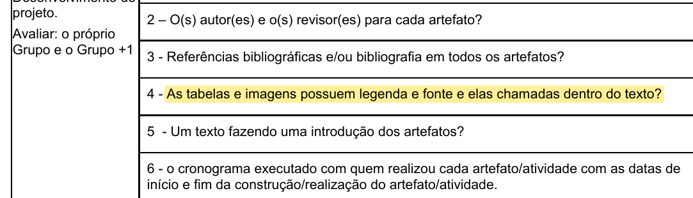{ loading=lazy }
    
Figura 4 — Fonte do critério D04.

    
Fonte: SALES (2026, p. 8 do PDF).

??? question "D05 — O GitHub Pages possui um texto fazendo uma introdução dos artefatos?"

    **Rastreabilidade na V2.** [D05](../../entrega-8/lista-etapa-4.md#d05).

    **Autor do item:** André Barros de Sales.

    **O que conferir:** Verificar texto introdutório no início de cada documento contextualizando objetivo, escopo, funcionalidade avaliada e relação com as etapas anteriores.

    **Origem da pergunta:** Plano de ensino (SALES, 2026, p. 8 do PDF). A Figura 5 mostra o trecho destacado.

    { loading=lazy }
    
Figura 5 — Fonte do critério D05.

    
Fonte: SALES (2026, p. 8 do PDF).

??? question "D06 — O GitHub Pages possui o cronograma executado com quem realizou cada artefato/atividade com as datas de início e fim?"

    **Rastreabilidade na V2.** [D06](../../entrega-8/lista-etapa-4.md#d06).

    **Autor do item:** André Barros de Sales.

    **O que conferir:** Conferir registro do cronograma efetivamente executado da Etapa 4 (com responsáveis, revisores e datas reais de início e término, sem confundir agenda planejada com execução).

    **Origem da pergunta:** Plano de ensino (SALES, 2026, p. 8 do PDF). A Figura 6 mostra o trecho destacado.

    { loading=lazy }
    
Figura 6 — Fonte do critério D06.

    
Fonte: SALES (2026, p. 8 do PDF).

??? question "D07 — O GitHub Pages possui ata(s) da(s) reuniões (com data, horário de início e fim, participantes, objetivo, atividades definidas etc.)?"

    **Rastreabilidade na V2.** [D07](../../entrega-8/lista-etapa-4.md#d07).

    **Autor do item:** André Barros de Sales.

    **O que conferir:** Conferir na seção de Atas a presença da ata formal da etapa contendo data, horários de abertura e encerramento, participantes presentes, pauta/objetivo e deliberações.

    **Origem da pergunta:** Plano de ensino (SALES, 2026, p. 9 do PDF). A Figura 7 mostra o trecho destacado.

    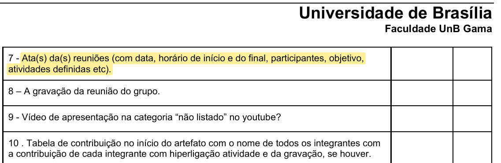{ loading=lazy }
    
Figura 7 — Fonte do critério D07.

    
Fonte: SALES (2026, p. 9 do PDF).

??? question "D08 — O GitHub Pages possui a gravação da reunião do grupo?"

    **Rastreabilidade na V2.** [D08](../../entrega-8/lista-etapa-4.md#d08).

    **Autor do item:** André Barros de Sales.

    **O que conferir:** Verificar link acessível e funcional para a gravação em vídeo da reunião do grupo referente à Etapa 4.

    **Origem da pergunta:** Plano de ensino (SALES, 2026, p. 9 do PDF). A Figura 8 mostra o trecho destacado.

    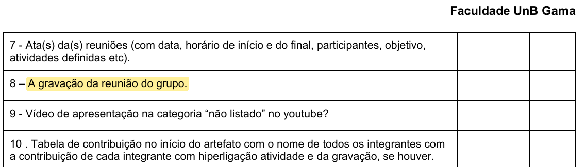{ loading=lazy }
    
Figura 8 — Fonte do critério D08.

    
Fonte: SALES (2026, p. 9 do PDF).

??? question "D09 — O GitHub Pages possui vídeo de apresentação na categoria “não listado” no YouTube?"

    **Rastreabilidade na V2.** [D09](../../entrega-8/lista-etapa-4.md#d09).

    **Autor do item:** André Barros de Sales.

    **O que conferir:** Conferir disponibilidade do vídeo da Apresentação 4 publicado como “não listado” no YouTube e devidamente vinculado na página de apresentações do grupo.

    **Origem da pergunta:** Plano de ensino (SALES, 2026, p. 9 do PDF). A Figura 9 mostra o trecho destacado.

    { loading=lazy }
    
Figura 9 — Fonte do critério D09.

    
Fonte: SALES (2026, p. 9 do PDF).

??? question "D10 — O GitHub Pages possui tabela de contribuição no início do artefato com o nome dos integrantes e hiperligação da atividade?"

    **Rastreabilidade na V2.** [D10](../../entrega-8/lista-etapa-4.md#d10).

    **Autor do item:** André Barros de Sales.

    **O que conferir:** Conferir tabela no topo de cada artefato identificando quem efetivamente atuou naquela página, qual atividade realizou e o link direto para a seção correspondente.

    **Origem da pergunta:** Plano de ensino (SALES, 2026, p. 9 do PDF). A Figura 10 mostra o trecho destacado.

    { loading=lazy }
    
Figura 10 — Fonte do critério D10.

    
Fonte: SALES (2026, p. 9 do PDF).

??? question "D11 — O GitHub Pages possui a seção de agradecimentos apresentando o uso de Inteligência Artificial (IA) Generativa no artefato?"

    **Rastreabilidade na V2.** [D11](../../entrega-8/lista-etapa-4.md#d11).

    **Autor do item:** André Barros de Sales.

    **O que conferir:** Conferir menção nominal às ferramentas de IA generativa utilizadas (ex.: Google Gemini, ChatGPT/Codex, Claude), detalhando a finalidade do apoio e reafirmando a responsabilidade humana pelo conteúdo.

    **Origem da pergunta:** Plano de ensino (SALES, 2026, p. 3 do PDF). A Figura 11 mostra o trecho destacado.

    { loading=lazy }
    
Figura 11 — Fonte do critério D11.

    
Fonte: SALES (2026, p. 3 do PDF).

## Conteúdo da disciplina

Os critérios `E4-C02` a `E4-C13` reproduzem integralmente os itens **2 a 13** da lista oficial da **Apresentação 4** (*Planejamento da Avaliação do Storyboard e Análise de tarefas, planejamento do relato dos resultados da avaliação do Storyboard e o planejamento do relato dos resultados da avaliação do Análise de tarefas*), elaborada pelo professor **André Barros de Sales** [1].

??? question "E4-C02 (Item 2) — O planejamento da avaliação segue o Framework DECIDE?"

    **Rastreabilidade na V2.** [E4-11](../../entrega-8/lista-etapa-4.md#e4-11) · mantido integralmente no bloco *Planejamento da avaliação*.

    **Autor do item:** André Barros de Sales.

    **O que conferir:** Verificar se os planejamentos da avaliação do Storyboard e da Análise de Tarefas estão estruturados pelas seis etapas do framework DECIDE: **(D)** determinar os objetivos gerais; **(E)** explorar as perguntas específicas a responder; **(C)** escolher os métodos de avaliação; **(I)** identificar e administrar as questões práticas; **(D)** decidir como lidar com as questões éticas; e **(E)** avaliar, interpretar e apresentar os dados.

    **Origem da pergunta:** Lista oficial da Apresentação 4 no Plano de Ensino (SALES, 2026). A Figura 12 mostra o trecho destacado.

    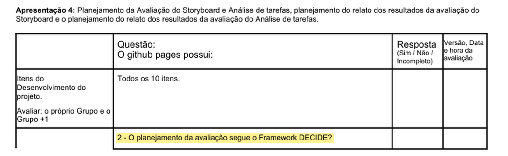{ loading=lazy }
    
Figura 12 — Fonte do critério E4-C02 (Item 2 da lista oficial).

    
Fonte: SALES (2026) — Lista oficial da Apresentação 4.

??? question "E4-C03 (Item 3) — Descreve o(s) objetivo(s) da avaliação? (apropriação de tecnologia pelos usuários; ideias e alternativas de design; conformidade com um padrão; e/ou problemas na interação e na interface na fase do modelo conceitual)?"

    **Rastreabilidade na V2.** [E4-12](../../entrega-8/lista-etapa-4.md#e4-12) · mantido integralmente no bloco *Planejamento da avaliação*.

    **Autor do item:** André Barros de Sales.

    **O que conferir:** Conferir na etapa **D (Determinar os objetivos)** de cada planejamento a explicitação clara de quais objetivos de avaliação de IHC estão sendo investigados (apropriação tecnológica, comparação de alternativas de design, conformidade com padrões e/ou identificação de problemas na interação e interface ainda na fase conceitual).

    **Origem da pergunta:** Lista oficial da Apresentação 4 no Plano de Ensino (SALES, 2026). A Figura 13 mostra o trecho destacado.

    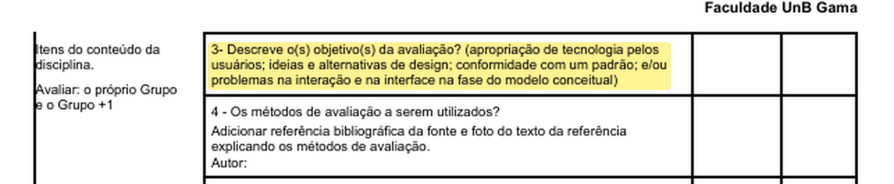{ loading=lazy }
    
Figura 13 — Fonte do critério E4-C03 (Item 3 da lista oficial).

    
Fonte: SALES (2026) — Lista oficial da Apresentação 4.

??? question "E4-C04 (Item 4) — Apresenta os métodos de avaliação a serem utilizados, acompanhados de referência bibliográfica da fonte, foto do texto da referência explicando os métodos e identificação do autor do item?"

    **Rastreabilidade na V2.** [E4-13](../../entrega-8/lista-etapa-4.md#e4-13) · mantido integralmente no bloco *Planejamento da avaliação*.

    **Autor do item:** André Barros de Sales.

    **O que conferir:** Verificar na etapa **C (Escolher os métodos)** a descrição e justificativa dos métodos adotados para avaliar o Storyboard e a Análise de Tarefas, acompanhadas obrigatoriamente de **(1)** referência bibliográfica completa, **(2)** imagem legível da página da obra explicando o método e **(3)** nome explícito do autor daquele item de conteúdo no artefato.

    **Origem da pergunta:** Lista oficial da Apresentação 4 no Plano de Ensino (SALES, 2026). A Figura 14 mostra o trecho destacado.

    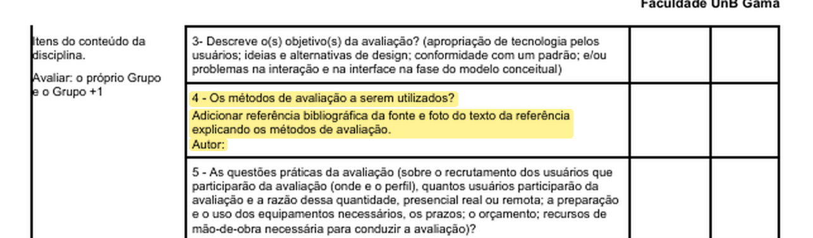{ loading=lazy }
    
Figura 14 — Fonte do critério E4-C04 (Item 4 da lista oficial).

    
Fonte: SALES (2026) — Lista oficial da Apresentação 4.

??? question "E4-C05 (Item 5) — Descreve as questões práticas da avaliação (recrutamento: onde e perfil; quantidade de usuários e justificativa dessa quantidade; modalidade presencial real ou remota; preparação e uso de equipamentos; prazos; orçamento; e mão de obra necessária)?"

    **Rastreabilidade na V2.** [E4-14](../../entrega-8/lista-etapa-4.md#e4-14) · mantido integralmente no bloco *Planejamento da avaliação*.

    **Autor do item:** André Barros de Sales.

    **O que conferir:** Conferir na etapa **I (Identificar e administrar as questões práticas)** a presença de todos os sete pontos operacionais: **(1)** local/canal de recrutamento e perfil dos participantes, **(2)** quantidade prevista e justificativa metodológica/prática desse número, **(3)** modalidade presencial ou remota, **(4)** preparação e equipamentos necessários, **(5)** prazos, **(6)** orçamento (inclusive justificativa quando for custo zero) e **(7)** papéis/mão de obra para conduzir as sessões.

    **Origem da pergunta:** Lista oficial da Apresentação 4 no Plano de Ensino (SALES, 2026). A Figura 15 mostra o trecho destacado.

    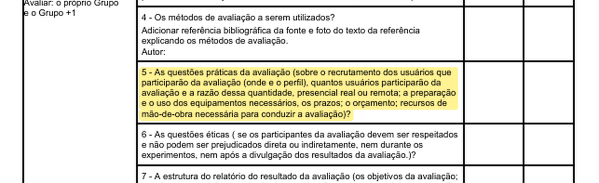{ loading=lazy }
    
Figura 15 — Fonte do critério E4-C05 (Item 5 da lista oficial).

    
Fonte: SALES (2026) — Lista oficial da Apresentação 4.

??? question "E4-C06 (Item 6) — Aborda as questões éticas (garantindo que os participantes sejam respeitados e não sejam prejudicados direta ou indiretamente, nem durante os experimentos nem após a divulgação dos resultados)?"

    **Rastreabilidade na V2.** [E4-15](../../entrega-8/lista-etapa-4.md#e4-15) · mantido integralmente no bloco *Planejamento da avaliação*.

    **Autor do item:** André Barros de Sales.

    **O que conferir:** Conferir na etapa **D (Decidir como lidar com as questões éticas)** e na minuta do TCLE a proteção integral ao participante antes, durante e após a avaliação (respeito, não maleficência, anonimato/desidentificação na divulgação, participação voluntária, liberdade de desistência e consentimento informado).

    **Origem da pergunta:** Lista oficial da Apresentação 4 no Plano de Ensino (SALES, 2026). A Figura 16 mostra o trecho destacado.

    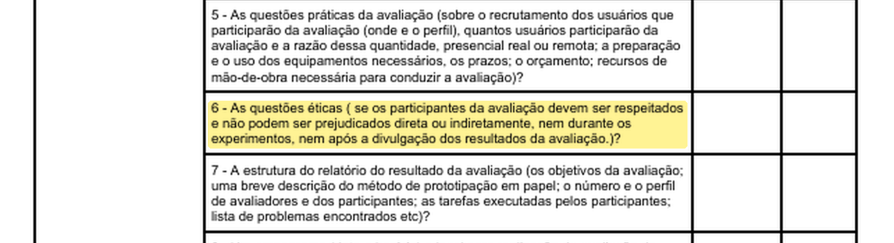{ loading=lazy }
    
Figura 16 — Fonte do critério E4-C06 (Item 6 da lista oficial).

    
Fonte: SALES (2026) — Lista oficial da Apresentação 4.

??? question "E4-C07 (Item 7) — Define a estrutura do relatório do resultado da avaliação (objetivos da avaliação; breve descrição do método utilizado; número e perfil de avaliadores e participantes; tarefas/roteiros avaliados; lista de problemas encontrados etc.)?"

    **Rastreabilidade na V2.** [E4-25](../../entrega-8/lista-etapa-4.md#e4-25) · mantido integralmente no bloco *Planejamento do relato*.

    **Autor do item:** André Barros de Sales.

    **O que conferir:** Examinar os artefatos de **planejamento do relato dos resultados** (do Storyboard e da Análise de Tarefas) para confirmar se estruturam previamente todas as seções que receberão os dados na etapa seguinte: objetivos, método empregado, quantidade e perfil de avaliadores e participantes, tarefas/cenários percorridos, consolidação dos achados e lista estruturada de problemas encontrados.

    **Origem da pergunta:** Lista oficial da Apresentação 4 no Plano de Ensino (SALES, 2026). A Figura 17 mostra o trecho destacado.

    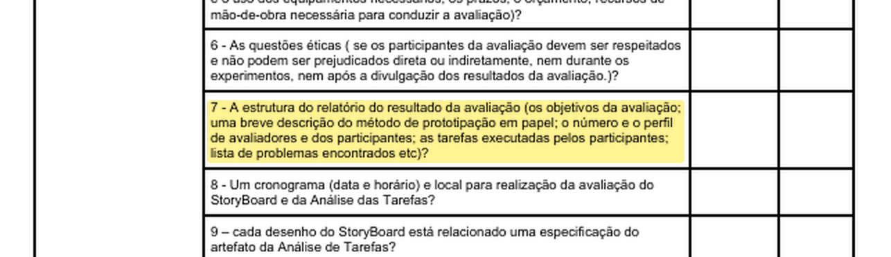{ loading=lazy }
    
Figura 17 — Fonte do critério E4-C07 (Item 7 da lista oficial).

    
Fonte: SALES (2026) — Lista oficial da Apresentação 4.

??? question "E4-C08 (Item 8) — Apresenta um cronograma (data e horário) e local para realização da avaliação do Storyboard e da Análise de Tarefas?"

    **Rastreabilidade na V2.** [E4-16](../../entrega-8/lista-etapa-4.md#e4-16) · mantido integralmente no bloco *Planejamento da avaliação*.

    **Autor do item:** André Barros de Sales.

    **O que conferir:** Verificar nos planejamentos da avaliação a existência de agenda explícita com **datas**, **horários** (ou janelas definidas) e **local físico ou plataforma remota** para as sessões de avaliação tanto do Storyboard quanto da Análise de Tarefas.

    **Origem da pergunta:** Lista oficial da Apresentação 4 no Plano de Ensino (SALES, 2026). A Figura 18 mostra o trecho destacado.

    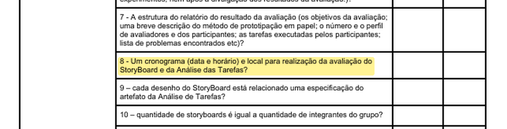{ loading=lazy }
    
Figura 18 — Fonte do critério E4-C08 (Item 8 da lista oficial).

    
Fonte: SALES (2026) — Lista oficial da Apresentação 4.

??? question "E4-C09 (Item 9) — Cada desenho do Storyboard está relacionado a uma especificação do artefato da Análise de Tarefas?"

    **Rastreabilidade na V2.** [E4-02](../../entrega-8/lista-etapa-4.md#e4-02) · mantido integralmente no bloco *Storyboard*.

    **Autor do item:** André Barros de Sales.

    **O que conferir:** Conferir se cada Storyboard e seus respectivos quadros estão explicitamente vinculados a uma tarefa modelada na Análise de Tarefas (HTA e/ou CTT), permitindo rastrear qual fluxo analítico aquela narrativa visual representa.

    **Origem da pergunta:** Lista oficial da Apresentação 4 no Plano de Ensino (SALES, 2026). A Figura 19 mostra o trecho destacado.

    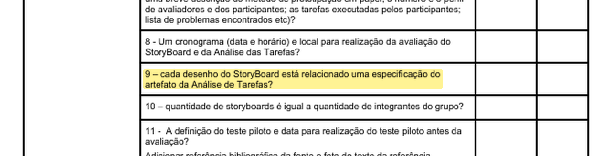{ loading=lazy }
    
Figura 19 — Fonte do critério E4-C09 (Item 9 da lista oficial).

    
Fonte: SALES (2026) — Lista oficial da Apresentação 4.

??? question "E4-C10 (Item 10) — A quantidade de storyboards é igual à quantidade de integrantes do grupo?"

    **Rastreabilidade na V2.** [E4-01](../../entrega-8/lista-etapa-4.md#e4-01) · mantido integralmente no bloco *Storyboard*.

    **Autor do item:** André Barros de Sales.

    **O que conferir:** Contar os Storyboards completos publicados na entrega e comparar com o número total de integrantes ativos da equipe (ex.: 5 storyboards completos para 5 integrantes no Grupo 06; 7 storyboards para 7 integrantes no Grupo 05).

    **Origem da pergunta:** Lista oficial da Apresentação 4 no Plano de Ensino (SALES, 2026). A Figura 20 mostra o trecho destacado.

    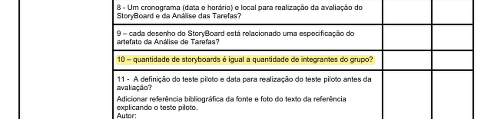{ loading=lazy }
    
Figura 20 — Fonte do critério E4-C10 (Item 10 da lista oficial).

    
Fonte: SALES (2026) — Lista oficial da Apresentação 4.

??? question "E4-C11 (Item 11) — Apresenta a definição do teste-piloto e a data para sua realização antes da avaliação oficial, com referência bibliográfica, foto do texto da referência explicando o teste-piloto e autor do item?"

    **Rastreabilidade na V2.** [E4-17](../../entrega-8/lista-etapa-4.md#e4-17) · mantido integralmente no bloco *Planejamento da avaliação*.

    **Autor do item:** André Barros de Sales.

    **O que conferir:** Verificar nos planejamentos **(1)** a conceituação e finalidade do teste-piloto, **(2)** data agendada estritamente **anterior** às sessões definitivas de avaliação, **(3)** referência bibliográfica da fonte, **(4)** imagem legível do trecho do livro explicando o teste-piloto e **(5)** identificação nominal do autor desse item de conteúdo.

    **Origem da pergunta:** Lista oficial da Apresentação 4 no Plano de Ensino (SALES, 2026). A Figura 21 mostra o trecho destacado.

    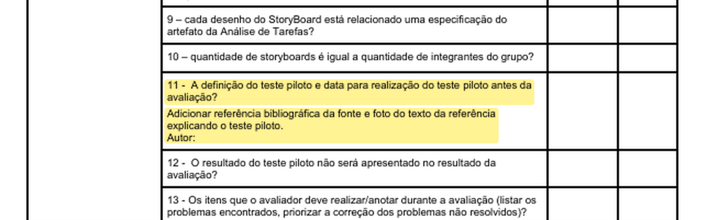{ loading=lazy }
    
Figura 21 — Fonte do critério E4-C11 (Item 11 da lista oficial).

    
Fonte: SALES (2026) — Lista oficial da Apresentação 4.

??? question "E4-C12 (Item 12) — Explicita que o resultado do teste-piloto não será apresentado junto ao resultado oficial da avaliação?"

    **Rastreabilidade na V2.** [E4-18](../../entrega-8/lista-etapa-4.md#e4-18) · mantido integralmente no bloco *Planejamento da avaliação*.

    **Autor do item:** André Barros de Sales.

    **O que conferir:** Confirmar a presença de regra expressa determinando que os dados coletados durante o teste-piloto servem apenas para calibrar roteiro, tempo e ferramentas, sendo descartados/separados da consolidação dos resultados finais da avaliação.

    **Origem da pergunta:** Lista oficial da Apresentação 4 no Plano de Ensino (SALES, 2026). A Figura 22 mostra o trecho destacado.

    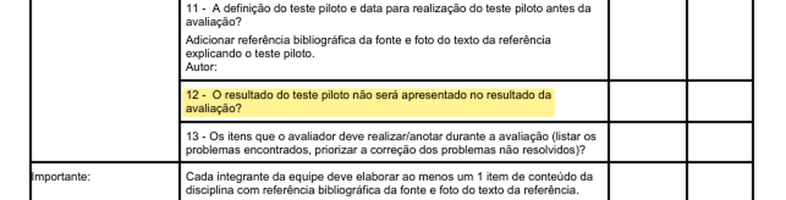{ loading=lazy }
    
Figura 22 — Fonte do critério E4-C12 (Item 12 da lista oficial).

    
Fonte: SALES (2026) — Lista oficial da Apresentação 4.

??? question "E4-C13 (Item 13) — Especifica os itens que o avaliador deve realizar/anotar durante a avaliação (listar os problemas encontrados, priorizar a correção dos problemas não resolvidos)?"

    **Rastreabilidade na V2.** [E4-26](../../entrega-8/lista-etapa-4.md#e4-26) · mantido integralmente no bloco *Planejamento do relato*.

    **Autor do item:** André Barros de Sales.

    **O que conferir:** Verificar nos instrumentos de coleta e nos planejamentos do relato a descrição objetiva do que o avaliador deve observar e registrar durante as sessões, incluindo a listagem estruturada dos problemas encontrados e os critérios para priorizar a correção dos problemas pendentes.

    **Origem da pergunta:** Lista oficial da Apresentação 4 no Plano de Ensino (SALES, 2026). A Figura 23 mostra o trecho destacado.

    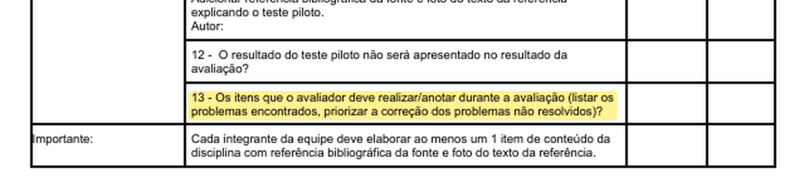{ loading=lazy }
    
Figura 23 — Fonte do critério E4-C13 (Item 13 da lista oficial).

    
Fonte: SALES (2026) — Lista oficial da Apresentação 4.

## Itens elaborados pelo grupo

Em cumprimento à diretriz final da lista oficial (*"Cada integrante da equipe deve elaborar ao menos 1 item de conteúdo da disciplina com referência bibliográfica da fonte e foto do texto da referência"*), os critérios `E4-C14` a `E4-C23` reúnem os **10 itens adicionais** (2 por integrante) elaborados pelo Grupo 06.

??? question "E4-C14 (Item 14) — O diagrama HTA utiliza a notação canônica de retângulos com linha espessa na base para operações terminais e explicita os operadores lógicos dos planos (`>`, `/`, `+`, `( )`)?"

    **Rastreabilidade na V2.** Retirado da Etapa 4 V2 por pertencer à sintaxe gráfica da HTA na Etapa 2; na Etapa 4 a avaliação da decomposição com stakeholders é verificada em [E4-22](../../entrega-8/lista-etapa-4.md#e4-22). Ver [Conferência da lista](../../entrega-8/lista-etapa-4.md#conferencia-da-lista).

    **Autor do item:** [Bruno Ferreira Dornelas](https://github.com/brunnf).

    **Referência:** BARBOSA, Simone Diniz Junqueira; SILVA, Bruno Santana da. *Interação humano-computador*. Rio de Janeiro: Elsevier, 2010. Cap. 6, Seção 6.4.1, p. 193–194.

    **Fundamentação:** Na HTA clássica (Annett; Duncan, 1967; Barbosa; Silva, 2010), os elementos gráficos distinguem os níveis hierárquicos: subobjetivos não terminais geram ramificações, enquanto as **operações** (unidades fundamentais que não se decompõem mais) são representadas por retângulos com um traço horizontal espesso na base. Além disso, os planos articulam a lógica de execução por operadores definidos: sequência fixa (`>`), regra de decisão/seleção (`/`), paralelismo (`+`) e opcionalidade (`( )`).

    **Como verificar:**

    - **Sim:** operações terminais graficamente diferenciadas dos objetivos não terminais (linha espessa na base) e todos os nós decompostos acompanhados de planos com operadores lógicos padronizados.
    - **Incompleto:** planos descritos apenas em texto livre ambíguo, sem operadores claros, ou ausência de distinção visual consistente das operações terminais.
    - **Não:** diagrama reduzido a fluxograma genérico sem a sintaxe formal da HTA.

    A Figura 24 reproduz os elementos do diagrama HTA e a notação de planos e operações em Barbosa e Silva (2010, p. 193).

    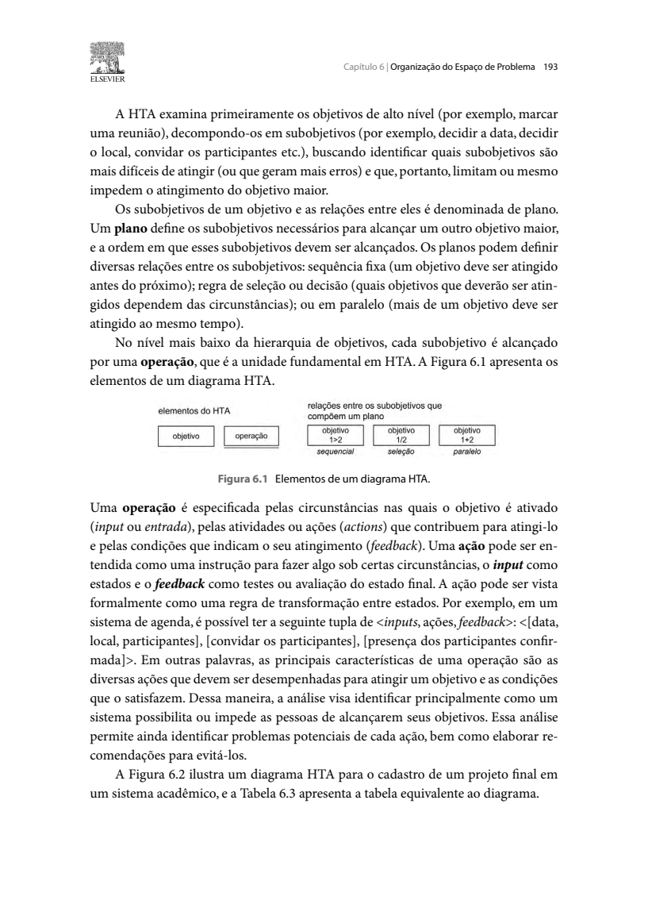{ loading=lazy }
    
Figura 24 — Elementos do diagrama HTA e especificação de operações.

    
Fonte: BARBOSA; SILVA (2010, p. 193).

??? question "E4-C15 (Item 15) — O artefato de Análise de Tarefas documenta medidas mensuráveis de sucesso (evidência objetiva de atingimento do objetivo) e explicita as consequências da falha em atingi-lo?"

    **Rastreabilidade na V2.** Retirado da Etapa 4 V2 por pertencer à construção do artefato HTA na Etapa 2; ver [Conferência da lista](../../entrega-8/lista-etapa-4.md#conferencia-da-lista).

    **Autor do item:** [Bruno Ferreira Dornelas](https://github.com/brunnf).

    **Referência:** BARBOSA, Simone Diniz Junqueira; SILVA, Bruno Santana da. *Interação humano-computador*. Rio de Janeiro: Elsevier, 2010. Cap. 6, Seção 6.4.1, p. 195–196.

    **Fundamentação:** No passo 2 da construção da HTA, Barbosa e Silva (2010, p. 196) orientam obter consenso na definição dos objetivos da tarefa e das medidas de sucesso, respondendo explicitamente a duas questões: *(1) qual evidência objetiva indicará que o objetivo foi atingido?* e *(2) quais as consequências da falha em atingir esse objetivo?*

    **Como verificar:**

    - **Sim:** presença de tabela ou seção registrando indicadores/evidências perceptíveis de êxito da tarefa e o impacto negativo caso o objetivo falhe.
    - **Incompleto:** menção apenas ao objetivo geral do usuário, omitindo critérios objetivos de sucesso ou as consequências do insucesso.
    - **Não:** ausência de qualquer registro sobre medidas de sucesso ou consequências de falha.

    A Figura 25 apresenta os passos 1 e 2 da HTA com a definição de medidas de sucesso e consequências de falha em Barbosa e Silva (2010, p. 196).

    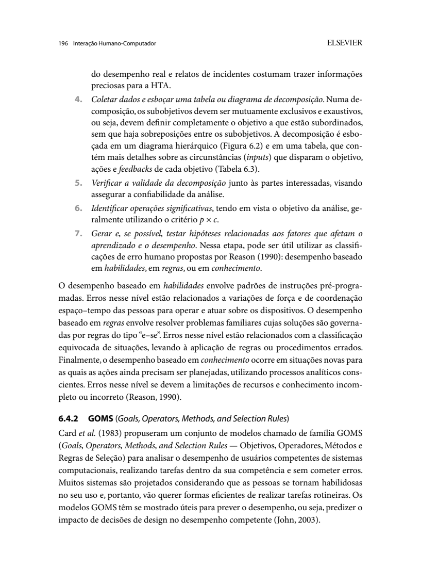{ loading=lazy }
    
Figura 25 — Passos da HTA e definição de medidas de sucesso.

    
Fonte: BARBOSA; SILVA (2010, p. 196).

??? question "E4-C16 (Item 16) — As operações da HTA especificam explicitamente as circunstâncias de ativação (input), as atividades motoras/cognitivas (ações) e a condição de término (feedback)?"

    **Rastreabilidade na V2.** Retirado da Etapa 4 V2 por inspecionar a tabela de operações da HTA na Etapa 2; ver [Conferência da lista](../../entrega-8/lista-etapa-4.md#conferencia-da-lista).

    **Autor do item:** [Caio Breno de Souza Bezerra](https://github.com/CaioBezerra-Dev).

    **Referência:** BARBOSA, Simone Diniz Junqueira; SILVA, Bruno Santana da. *Interação humano-computador*. Rio de Janeiro: Elsevier, 2010. Cap. 6, Seção 6.4.1, p. 193–195.

    **Fundamentação:** De acordo com Barbosa e Silva (2010, p. 193), uma operação em HTA é definida por três componentes indissociáveis: as circunstâncias nas quais o objetivo é ativado (*input* ou entrada), as atividades motoras ou cognitivas que contribuem para atingi-lo (*ações*) e as condições que indicam o seu atingimento (*feedback*).

    **Como verificar:**

    - **Sim:** tabela detalhada da HTA especifica para cada operação terminal os campos *Input*, *Ação* e *Feedback*.
    - **Incompleto:** especificação parcial (omitindo um dos três elementos ou cobrindo apenas parte das operações).
    - **Não:** tabela ou texto apenas descritivo sem decompor a tríade *Input / Ação / Feedback*.

    A Figura 26 reproduz o trecho da página 193 que formaliza a especificação de operações por *input*, *ações* e *feedback*.

    { loading=lazy }
    
Figura 26 — Especificação formal de uma operação na HTA.

    
Fonte: BARBOSA; SILVA (2010, p. 193).

??? question "E4-C17 (Item 17) — O TCLE assegura explicitamente a não maleficência, a garantia de desistência a qualquer momento sem ônus, o sigilo/anonimato e a autorização formal prévia para gravações?"

    **Rastreabilidade na V2.** [E4-24](../../entrega-8/lista-etapa-4.md#e4-24) · refinado em enunciado autocontido com recortes específicos de TCLE, gravação e anonimato (p. 140–141).

    **Autor do item:** [Caio Breno de Souza Bezerra](https://github.com/CaioBezerra-Dev).

    **Referência:** BARBOSA, Simone Diniz Junqueira; SILVA, Bruno Santana da. *Interação humano-computador*. Rio de Janeiro: Elsevier, 2010. Cap. 5, p. 141–146; BRASIL. Conselho Nacional de Saúde. *Resolução nº 510, de 7 de abril de 2016*. Brasília: CNS, 2016.

    **Fundamentação:** A condução ética de estudos com participantes exige assegurar formalmente no Termo de Consentimento Livre e Esclarecido (TCLE) o objetivo do estudo, o sigilo/anonimato, a não maleficência, a autonomia para interromper a participação a qualquer momento sem penalidades e a permissão específica prévia para gravação de áudio, vídeo ou tela.

    **Como verificar:**

    - **Sim:** minuta de TCLE contempla explicitamente objetivo, anonimato, desistência livre sem prejuízo e cláusula específica de autorização para gravação.
    - **Incompleto:** termo genérico omitindo cláusula de gravação ou direito expresso de interrupção sem ônus.
    - **Não:** ausência de minuta de TCLE ou de salvaguardas éticas equivalentes.

    A Figura 27 apresenta as orientações de postura ética e respeito aos participantes em Barbosa e Silva (2010, p. 146).

    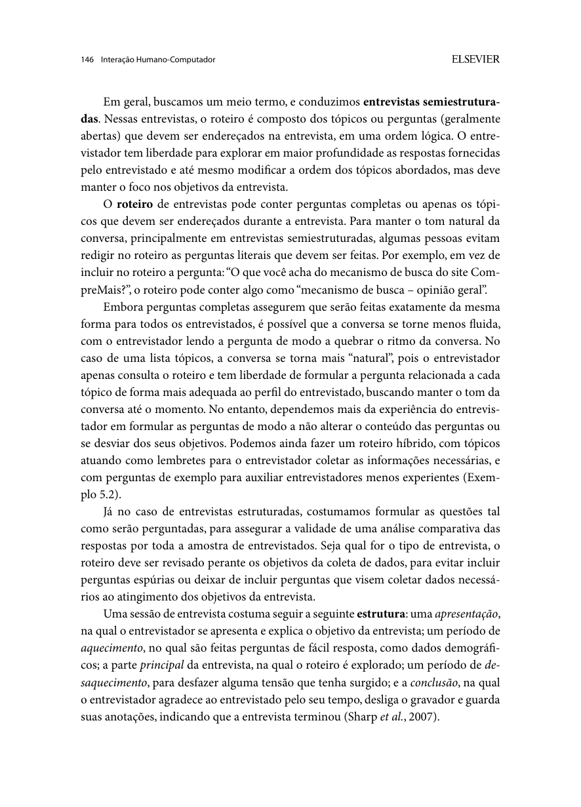{ loading=lazy }
    
Figura 27 — Diretrizes de respeito e ética na relação com os participantes.

    
Fonte: BARBOSA; SILVA (2010, p. 146).

??? question "E4-C18 (Item 18) — A decomposição de objetivos em subobjetivos na HTA comprova ser mutuamente exclusiva (sem sobreposições entre nós irmãos) e exaustiva (cobrindo 100% do objetivo-pai)?"

    **Rastreabilidade na V2.** Retirado como critério de diagrama da Etapa 2; reorientado na Etapa 4 para a validação da decomposição com partes interessadas em [E4-22](../../entrega-8/lista-etapa-4.md#e4-22).

    **Autor do item:** [Heitor Pinheiro Gonçalves das Chagas](https://github.com/Heitorovski01).

    **Referência:** BARBOSA, Simone Diniz Junqueira; SILVA, Bruno Santana da. *Interação humano-computador*. Rio de Janeiro: Elsevier, 2010. Cap. 6, Seção 6.4.1, p. 195–196.

    **Fundamentação:** No passo 4 da HTA (*Coletar dados e esboçar tabela ou diagrama*), Barbosa e Silva (2010, p. 196) estabelecem que os subobjetivos de um mesmo objetivo devem ser **mutuamente exclusivos** (sem etapas redundantes ou sobrepostas no mesmo nível) e **exaustivos** (cumpridos os subobjetivos, o objetivo-pai é integralmente alcançado, sem passos intermediários ocultos).

    **Como verificar:**

    - **Sim:** decomposição cobre integralmente o ciclo da tarefa sem sobreposição funcional entre subobjetivos irmãos.
    - **Incompleto:** sobreposição parcial entre nós irmãos ou lacunas intermediárias não justificadas para atingir o objetivo-pai.
    - **Não:** hierarquia desordenada, misturando ações redundantes ou níveis incompatíveis.

    A Figura 28 reproduz o passo 4 da página 196, onde os critérios de exclusividade e exaustão são prescritos.

    { loading=lazy }
    
Figura 28 — Critérios de exclusividade e exaustão na decomposição da HTA.

    
Fonte: BARBOSA; SILVA (2010, p. 196).

??? question "E4-C19 (Item 19) — Cada quadro do Storyboard possui rastreabilidade formal e identificada com as operações/subobjetivos modelados na Análise de Tarefas?"

    **Rastreabilidade na V2.** Retirado por duplicidade direta com o item oficial imutável [E4-02](../../entrega-8/lista-etapa-4.md#e4-02) (`E4-C09`); substituído pelos critérios específicos de Storyboard [E4-03](../../entrega-8/lista-etapa-4.md#e4-03) a [E4-10](../../entrega-8/lista-etapa-4.md#e4-10).

    **Autor do item:** [Heitor Pinheiro Gonçalves das Chagas](https://github.com/Heitorovski01).

    **Referência:** BARBOSA, Simone Diniz Junqueira; SILVA, Bruno Santana da. *Interação humano-computador*. Rio de Janeiro: Elsevier, 2010. Cap. 6, p. 193–195; Cap. 9, p. 294, 301.

    **Fundamentação:** O Storyboard atua como contextualização sociotécnica das tarefas analisadas, devendo associar cada quadro ou cena (motivação inicial, etapas de interação, ponto de atrito e desfecho) aos subobjetivos e operações correspondentes na Análise de Tarefas por meio de identificadores rastreáveis.

    **Como verificar:**

    - **Sim:** presença de tabela ou mapeamento nominal associando cada quadro do Storyboard (ex.: Quadro 1..N) aos nós/operações correspondentes da Análise de Tarefas.
    - **Incompleto:** relação mencionada apenas de modo genérico em texto corrido, sem correspondência quadro a quadro.
    - **Não:** Storyboard desconectado das operações modeladas na Análise de Tarefas.

    A Figura 29 apresenta a fundamentação sobre investigação apoiada em representações visuais de tarefas e cenários em Barbosa e Silva (2010, p. 301).

    { loading=lazy }
    
Figura 29 — Uso de artefatos visuais e materiais de apoio na avaliação de IHC.

    
Fonte: BARBOSA; SILVA (2010, p. 301).

??? question "E4-C20 (Item 20) — O planejamento do relato dos resultados estrutura os 7 componentes de consolidação de Barbosa e Silva e explicita os limites de generalização dos achados?"

    **Rastreabilidade na V2.** [E4-29](../../entrega-8/lista-etapa-4.md#e4-29) · reformulado para retirar sobreposição com [E4-25](../../entrega-8/lista-etapa-4.md#e4-25) (`E4-C07`), focando nos limites de generalização e validades do estudo.

    **Autor do item:** [Israel Soares de Paiva](https://github.com/IsraelSoares-25).

    **Referência:** BARBOSA, Simone Diniz Junqueira; SILVA, Bruno Santana da. *Interação humano-computador*. Rio de Janeiro: Elsevier, 2010. Cap. 9, Seção 9.7, p. 312–313.

    **Fundamentação:** Barbosa e Silva (2010, p. 312) destacam que avaliações formativas apontam indícios de problemas dentro do escopo observado, devendo evitar generalizações indevidas, e recomendam estruturar o relato em sete componentes: **(1)** objetivos e escopo da avaliação, **(2)** forma de realização/método, **(3)** número e perfil de participantes e avaliadores, **(4)** sumário dos dados coletados, **(5)** relato da análise e interpretação, **(6)** lista de problemas encontrados e **(7)** planejamento de reprojeto dos sistemas.

    **Como verificar:**

    - **Sim:** planejamento do relato contempla formalmente os 7 componentes de consolidação de Barbosa e Silva e explicita os cuidados quanto aos limites de generalização.
    - **Incompleto:** estrutura parcial omitindo componentes-chave de análise/reprojeto ou sem ressalva sobre alcance/limitações da amostra.
    - **Não:** ausência de estrutura planejada para consolidação e interpretação das evidências.

    A Figura 30 reproduz a página 312 de Barbosa e Silva (2010) com os sete itens do relatório e as recomendações sobre generalização.

    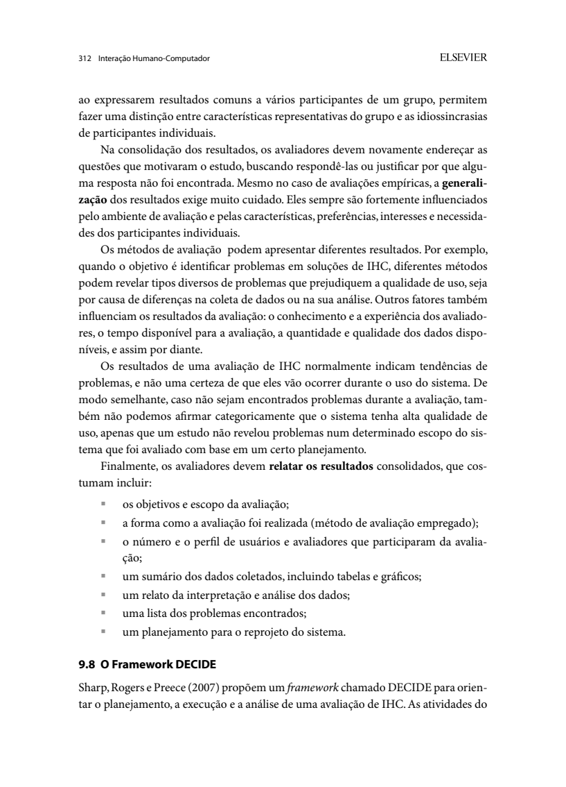{ loading=lazy }
    
Figura 30 — Componentes do relato e cuidados metodológicos de generalização.

    
Fonte: BARBOSA; SILVA (2010, p. 312).

??? question "E4-C21 (Item 21) — O planejamento do relato define uma métrica ou escala objetiva de severidade (ex.: escala de 0 a 4 de Nielsen) para classificar problemas e orientar o reprojeto?"

    **Rastreabilidade na V2.** [E4-28](../../entrega-8/lista-etapa-4.md#e4-28) · reformulado com base em Barbosa e Silva (2010, p. 292, 312) para cobrir gravidade/priorização e planejamento de reprojeto.

    **Autor do item:** [Israel Soares de Paiva](https://github.com/IsraelSoares-25).

    **Referência:** NIELSEN, Jakob. *Usability Engineering*. San Francisco: Morgan Kaufmann, 1994; BARBOSA, Simone Diniz Junqueira; SILVA, Bruno Santana da. *Interação humano-computador*. Rio de Janeiro: Elsevier, 2010. p. 312.

    **Fundamentação:** Para priorizar as decisões de reprojeto na etapa seguinte com base em frequência, impacto e persistência, o planejamento do relato deve estabelecer previamente uma escala objetiva de severidade — como a escala de 0 a 4 de Nielsen (`0` sem problema, `1` cosmético, `2` pequeno, `3` grande, `4` catastrófico) ou classificação equivalente fundamentada.

    **Como verificar:**

    - **Sim:** artefato define explicitamente os níveis da escala de severidade (ex.: 0 a 4 de Nielsen ou critério equivalente) e como guiarão a priorização de correções.
    - **Incompleto:** menciona apenas que haverá priorização, mas sem fixar os níveis ou critérios objetivos de classificação.
    - **Não:** não prevê qualquer classificação de gravidade/prioridade para os problemas encontrados.

    A Figura 31 apresenta a escala clássica de severidade de problemas de usabilidade proposta por Nielsen (1994).

    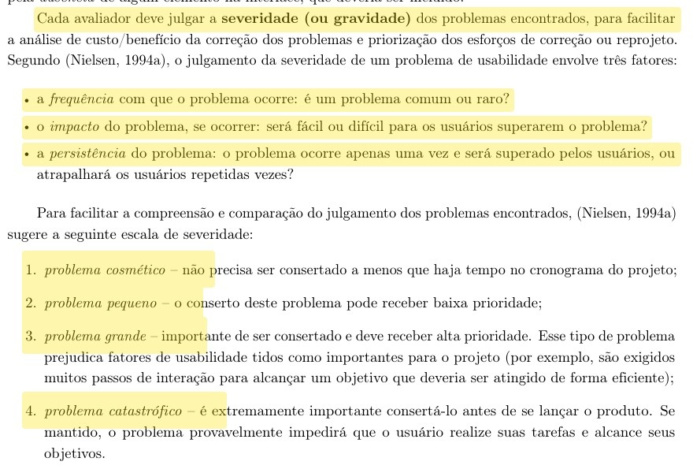{ loading=lazy }
    
Figura 31 — Escala de severidade de problemas de usabilidade de Nielsen (1994).

    
Fonte: NIELSEN (1994); BARBOSA; SILVA (2010, p. 312).

??? question "E4-C22 (Item 22) — O artefato fixa a realização do teste-piloto com participante distinto da amostra oficial e registra formalmente o descarte de seus dados no relato final?"

    **Rastreabilidade na V2.** Retirado por duplicidade direta com os itens oficiais imutáveis [E4-17](../../entrega-8/lista-etapa-4.md#e4-17) (`E4-C11`) e [E4-18](../../entrega-8/lista-etapa-4.md#e4-18) (`E4-C12`).

    **Autor do item:** [Luís Henrique Arruda Luna](https://github.com/Donnk61).

    **Referência:** BARBOSA, Simone Diniz Junqueira; SILVA, Bruno Santana da. *Interação humano-computador*. Rio de Janeiro: Elsevier, 2010. Cap. 9, Seção 9.7, p. 307–308.

    **Fundamentação:** O teste-piloto visa avaliar a própria avaliação (clareza do roteiro, funcionamento dos recursos de gravação, adequação da duração e viabilidade das perguntas). Para evitar viés de aprendizado e contaminação dos dados, seu participante não integra a amostra definitiva e os dados coletados na sessão piloto são descartados do relatório final.

    **Como verificar:**

    - **Sim:** teste-piloto agendado antes das sessões principais, com participante fora da amostra oficial e cláusula explícita de descarte de seus dados na consolidação final.
    - **Incompleto:** teste-piloto previsto, porém sem explicitar independência do participante ou a exclusão dos dados preliminares.
    - **Não:** ausência de previsão de teste-piloto ou inclusão dos dados do piloto na amostra principal.

    A Figura 32 reproduz a página 307 de Barbosa e Silva (2010) sobre a finalidade do teste-piloto.

    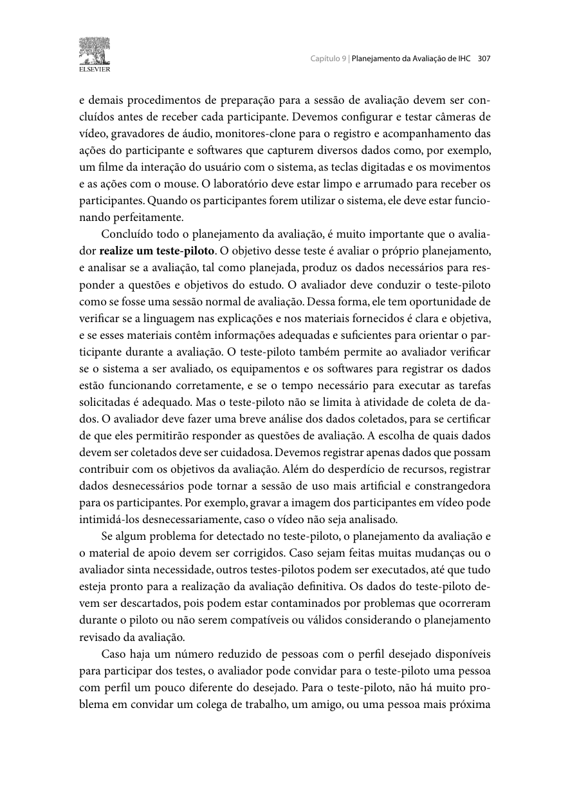{ loading=lazy }
    
Figura 32 — Finalidade do ensaio piloto e separação dos dados preliminares.

    
Fonte: BARBOSA; SILVA (2010, p. 307).

??? question "E4-C23 (Item 23) — O planejamento estabelece diretrizes operacionais sobre a postura do avaliador durante as sessões (não indução de respostas, escuta ativa e anotação imediata de atritos)?"

    **Rastreabilidade na V2.** [E4-23](../../entrega-8/lista-etapa-4.md#e4-23) · refinado em enunciado autocontido cobrindo material de apoio padronizado, estrutura da sessão e postura não indutora.

    **Autor do item:** [Luís Henrique Arruda Luna](https://github.com/Donnk61).

    **Referência:** BARBOSA, Simone Diniz Junqueira; SILVA, Bruno Santana da. *Interação humano-computador*. Rio de Janeiro: Elsevier, 2010. Cap. 5, p. 146–148; Cap. 9, p. 301.

    **Fundamentação:** Em sessões de entrevista e leitura guiada de Storyboard e modelos de tarefas, a condução do avaliador deve manter neutralidade estrita — evitando perguntas indutoras que sugiram a resposta esperada, respeitando o ritmo de reflexão do participante e registrando hesitações e divergências de imediato nas fichas de observação.

    **Como verificar:**

    - **Sim:** seção de condução define o papel do avaliador com regras explícitas de neutralidade/não indução, respeito ao tempo do participante e protocolo de anotação.
    - **Incompleto:** indica apenas quem atuará como avaliador/observador, sem explicitar diretrizes comportamentais de condução.
    - **Não:** não descreve o papel nem os cuidados de postura do avaliador durante a sessão.

    A Figura 33 apresenta as recomendações de postura neutra e condução de entrevistas em Barbosa e Silva (2010, p. 146).

    { loading=lazy }
    
Figura 33 — Postura neutra e condução da sessão pelo avaliador.

    
Fonte: BARBOSA; SILVA (2010, p. 146).

## Agradecimentos

O Google Gemini e o Antigravity apoiaram a organização em blocos recolhidos, a geração dos recortes com destaque amarelo a partir da lista oficial da Apresentação 4 e a revisão das referências. A responsabilidade técnica pela organização desta lista é de Bruno Ferreira Dornelas; os itens `D01`–`D11` e `E4-C02`–`E4-C13` são de autoria docente de André Barros de Sales, e os itens `E4-C14`–`E4-C23` pertencem aos respectivos integrantes do Grupo 06.

## Histórico de versão

| Versão | Data | Descrição | Autor(es) | Revisor(es) |
| :---: | :---: | --- | --- | --- |
| `1.0` | 19/11/2026 | Estruturação da lista V1 da Etapa 4 com recortes grifados | [Bruno Ferreira Dornelas](https://github.com/brunnf) | [Caio Breno de Souza Bezerra](https://github.com/CaioBezerra-Dev) |
| `1.1` | 21/11/2026 | Indicação de versão histórica e rastreabilidade com a V2 | [Bruno Ferreira Dornelas](https://github.com/brunnf) | [Caio Breno de Souza Bezerra](https://github.com/CaioBezerra-Dev) (designado) |

Tabela 2 — Histórico de versão.

Fonte: elaboração do Grupo 06 (2026).

## Referências

[1] SALES, André Barros de. *Plano de Ensino FIHC 022026 — Turma 01*, v1. Brasília: FCTE/UnB, 2026.

[2] BARBOSA, Simone Diniz Junqueira; SILVA, Bruno Santana da. *Interação humano-computador*. Rio de Janeiro: Elsevier, 2010.

[3] BRASIL. Conselho Nacional de Saúde. *Resolução nº 510, de 7 de abril de 2016*. Brasília: CNS, 2016.

[4] NIELSEN, Jakob. *Usability Engineering*. San Francisco: Morgan Kaufmann, 1994.

