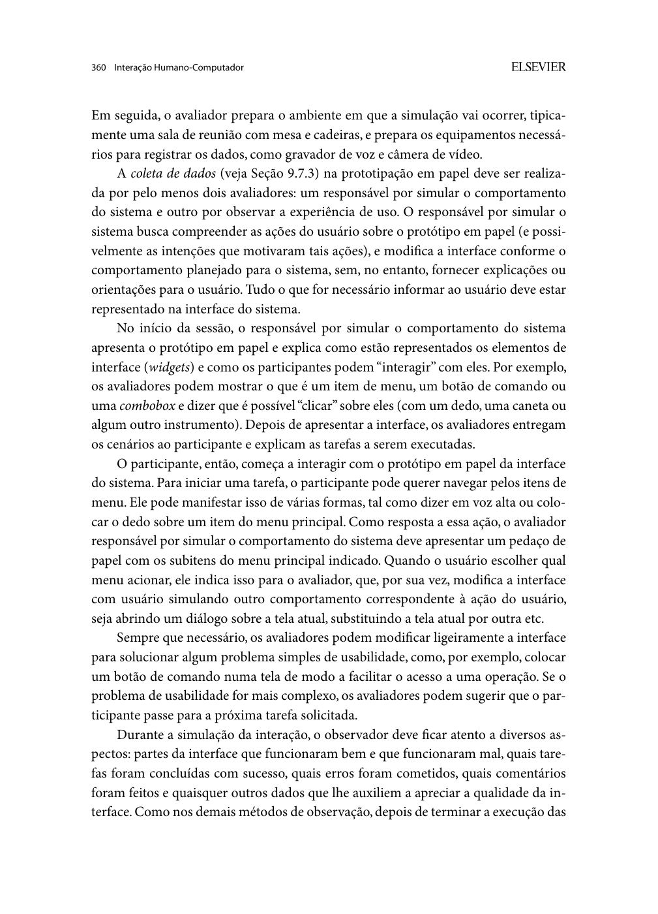

Responsável: Caio Breno de Souza Bezerra — Verificação da Etapa 5 · Autor do item: Caio Breno de Souza Bezerra

# Lista de verificação — Etapa 5

## Tabela de contribuição

A Tabela 1 identifica as contribuições neste artefato.

| Integrante | Contribuição | Artefato / atividade |
| --- | --- | --- |
| [Caio Breno de Souza Bezerra](https://github.com/CaioBezerra-Dev) | Elaboração da proposta de critérios da Etapa 5 | [Conteúdo](#introducao) |
| Codex (OpenAI) | Apoio à consulta das fontes, redação e organização documental | [Agradecimentos](#agradecimentos) |

Tabela 1 — Contribuições neste artefato.

Fonte: elaboração para o Grupo 06 (2026).

## Introdução

Esta lista verifica os **relatos do storyboard e da análise de tarefas** e os **planejamentos da avaliação do protótipo de papel e do relato de seus resultados**. É uma proposta elaborada para o grupo, com base no cronograma da Etapa 5 do plano de ensino e na literatura. Não é uma lista oficial transcrita do professor.

Mantém as colunas e os 11 critérios gerais usados nas etapas anteriores. Os critérios de conteúdo foram formulados para esta entrega. A lista é reutilizável na autoverificação e na inspeção de outro grupo; as respostas e as evidências devem pertencer à versão efetivamente inspecionada.

## Como aplicar

Registrar grupo, endereço, versão/commit, data, hora e avaliadores no registro da inspeção. Preencher **Sim** quando toda a evidência do critério estiver presente, **Incompleto** quando existir apenas parte e **Não** quando faltar. Uma célula vazia significa **não inspecionado**, não “Sim”. Para itens condicionais, registrar a situação na observação; material de preparação não equivale a sessão realizada.

Esta página contém os critérios, ainda sem respostas de uma inspeção coletiva. A gravação da reunião e suas conclusões deverão ficar em **Inspeções**, com referência a esta versão da lista, preservando a separação da seção Verificação.

## Itens de desenvolvimento do projeto

A Tabela 2 mantém a linha de verificação das etapas anteriores. Sua numeração é independente da tabela de conteúdo.

| # | Questão: O GitHub Pages possui… | Resposta | Versão, data e hora da avaliação | Observação |
| :---: | --- | :---: | :---: | --- |
| 1 | O histórico de versão está padronizado? | | | Conferir versão, data, descrição, autor e revisor em cada artefato. |
| 2 | Os autores e revisores estão identificados, com revisão efetivamente registrada? | | | Revisor distinto do autor; “Pendente” não comprova revisão realizada. |
| 3 | Há referências bibliográficas em todos os artefatos? | | | Verificar correspondência entre citações, edição, página e referência. |
| 4 | As tabelas e figuras têm número, legenda, fonte e chamada no texto? | | | Abrir os materiais, inclusive a imagem do storyboard e os trechos do livro. |
| 5 | Os artefatos têm introdução que esclarece objetivo e escopo? | | | Verificar vínculo com a funcionalidade e com as etapas anteriores. |
| 6 | O cronograma executado registra quem fez cada atividade e suas datas reais? | | | Comparar com o planejado; não registrar agenda proposta como execução. |
| 7 | Há atas das reuniões da etapa, com data, horários, pessoas e decisões? | | | Conferir em Registros → Atas; lista de verificação não substitui ata. |
| 8 | As gravações das reuniões e inspeções realizadas estão acessíveis e autorizadas? | | | Conferir link, permissão e correspondência com a reunião registrada. |
| 9 | O vídeo da apresentação da Etapa 5 está acessível na categoria prevista pelo grupo? | | | Conferir link, participantes e conteúdo dos quatro artefatos; não usar vídeo antigo como evidência. |
| 10 | A contribuição aparece no início de cada artefato e corresponde a quem atuou nele? | | | Não atribuir contribuição ou autoria a integrante apenas por pertencer ao grupo. |
| 11 | O uso de IA está identificado na contribuição e nos agradecimentos? | | | Nome da ferramenta e atividade realizada; não confundir autoria manual do desenho com apoio à redação. |

Tabela 2 — Critérios de desenvolvimento do projeto.

Fonte: adaptação dos critérios gerais do plano de ensino e das listas anteriores do Grupo 06.

## Itens de conteúdo da disciplina

A Tabela 3 apresenta critérios específicos. Todos são de autoria proposta por **Caio Breno de Souza Bezerra**, com apoio de Codex; não atribuem itens aos demais integrantes. As referências remetem à edição de 2010 do livro, salvo a indicação do plano de ensino.

| # | Item de verificação | Resposta | Versão, data e hora da avaliação | Observação / evidência esperada |
| :---: | --- | :---: | :---: | --- |
| 1 | Os quatro artefatos da Etapa 5 estão disponíveis por integrante e funcionalidade? | | | Relatos do storyboard e das tarefas; planos da avaliação e do relato do papel. Base: Plano de ensino, cronograma, p. 5 do PDF. |
| 2 | Cada relato identifica objetivos, escopo, método realizado, versão avaliada, pessoas e execução? | | | Data, duração e papéis efetivos; origem das falas e modalidade explicitadas. Base: Barbosa e Silva, p. 311–313. |
| 3 | O relato do storyboard responde às perguntas do planejamento e localiza os quadros discutidos? | | | Q1–Q7 ou IDs equivalentes; transcrição, notas ou localizadores verificáveis. Base: p. 301, 311–313. |
| 4 | O relato da análise de tarefas discute cobertura, ordem, entradas, ações, término e responsabilidades? | | | Nó HTA / tarefa CTT identificados; distinguir fala da pessoa e conferência técnica. Base: p. 191–196, 203–205. |
| 5 | Os dados, interpretações e sugestões estão separados e sua origem é verificável? | | | Identificar a origem de cada registro e separar fala, observação, interpretação e sugestão. Base: p. 311–313. |
| 6 | Problemas e recomendações dos relatos indicam local, consequência, prioridade e destino no reprojeto? | | | Relacionar problema ao quadro/nó e à hipótese do protótipo; justificar prioridade. Base: p. 311–312, 361–362. |
| 7 | As lacunas e revisões dos modelos estão registradas sem apagar a versão avaliada? | | | Comparar versão inicial e proposta; registrar pendências de notação e cobertura. Base: p. 191–196, 203–205, 311–312. |
| 8 | O planejamento da avaliação do papel cobre as seis atividades do DECIDE? | | | Objetivos, perguntas, métodos, prática, ética, interpretação/apresentação dos dados. Base: p. 312–313. |
| 9 | O método de prototipação em papel tem explicação, autor do item, referência e imagem do trecho utilizado? | | | Explicar execução de tarefas e simulação das respostas; não apresentar apenas telas para opinião. Base: p. 358–360. |
| 10 | O inventário prevê telas e elementos móveis suficientes, ligados às tarefas e aos modelos? | | | Folhas, menus, confirmação, variantes e transições; indicar o que ainda precisa ser construído. Base: p. 358–359. |
| 11 | Os enunciados, dados fictícios, estados iniciais e critérios de conclusão estão definidos? | | | Separar enunciado dado ao participante e critério reservado à equipe; documentar reinícios. Base: p. 358–360. |
| 12 | A equipe distingue quem simula o sistema de quem observa a experiência de uso? | | | Pelo menos dois avaliadores previstos para o papel, além da pessoa participante; confirmar antes da execução. Base: p. 360. |
| 13 | Perfil, recrutamento, quantidade e sua justificativa, modalidade, recursos e orçamento estão previstos? | | | Escolhas proporcionais ao escopo; não afirmar representatividade sem suporte. Base: p. 305–308, 313. |
| 14 | A agenda informa data, horário, duração, local, responsáveis e condição de confirmação? | | | Piloto antes da sessão; tempo para ajustes e análise até a entrega da Etapa 6. Base: p. 307–308, 313; plano de ensino. |
| 15 | O piloto testa o procedimento e a análise, com dados separados da avaliação principal? | | | Outra pessoa; materiais e fichas ensaiados; ajustes registrados antes da coleta. Base: p. 307–308. |
| 16 | O consentimento cobre participação, gravação, uso do vídeo, privacidade e desistência? | | | Autorizações específicas; TCLE e contato privados; explicar o acesso por link ao vídeo não listado. Base: p. 138–142, 313. |
| 17 | Os instrumentos registram ações, conclusão, ajuda, erros, comentários e falhas de simulação? | | | Anotar tela, tarefa, versão e localizador; separar problema da interface e problema da condução. Base: p. 360–361. |
| 18 | O plano do relato do papel contempla problemas corrigidos e pendentes e a recorrência após a correção? | | | Local, fator afetado, justificativa, correção, prioridade e proposta; “não retestado” quando cabível. Base: p. 361–362. |
| 19 | Indicadores e conclusões respeitam o método, a amostra e o que foi efetivamente medido? | | | Relacionar cada conclusão aos registros e às medidas disponíveis; indicar o que não foi avaliado. Base: p. 105–106, 311–313. |
| 20 | O encadeamento entre resultados anteriores, hipóteses, tarefas do papel e próximo reprojeto está rastreável? | | | Relato → decisão → tela/tarefa → critério; requisitos ainda sem evidência ficam como hipóteses. Base: p. 311–313, 358–362. |

Tabela 3 — Critérios de conteúdo elaborados para a Etapa 5.

Fonte: elaboração para o Grupo 06 (2026).

## Fundamentação dos critérios

**Autor do item:** Caio Breno de Souza Bezerra.

### Relatos, rastreabilidade e limites — itens 2 a 7, 19 e 20

Barbosa e Silva (2010, p. 311–313) relacionam a consolidação às perguntas do estudo, ao método e aos limites dos dados. Por isso a verificação exige uma evidência localizável para cada interpretação e um encaminhamento justificado. Nos modelos, entradas, ações, condições de término, decomposição e relações temporais fundamentam a conferência da tarefa (p. 191–196, 203–205). A Figura 1 reproduz a base da estrutura de relato.

### Planejamento e execução do papel — itens 8 a 17

O DECIDE articula objetivos e condições de execução (p. 312–313). O piloto verifica o próprio procedimento e não integra os resultados principais (p. 307–308). A seção 10.2.3 descreve telas, elementos móveis e tarefas, com um avaliador operando o sistema e outro observando (p. 358–360). A verificação deve conferir esses papéis, as condições de início e a diferença entre planejamento e execução. A Figura 2 apresenta o trecho sobre os avaliadores.

### Correções e continuidade — item 18

O livro exige que os problemas corrigidos indiquem o que mudou e se voltaram a ocorrer; os pendentes devem ter prioridade e sugestão (p. 361–362). A ausência de novo teste deve permanecer registrada, sem chamar uma correção de “validada”. As Figuras 3–4 fundamentam esses campos.

## Apêndice A — Trechos das referências

??? note "Figura 1 — Consolidação e relato"

    
    
Figura 1 — Estrutura e alcance do relato.

    
Fonte: Barbosa e Silva (2010, p. 312).

??? note "Figura 2 — Papéis no papel"

    
    
Figura 2 — Equipe e coleta na prototipação em papel.

    
Fonte: Barbosa e Silva (2010, p. 360).

??? note "Figura 3 — Correções e recorrência"

    
    
Figura 3 — Correções e recorrência.

    
Fonte: Barbosa e Silva (2010, p. 361).

??? note "Figura 4 — Pendências e prioridades"

    
    
Figura 4 — Problemas pendentes.

    
Fonte: Barbosa e Silva (2010, p. 362).

## Agradecimentos

O Codex (OpenAI) apoiou a consulta bibliográfica, a redação e a organização deste artefato. Caio Breno de Souza Bezerra responde pelo conteúdo. A revisão humana desta versão é de responsabilidade de [Bruno Ferreira Dornelas](https://github.com/brunnf).

## Histórico de versão

| Versão | Data | Descrição | Autor(es) | Revisor(es) |
| :---: | :---: | --- | --- | --- |
| `0.1` | 22/10/2026 | Proposta de 11 critérios gerais e 20 critérios de conteúdo para a Etapa 5, com fundamentação | [Caio Breno de Souza Bezerra](https://github.com/CaioBezerra-Dev) | [Bruno Ferreira Dornelas](https://github.com/brunnf) |
| `0.2` | 22/10/2026 | Simplifica títulos, rótulos e avisos; concentra o procedimento nos relatos e preserva os campos de conferência | [Caio Breno de Souza Bezerra](https://github.com/CaioBezerra-Dev) | [Bruno Ferreira Dornelas](https://github.com/brunnf) |

## Referências

[1] SALES, André Barros de. *Plano de Ensino FIHC 022026 — Turma 01*, v1. FCTE/UnB, 2026. Cronograma da Etapa 5, p. 5 do PDF, e critérios gerais das entregas anteriores.

[2] BARBOSA, Simone Diniz Junqueira; SILVA, Bruno Santana da. *Interação humano-computador*. Rio de Janeiro: Elsevier, 2010. p. 138–149, 191–196, 203–205, 301, 305–313, 358–362.

[3] GRUPO 06. [Lista de verificação da Etapa 4](../grupo-06/etapa-4/lista-verificacao.md). 2026.
