Responsável: Caio Breno de Souza Bezerra · Autor do item: Caio Breno de Souza Bezerra

# Lista de verificação — Etapa 5

## Tabela de contribuição

A Tabela 1 registra a contribuição neste artefato.

| Integrante | Contribuição | Artefato / atividade |
| --- | --- | --- |
| [Caio Breno de Souza Bezerra](https://github.com/CaioBezerra-Dev) | Elaboração e organização dos critérios da Etapa 5 | [Conteúdo](#introducao) |
| Codex (OpenAI) | Apoio à consulta bibliográfica, redação, telas e organização | [Agradecimentos](#agradecimentos) |

Tabela 1 — Contribuição neste artefato.

Fonte: elaboração para o Grupo 06 (2026).

## Introdução

Cada pergunta possui **autor, evidência esperada, referência e imagem do trecho utilizado**. Abra um item para consultar sua fundamentação. Os critérios de desenvolvimento vêm do plano de ensino; os critérios de conteúdo foram formulados para a etapa, com base no livro e no cronograma. São uma lista do grupo, não uma transcrição de lista oficial da Etapa 5.

**Esta página define perguntas.** Respostas, versão inspecionada, data e evidências ficam nas tabelas de inspeção: [Grupo 06](../grupo-06/etapa-5/lista-verificacao.md) e [Grupo 07](../grupo-07/etapa-5/lista-verificacao.md).

Usar **Sim / Não / Incompleto**; vazio significa não inspecionado. Registrar a evidência da versão realmente examinada.

A versão 0.3 reorganiza os mesmos 11 critérios gerais e 20 critérios de conteúdo da versão 0.2. D01–D11 correspondem às linhas 1–11 da tabela de desenvolvimento; E5-C01–E5-C20, às linhas 1–20 da tabela de conteúdo. As inspeções anteriores preservam suas respostas e versões de origem.

## Desenvolvimento do projeto

O plano de ensino, p. 8–9 do PDF, é a fonte das perguntas D01–D11.

??? question "D01 — O histórico de versão está padronizado?"

    **Autor do item:** Caio Breno de Souza Bezerra.

    **O que conferir:** Conferir versão, data, descrição, autor e revisor em cada artefato.

    **Origem da pergunta:** Plano de ensino, p. 8 do PDF. Critério formulado/adaptado para a entrega. A Figura 1 mostra a fonte.

    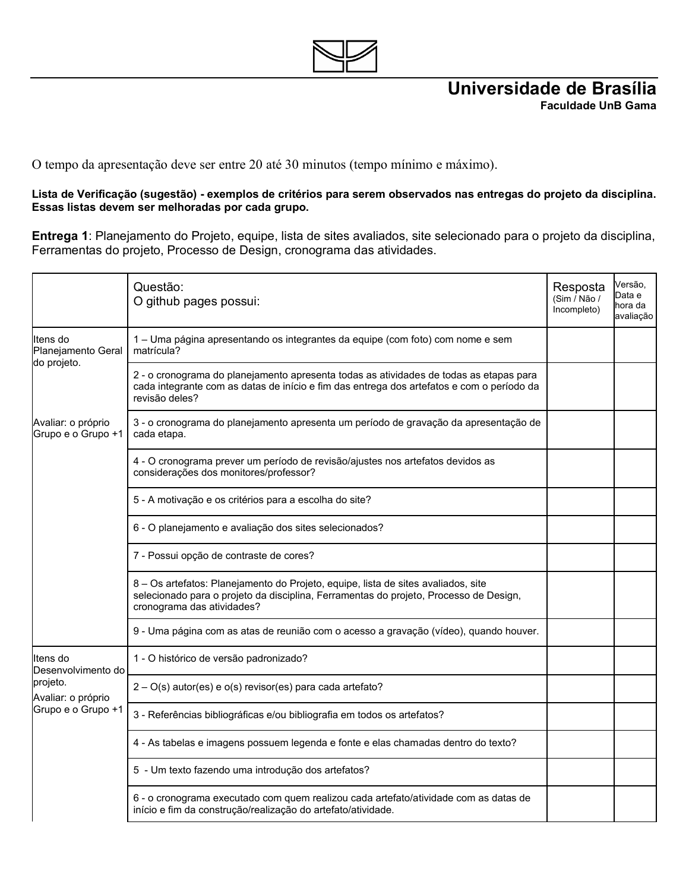{ loading=lazy }
    
Figura 1 — Fonte do critério D01.

    
Fonte: Plano de ensino, p. 8 do PDF.

??? question "D02 — Os autores e revisores estão identificados, com revisão efetivamente registrada?"

    **Autor do item:** Caio Breno de Souza Bezerra.

    **O que conferir:** Revisor distinto do autor; “Pendente” não comprova revisão realizada.

    **Origem da pergunta:** Plano de ensino, p. 8 do PDF. Critério formulado/adaptado para a entrega. A Figura 2 mostra a fonte.

    { loading=lazy }
    
Figura 2 — Fonte do critério D02.

    
Fonte: Plano de ensino, p. 8 do PDF.

??? question "D03 — Há referências bibliográficas em todos os artefatos?"

    **Autor do item:** Caio Breno de Souza Bezerra.

    **O que conferir:** Verificar correspondência entre citações, edição, página e referência.

    **Origem da pergunta:** Plano de ensino, p. 8 do PDF. Critério formulado/adaptado para a entrega. A Figura 3 mostra a fonte.

    { loading=lazy }
    
Figura 3 — Fonte do critério D03.

    
Fonte: Plano de ensino, p. 8 do PDF.

??? question "D04 — As tabelas e figuras têm número, legenda, fonte e chamada no texto?"

    **Autor do item:** Caio Breno de Souza Bezerra.

    **O que conferir:** Abrir os materiais, inclusive a imagem do storyboard e os trechos do livro.

    **Origem da pergunta:** Plano de ensino, p. 8 do PDF. Critério formulado/adaptado para a entrega. A Figura 4 mostra a fonte.

    { loading=lazy }
    
Figura 4 — Fonte do critério D04.

    
Fonte: Plano de ensino, p. 8 do PDF.

??? question "D05 — Os artefatos têm introdução que esclarece objetivo e escopo?"

    **Autor do item:** Caio Breno de Souza Bezerra.

    **O que conferir:** Verificar vínculo com a funcionalidade e com as etapas anteriores.

    **Origem da pergunta:** Plano de ensino, p. 8 do PDF. Critério formulado/adaptado para a entrega. A Figura 5 mostra a fonte.

    { loading=lazy }
    
Figura 5 — Fonte do critério D05.

    
Fonte: Plano de ensino, p. 8 do PDF.

??? question "D06 — O cronograma executado registra quem fez cada atividade e suas datas reais?"

    **Autor do item:** Caio Breno de Souza Bezerra.

    **O que conferir:** Comparar com o planejado; não registrar agenda proposta como execução.

    **Origem da pergunta:** Plano de ensino, p. 8 do PDF. Critério formulado/adaptado para a entrega. A Figura 6 mostra a fonte.

    { loading=lazy }
    
Figura 6 — Fonte do critério D06.

    
Fonte: Plano de ensino, p. 8 do PDF.

??? question "D07 — Há atas das reuniões da etapa, com data, horários, pessoas e decisões?"

    **Autor do item:** Caio Breno de Souza Bezerra.

    **O que conferir:** Conferir em Registros → Atas; lista de verificação não substitui ata.

    **Origem da pergunta:** Plano de ensino, p. 9 do PDF. Critério formulado/adaptado para a entrega. A Figura 7 mostra a fonte.

    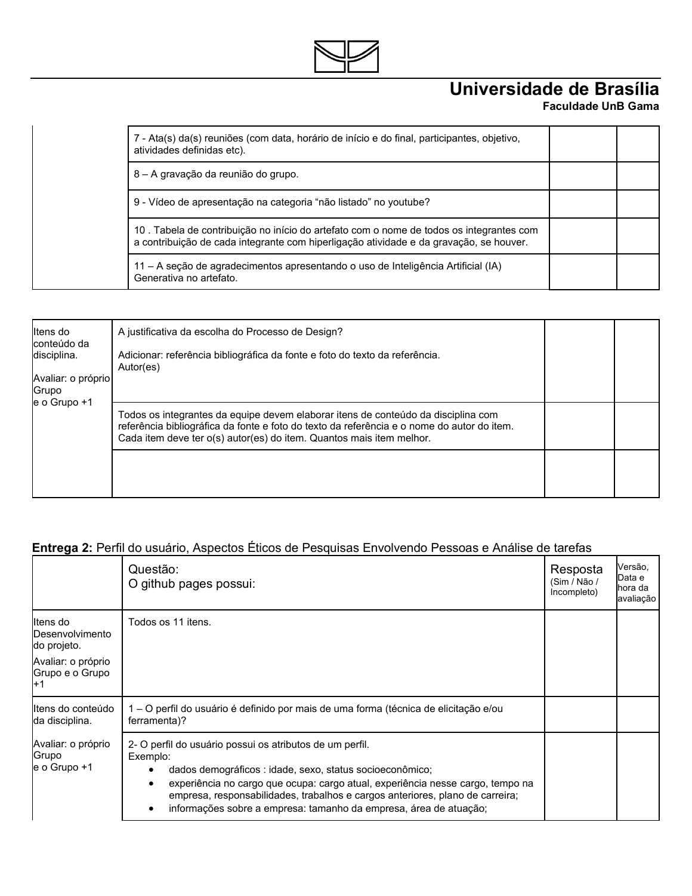{ loading=lazy }
    
Figura 7 — Fonte do critério D07.

    
Fonte: Plano de ensino, p. 9 do PDF.

??? question "D08 — As gravações das reuniões e inspeções realizadas estão acessíveis e autorizadas?"

    **Autor do item:** Caio Breno de Souza Bezerra.

    **O que conferir:** Conferir link, permissão e correspondência com a reunião registrada.

    **Origem da pergunta:** Plano de ensino, p. 9 do PDF. Critério formulado/adaptado para a entrega. A Figura 8 mostra a fonte.

    { loading=lazy }
    
Figura 8 — Fonte do critério D08.

    
Fonte: Plano de ensino, p. 9 do PDF.

??? question "D09 — O vídeo da apresentação da Etapa 5 está acessível na categoria prevista pelo grupo?"

    **Autor do item:** Caio Breno de Souza Bezerra.

    **O que conferir:** Conferir link, participantes e conteúdo dos quatro artefatos; não usar vídeo antigo como evidência.

    **Origem da pergunta:** Plano de ensino, p. 9 do PDF. Critério formulado/adaptado para a entrega. A Figura 9 mostra a fonte.

    { loading=lazy }
    
Figura 9 — Fonte do critério D09.

    
Fonte: Plano de ensino, p. 9 do PDF.

??? question "D10 — A contribuição aparece no início de cada artefato e corresponde a quem atuou nele?"

    **Autor do item:** Caio Breno de Souza Bezerra.

    **O que conferir:** Não atribuir contribuição ou autoria a integrante apenas por pertencer ao grupo.

    **Origem da pergunta:** Plano de ensino, p. 9 do PDF. Critério formulado/adaptado para a entrega. A Figura 10 mostra a fonte.

    { loading=lazy }
    
Figura 10 — Fonte do critério D10.

    
Fonte: Plano de ensino, p. 9 do PDF.

??? question "D11 — O uso de IA está identificado na contribuição e nos agradecimentos?"

    **Autor do item:** Caio Breno de Souza Bezerra.

    **O que conferir:** Nome da ferramenta e atividade realizada; não confundir autoria manual do desenho com apoio à redação.

    **Origem da pergunta:** Plano de ensino, p. 9 do PDF. Critério formulado/adaptado para a entrega. A Figura 11 mostra a fonte.

    { loading=lazy }
    
Figura 11 — Fonte do critério D11.

    
Fonte: Plano de ensino, p. 9 do PDF.

## Conteúdo da disciplina

Cada pergunta está ligada ao artefato ou procedimento que será conferido.

??? question "E5-C01 — Os quatro artefatos da Etapa 5 estão disponíveis por integrante e funcionalidade?"

    **Autor do item:** Caio Breno de Souza Bezerra.

    **O que conferir:** Relatos do storyboard e das tarefas; planos da avaliação e do relato do papel.

    **Origem da pergunta:** Plano de ensino, p. 5 do PDF. Critério formulado/adaptado para a entrega. A Figura 12 mostra a fonte.

    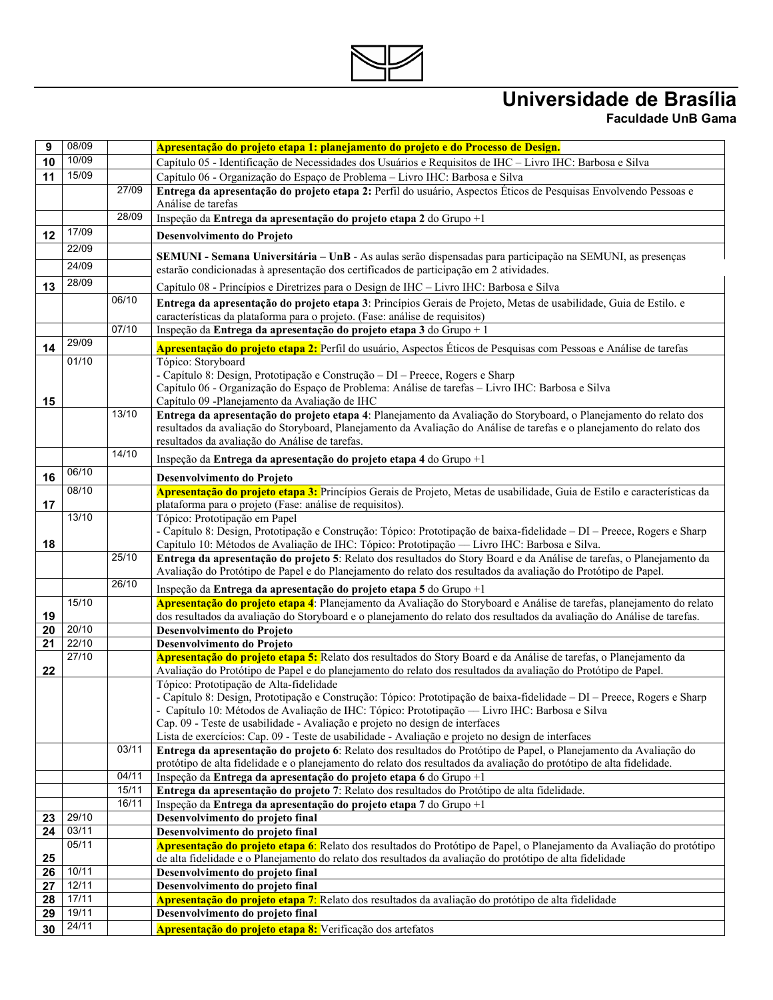{ loading=lazy }
    
Figura 12 — Fonte do critério E5-C01.

    
Fonte: Plano de ensino, p. 5 do PDF.

??? question "E5-C02 — Cada relato identifica objetivos, escopo, método realizado, versão avaliada, pessoas e execução?"

    **Autor do item:** Caio Breno de Souza Bezerra.

    **O que conferir:** Data, duração e papéis efetivos; origem das falas e modalidade explicitadas.

    **Origem da pergunta:** Barbosa e Silva (2010, p. 311–313). Critério formulado/adaptado para a entrega. A Figura 13 mostra a fonte.

    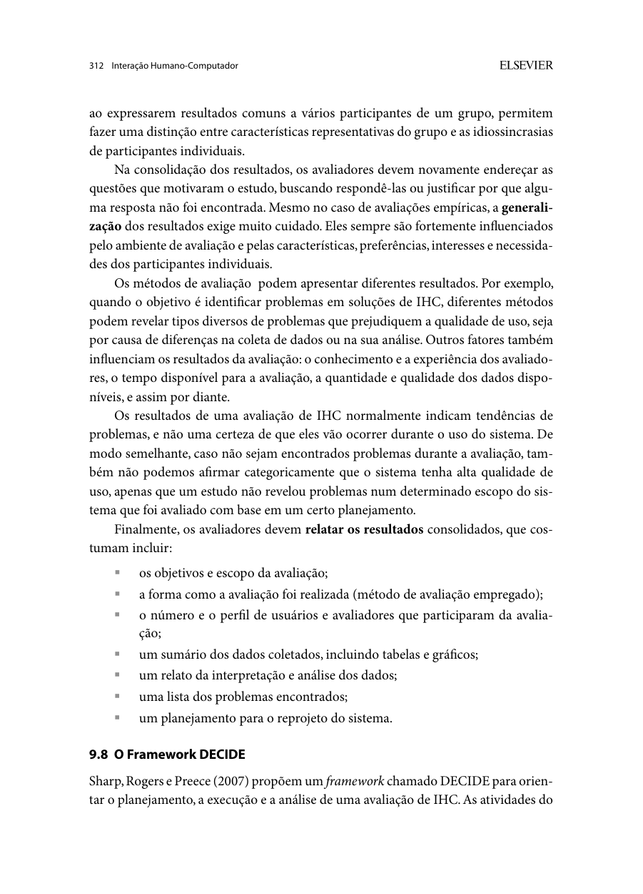{ loading=lazy }
    
Figura 13 — Fonte do critério E5-C02.

    
Fonte: Barbosa e Silva (2010, p. 311–313).

??? question "E5-C03 — O relato do storyboard responde às perguntas do planejamento e localiza os quadros discutidos?"

    **Autor do item:** Caio Breno de Souza Bezerra.

    **O que conferir:** Q1–Q7 ou IDs equivalentes; transcrição, notas ou localizadores verificáveis.

    **Origem da pergunta:** Barbosa e Silva (2010, p. 311–313). Critério formulado/adaptado para a entrega. A Figura 14 mostra a fonte.

    { loading=lazy }
    
Figura 14 — Fonte do critério E5-C03.

    
Fonte: Barbosa e Silva (2010, p. 311–313).

??? question "E5-C04 — O relato da análise de tarefas discute cobertura, ordem, entradas, ações, término e responsabilidades?"

    **Autor do item:** Caio Breno de Souza Bezerra.

    **O que conferir:** Nó HTA / tarefa CTT identificados; distinguir fala da pessoa e conferência técnica.

    **Origem da pergunta:** Barbosa e Silva (2010, p. 191–196, 203–205). Critério formulado/adaptado para a entrega. A Figura 15 mostra a fonte.

    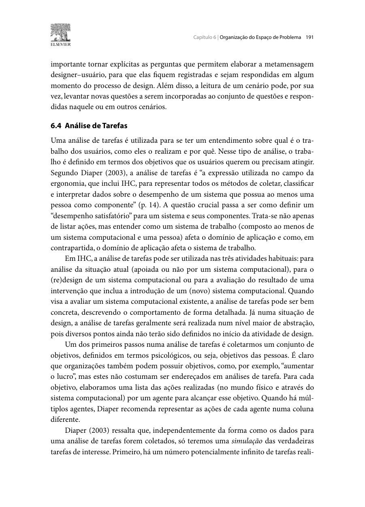{ loading=lazy }
    
Figura 15 — Fonte do critério E5-C04.

    
Fonte: Barbosa e Silva (2010, p. 191–196, 203–205).

??? question "E5-C05 — Os dados, interpretações e sugestões estão separados e sua origem é verificável?"

    **Autor do item:** Caio Breno de Souza Bezerra.

    **O que conferir:** Identificar a origem de cada registro e separar fala, observação, interpretação e sugestão.

    **Origem da pergunta:** Barbosa e Silva (2010, p. 311–313). Critério formulado/adaptado para a entrega. A Figura 16 mostra a fonte.

    { loading=lazy }
    
Figura 16 — Fonte do critério E5-C05.

    
Fonte: Barbosa e Silva (2010, p. 311–313).

??? question "E5-C06 — Problemas e recomendações dos relatos indicam local, consequência, prioridade e destino no reprojeto?"

    **Autor do item:** Caio Breno de Souza Bezerra.

    **O que conferir:** Relacionar problema ao quadro/nó e à hipótese do protótipo; justificar prioridade.

    **Origem da pergunta:** Barbosa e Silva (2010, p. 361–362). Critério formulado/adaptado para a entrega. A Figura 17 mostra a fonte.

    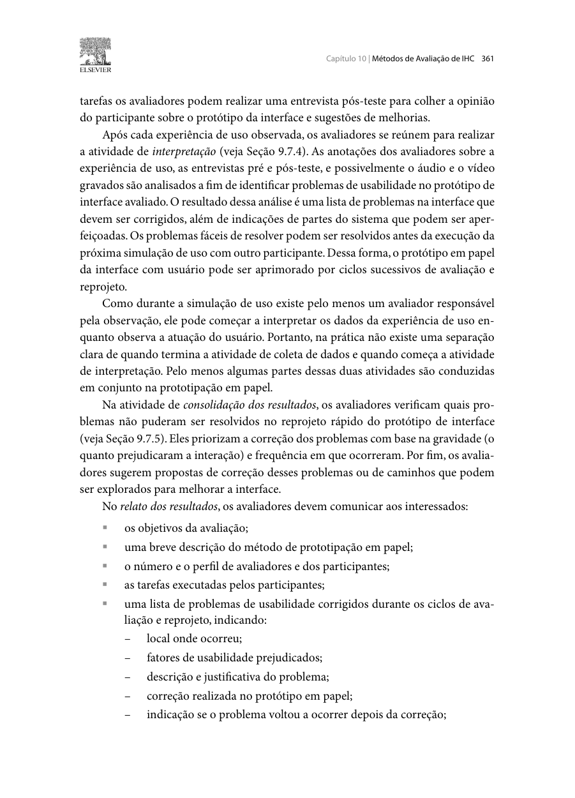{ loading=lazy }
    
Figura 17 — Fonte do critério E5-C06.

    
Fonte: Barbosa e Silva (2010, p. 361–362).

??? question "E5-C07 — As lacunas e revisões dos modelos estão registradas sem apagar a versão avaliada?"

    **Autor do item:** Caio Breno de Souza Bezerra.

    **O que conferir:** Comparar versão inicial e proposta; registrar pendências de notação e cobertura.

    **Origem da pergunta:** Barbosa e Silva (2010, p. 191–196, 203–205). Critério formulado/adaptado para a entrega. A Figura 18 mostra a fonte.

    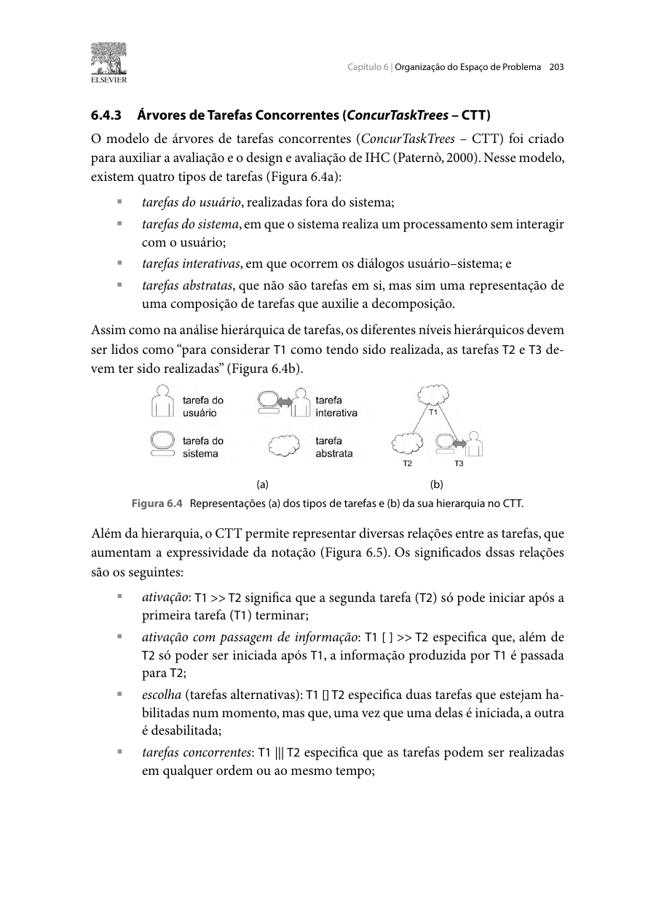{ loading=lazy }
    
Figura 18 — Fonte do critério E5-C07.

    
Fonte: Barbosa e Silva (2010, p. 191–196, 203–205).

??? question "E5-C08 — O planejamento da avaliação do papel cobre as seis atividades do DECIDE?"

    **Autor do item:** Caio Breno de Souza Bezerra.

    **O que conferir:** Objetivos, perguntas, métodos, prática, ética, interpretação/apresentação dos dados.

    **Origem da pergunta:** Barbosa e Silva (2010, p. 312–313). Critério formulado/adaptado para a entrega. A Figura 19 mostra a fonte.

    { loading=lazy }
    
Figura 19 — Fonte do critério E5-C08.

    
Fonte: Barbosa e Silva (2010, p. 312–313).

??? question "E5-C09 — O método de prototipação em papel tem explicação, autor do item, referência e imagem do trecho utilizado?"

    **Autor do item:** Caio Breno de Souza Bezerra.

    **O que conferir:** Explicar execução de tarefas e simulação das respostas; não apresentar apenas telas para opinião.

    **Origem da pergunta:** Barbosa e Silva (2010, p. 358–360). Critério formulado/adaptado para a entrega. A Figura 20 mostra a fonte.

    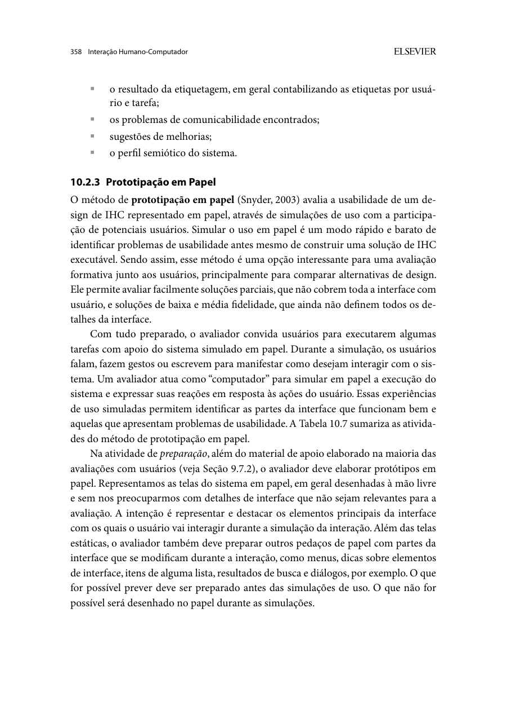{ loading=lazy }
    
Figura 20 — Fonte do critério E5-C09.

    
Fonte: Barbosa e Silva (2010, p. 358–360).

??? question "E5-C10 — O inventário prevê telas e elementos móveis suficientes, ligados às tarefas e aos modelos?"

    **Autor do item:** Caio Breno de Souza Bezerra.

    **O que conferir:** Folhas, menus, confirmação, variantes e transições; indicar o que ainda precisa ser construído.

    **Origem da pergunta:** Barbosa e Silva (2010, p. 358–359). Critério formulado/adaptado para a entrega. A Figura 21 mostra a fonte.

    { loading=lazy }
    
Figura 21 — Fonte do critério E5-C10.

    
Fonte: Barbosa e Silva (2010, p. 358–359).

??? question "E5-C11 — Os enunciados, dados fictícios, estados iniciais e critérios de conclusão estão definidos?"

    **Autor do item:** Caio Breno de Souza Bezerra.

    **O que conferir:** Separar enunciado dado ao participante e critério reservado à equipe; documentar reinícios.

    **Origem da pergunta:** Barbosa e Silva (2010, p. 358–360). Critério formulado/adaptado para a entrega. A Figura 22 mostra a fonte.

    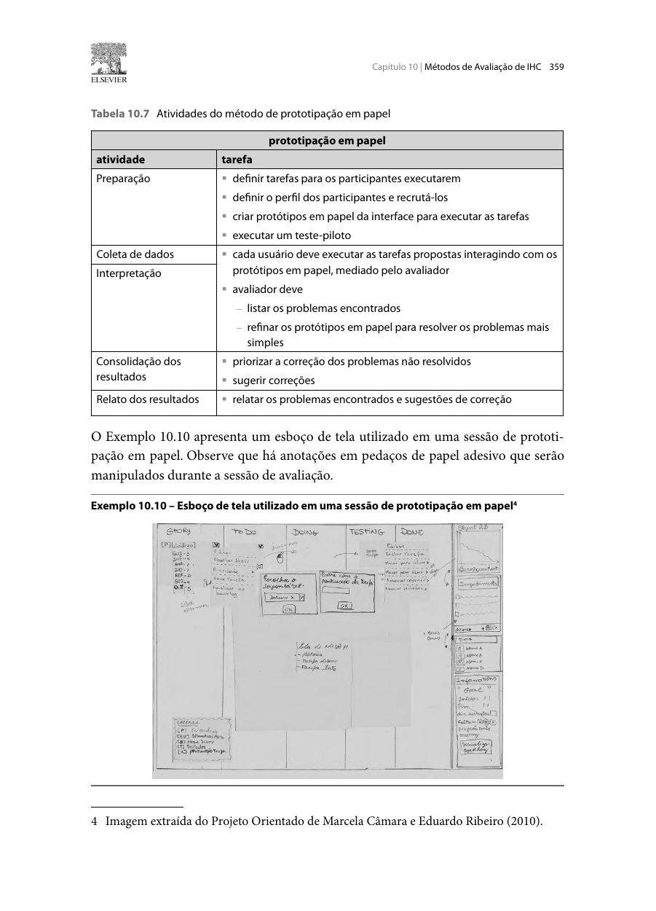{ loading=lazy }
    
Figura 22 — Fonte do critério E5-C11.

    
Fonte: Barbosa e Silva (2010, p. 358–360).

??? question "E5-C12 — A equipe distingue quem simula o sistema de quem observa a experiência de uso?"

    **Autor do item:** Caio Breno de Souza Bezerra.

    **O que conferir:** Pelo menos dois avaliadores previstos para o papel, além da pessoa participante; confirmar antes da execução.

    **Origem da pergunta:** Barbosa e Silva (2010, p. 360). Critério formulado/adaptado para a entrega. A Figura 23 mostra a fonte.

    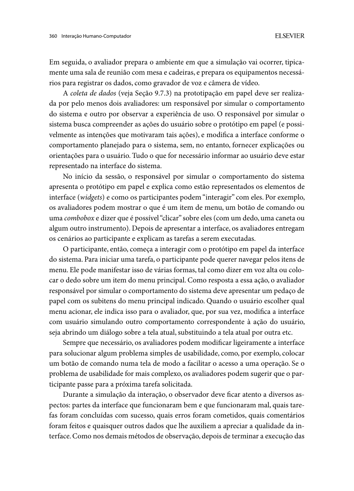{ loading=lazy }
    
Figura 23 — Fonte do critério E5-C12.

    
Fonte: Barbosa e Silva (2010, p. 360).

??? question "E5-C13 — Perfil, recrutamento, quantidade e sua justificativa, modalidade, recursos e orçamento estão previstos?"

    **Autor do item:** Caio Breno de Souza Bezerra.

    **O que conferir:** Escolhas proporcionais ao escopo; não afirmar representatividade sem suporte.

    **Origem da pergunta:** Barbosa e Silva (2010, p. 305–308, 313). Critério formulado/adaptado para a entrega. A Figura 24 mostra a fonte.

    { loading=lazy }
    
Figura 24 — Fonte do critério E5-C13.

    
Fonte: Barbosa e Silva (2010, p. 305–308, 313).

??? question "E5-C14 — A agenda informa data, horário, duração, local, responsáveis e condição de confirmação?"

    **Autor do item:** Caio Breno de Souza Bezerra.

    **O que conferir:** Piloto antes da sessão; tempo para ajustes e análise até a entrega da Etapa 6.

    **Origem da pergunta:** Barbosa e Silva (2010, p. 307–308, 313). Critério formulado/adaptado para a entrega. A Figura 25 mostra a fonte.

    { loading=lazy }
    
Figura 25 — Fonte do critério E5-C14.

    
Fonte: Barbosa e Silva (2010, p. 307–308, 313).

??? question "E5-C15 — O piloto testa o procedimento e a análise, com dados separados da avaliação principal?"

    **Autor do item:** Caio Breno de Souza Bezerra.

    **O que conferir:** Outra pessoa; materiais e fichas ensaiados; ajustes registrados antes da coleta.

    **Origem da pergunta:** Barbosa e Silva (2010, p. 307–308). Critério formulado/adaptado para a entrega. A Figura 26 mostra a fonte.

    { loading=lazy }
    
Figura 26 — Fonte do critério E5-C15.

    
Fonte: Barbosa e Silva (2010, p. 307–308).

??? question "E5-C16 — O consentimento cobre participação, gravação, uso do vídeo, privacidade e desistência?"

    **Autor do item:** Caio Breno de Souza Bezerra.

    **O que conferir:** Autorizações específicas; TCLE e contato privados; explicar o acesso por link ao vídeo não listado.

    **Origem da pergunta:** Barbosa e Silva (2010, p. 138–142, 313). Critério formulado/adaptado para a entrega. A Figura 27 mostra a fonte.

    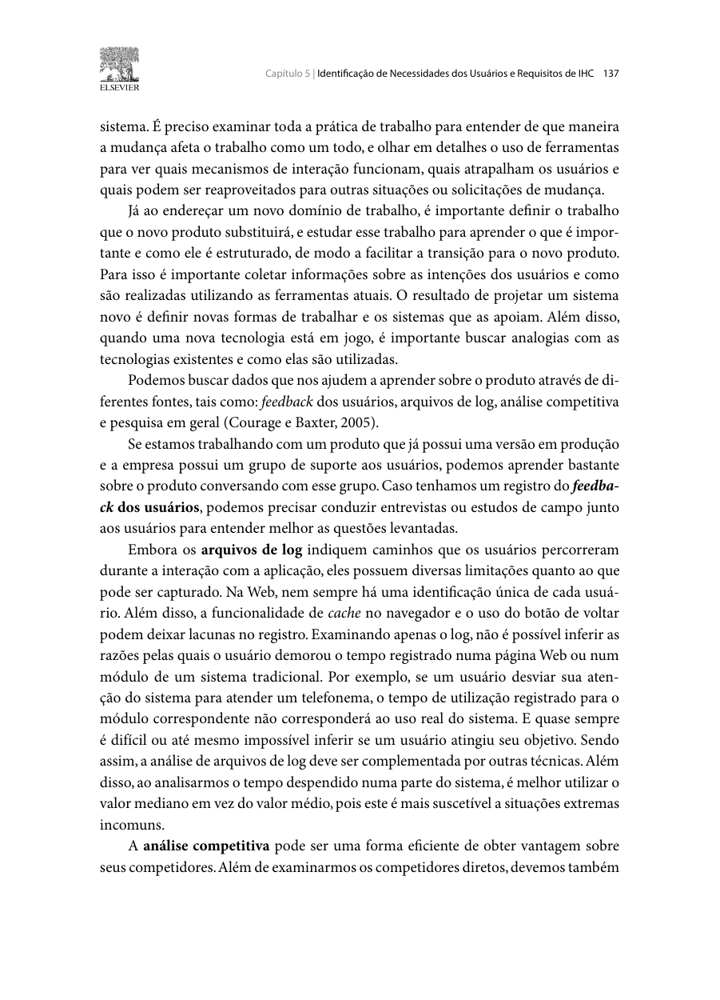{ loading=lazy }
    
Figura 27 — Fonte do critério E5-C16.

    
Fonte: Barbosa e Silva (2010, p. 138–142, 313).

??? question "E5-C17 — Os instrumentos registram ações, conclusão, ajuda, erros, comentários e falhas de simulação?"

    **Autor do item:** Caio Breno de Souza Bezerra.

    **O que conferir:** Anotar tela, tarefa, versão e localizador; separar problema da interface e problema da condução.

    **Origem da pergunta:** Barbosa e Silva (2010, p. 360–361). Critério formulado/adaptado para a entrega. A Figura 28 mostra a fonte.

    { loading=lazy }
    
Figura 28 — Fonte do critério E5-C17.

    
Fonte: Barbosa e Silva (2010, p. 360–361).

??? question "E5-C18 — O plano do relato do papel contempla problemas corrigidos e pendentes e a recorrência após a correção?"

    **Autor do item:** Caio Breno de Souza Bezerra.

    **O que conferir:** Local, fator afetado, justificativa, correção, prioridade e proposta; “não retestado” quando cabível.

    **Origem da pergunta:** Barbosa e Silva (2010, p. 361–362). Critério formulado/adaptado para a entrega. A Figura 29 mostra a fonte.

    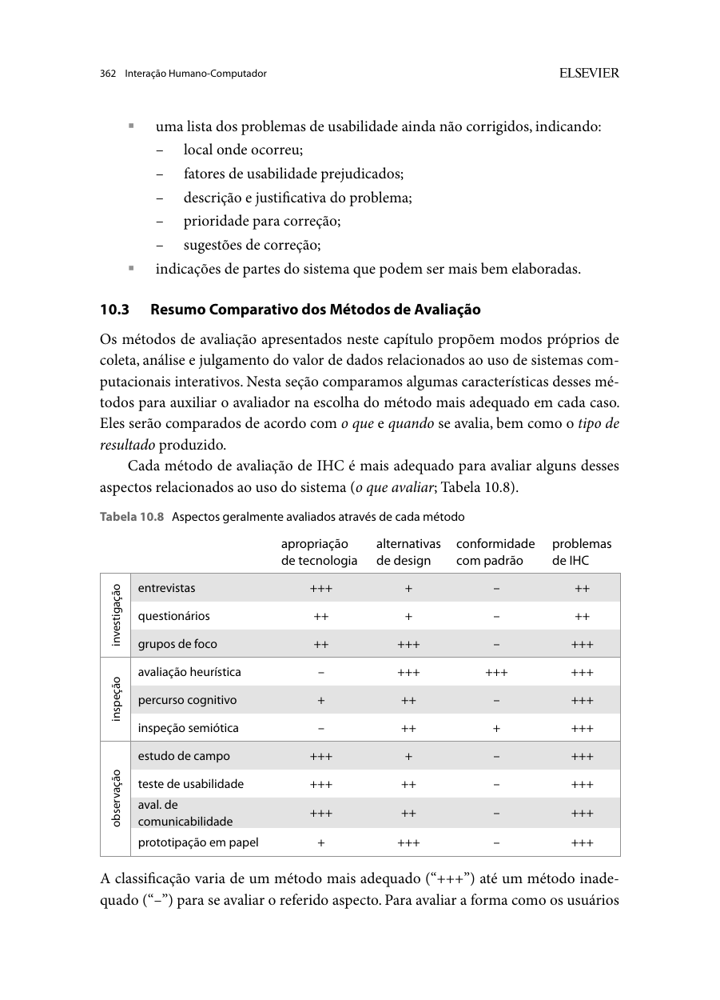{ loading=lazy }
    
Figura 29 — Fonte do critério E5-C18.

    
Fonte: Barbosa e Silva (2010, p. 361–362).

??? question "E5-C19 — Indicadores e conclusões respeitam o método, a amostra e o que foi efetivamente medido?"

    **Autor do item:** Caio Breno de Souza Bezerra.

    **O que conferir:** Relacionar cada conclusão aos registros e às medidas disponíveis; indicar o que não foi avaliado.

    **Origem da pergunta:** Barbosa e Silva (2010, p. 311–313). Critério formulado/adaptado para a entrega. A Figura 30 mostra a fonte.

    { loading=lazy }
    
Figura 30 — Fonte do critério E5-C19.

    
Fonte: Barbosa e Silva (2010, p. 311–313).

??? question "E5-C20 — O encadeamento entre resultados anteriores, hipóteses, tarefas do papel e próximo reprojeto está rastreável?"

    **Autor do item:** Caio Breno de Souza Bezerra.

    **O que conferir:** Relato → decisão → tela/tarefa → critério; requisitos ainda sem evidência ficam como hipóteses.

    **Origem da pergunta:** Barbosa e Silva (2010, p. 311–313, 358–362). Critério formulado/adaptado para a entrega. A Figura 31 mostra a fonte.

    { loading=lazy }
    
Figura 31 — Fonte do critério E5-C20.

    
Fonte: Barbosa e Silva (2010, p. 311–313, 358–362).

## Agradecimentos

Codex (OpenAI) apoiou a consulta das fontes e a reorganização das perguntas. Caio responde pelos critérios; Bruno Ferreira Dornelas é o revisor desta atualização.

## Histórico de versão
| Versão | Data | Descrição | Autor(es) | Revisor(es) |
| :---: | :---: | --- | --- | --- |
| `0.1` | 22/10/2026 | Proposta de 11 critérios gerais e 20 critérios de conteúdo para a Etapa 5, com fundamentação | [Caio Breno de Souza Bezerra](https://github.com/CaioBezerra-Dev) | [Bruno Ferreira Dornelas](https://github.com/brunnf) |
| `1.0` | 22/10/2026 | Simplifica títulos, rótulos e avisos; concentra o procedimento nos relatos e preserva os campos de conferência | [Caio Breno de Souza Bezerra](https://github.com/CaioBezerra-Dev) | [Bruno Ferreira Dornelas](https://github.com/brunnf) |
| `1.1` | 03/11/2026 | Organização dos critérios e da fundamentação bibliográfica | [Caio Breno de Souza Bezerra](https://github.com/CaioBezerra-Dev) | [Bruno Ferreira Dornelas](https://github.com/brunnf) |

## Referências

[1] SALES, André Barros de. *Plano de Ensino FIHC 022026 — Turma 01*, v1. FCTE/UnB, 2026. p. 5, 8–9 do PDF.

[2] BARBOSA, Simone Diniz Junqueira; SILVA, Bruno Santana da. *Interação humano-computador*. Rio de Janeiro: Elsevier, 2010. p. 138–149, 191–196, 203–205, 301, 305–313, 358–362.
