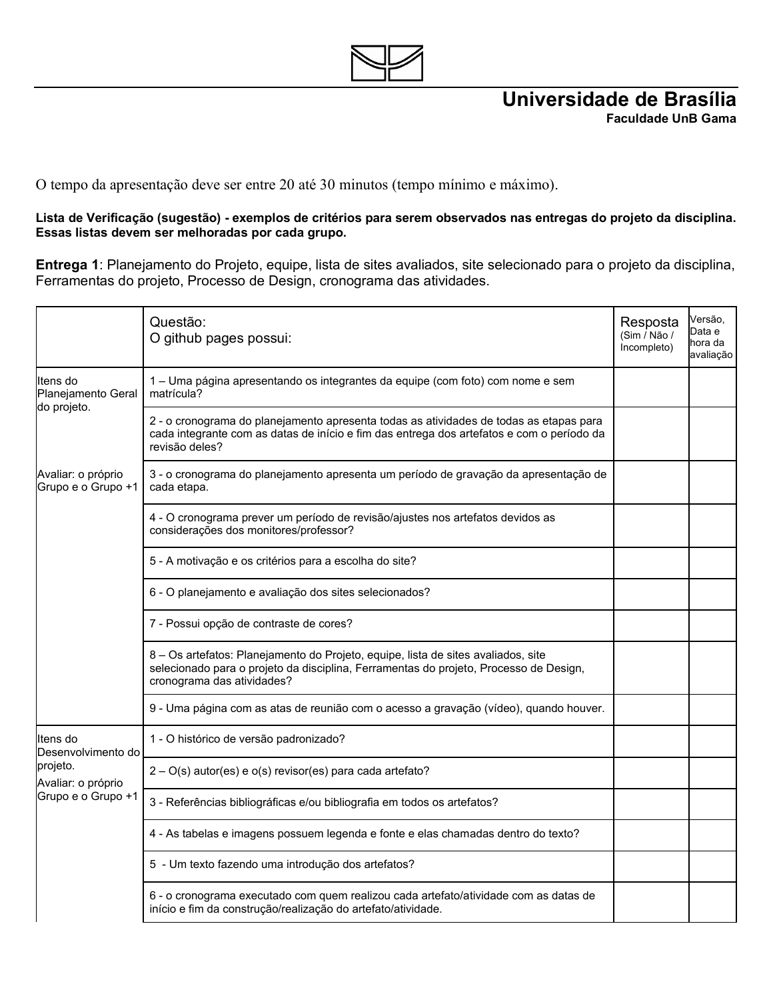
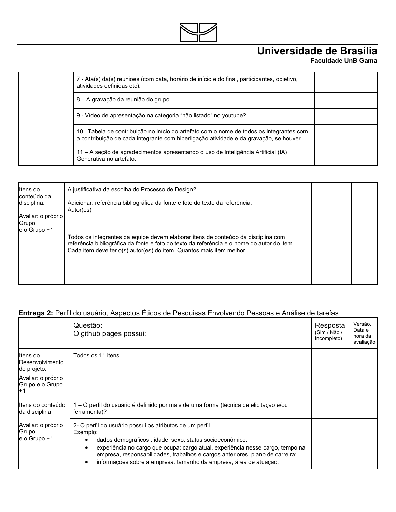
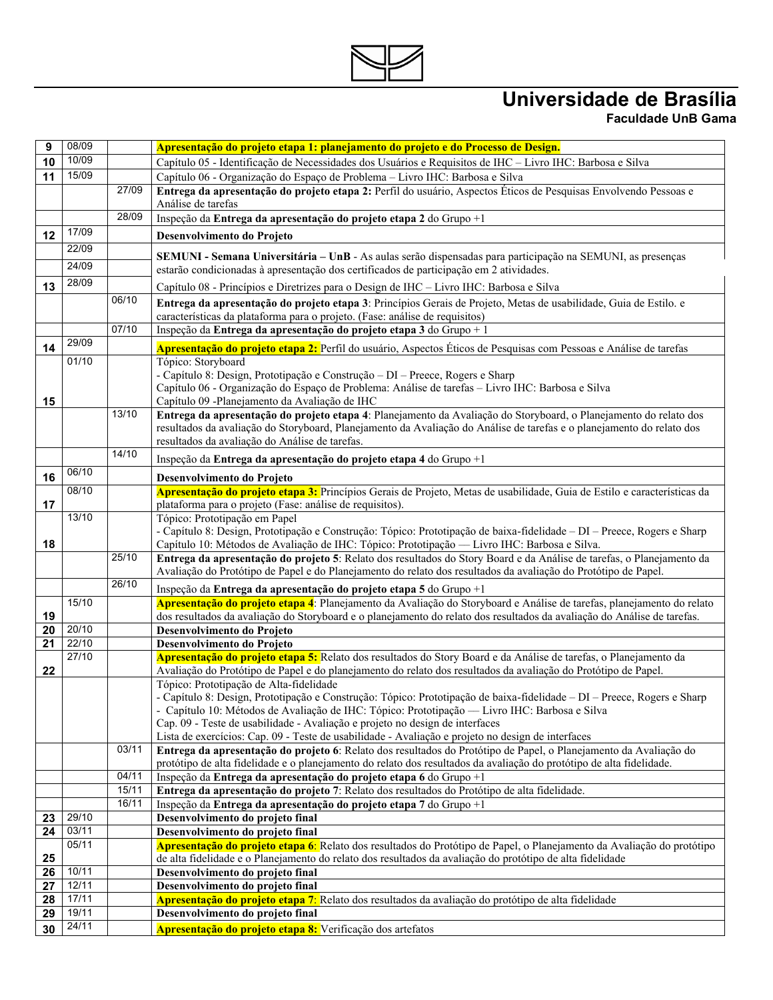
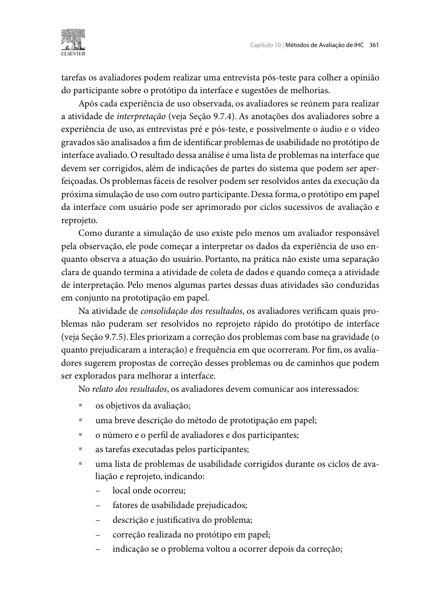
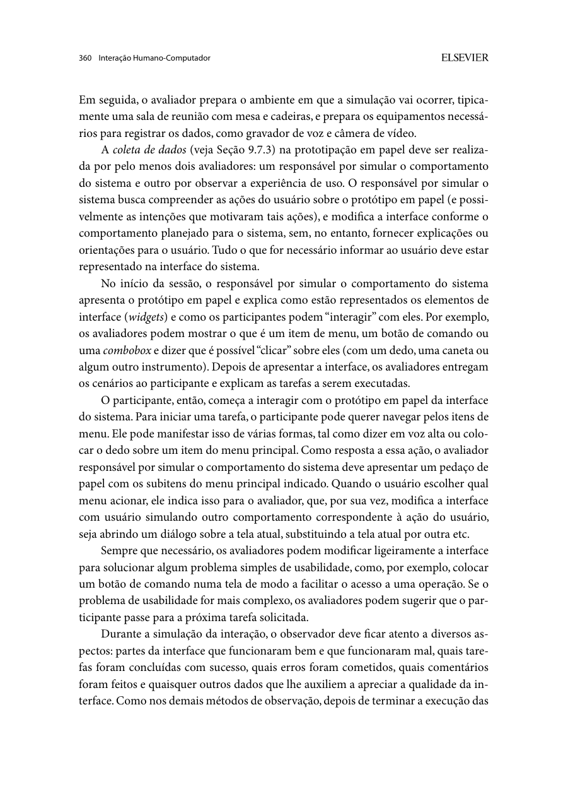
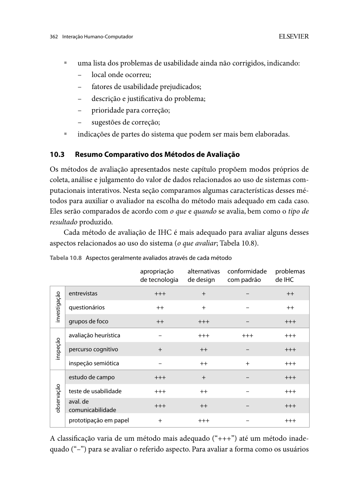
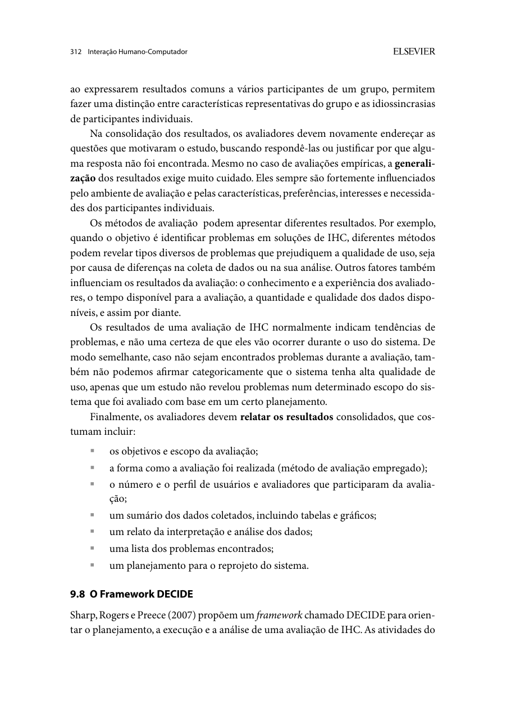
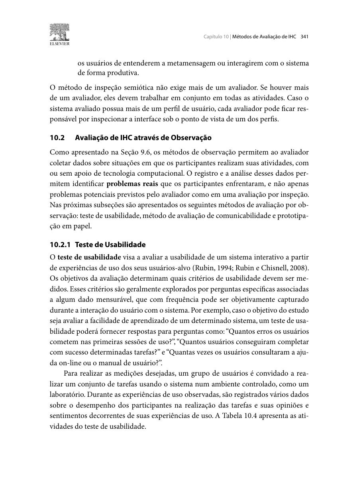
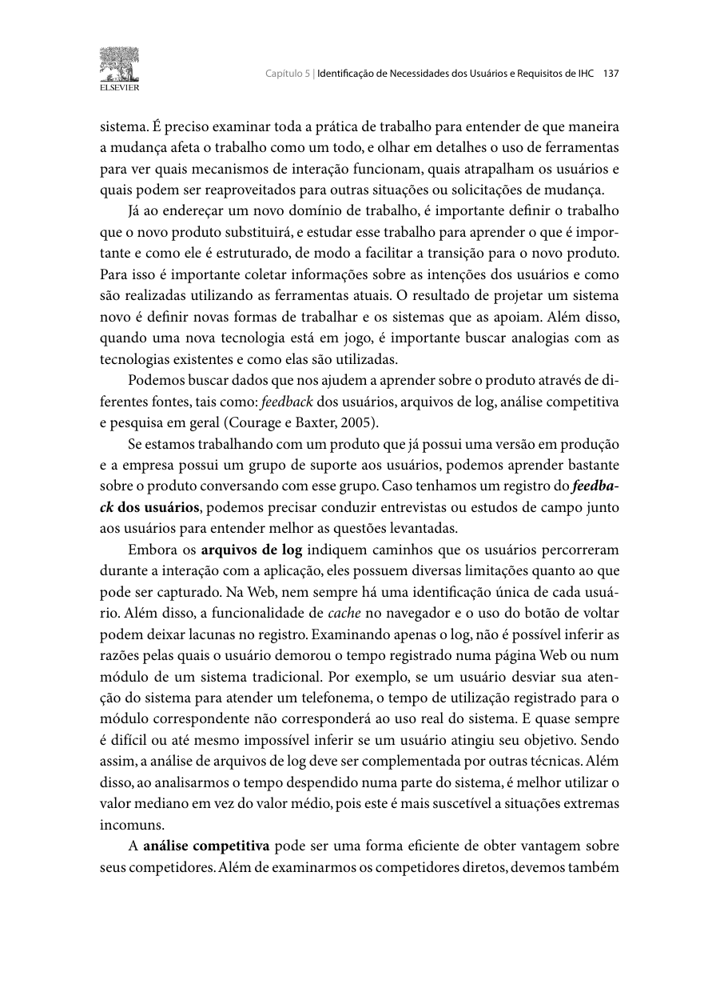

Responsável: Caio Breno de Souza Bezerra · Autor do item: Caio Breno de Souza Bezerra

# Lista de verificação — Etapa 6

## Tabela de contribuição

A Tabela 1 registra a contribuição neste artefato.

| Integrante | Contribuição | Artefato / atividade |
| --- | --- | --- |
| [Caio Breno de Souza Bezerra](https://github.com/CaioBezerra-Dev) | Elaboração e organização dos critérios da Etapa 6 | [Conteúdo](#introducao) |
| Codex (OpenAI) | Apoio à consulta bibliográfica, redação, telas e organização | [Agradecimentos](#agradecimentos) |

Tabela 1 — Contribuição neste artefato.

Fonte: elaboração para o Grupo 06 (2026).

## Introdução

Cada pergunta possui **autor, evidência esperada, referência e imagem do trecho utilizado**. Abra um item para consultar sua fundamentação. Os critérios de desenvolvimento vêm do plano de ensino; os critérios de conteúdo foram formulados para a etapa, com base no livro e no cronograma. São uma lista do grupo, não uma transcrição de lista oficial da Etapa 6.

**Esta página define perguntas.** Respostas, versão inspecionada, data e evidências ficam nas tabelas de inspeção: [Grupo 06](../grupo-06/etapa-6/lista-verificacao.md) e [Grupo 07](../grupo-07/etapa-6/lista-verificacao.md).

Usar **Sim / Não / Incompleto**; vazio significa não inspecionado. Registrar a evidência da versão realmente examinada.

## Desenvolvimento do projeto

O plano de ensino, p. 8–9 do PDF, é a fonte das perguntas D01–D11.

??? question "D01 — O histórico de versão está padronizado?"

    **Autor do item:** Caio Breno de Souza Bezerra.

    **O que conferir:** Conferir versão, data, descrição, autor e revisor em cada artefato.

    **Origem da pergunta:** Plano de ensino, p. 8 do PDF. Critério formulado/adaptado para a entrega. A Figura 1 mostra a fonte.

    { loading=lazy }
    
Figura 1 — Fonte do critério D01.

    
Fonte: Plano de ensino, p. 8 do PDF.

??? question "D02 — Os autores e revisores estão identificados, com revisão efetivamente registrada?"

    **Autor do item:** Caio Breno de Souza Bezerra.

    **O que conferir:** Revisor distinto do autor; “Pendente” não comprova revisão realizada.

    **Origem da pergunta:** Plano de ensino, p. 8 do PDF. Critério formulado/adaptado para a entrega. A Figura 2 mostra a fonte.

    { loading=lazy }
    
Figura 2 — Fonte do critério D02.

    
Fonte: Plano de ensino, p. 8 do PDF.

??? question "D03 — Há referências bibliográficas em todos os artefatos?"

    **Autor do item:** Caio Breno de Souza Bezerra.

    **O que conferir:** Verificar correspondência entre citações, edição, página e referência.

    **Origem da pergunta:** Plano de ensino, p. 8 do PDF. Critério formulado/adaptado para a entrega. A Figura 3 mostra a fonte.

    { loading=lazy }
    
Figura 3 — Fonte do critério D03.

    
Fonte: Plano de ensino, p. 8 do PDF.

??? question "D04 — As tabelas e figuras têm número, legenda, fonte e chamada no texto?"

    **Autor do item:** Caio Breno de Souza Bezerra.

    **O que conferir:** Abrir os materiais, inclusive a imagem do storyboard e os trechos do livro.

    **Origem da pergunta:** Plano de ensino, p. 8 do PDF. Critério formulado/adaptado para a entrega. A Figura 4 mostra a fonte.

    { loading=lazy }
    
Figura 4 — Fonte do critério D04.

    
Fonte: Plano de ensino, p. 8 do PDF.

??? question "D05 — Os artefatos têm introdução que esclarece objetivo e escopo?"

    **Autor do item:** Caio Breno de Souza Bezerra.

    **O que conferir:** Verificar vínculo com a funcionalidade e com as etapas anteriores.

    **Origem da pergunta:** Plano de ensino, p. 8 do PDF. Critério formulado/adaptado para a entrega. A Figura 5 mostra a fonte.

    { loading=lazy }
    
Figura 5 — Fonte do critério D05.

    
Fonte: Plano de ensino, p. 8 do PDF.

??? question "D06 — O cronograma executado registra quem fez cada atividade e suas datas reais?"

    **Autor do item:** Caio Breno de Souza Bezerra.

    **O que conferir:** Comparar com o planejado; não registrar agenda proposta como execução.

    **Origem da pergunta:** Plano de ensino, p. 8 do PDF. Critério formulado/adaptado para a entrega. A Figura 6 mostra a fonte.

    { loading=lazy }
    
Figura 6 — Fonte do critério D06.

    
Fonte: Plano de ensino, p. 8 do PDF.

??? question "D07 — Há atas das reuniões da etapa, com data, horários, pessoas e decisões?"

    **Autor do item:** Caio Breno de Souza Bezerra.

    **O que conferir:** Conferir em Registros → Atas; lista de verificação não substitui ata.

    **Origem da pergunta:** Plano de ensino, p. 9 do PDF. Critério formulado/adaptado para a entrega. A Figura 7 mostra a fonte.

    { loading=lazy }
    
Figura 7 — Fonte do critério D07.

    
Fonte: Plano de ensino, p. 9 do PDF.

??? question "D08 — As gravações das reuniões e inspeções realizadas estão acessíveis e autorizadas?"

    **Autor do item:** Caio Breno de Souza Bezerra.

    **O que conferir:** Conferir link, permissão e correspondência com a reunião registrada.

    **Origem da pergunta:** Plano de ensino, p. 9 do PDF. Critério formulado/adaptado para a entrega. A Figura 8 mostra a fonte.

    { loading=lazy }
    
Figura 8 — Fonte do critério D08.

    
Fonte: Plano de ensino, p. 9 do PDF.

??? question "D09 — O vídeo da apresentação da Etapa 6 está acessível na categoria prevista pelo grupo?"

    **Autor do item:** Caio Breno de Souza Bezerra.

    **O que conferir:** Conferir link, participantes e conteúdo dos quatro artefatos; não usar vídeo antigo como evidência.

    **Origem da pergunta:** Plano de ensino, p. 9 do PDF. Critério formulado/adaptado para a entrega. A Figura 9 mostra a fonte.

    { loading=lazy }
    
Figura 9 — Fonte do critério D09.

    
Fonte: Plano de ensino, p. 9 do PDF.

??? question "D10 — A contribuição aparece no início de cada artefato e corresponde a quem atuou nele?"

    **Autor do item:** Caio Breno de Souza Bezerra.

    **O que conferir:** Não atribuir contribuição ou autoria a integrante apenas por pertencer ao grupo.

    **Origem da pergunta:** Plano de ensino, p. 9 do PDF. Critério formulado/adaptado para a entrega. A Figura 10 mostra a fonte.

    { loading=lazy }
    
Figura 10 — Fonte do critério D10.

    
Fonte: Plano de ensino, p. 9 do PDF.

??? question "D11 — O uso de IA está identificado na contribuição e nos agradecimentos?"

    **Autor do item:** Caio Breno de Souza Bezerra.

    **O que conferir:** Nome da ferramenta e atividade realizada; não confundir autoria manual do desenho com apoio à redação.

    **Origem da pergunta:** Plano de ensino, p. 9 do PDF. Critério formulado/adaptado para a entrega. A Figura 11 mostra a fonte.

    { loading=lazy }
    
Figura 11 — Fonte do critério D11.

    
Fonte: Plano de ensino, p. 9 do PDF.

## Conteúdo da disciplina

Cada pergunta está ligada ao artefato ou procedimento que será conferido.

??? question "E6-C01 — Os três artefatos da Etapa 6 estão disponíveis por integrante e funcionalidade?"

    **Autor do item:** Caio Breno de Souza Bezerra.

    **O que conferir:** Relato do papel; planejamento da avaliação de alta fidelidade; planejamento do relato.

    **Origem da pergunta:** Plano de ensino, p. 5 do PDF. Critério formulado/adaptado para a entrega. A Figura 12 mostra a fonte.

    { loading=lazy }
    
Figura 12 — Fonte do critério E6-C01.

    
Fonte: Plano de ensino, p. 5 do PDF.

??? question "E6-C02 — O relato do papel explicita objetivos, método, quantidade e perfil das pessoas e tarefas executadas?"

    **Autor do item:** Caio Breno de Souza Bezerra.

    **O que conferir:** Conferir a execução efetiva, a versão das folhas e os papéis de operador e observador.

    **Origem da pergunta:** Barbosa e Silva (2010, p. 360–361). Critério formulado/adaptado para a entrega. A Figura 13 mostra a fonte.

    { loading=lazy }
    
Figura 13 — Fonte do critério E6-C02.

    
Fonte: Barbosa e Silva (2010, p. 360–361).

??? question "E6-C03 — As ações, dificuldades, erros e opiniões do participante têm evidência localizável?"

    **Autor do item:** Caio Breno de Souza Bezerra.

    **O que conferir:** Conferir tarefa, tela, fala ou paráfrase, ajuda e minuto do vídeo ou código da nota.

    **Origem da pergunta:** Barbosa e Silva (2010, p. 360–361). Critério formulado/adaptado para a entrega. A Figura 14 mostra a fonte.

    { loading=lazy }
    
Figura 14 — Fonte do critério E6-C03.

    
Fonte: Barbosa e Silva (2010, p. 360–361).

??? question "E6-C04 — Os problemas corrigidos no papel indicam local, fator afetado, justificativa, correção e recorrência?"

    **Autor do item:** Caio Breno de Souza Bezerra.

    **O que conferir:** Preservar versão inicial e nova; se não houve novo teste, registrar não retestado.

    **Origem da pergunta:** Barbosa e Silva (2010, p. 361). Critério formulado/adaptado para a entrega. A Figura 15 mostra a fonte.

    { loading=lazy }
    
Figura 15 — Fonte do critério E6-C04.

    
Fonte: Barbosa e Silva (2010, p. 361).

??? question "E6-C05 — Os problemas pendentes indicam local, fator, descrição, justificativa, prioridade e sugestão?"

    **Autor do item:** Caio Breno de Souza Bezerra.

    **O que conferir:** A prioridade deve corresponder à consequência e à frequência observadas.

    **Origem da pergunta:** Barbosa e Silva (2010, p. 361–362). Critério formulado/adaptado para a entrega. A Figura 16 mostra a fonte.

    { loading=lazy }
    
Figura 16 — Fonte do critério E6-C05.

    
Fonte: Barbosa e Silva (2010, p. 361–362).

??? question "E6-C06 — As conclusões do papel respondem às perguntas e mostram o destino de cada decisão de reprojeto?"

    **Autor do item:** Caio Breno de Souza Bezerra.

    **O que conferir:** Relacionar evidência, problema, correção e tela ou tarefa da alta fidelidade.

    **Origem da pergunta:** Barbosa e Silva (2010, p. 311–312). Critério formulado/adaptado para a entrega. A Figura 17 mostra a fonte.

    { loading=lazy }
    
Figura 17 — Fonte do critério E6-C06.

    
Fonte: Barbosa e Silva (2010, p. 311–312).

??? question "E6-C07 — O planejamento de alta fidelidade cobre as seis atividades do DECIDE?"

    **Autor do item:** Caio Breno de Souza Bezerra.

    **O que conferir:** Objetivos, perguntas, método, prática, ética e interpretação/apresentação.

    **Origem da pergunta:** Barbosa e Silva (2010, p. 312–313). Critério formulado/adaptado para a entrega. A Figura 18 mostra a fonte.

    { loading=lazy }
    
Figura 18 — Fonte do critério E6-C07.

    
Fonte: Barbosa e Silva (2010, p. 312–313).

??? question "E6-C08 — A escolha do teste de usabilidade está explicada e ligada aos objetivos?"

    **Autor do item:** Caio Breno de Souza Bezerra.

    **O que conferir:** Distinguir observar execução de tarefas de apenas solicitar opinião sobre telas.

    **Origem da pergunta:** Barbosa e Silva (2010, p. 341–342). Critério formulado/adaptado para a entrega. A Figura 19 mostra a fonte.

    { loading=lazy }
    
Figura 19 — Fonte do critério E6-C08.

    
Fonte: Barbosa e Silva (2010, p. 341–342).

??? question "E6-C09 — O perfil, recrutamento, quantidade de participantes e sua justificativa estão definidos?"

    **Autor do item:** Caio Breno de Souza Bezerra.

    **O que conferir:** Registrar experiência e exposição anterior; não inferir representatividade pela quantidade.

    **Origem da pergunta:** Barbosa e Silva (2010, p. 305–308). Critério formulado/adaptado para a entrega. A Figura 20 mostra a fonte.

    { loading=lazy }
    
Figura 20 — Fonte do critério E6-C09.

    
Fonte: Barbosa e Silva (2010, p. 305–308).

??? question "E6-C10 — Os enunciados, dados, estados iniciais e critérios de conclusão das tarefas estão prontos?"

    **Autor do item:** Caio Breno de Souza Bezerra.

    **O que conferir:** Separar enunciado e critério da equipe; preparar reinícios e caminhos alternativos.

    **Origem da pergunta:** Barbosa e Silva (2010, p. 341–342). Critério formulado/adaptado para a entrega. A Figura 21 mostra a fonte.

    { loading=lazy }
    
Figura 21 — Fonte do critério E6-C10.

    
Fonte: Barbosa e Silva (2010, p. 341–342).

??? question "E6-C11 — A agenda informa data, horário, local, duração, equipe, equipamentos e orçamento?"

    **Autor do item:** Caio Breno de Souza Bezerra.

    **O que conferir:** Conferir viabilidade, confirmação de pessoas e tempo de análise antes da Etapa 7.

    **Origem da pergunta:** Barbosa e Silva (2010, p. 307–308, 313). Critério formulado/adaptado para a entrega. A Figura 22 mostra a fonte.

    { loading=lazy }
    
Figura 22 — Fonte do critério E6-C11.

    
Fonte: Barbosa e Silva (2010, p. 307–308, 313).

??? question "E6-C12 — O piloto tem definição, pessoa distinta, data anterior à coleta e registro separado?"

    **Autor do item:** Caio Breno de Souza Bezerra.

    **O que conferir:** Ensaiar procedimento e fichas; registrar ajustes antes da sessão principal.

    **Origem da pergunta:** Barbosa e Silva (2010, p. 307–308). Critério formulado/adaptado para a entrega. A Figura 23 mostra a fonte.

    { loading=lazy }
    
Figura 23 — Fonte do critério E6-C12.

    
Fonte: Barbosa e Silva (2010, p. 307–308).

??? question "E6-C13 — O consentimento cobre participação, gravação, disponibilização, privacidade e desistência?"

    **Autor do item:** Caio Breno de Souza Bezerra.

    **O que conferir:** Termo e contato privados; dados fictícios; explicar acesso ao vídeo por link.

    **Origem da pergunta:** Barbosa e Silva (2010, p. 138–142, 313). Critério formulado/adaptado para a entrega. A Figura 24 mostra a fonte.

    { loading=lazy }
    
Figura 24 — Fonte do critério E6-C13.

    
Fonte: Barbosa e Silva (2010, p. 138–142, 313).

??? question "E6-C14 — Os instrumentos permitem registrar desempenho e opinião por tarefa?"

    **Autor do item:** Caio Breno de Souza Bezerra.

    **O que conferir:** Conclusão, ajuda, erro, recuperação, tempo, falas e satisfação com localizador.

    **Origem da pergunta:** Barbosa e Silva (2010, p. 342–343). Critério formulado/adaptado para a entrega. A Figura 25 mostra a fonte.

    { loading=lazy }
    
Figura 25 — Fonte do critério E6-C14.

    
Fonte: Barbosa e Silva (2010, p. 342–343).

??? question "E6-C15 — As medidas e os critérios de análise são definidos antes da coleta e ligados às metas?"

    **Autor do item:** Caio Breno de Souza Bezerra.

    **O que conferir:** Definir sucesso, ajuda, tempo, pausas, erros críticos, escala e indicadores não avaliados.

    **Origem da pergunta:** Barbosa e Silva (2010, p. 341–343). Critério formulado/adaptado para a entrega. A Figura 26 mostra a fonte.

    { loading=lazy }
    
Figura 26 — Fonte do critério E6-C15.

    
Fonte: Barbosa e Silva (2010, p. 341–343).

??? question "E6-C16 — O planejamento do relato contempla objetivos, método, pessoas, tarefas, medições e problemas?"

    **Autor do item:** Caio Breno de Souza Bezerra.

    **O que conferir:** Cada problema deve ter local, descrição, justificativa, fator e sugestão.

    **Origem da pergunta:** Barbosa e Silva (2010, p. 343). Critério formulado/adaptado para a entrega. A Figura 27 mostra a fonte.

    { loading=lazy }
    
Figura 27 — Fonte do critério E6-C16.

    
Fonte: Barbosa e Silva (2010, p. 343).

??? question "E6-C17 — Há regra para interpretar evidências, priorizar correções e controlar versões e retestes?"

    **Autor do item:** Caio Breno de Souza Bezerra.

    **O que conferir:** Separar ação, fala e inferência; registrar causa proposta e evidências divergentes.

    **Origem da pergunta:** Barbosa e Silva (2010, p. 342–343). Critério formulado/adaptado para a entrega. A Figura 28 mostra a fonte.

    { loading=lazy }
    
Figura 28 — Fonte do critério E6-C17.

    
Fonte: Barbosa e Silva (2010, p. 342–343).

??? question "E6-C18 — Os limites da amostra, do material e do procedimento estão explícitos nas conclusões?"

    **Autor do item:** Caio Breno de Souza Bezerra.

    **O que conferir:** Não misturar piloto e principal; não declarar melhora sem comparação adequada.

    **Origem da pergunta:** Barbosa e Silva (2010, p. 311–312). Critério formulado/adaptado para a entrega. A Figura 29 mostra a fonte.

    { loading=lazy }
    
Figura 29 — Fonte do critério E6-C18.

    
Fonte: Barbosa e Silva (2010, p. 311–312).

??? question "E6-C19 — O protótipo e os materiais avaliados estão identificados e acessíveis na versão do teste?"

    **Autor do item:** Caio Breno de Souza Bezerra.

    **O que conferir:** Abrir o fluxo completo, conferir dados fictícios e registrar versão ou commit usado.

    **Origem da pergunta:** Barbosa e Silva (2010, p. 342). Critério formulado/adaptado para a entrega. A Figura 30 mostra a fonte.

    { loading=lazy }
    
Figura 30 — Fonte do critério E6-C19.

    
Fonte: Barbosa e Silva (2010, p. 342).

??? question "E6-C20 — Cada item de conteúdo tem pergunta, autor, referência e imagem legível da fonte?"

    **Autor do item:** Caio Breno de Souza Bezerra.

    **O que conferir:** Conferir vínculo entre o critério e o trecho da fonte; não apresentar só uma tabela de respostas.

    **Origem da pergunta:** Plano de ensino, p. 9 do PDF. Critério formulado/adaptado para a entrega. A Figura 31 mostra a fonte.

    { loading=lazy }
    
Figura 31 — Fonte do critério E6-C20.

    
Fonte: Plano de ensino, p. 9 do PDF.

## Agradecimentos

Codex (OpenAI) apoiou a consulta das fontes e a preparação deste material. Caio Breno de Souza Bezerra responde pelo conteúdo. Revisor: [Bruno Ferreira Dornelas](https://github.com/brunnf).

## Histórico de versão

A Tabela 2 registra a versão deste artefato.

| Versão | Data | Descrição | Autor(es) | Revisor(es) |
| :---: | :---: | --- | --- | --- |
| `0.1` | 03/11/2026 | Elaboração dos critérios de verificação da Etapa 6 | [Caio Breno de Souza Bezerra](https://github.com/CaioBezerra-Dev) | [Bruno Ferreira Dornelas](https://github.com/brunnf) |

Tabela 2 — Histórico de versão.

Fonte: elaboração para o Grupo 06 (2026).

## Referências

[1] SALES, André Barros de. *Plano de Ensino FIHC 022026 — Turma 01*, v1. FCTE/UnB, 2026. p. 5, 8–9 do PDF.

[2] BARBOSA, Simone Diniz Junqueira; SILVA, Bruno Santana da. *Interação humano-computador*. Rio de Janeiro: Elsevier, 2010. p. 138–142, 305–313, 341–343, 358–362.
