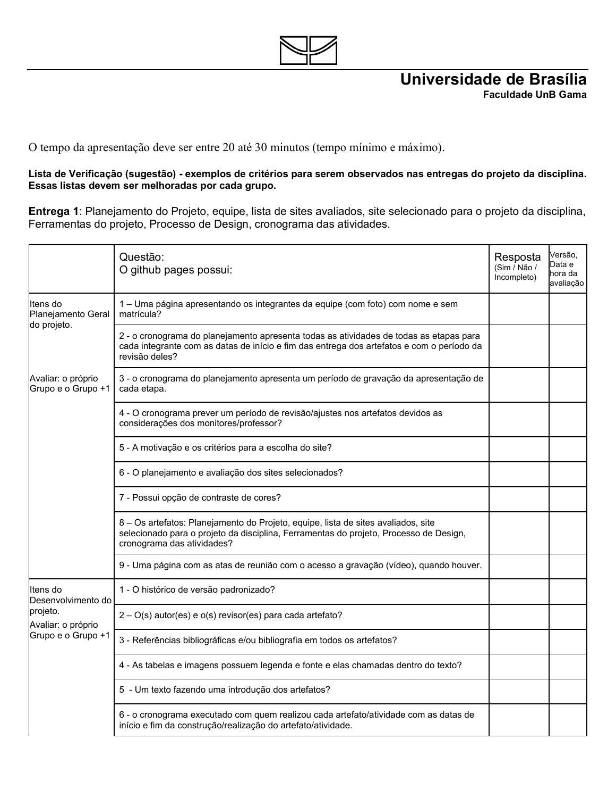
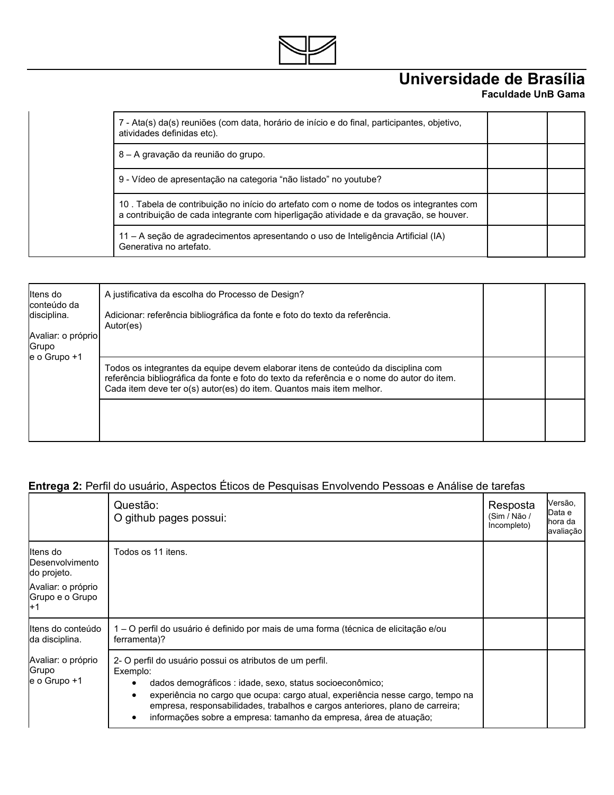
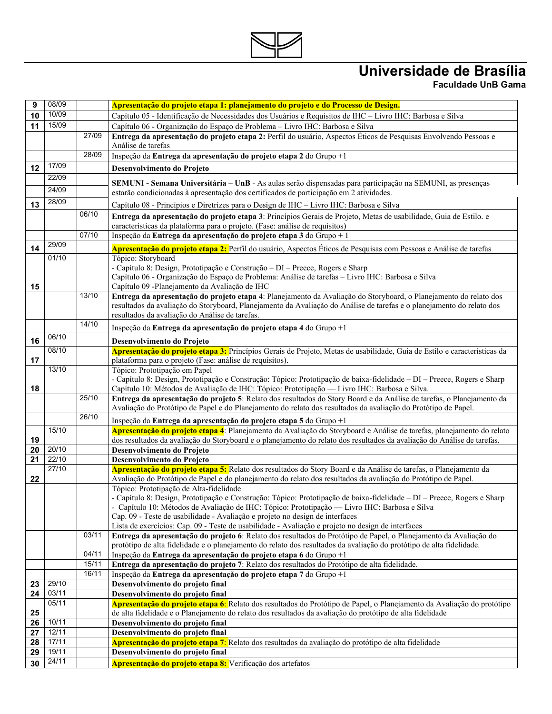
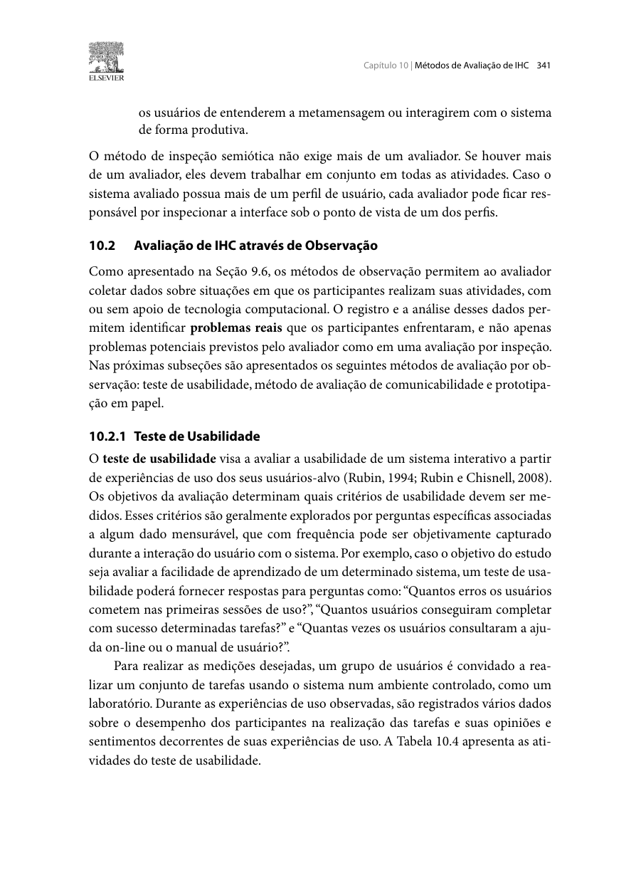
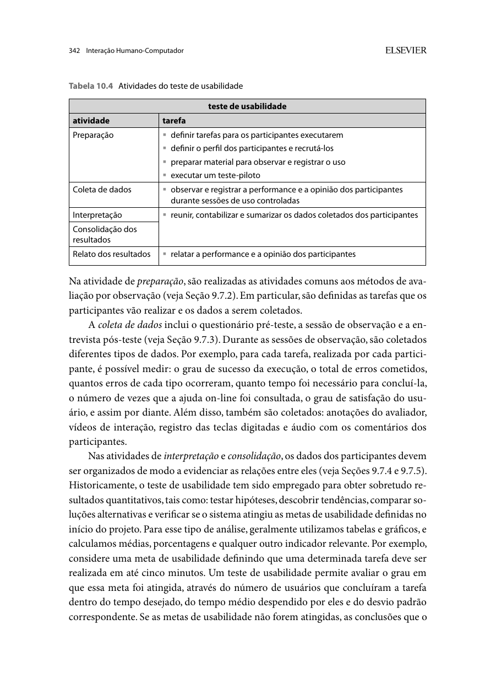
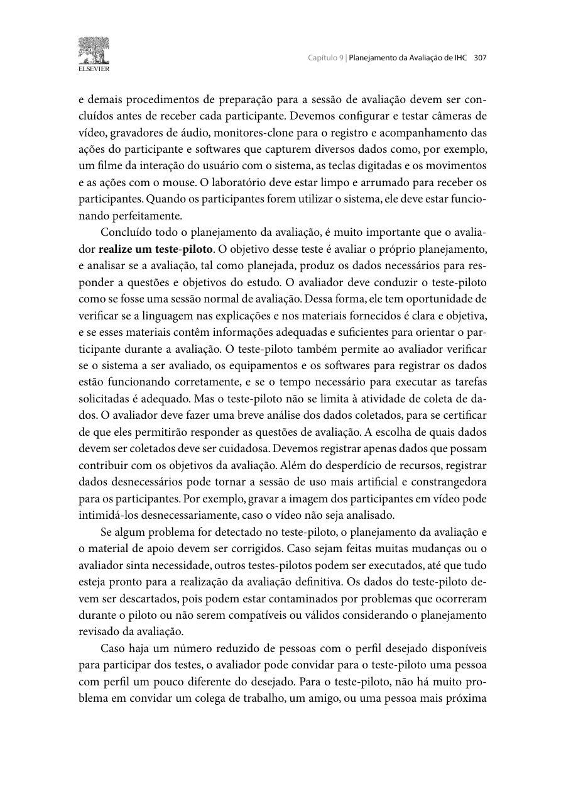
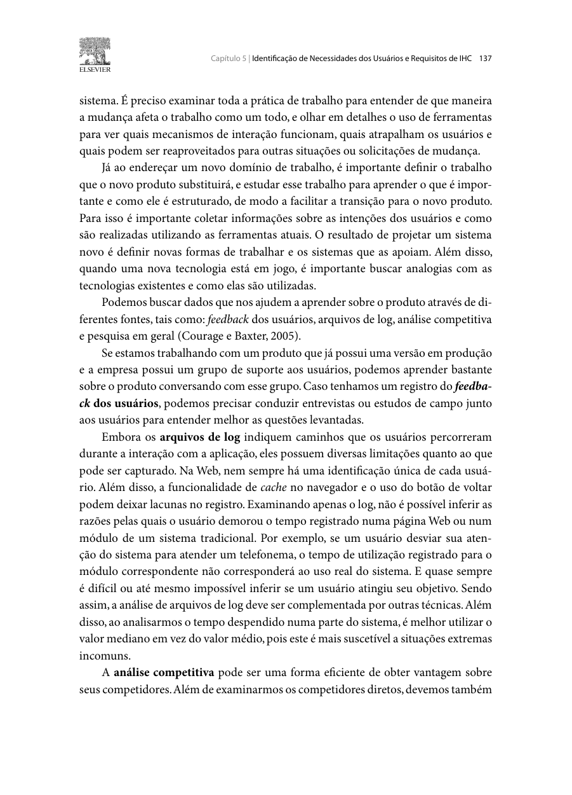

Responsável: Caio Breno de Souza Bezerra · Autor do item: Caio Breno de Souza Bezerra

# Lista de verificação — Etapa 7

## Tabela de contribuição

A Tabela 1 registra a contribuição neste artefato.

| Integrante | Contribuição | Artefato / atividade |
| --- | --- | --- |
| [Caio Breno de Souza Bezerra](https://github.com/CaioBezerra-Dev) | Elaboração dos critérios da Etapa 7 | [Conteúdo](#introducao) |
| Codex (OpenAI) | Apoio à consulta bibliográfica e à organização da lista da Etapa 6, reutilizada como modelo | [Agradecimentos](#agradecimentos) |
| Grok (xAI) | Apoio à consulta bibliográfica, redação e organização | [Agradecimentos](#agradecimentos) |

Tabela 1 — Contribuição neste artefato.

Fonte: elaboração para o Grupo 06 (2026).

## Introdução

Cada pergunta possui **autor, evidência esperada, referência e imagem do trecho utilizado**. Abra um item para consultar sua fundamentação. Os critérios de desenvolvimento vêm do plano de ensino; os critérios de conteúdo foram formulados para o relato da avaliação de alta fidelidade, com base em Barbosa e Silva (2010, p. 341–343) e no cronograma. São uma lista do grupo, não uma transcrição de lista oficial da Etapa 7.

**Esta página define perguntas.** Respostas, versão inspecionada, data e evidências ficam na [ficha de inspeção do Grupo 06](../grupo-06/etapa-7/lista-verificacao.md). Usar **Sim / Não / Incompleto**; vazio significa não inspecionado. Registrar a evidência da versão realmente examinada. A mesma lista serve para a inspeção do grupo +1.

## Desenvolvimento do projeto

O plano de ensino, p. 8–9 do PDF, é a fonte das perguntas D01–D11.

??? question "D01 — O histórico de versão está padronizado?"

    **Autor do item:** Caio Breno de Souza Bezerra.

    **O que conferir:** Conferir versão, data, descrição, autor e revisor em cada artefato da Etapa 7.

    **Origem da pergunta:** Plano de ensino, p. 8 do PDF. Critério formulado/adaptado para a entrega. A Figura 1 mostra a fonte.

    { loading=lazy }
    
Figura 1 — Fonte do critério D01.

    
Fonte: Plano de ensino, p. 8 do PDF.

??? question "D02 — Os autores e revisores estão identificados, com revisão efetivamente registrada?"

    **Autor do item:** Caio Breno de Souza Bezerra.

    **O que conferir:** Revisor distinto do autor; “Pendente” não comprova revisão realizada.

    **Origem da pergunta:** Plano de ensino, p. 8 do PDF. Critério formulado/adaptado para a entrega. A Figura 2 mostra a fonte.

    { loading=lazy }
    
Figura 2 — Fonte do critério D02.

    
Fonte: Plano de ensino, p. 8 do PDF.

??? question "D03 — Há referências bibliográficas em todos os artefatos?"

    **Autor do item:** Caio Breno de Souza Bezerra.

    **O que conferir:** Verificar correspondência entre citações, edição, página e referência.

    **Origem da pergunta:** Plano de ensino, p. 8 do PDF. Critério formulado/adaptado para a entrega. A Figura 3 mostra a fonte.

    { loading=lazy }
    
Figura 3 — Fonte do critério D03.

    
Fonte: Plano de ensino, p. 8 do PDF.

??? question "D04 — As tabelas e figuras têm número, legenda, fonte e chamada no texto?"

    **Autor do item:** Caio Breno de Souza Bezerra.

    **O que conferir:** Incluir as imagens do livro e as tabelas de resultado da avaliação.

    **Origem da pergunta:** Plano de ensino, p. 8 do PDF. Critério formulado/adaptado para a entrega. A Figura 4 mostra a fonte.

    { loading=lazy }
    
Figura 4 — Fonte do critério D04.

    
Fonte: Plano de ensino, p. 8 do PDF.

??? question "D05 — Os artefatos têm introdução que esclarece objetivo e escopo?"

    **Autor do item:** Caio Breno de Souza Bezerra.

    **O que conferir:** Verificar vínculo com a funcionalidade, com o protótipo de papel e com o planejamento da Etapa 6.

    **Origem da pergunta:** Plano de ensino, p. 8 do PDF. Critério formulado/adaptado para a entrega. A Figura 5 mostra a fonte.

    { loading=lazy }
    
Figura 5 — Fonte do critério D05.

    
Fonte: Plano de ensino, p. 8 do PDF.

??? question "D06 — O cronograma executado registra quem fez cada atividade e suas datas reais?"

    **Autor do item:** Caio Breno de Souza Bezerra.

    **O que conferir:** Comparar com o planejado; não registrar agenda proposta como execução.

    **Origem da pergunta:** Plano de ensino, p. 8 do PDF. Critério formulado/adaptado para a entrega. A Figura 6 mostra a fonte.

    { loading=lazy }
    
Figura 6 — Fonte do critério D06.

    
Fonte: Plano de ensino, p. 8 do PDF.

??? question "D07 — Há atas das reuniões da etapa, com data, horários, pessoas e decisões?"

    **Autor do item:** Caio Breno de Souza Bezerra.

    **O que conferir:** Conferir em Registros → Atas; lista de verificação não substitui ata.

    **Origem da pergunta:** Plano de ensino, p. 9 do PDF. Critério formulado/adaptado para a entrega. A Figura 7 mostra a fonte.

    { loading=lazy }
    
Figura 7 — Fonte do critério D07.

    
Fonte: Plano de ensino, p. 9 do PDF.

??? question "D08 — As gravações das reuniões e inspeções realizadas estão acessíveis e autorizadas?"

    **Autor do item:** Caio Breno de Souza Bezerra.

    **O que conferir:** Conferir link, permissão e correspondência com a reunião registrada. Não usar o vídeo da avaliação com participante como se fosse a inspeção.

    **Origem da pergunta:** Plano de ensino, p. 9 do PDF. Critério formulado/adaptado para a entrega. A Figura 8 mostra a fonte.

    { loading=lazy }
    
Figura 8 — Fonte do critério D08.

    
Fonte: Plano de ensino, p. 9 do PDF.

??? question "D09 — O vídeo da apresentação da Etapa 7 está acessível na categoria prevista pelo grupo?"

    **Autor do item:** Caio Breno de Souza Bezerra.

    **O que conferir:** Conferir link não listado, autor do artefato e conteúdo do relato. Não usar a gravação da sessão com participante como apresentação.

    **Origem da pergunta:** Plano de ensino, p. 9 do PDF. Critério formulado/adaptado para a entrega. A Figura 9 mostra a fonte.

    { loading=lazy }
    
Figura 9 — Fonte do critério D09.

    
Fonte: Plano de ensino, p. 9 do PDF.

??? question "D10 — A contribuição aparece no início de cada artefato e corresponde a quem atuou nele?"

    **Autor do item:** Caio Breno de Souza Bezerra.

    **O que conferir:** Não atribuir contribuição ou autoria a integrante apenas por pertencer ao grupo.

    **Origem da pergunta:** Plano de ensino, p. 9 do PDF. Critério formulado/adaptado para a entrega. A Figura 10 mostra a fonte.

    { loading=lazy }
    
Figura 10 — Fonte do critério D10.

    
Fonte: Plano de ensino, p. 9 do PDF.

??? question "D11 — O uso de IA está identificado na contribuição e nos agradecimentos?"

    **Autor do item:** Caio Breno de Souza Bezerra.

    **O que conferir:** Nome da ferramenta e atividade realizada. A ferramenta não entra como autora.

    **Origem da pergunta:** Plano de ensino, p. 9 do PDF. Critério formulado/adaptado para a entrega. A Figura 11 mostra a fonte.

    { loading=lazy }
    
Figura 11 — Fonte do critério D11.

    
Fonte: Plano de ensino, p. 9 do PDF.

## Conteúdo da disciplina

O cronograma pede o relato dos resultados da avaliação do protótipo de alta fidelidade. Barbosa e Silva (2010, seção 10.2.1) definem o que esse relato descreve.

??? question "E7-C01 — O relato dos resultados da avaliação do protótipo de alta fidelidade está disponível por integrante?"

    **Autor do item:** Caio Breno de Souza Bezerra.

    **O que conferir:** Cada autor apresenta o próprio relato, com acesso ao protótipo avaliado e às gravações. Não substituir o relato pelo planejamento da Etapa 6.

    **Origem da pergunta:** Plano de ensino, p. 5 do PDF. Critério formulado/adaptado para a entrega. A Figura 12 mostra a fonte.

    { loading=lazy }
    
Figura 12 — Fonte do critério E7-C01.

    
Fonte: Plano de ensino, p. 5 do PDF.

??? question "E7-C02 — O relato descreve os objetivos e o escopo da avaliação?"

    **Autor do item:** Caio Breno de Souza Bezerra.

    **O que conferir:** Ligar os objetivos às perguntas do planejamento e à funcionalidade do integrante. Delimitar o que o protótipo faz e o que a sessão não mediu.

    **Origem da pergunta:** Barbosa e Silva (2010, p. 343). Critério formulado/adaptado para a entrega. A Figura 13 mostra a fonte.

    { loading=lazy }
    
Figura 13 — Fonte do critério E7-C02.

    
Fonte: Barbosa e Silva (2010, p. 343).

??? question "E7-C03 — Há uma descrição breve do método de teste de usabilidade efetivamente usado?"

    **Autor do item:** Caio Breno de Souza Bezerra.

    **O que conferir:** Modalidade, quem moderou, quem observou, como a pessoa controlou a interface e como a opinião foi recolhida. Distinguir observação de tarefa de opinião solta sobre telas.

    **Origem da pergunta:** Barbosa e Silva (2010, p. 341–342). Critério formulado/adaptado para a entrega. A Figura 14 mostra a fonte.

    { loading=lazy }
    
Figura 14 — Fonte do critério E7-C03.

    
Fonte: Barbosa e Silva (2010, p. 341–342).

??? question "E7-C04 — O número e o perfil dos avaliadores e dos participantes estão descritos?"

    **Autor do item:** Caio Breno de Souza Bezerra.

    **O que conferir:** Quantidade, papéis da equipe e caracterização desidentificada. Ausência de perfil não pode ser preenchida por suposição. Não tratar a amostra como representativa.

    **Origem da pergunta:** Barbosa e Silva (2010, p. 343). Critério formulado/adaptado para a entrega. A Figura 15 mostra a fonte.

    { loading=lazy }
    
Figura 15 — Fonte do critério E7-C04.

    
Fonte: Barbosa e Silva (2010, p. 343).

??? question "E7-C05 — As tarefas executadas e os resultados estão registrados por pessoa?"

    **Autor do item:** Caio Breno de Souza Bezerra.

    **O que conferir:** Enunciado ou objetivo, estado inicial, conclusão, ajuda e o que não foi executado. Não somar ângulos de gravação como se fossem pessoas diferentes.

    **Origem da pergunta:** Barbosa e Silva (2010, p. 343). Critério formulado/adaptado para a entrega. A Figura 16 mostra a fonte.

    { loading=lazy }
    
Figura 16 — Fonte do critério E7-C05.

    
Fonte: Barbosa e Silva (2010, p. 343).

??? question "E7-C06 — Desempenho e opinião têm evidência localizável na gravação?"

    **Autor do item:** Caio Breno de Souza Bezerra.

    **O que conferir:** Ação, fala ou paráfrase e minuto do vídeo. Separar o que foi observado do que o avaliador interpretou.

    **Origem da pergunta:** Barbosa e Silva (2010, p. 342–343). Critério formulado/adaptado para a entrega. A Figura 17 mostra a fonte.

    { loading=lazy }
    
Figura 17 — Fonte do critério E7-C06.

    
Fonte: Barbosa e Silva (2010, p. 342–343).

??? question "E7-C07 — As medições são resumidas com denominador, e a ausência de dado não vira zero?"

    **Autor do item:** Caio Breno de Souza Bezerra.

    **O que conferir:** Contagem por pessoa e tarefa. Nota não coletada, tempo não cronometrado e tarefa não executada ficam explícitos. Duração do arquivo não substitui tempo ativo.

    **Origem da pergunta:** Barbosa e Silva (2010, p. 342). Critério formulado/adaptado para a entrega. A Figura 18 mostra a fonte.

    { loading=lazy }
    
Figura 18 — Fonte do critério E7-C07.

    
Fonte: Barbosa e Silva (2010, p. 342).

??? question "E7-C08 — Cada problema indica local, descrição, justificativa, fator de usabilidade e sugestão?"

    **Autor do item:** Caio Breno de Souza Bezerra.

    **O que conferir:** Local na interface, consequência observada, hipótese de causa e sugestão. Frequência com denominador, sem estimativa populacional.

    **Origem da pergunta:** Barbosa e Silva (2010, p. 343). Critério formulado/adaptado para a entrega. A Figura 19 mostra a fonte.

    { loading=lazy }
    
Figura 19 — Fonte do critério E7-C08.

    
Fonte: Barbosa e Silva (2010, p. 343).

??? question "E7-C09 — Sugestão de correção está separada de correção retestada?"

    **Autor do item:** Caio Breno de Souza Bezerra.

    **O que conferir:** A versão avaliada permanece identificável. Proposta sem nova execução fica não retestada. “Corrigido” não significa “validado”.

    **Origem da pergunta:** Barbosa e Silva (2010, p. 343). Critério formulado/adaptado para a entrega. A Figura 20 mostra a fonte.

    { loading=lazy }
    
Figura 20 — Fonte do critério E7-C09.

    
Fonte: Barbosa e Silva (2010, p. 343).

??? question "E7-C10 — O resultado do piloto está fora dos resultados da sessão principal?"

    **Autor do item:** Caio Breno de Souza Bezerra.

    **O que conferir:** O piloto ensaia o procedimento. Seus dados não entram nas tabelas da coleta. Ajustes não registrados ficam declarados como lacuna, não como resultado.

    **Origem da pergunta:** Barbosa e Silva (2010, p. 307–308). Critério formulado/adaptado para a entrega. A Figura 21 mostra a fonte.

    { loading=lazy }
    
Figura 21 — Fonte do critério E7-C10.

    
Fonte: Barbosa e Silva (2010, p. 307–308).

??? question "E7-C11 — O consentimento cobre participação, gravação e disponibilização do vídeo?"

    **Autor do item:** Caio Breno de Souza Bezerra.

    **O que conferir:** Autorização antes da gravação, explicação do link não listado e ausência de dados pessoais no relato. Termo e contato ficam fora do repositório.

    **Origem da pergunta:** Barbosa e Silva (2010, p. 138–142). Critério formulado/adaptado para a entrega. A Figura 22 mostra a fonte.

    { loading=lazy }
    
Figura 22 — Fonte do critério E7-C11.

    
Fonte: Barbosa e Silva (2010, p. 138–142).

??? question "E7-C12 — O protótipo avaliado está identificado e acessível na versão do teste?"

    **Autor do item:** Caio Breno de Souza Bezerra.

    **O que conferir:** A versão citada no relato é a mesma da faixa ou do arquivo aberto. Dados fictícios, sem envio real.

    **Origem da pergunta:** Barbosa e Silva (2010, p. 342). Critério formulado/adaptado para a entrega. A Figura 23 mostra a fonte.

    { loading=lazy }
    
Figura 23 — Fonte do critério E7-C12.

    
Fonte: Barbosa e Silva (2010, p. 342).

??? question "E7-C13 — As conclusões explicitam os limites da amostra, do material e do procedimento?"

    **Autor do item:** Caio Breno de Souza Bezerra.

    **O que conferir:** Não declarar meta populacional, superioridade sobre o serviço oficial nem validação do que não foi executado. Tarefa incompleta permanece incompleta.

    **Origem da pergunta:** Barbosa e Silva (2010, p. 342–343). Critério formulado/adaptado para a entrega. A Figura 24 mostra a fonte.

    { loading=lazy }
    
Figura 24 — Fonte do critério E7-C13.

    
Fonte: Barbosa e Silva (2010, p. 342–343).

??? question "E7-C14 — As gravações da avaliação estão acessíveis, não listadas e distintas da apresentação?"

    **Autor do item:** Caio Breno de Souza Bezerra.

    **O que conferir:** Link da sessão com participante na página de evidências. O vídeo em que o autor apresenta o artefato é outro registro.

    **Origem da pergunta:** Plano de ensino, p. 9 do PDF. Critério formulado/adaptado para a entrega. A Figura 25 mostra a fonte.

    { loading=lazy }
    
Figura 25 — Fonte do critério E7-C14.

    
Fonte: Plano de ensino, p. 9 do PDF.

??? question "E7-C15 — Cada item de conteúdo tem autor, referência e imagem legível da fonte?"

    **Autor do item:** Caio Breno de Souza Bezerra.

    **O que conferir:** Conferir vínculo entre o critério e o trecho da fonte. Não apresentar só uma tabela de respostas.

    **Origem da pergunta:** Plano de ensino, p. 9 do PDF. Critério formulado/adaptado para a entrega. A Figura 26 mostra a fonte.

    { loading=lazy }
    
Figura 26 — Fonte do critério E7-C15.

    
Fonte: Plano de ensino, p. 9 do PDF.

## Agradecimentos

Codex (OpenAI) e Grok (xAI) apoiaram a consulta das fontes e a preparação deste material. Caio Breno de Souza Bezerra responde pelo conteúdo. Revisor: [Bruno Ferreira Dornelas](https://github.com/brunnf).

## Histórico de versão

A Tabela 2 registra a versão deste artefato.

| Versão | Data | Descrição | Autor(es) | Revisor(es) |
| :---: | :---: | --- | --- | --- |
| `1.0` | 11/11/2026 | Critérios iniciais de conferência do relato de Caio | [Caio Breno de Souza Bezerra](https://github.com/CaioBezerra-Dev) | [Bruno Ferreira Dornelas](https://github.com/brunnf) |
| `2.0` | 15/11/2026 | Reorganiza a lista no modelo da Etapa 6, com perguntas, fontes e ficha de inspeção em branco | [Caio Breno de Souza Bezerra](https://github.com/CaioBezerra-Dev) | [Bruno Ferreira Dornelas](https://github.com/brunnf) |

Tabela 2 — Histórico de versão.

Fonte: elaboração para o Grupo 06 (2026).

## Referências

[1] SALES, André Barros de. *Plano de Ensino FIHC 022026 — Turma 01*, v1. FCTE/UnB, 2026. p. 5, 8–9 do PDF.

[2] BARBOSA, Simone Diniz Junqueira; SILVA, Bruno Santana da. *Interação humano-computador*. Rio de Janeiro: Elsevier, 2010. p. 138–142, 307–308, 341–343.
